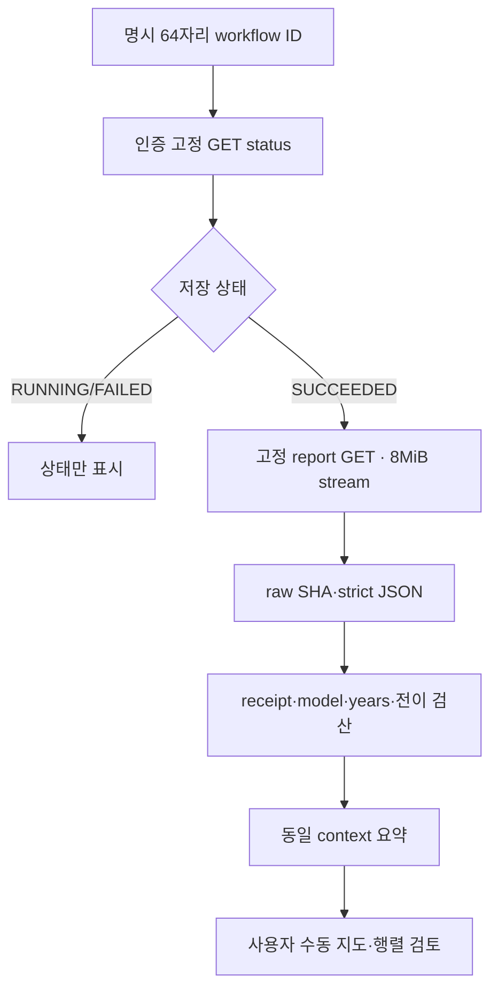

# Gate147 — GeoQuery의 수동 local workflow 근거 조회

| 필드 | 값 |
|---|---|
| updated_at | 2026-10-18 09:40:19 KST — 147 검증 이력·현재 API offline/프론트만 복원 정정 |
| source_commit | 기준 c07602a203907e99ac94e4008b94a783719f01de + 147 검증 작업파일 raw SHA (게시 전 검증 시점; 후속 Git 게시의 바이트 보존은 별도 확인) |
| evidence_paths | `frontend/src/GeoWorkflowEvidence.tsx`; `frontend/src/geollmWorkflowEvidenceAdapter.ts`; `frontend/src/geollmWorkflowEvidenceClient.ts`; `docs/implementation/147_geollm_workflow_evidence_ui.md`; `evidence/integration/geollm-workflow-evidence-ui-focused-20261018.log`; `evidence/integration/geollm-workflow-evidence-root-backend-20261018.log`; `evidence/integration/geollm-workflow-evidence-root-frontend-20261018.log`; `evidence/integration/geollm-workflow-evidence-build-20261018.log`; `evidence/integration/geollm-workflow-evidence-independent-20261018.py`; `evidence/integration/geollm-workflow-evidence-independent-20261018.json`; `evidence/integration/geollm-workflow-evidence-independent-20261018.log`; `evidence/integration/geollm-workflow-evidence-ui-focused-initial-20261018.log`; `evidence/integration/geollm-workflow-evidence-browser-20261018.json`; `evidence/integration/geollm-workflow-evidence-browser-dom-20261018.txt`; `evidence/integration/geollm-workflow-evidence-browser-20261018.png`; `evidence/integration/geollm-workflow-evidence-map-browser-20261018.png`; `evidence/integration/geollm-workflow-evidence-applied-dom-20261018.txt`; `evidence/integration/geollm-workflow-evidence-applied-browser-20261018.png`; `evidence/integration/geollm-workflow-evidence-browser-http-20261018.log`; `evidence/integration/geollm-workflow-evidence-browser-server-initial-20261018.log`; `evidence/integration/geollm-workflow-evidence-browser-server-initial2-20261018.log`; `evidence/integration/geollm-workflow-evidence-live-integrity-final-20261018.json`; `evidence/integration/geollm-workflow-evidence-dev-server-after-20261018.json`; `evidence/integration/geollm-workflow-evidence-final-processes-20261018.json` |
| confidence | UI9 PASS·독립7 PASS·front280 PASS/build116·backend관련34 PASS; 실제 main Temp 브라우저·운영 화면 적용/미실행 구분 |
| status | TESTED_SYNTHETIC 실제 main Temp 브라우저 검증 이력; 현재 API offline BLOCKED·frontend5174만 복원·운영 실행 0 |

## 쉬운 설명

GeoQuery의 근거 화면에서 사용자가 local workflow ID를 직접 입력해 저장된 기록과 보고서를 읽는다. 기존 자연어 질의나 분석 ID와 별도인 조회 창이다. 영수증 번호로 보관된 결과를 찾는 것과 같으며 새 일을 시작하거나 현재 승인을 내리는 기능은 아니다. 보고서 지문과 수치를 확인한 뒤 같은 workflow의 지도·행렬을 따로 연다.

## 이론적 배경

status의 artifact SHA와 실제 report raw bytes를 결합해야 서로 다른 보고서를 잘못 붙이는 위험을 줄일 수 있다. SHA가 같아도 기관 권위·내용의 과학 정확도·현재 모델 승인을 인증한 것은 아니다. 형식과 수치 검산은 결과의 내부 일관성 범위다.

비동기 응답은 입력·route가 바뀐 뒤에도 도착할 수 있다. 세대와 AbortController를 함께 사용하고 parse/SHA 이후에도 현재 요청인지 확인해 예전 success/error/finally가 새 결과·busy를 덮지 않게 한다. 브라우저 전송 중단은 서버 실행 취소·rollback이 아니다.

## 구조

## 코드·입력 → 처리 → 출력

GeoQuery에는 import와 evidence 조건부 child만 추가한다. 기존 /api/query·legacy analyses 선택·onReviewResult(analysisId)는 보존하고 workflow ID를 기존 분석 ID로 넘기지 않는다. 새 GeoWorkflowEvidence가 입력·busy·오류·receipt/report·검토 펼침 상태를 별도로 관리한다.

geollmWorkflowEvidenceClient는 API origin의 /v1/lcluc/workflows/{id}와 /report만 기존 Bearer·no-store·redirect:error·AbortSignal로 GET한다. ID는 소문자 hex 64자리이며 임의 경로나 분석 ID를 받지 않는다. 명시 버튼 전에는 자동 조회·POST·poll·재시도가 없다. RUNNING/FAILED는 report GET 없이 상태만 표시한다.

각 응답은 Content-Length와 실제 stream 누계를 8MiB로 제한한다. strict UTF-8·중복 key·비유한 수·unsafe integer·surrogate·depth32·node262144·문자열1MiB를 검사한다. 이것은 body 경계이며 전체 브라우저/서버 CPU·RSS·시간 sandbox가 아니다.

기존 readOnly receipt parser로 같은 ID·replayed true·과학/표준 false를 확인한다. SUCCEEDED의 report_path와 유일 artifact를 결합하고 raw bytes SHA를 검산한다. 기존 보고서 parser와 모든 변화쌍 transition 검산으로 모델 checkpoint·연도·9×9행렬·개수·면적·순변화를 확인한 사본만 게시한다. 오류와 누락을 0으로 바꾸거나 숫자·도형을 생성하지 않는다.

## 화면과 승인 경계

Workflow ID·Trace·model ID/version/checkpoint SHA·관측 연도·report raw SHA·전체 유효 래스터 변화 요약을 표시한다. 같은 receipt/rawReport의 기존 지도·행렬을 명시 버튼으로 연다. vector 자산 GET도 기존 별도 버튼에서만 발생한다. 전체 raster 통계와 최대 5000 vector subset을 혼동하지 않는다.

입력 편집·표시 중단·hash/popstate·unmount는 결과/지도/오류를 비우고 세대를 무효화한다. 오래된 busy 해제도 폐기한다. 404/503·tamper·형식 오류는 결과 0개로 닫고 실패를 변화량 0으로 해석하지 않는다. 과거 SUCCEEDED 이력은 현재 배포/권한을 재평가한 결과가 아니다.

LOCAL_LCLUC_WORKFLOW_ONLY·science false·standard GMAIS Result false를 유지한다. LLM 응답 생성·RAG·PostGIS·RDTR·정책 적합성·기관 승인·새 실행은 연결하지 않았다. 기존 운영 모델·후보 차단·독립 라벨·다른 5개 실행기 미확보는 그대로다.

## 시험 근거와 현재 상태

집중 최종 9 PASS/0.5883648초, redirect:error 보강 전 초기 9 PASS/0.4358917초를 구분한다. 초기 실패가 아니라 입력/전송 경계 강화 전 통과 이력이며 합산하지 않는다. 기존 backend 관련 34 PASS/20.542초를 확인했다. 전체 front 280 PASS/25.2827483초·build116모듈/23.55초·독립 7 PASS/5.5723868초를 확인했다. 실제 main Temp browser·최종 보존 결과까지 확정했다.

단위 시험의 fetch·Bearer·HTTP 오류·stream·세대/route/unmount·late finally와 과거 합성 CPU receipt/report fixture를 실제 운영 추론으로 표현하지 않는다. Root가 별도 actual main Temp API와 브라우저에서 확인한 실제 경로는 아래에 기록했다. 기존 사용자 탭 보존과 실제 운영 실행 0도 구분해 확인했다.

## 발표 대본

### 1분

“GeoQuery에서 local workflow의 저장 기록과 보고서를 직접 조회합니다. ID와 모델·연도·보고서 지문을 결합해 확인하고 같은 결과의 지도·행렬을 검토합니다. 새 분석을 실행하거나 LLM이 정책을 판단하는 기능은 아닙니다. 입력과 화면이 바뀌면 이전 결과를 지우며 표시 중단은 서버 취소와 다릅니다. 저장 이력 확인과 현재 운영 승인을 구분합니다.”

### 5분

‘별도 ID’, ‘수동 읽기’, ‘SHA와 수치’, ‘같은 지도·행렬’, ‘관측과 승인’을 각각 1분씩 설명한다. 실제 브라우저와 Mock 지연 시험은 근거에 맞춰 구분한다.

### 10분 확장

RUNNING/FAILED 상태 조회 1분, SHA 변조 반례 1분, 늦은 응답 폐기 1분, 질의응답 2분을 더한다. 운영 새 추론이나 LLM/RAG 완료를 시연한 것으로 소개하지 않는다.

## Q&A

Q. legacy analysis ID와 같은가? A. namespace가 다른 local workflow ID다.

Q. 성공 보고서를 읽으면 현재 모델도 승인됐나? A. 저장 이력 읽기이며 현재 승인 재평가가 아니다.

Q. 표시 중단으로 서버 작업도 취소되나? A. client 전송·표시 중단이며 취소 API가 아니다.

Q. 실패면 변화 0으로 보여주나? A. 결과를 비우며 측정된 0과 누락·실패를 구분한다.

Q. 지도와 행렬은 다른 workflow 결과일 수 있나? A. 같은 receipt/report context로만 전달하며 SHA와 수치를 검산한다.

Q. LLM/RAG가 연결됐나? A. local 저장 이력의 정형 수동 읽기만 연결했다.

## 근거 바로 열기

[구현 설명](../../implementation/147_geollm_workflow_evidence_ui.md) · [UI](../../../frontend/src/GeoWorkflowEvidence.tsx) · [집중 로그](../../../evidence/integration/geollm-workflow-evidence-ui-focused-20261018.log)

독립 HTTP 검증은 현재 auth AST와 기존 116 router를 사용하는 격리 FastAPI 범위다. 실제 local workflow 한 번과 작은 CPU 추론 세 번으로 fixture를 만들었지만 가중치와 승인 metadata는 명시 모의이며 운영 추론은 0이다. RUNNING/FAILED는 구성한 저장 이력이고 GET의 실행·Store put은 0이었다. 실제 main server 브라우저 검증은 별도 Root 근거로 구분한다.

147 최종 검증은 UI 집중 9 PASS/0.5883648초·독립 7 PASS/0 SKIP/5.5723868초·전체 frontend 280 PASS/25.2827483초·build 116모듈/23.55초·기존 backend 관련 34 PASS/20.542초다. 초기 집중 9 PASS/0.4358917초는 redirect:error 보강 전 통과 이력이며 중복 합산하지 않는다. backend 소스는 그대로여서 이번 전체 backend는 재실행하지 않았고 145의 1431 PASS/1 SKIP/332.720초는 이전 이력이다.

실제 main Temp8003와 Vite5180 브라우저에서 401·성공 세 변화쌍·수동 지도 한 polygon/다섯 꼭짓점·9×9행렬·ID 편집 clear·RUNNING/FAILED·404·완료 응답 뒤 표시 중단·메뉴 이동/뒤로 가기와 기존 질의 초안 보존을 확인했다. 관측값은 2020–2021 유효256/변화25600m², 2021–2022 유효256/변화0m², 2020–2022 유효256/변화25600m²다. 지연 중 응답 경쟁·SHA/집계 오염·큰 body는 단위 시험 범위이며 모바일·장치별 WebGL·접근성·부하/SLA는 실브라우저 미검증이다.

기존 5174의 stale Vite는 정확 PID15608만 재시작해 검증 frontend와 모듈 SHA·child 적용을 확인했다. 운영 화면은 빈 ID/read disabled만 확인했으며 운영 workflow GET·추론은 0이다. 원래 사용자 tab1의 /#/view/15를 보존하고 임시 tab14/15는 닫았다. 보호141·기존 소스434 중 허용 GeoQuery 한 개 변경/433개 불변·이전 증거1439·catalog14행 SHA·예약136314880B를 보존했다.

## 초기 준비 오류와 실제 실행 이력

임시 서버 helper 두 번이 cp949 console print에서 실패했지만 각각 Temp workflow 한 번·작은 CPU 추론 세 번은 이미 수행했다. 초기 로그 두 개를 보존하고 UTF-8/ensure_ascii를 명시한 준비 도구를 고쳤다. 성공 브라우저 fixture도 workflow 한 번/CPU 세 번, 독립 fixture도 한 번/세 번이므로 각 준비 실행 이력을 숨기지 않는다. 이는 운영 추론·학습 0과 별도이며 상품 성능이나 독립 라벨 평가가 아니다. 초기 별도 Vite의 proxy 환경도 실제8003으로 정정한 뒤 positive 검증을 했다.

성공 dedicated Temp 서버 HTTP 로그는 GET 46건만 기록했고 전체 운영 HTTP traffic의 전수 기록이 아니다. 기존 query/analysis API와 자동 polling을 새로 추가한 것으로 해석하지 않는다. 전체 프로젝트는 미완료이며 과학 false·표준 false·local scope와 기관/현재 모델 승인 한계를 유지한다.

최신 가용성 정정: 재개 후 재조회에서 기존 API 8000/8001/8002·Temp API8003·frontend5174/5180의 이전 세션은 관측되지 않았다. Ollama만 남은 상태에서 frontend5174만 hidden detached PID34484로 복원했고 API는 Store 복구 부작용을 피하려고 재시작하지 않았다. 따라서 앞선 실제 main Temp 브라우저 PASS와 운영5174 적용 확인은 당시 이력이며 현재 API 서비스 정상 가용성으로 표현하지 않는다. 세션 종료 원인과 Temp fixture 정리 여부는 미확인이다. dev-server-after JSON의 기록 시각은 09:39:17이며 재보존 감사는 09:39:32이다. 원래 사용자 탭 URL 보존과 API offline 상태도 구분한다.
