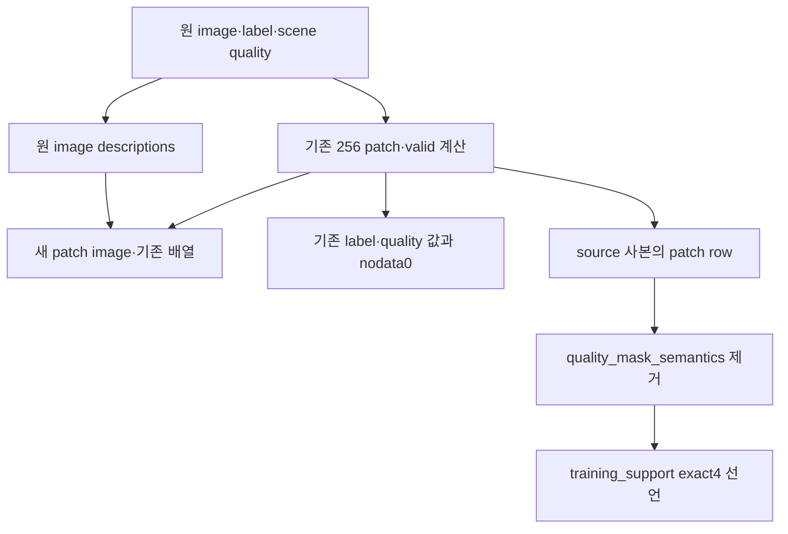

# Gate145 — 패치 밴드 설명과 학습 지원 mask의 선언

| 필드 | 값 |
|---|---|
| updated_at | 2026-10-18 07:24:38 KST — 145 전체·보존 최종 근거 확정 |
| source_commit | 기준 a3f4a94a69ad0f5c54a9af76bf6af82053e1a419 + 145 검증 작업파일 raw SHA (게시 전 검증 시점; 후속 Git 게시의 바이트 보존은 별도 확인) |
| evidence_paths | `scripts/collect_training_grid.py`; `tests/test_grid_patch_declarations.py`; `evidence/integration/grid-patch-declarations-agent-20261018.log`; `evidence/integration/grid-patch-declarations-agent-initial-20261018.log`; `evidence/integration/grid-patch-declarations-source-scope-20261018.json`; `evidence/integration/grid-patch-declarations-operating-inventory-20261018.json`; `docs/implementation/145_grid_patch_declarations.md`; `evidence/integration/grid-patch-declarations-independent-20261018.py`; `evidence/integration/grid-patch-declarations-independent-20261018.json`; `evidence/integration/grid-patch-declarations-independent-20261018.log`; `evidence/integration/grid-patch-declarations-live-integrity-final-20261018.json`; `evidence/integration/grid-patch-declarations-root-related-20261018.log`; `evidence/integration/grid-patch-declarations-full-20261018.log`; `evidence/integration/grid-patch-declarations-final-processes-20261018.json` |
| confidence | 집중 6 PASS/2.778초·관련 170 PASS/1 SKIP/79.284초·독립 7 PASS/4.2726165초·전체 1431 PASS/1 SKIP/332.720초; Temp/native/운영 미실행 구분 |
| status | TESTED_SYNTHETIC 패치 밴드 설명·학습 지원 mask 선언; 운영 호출 0·품질/과학/실행 승인 BLOCKED |

## 쉬운 설명

원 영상에서 작은 patch를 만들 때 밴드 이름도 같은 순서로 옮긴다. 이름이 없거나 알 수 없으면 발명하지 않는다. 또 patch mask는 영상 품질뿐 아니라 라벨과 AOI 조건을 포함하므로 ‘학습 지원용’이라고 따로 표시한다. 상자에 붙은 원재료 표시와 사용 목적 표시를 구분하는 것과 같다. 이름과 목적을 명확히 해도 품질·과학·모델 실행을 승인한 것은 아니다.

## 이론적 배경

래스터 배열과 파일 metadata는 별개다. 배열을 그대로 보존해도 description이 추가되면 파일 바이트와 SHA가 달라질 수 있다. 따라서 보존 비교는 image 배열·profile과 label/quality 파일 바이트를 구분한다.

scene quality mask와 training support mask의 범위도 다르다. 후자는 영상 품질 외에 AOI 안쪽·라벨 존재·finite/nonzero를 결합한다. 이를 순수 영상의 binary_validity로 잘못 전달하면 라벨 지원 여부를 물리 품질로 오인할 수 있어 별도 kind를 명시한다.

## 구조

## 코드·입력 → 처리 → 출력

`scripts/collect_training_grid.py`의 materialize_patches에 6줄을 추가한다. image를 쓰는 경우에만 원 image.descriptions를 순서대로 순회하고 None 아닌 문자열을 같은 밴드 index에 기록한다. None·unknown·뒤바뀐 순서를 추정하거나 재배열하지 않는다. label/quality description에는 전파하지 않는다.

원 source를 deepcopy한 반환 row에서 quality_mask_semantics를 제거하고 training_support_mask_semantics에 schema_version1/kind training_support/valid_value1/invalid_value0 exact4를 넣는다. 원 report는 수정하지 않으며 source_window에 별도 새 필드를 추가하지 않는다.

기존 valid는 scene quality==1 AND AOI inside AND label!=0 AND 모든 image 값 finite/nonzero다. 이 계산·label 적용·nodata0·256 비중복 patch·잔여 영역 skip·threshold·split·gap·예산·원장 정책은 그대로다. 이번 변화는 값을 새 정책으로 바꾸는 것이 아니라 metadata 전파와 의미 구분이다.

## 시험 근거와 경계

집중 최종은 6 PASS/2.778초다. 초기 6 PASS/3.213초는 native header/값 거부 코드 검사를 강화하기 전 통과 이력이며 실패가 아니다. 제품 추가 변경 없이 시험 검사를 강화했고 두 실행을 합산하지 않는다. 독립 최종은 7 PASS/0 SKIP/4.2726165초이며 관련 최종은 171건 중 170 PASS/1 SKIP/79.284초이며 전체 backend 최종은 1432건 중 1431 PASS/1 SKIP/332.720초다.

실제 Temp GeoTIFF와 고정 Git baseline 모듈을 격리 실행해 source report·입력 파일·patch 배열/profile·label/quality bytes 및 split/window/통계 보존을 확인했다. image의 description과 파일 SHA 변경은 의도된 범위다. None·부분 누락·unknown·permuted 순서는 그대로 전파한다. 원 source의 quality_mask_semantics는 유지되며 반환 row에만 training_support를 기록한다.

native 129 _header는 명시 6밴드 설명을 읽을 수 있지만 누락된 이름을 발명하지 않는다. nodata0인 patch quality는 133 _binary_counts에서 MASK_INTRINSIC_VALIDITY_UNSUPPORTED로 차단되고 training_support 선언은 139에서 MASK_SEMANTICS_INVALID로 거부된다. 이 시험은 개별 native helper와 선언 경계이지 전체 Registry 등록·소비 성공이 아니다.

## 쓰기와 승인 한계

기존 mkdir/open(w)는 그대로다. 운영 호출 0은 덮어쓰기 방지가 생겼다는 뜻이 아니며 동일 출력 경로를 다시 호출하면 기존 정책에 따라 덮어쓸 수 있다. 두 파일 transaction·원자 snapshot·OS sandbox·시간/RSS·반환 후 불변을 새로 보장하지 않는다.

운영 수집·다운로드·Registry 등록·학습·추론은 실행하지 않는다. 원본 5차단·후보 4차단·Draft·독립 라벨과 다른 5개 실행기 미확보는 유지한다. 기존 producer 함수가 바뀌어 Root가 전체 backend 회귀를 실행했고 1431 PASS/1 SKIP을 확인했다. 144의 1425 PASS/1 SKIP은 이전 완료 이력이며 이번 결과로 재사용하지 않는다. API/main/UI를 바꾸지 않아 이번 frontend/build/browser는 재실행하지 않는다.

## 발표 대본

### 1분

“패치 영상에도 원래 밴드 이름을 같은 순서로 옮깁니다. 이름이 비어 있으면 채워 넣지 않습니다. patch mask는 라벨과 지역 조건까지 포함한 학습 지원용이라고 따로 표시합니다. 기존 값 계산과 원본 report는 유지합니다. 실제 임시 파일과 이전 코드를 비교했으며 운영 학습이나 품질 승인을 한 것은 아닙니다.”

### 5분

‘원 영상과 patch’, ‘밴드 이름 전파’, ‘두 mask의 의미’, ‘배열과 파일 SHA’, ‘소비 거부와 승인 한계’를 각각 1분씩 설명한다. 실제 Temp와 native helper 시험을 전체 Registry 또는 운영 검증으로 확대하지 않는다.

### 10분 확장

None/unknown/permuted 반례 1분, baseline 배열·bytes 비교 1분, 기존 open(w) 한계 1분, 질의응답 2분을 더한다. 전체 회귀 숫자는 확정된 1431 PASS/1 SKIP과 원로그를 제시한다.

## Q&A

Q. 원 source report도 바뀌나? A. deepcopy한 반환 row만 바꾸고 원 report는 보존한다.

Q. source_window에 새 참조가 생기나? A. 이번에는 추가하지 않는다.

Q. label/quality 배열도 새 규칙으로 계산하나? A. 기존 valid·값·nodata·threshold를 유지한다.

Q. patch mask를 순수 QA reader에 넣어도 되나? A. training_support와 nodata0은 기존 순수 binary-validity 계약과 달라 거부된다.

Q. 원 image 이름이 없으면 consumer 통과를 위해 채우나? A. 발명하지 않고 소비자가 거부하도록 원형을 유지한다.

Q. 파일을 덮지 않도록 보호했나? A. 기존 open(w) 동작은 그대로이며 새 overwrite guard는 없다.

## 근거 바로 열기

[패치 소스](../../../scripts/collect_training_grid.py) · [집중 시험](../../../evidence/integration/grid-patch-declarations-agent-20261018.log) · [수정 범위 검사](../../../evidence/integration/grid-patch-declarations-source-scope-20261018.json)

## 독립 최종과 회귀 전 보존 관측

독립 7 PASS/0 SKIP/4.2726165초이며 초기 독립 실패는 없다. 실제 Temp 영상·label·quality·report와 명시 Temp 경계 GeoJSON만 사용했고 Store·네트워크·학습·추론은 호출하지 않았다. 정상 영상 header와 순서 오류 RASTER_BAND_SIGNATURE_INVALID, patch mask의 MASK_INTRINSIC_VALIDITY_UNSUPPORTED를 실제 native helper로 확인했다. 전체 Registry 소비를 수행한 결과가 아니다.

07:17:15 감사의 tracked source 431개 중 grid 한 개만 허용 변경·430개 불변이며 보호 141개·이전 증거 1399개·catalog 14행 SHA·운영 DatasetVersion 0·예약 136314880B를 보존했다. snapshot 파일 수나 시험 건수와 다른 집계이며 전체 회귀 종료 후 07:23:48 재감사에서도 같은 보존 결과를 확인했다.

관련 최종은 15모듈 171건 중 170 PASS/1 SKIP/79.284초다. 제외는 기존 collection_recovery 실제 Windows symlink 권한 제한이며 집중·독립 SKIP 0과 구분한다. source-scope는 baseline에 지정 두 편집을 재적용해 최종 소스와 정확히 같은지 확인한 순방향 검사이며 나머지 AST·LF를 보존했다.

## 다음 읽기 검토 후보

146 우선 후보는 caller가 완성한 source raster manifest 한 개를 명시적으로 Registry에 등록하는 CLI다. 현재 image/mask 등록은 별도 Python 시험 setup에 의존하며 142/143은 report만 등록한다. 기존 immutable/SHA·RAW/STAGED·결과 미확정 경계를 유지하고 메타데이터를 추정하거나 역채우지 않는 설계를 검토한다. 아직 구현하지 않은 PLANNED다. 별도 후보인 GeoQuery의 local LCLUC 완료 report 명시 조회도 UI 동선 검토이며 LLM/RAG 완료가 아니다.

145 최종 전체 backend는 1432건 중 1431 PASS/기존 Windows symlink 권한 1 SKIP/332.720초/exit 0이다. 첫 전체 실행에서 통과했으며 실패·재실행은 없다. 집중 6 PASS/2.778초·관련 171건 중 170 PASS/1 SKIP/79.284초·독립 7 PASS/0 SKIP/4.2726165초는 중복 합산하지 않는다. 144의 1425 PASS/1 SKIP은 이전 backend 이력이며 이번 최신은 145다. frontend는 137의 271 PASS/build112 이력을 유지하고 이번 frontend/build/browser는 재실행하지 않았다.

07:23:48 최종 보존 감사에서 tracked source 431개 중 허용된 collect_training_grid.py 한 개 변경·430개 불변, 보호 141개·이전 증거 1399개·catalog 14행 SHA·운영 DatasetVersion 0·예약 136314880B를 확인했다. 추적 소스 기준과 snapshot/시험 건수는 서로 다른 집계다. 07:23:50 실제 프로세스 패턴 관측의 수집·학습은 0이며 ACTIVE/10분 보고 예약과 구분한다. 새 코드의 운영 실행·등록·학습·추론은 수행하지 않았다.

동결 소스 raw SHA는 `d312660f1a25fb6a9477f101e09aacd14f543636614726fb13092f42bceda3d6`, 집중 시험은 `f183ba9e6469e5fff225d2ebd163fea2c54bcadf3f6bc604f53046aa2af38805`다.
