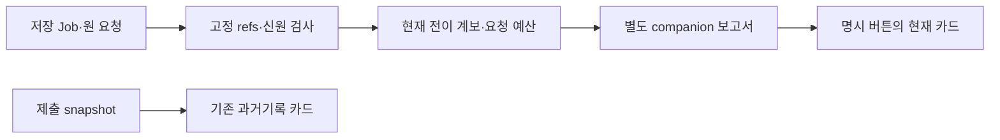

# Gate Job Current Lineage 20261017 — 옛 점검표와 지금 자료 구분

| 필드 | 값 |
|---|---|
| updated_at | 2026-10-17 23:36 KST — Git 상태 메타데이터 정정; 본문은 해당 Gate 기준 |
| source_commit | Git 연결됨; 문서 작성 시 변경분 미커밋, evidence snapshot SHA로 추적 (원격 기준 d483d25) |
| evidence_paths | `backend/app/job_lineage.py`; `backend/app/job_lineage_api.py`; `docs/implementation/38_job_lineage_validation.md`; `docs/implementation/39_job_lineage_ui.md`; `evidence/integration/job-lineage-tests-20261017.log`; `evidence/integration/job-lineage-full-tests-20261017.log`; `evidence/integration/job-lineage-ui-build-20261017.log`; `evidence/integration/job-lineage-live-20261017.json` |
| confidence | 코드·fixture시험·실제기존Job BLOCKED/404 및 UI근거; 운영성공계보미검증 |
| status | TESTED_SYNTHETIC: 성공/예산/계약; VERIFIED_REAL: 기존Job차단·UI; 실행 BLOCKED |

## 한 문장·1분 설명

옛 접수 점검표를 그대로 두고, 저장된 접수 요청의 자료가 지금도 맞는지 별도로 확인하는 창구를 추가했다. 점검표가 없는 LEGACY라도 원 요청이 남아 있으면 현재를 검사할 수 있다. 이 검사가 옛 기록이나 실행 허가를 바꾸지는 않는다.

## 왜·이론·5분 흐름

기존 input-resolution은 제출 snapshot을 읽으므로 현재 파일 상태를 인증하지 않는다. 새 `GET /v1/jobs/{id}/lineage-validation`은 저장 원 요청의 고정 refs를 현재 전이 계보로 검사한다. Job·Agent·Trace 연결을 먼저 확인하고 저장 snapshot·URI hint·role·parameters를 진단에 투영하지 않는다. 원 요청 전체의 의미·품질·실행 요건을 모두 재검증한 것은 아니다.

## 코드·계약·예외

`job_lineage.py:validate_job_lineage`, `job_lineage_api.py:create_job_lineage_router`와 main router가 구현이다. 확장은 `greenblue.job-lineage-validation.rfc1`/INTERNAL_REVIEW, 범위는 `CURRENT_TRANSITIVE_LINEAGE_NOT_SUBMISSION_SNAPSHOT`이다. 원문 schema·Status·저장 input_resolution은 바꾸지 않는다. no-store·thread pool을 사용하고 Job/Trace나 background 저장을 만들지 않는다.

| 사유 | 의미 |
|---|---|
| CURRENT_LINEAGE_CHECKED | 현재 보고서가 있음; BLOCKED일 수 있음 |
| LEGACY_REQUEST_NOT_RECORDED | 저장 원 요청이 없음; 제출 snapshot 부재와 별개 |
| JOB_REQUEST_INVALID | 요청·고정 참조·신원이 손상됨 |
| CHECK_LIMIT_REACHED | 선행 한도 또는 부분 예산 차단; 미검사 binding 구분 |
| 404/503 | Job 없음/자원 불가; 내부 KeyError를 모두404로 오인하지 않음 |

## 예산·부분 검사

서버 기본 상한은 입력64·고유 root32·깊이32·root당64노드·요청전체256노드검사다. 입력/고유root 초과는 개별검사 전에 닫는다. 같은 고정root는 요청내cache를 재사용하지만 다른root의 공유조상 재검사비용도 총량에 포함한다. 총예산이 끝나면 새root는 checked=false/diagnostic_index=null로 두고 기존cache는 재사용할 수 있다.

checked는 진단 수행/재사용, reused는 요청내재사용, current_assets_revalidated는 resolve시도다. 어느 것도 성공 자체가 아니다. 부분 available=true나 상충SHA 때문에 diagnostics=[]인 차단보고서도 가능하다. 전체무결성은 모든binding성공·빈blocker를 요구한다. 같은자료의다른고정version은허용하고동일ID/version다른SHA는해시전차단한다. 노드상한은총자산byte·운영동시부하·원자적snapshot 보장이 아니다.

## UI·실제 검증

AgentCenter는 저장기록과 독립된 `JobLineageDiagnostics`를 두고 명시 버튼으로만 현재GET을 요청한다. 화면진입·상태조회·2.5초polling에 해시를 넣지 않는다. Job/Trace·scope·refs/index/root·부분결과·승인false·읽기불변을 adapter가검사하고 ID/Agent변경·재조회·이탈의세대guard로이전/늦은응답을막는다.

실제5174→API8002에서 기존Job1은 제출LEGACY와 현재BLOCKED/DATASET_VERSION_NOT_FOUND를 따로 표시했다. 클릭전현재결과없음·ID편집clear·다른기존Job상태조회시자동현재검사없음·KST/시도≠성공·승인없음을 확인했다. desktop1440×1000/mobile390×844·폭375<390과viewport복원이다. 성공계보는임시fixture범위다.

## 시험·보존·한계

관련12 PASS/3.188초·독립12 PASS/4.430초, 전체310건/101.622초/OK(skipped=1)=309 PASS·1 SKIP다. UI32/32 PASS/1129.7804ms·build63modules/24.15초다. 기존OSsymlink권한1SKIP·mock경계PASS와과거전체시험을구별한다.

보호5SHA·기존2JobSHA불변·신규실행0이다. 모든권한·실행·과학승인false,쓰기/네트워크0을유지한다. 기관ACL·정보노출운영정책·독립과학·실행직전불변입력·executor·Workflow전이계보는후속이다.

## 발표·10분 확장·질문

30초: “저장된 접수 점검표와 현재 자료 검사를 따로 보여줍니다. 과거 기록은 없지만 현재는 미등록 차단인 기존Job을 실제로 확인했고 실행 허가는 바꾸지 않았습니다.”

5분은 과거/현재→고정refs→진단→UI 분리를 설명한다.10분은 예산/cache/부분검사·원문전체의미미검사·명시조회/비반복·성공fixture/실제차단차이를 확장한다.

Q1. LEGACY와현재결과가모순인가? A. snapshot과저장원요청은다르다.

Q2. checked면성공인가? A. 진단수행표시다.

Q3. 자동반복하나? A. 명시버튼요청만한다.

Q4. 과거Job을READY로바꾸나? A. 상태·기록·승인은불변이다.

Q5. 성공운영계보인가? A. 성공은fixture이며실제는미등록차단이다.

[DEMO](../presentations/DEMO_STORY.md)의최신Job현재계보절을사용한다. 코드/API/사용법/시험/인계·UI/실행서버/브라우저와이해자료를같은완료단위로갱신하고전체개발·보고는유지한다.
