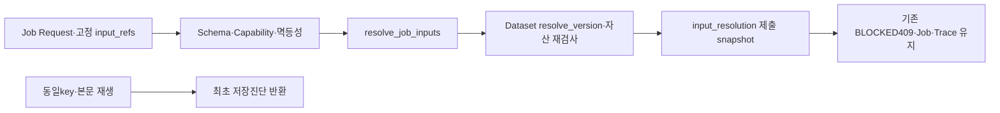

# Gate Job Input 20261017 — 접수시점의 고정자료 진단

| 필드 | 값 |
|---|---|
| updated_at | 2026-10-17 23:36 KST — Git 상태 메타데이터 정정; 본문은 해당 Gate 기준 |
| source_commit | d474d5bce6c2a6c4bd8ba141c9256d15f6004631 (108까지 구현 검토 기준; 이 메타데이터 정리는 후속 문서 커밋) |
| evidence_paths | `backend/app/job_inputs.py`; `backend/app/gmais_api.py`; `docs/implementation/27_job_input_resolution.md`; `evidence/integration/job-input-core-tests-20261017.log`; `evidence/integration/job-input-api-tests-20261017.log`; `evidence/integration/job-input-full-tests-20261017.log` |
| confidence | 현재 코드·완료시험 로그 기반; 실제자료·실행·기관권한·과학승인 검증 아님 |
| status | TESTED_SYNTHETIC: 제출진단 코어·API; 실제 실행 BLOCKED |

## 한 문장·1분 설명

분석접수증에적힌자료의고정버전과실제파일지문이등록부와맞는지대조하고결과를남긴다.검사표는접수시점기록이며실행허가가아니다.파일무결성·품질·권한·모델과학승인은각기다른질문이다.

## 왜·이론·5분 흐름

JSON형식만맞는요청은실제로등록되지않았거나바뀐파일을가리킬수있다.새Job은schema/Agent/capability/멱등성을먼저검사하고 `resolve_job_inputs`가Dataset `resolve_version`을호출해고정ID/version/artifactSHA와자산을대조한다.입력SHA는manifest metadataSHA와다르다.같은ID의다른고정version은시계열T1/T2로허용하고동일(id,version)다른SHA만충돌한다.동일참조의다른role반복도허용한다.

제출URI가등록자산을교체하거나원격자료를가져오지않는다.품질/ACL blocker가있어도무결성만true일수있으므로status/blockers를함께읽는다.제한자료내부경로·URI·manifest·원문예외를응답에노출하지않는다.

## 구조와 코드

| 구현 | 실제 위치·입출력 |
|---|---|
| 입력진단 | `backend/app/job_inputs.py:resolve_job_inputs(store,input_refs)` →무결성·품질/ACL blocker·기록 |
| 버전대조 | `backend/app/dataset_registry.py:resolve_version` →고정신원·자산SHA검사 |
| API접수 | `backend/app/gmais_api.py`의 `POST /v1/agents/{agent_id}/jobs` →Job record/409details에진단저장 |

확장은 `greenblue.job-input-resolution.rfc1`/`INTERNAL_REVIEW`다.원문JobStatus schema에는필드를추가하지않는다.기존409/BLOCKED·Location·JobID/Trace·결과미생성은유지한다.

## 기록의 시점·예외·권한

`evaluated_at`과 `SUBMISSION_SNAPSHOT_NOT_EXECUTION_AUTHORIZATION`이범위를표시한다.같은key·본문재생은최초진단이며현재파일을재검사한응답이아니다.같은key·다른본문은기존SCHEMA_MISMATCH다.과거Job에진단이없으면재생시새로추가하지않는다.실제executor는실행직전재검증해야한다. `authorization_verified=false`, `ready_for_execution=false`, `scientific_approval=false`가유지된다. PUBLIC+VALIDATED도기관권한이나독립정확도를보증하지않는다.

## 실제 시험과 한계

임시fixture기반코어10 PASS/1.663초,API12 PASS/1.987초,전체240건/48.174초/OK(skipped=1),즉239 PASS·1 SKIP다.실제symlink생성권한부족1SKIP의기존환경제약과mock경계시험통과를구별한다.보존로그를읽은결과이며이해에이전트가다시실행하지않았다.실자료등록·원본변경·수집·학습·실행Result생성은없다.이전225건224 PASS·1 SKIP와197 PASS는이력이고신규시험과합산하지않는다.

기관ACL·등록API·lineage부모존재·불변자산복제·AOI/기간/제품의미적합성·승인모델선택·실행기/DAG연결은후속이다. Workflow plan입력바인딩해석은이번범위가아니다.실제자료1,111과후보예상1,095·bare미해결·실자료학습BLOCKED는유지한다.

## 발표·10분 확장·Q&A

30초: “접수자료의고정버전과지문을대조하는진단을추가했습니다.최초검사기록을저장하되실행권한과과학승인은부여하지않습니다.최신전체시험은240건중239개통과·권한문제1개건너뜀이며실제학습은여전히차단돼있습니다.”

5분은접수→등록대조→snapshot→BLOCKED경계를설명한다.10분은T1/T2허용·동일버전SHA충돌·제한경로비노출·재생시점한계를확장한다.슬라이드: 자료접수증 / 고정지문 / 제출기록과재생 / 실행승인의별도문턱.

Q1.파일이맞으면실행되나? A.아니다.진단과승인은다르다.

Q2.다른연도면충돌인가? A.고정version이다르면허용한다.

Q3.같은요청을재생하면최신검사인가? A.최초snapshot이다.

Q4.제한자료권한도검증하나? A.ACL미연결blocker이며권한검증false다.

Q5.Workflow실행도연결됐나? A.개별Job제출진단이며Workflow입력해석/실행은후속이다.

## 시연·다음 Gate

[기존시연](../presentations/DEMO_STORY.md)에문서27과시험로그를읽는설명을붙인다.실자료Registry등록이나Job실행을시연목적으로새로하지않는다.다음승인된실행단위에서실행직전검증과기관권한·의미검증근거를받으면관련설계/API/사용법/시험/인계와이해자료를같이갱신한다.
