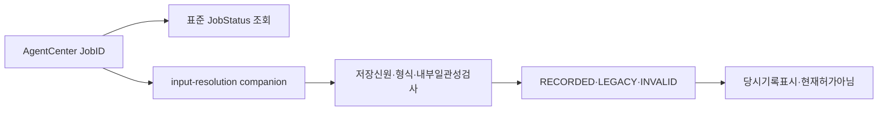

# Gate Job Snapshot 20261017 — 접수 당시 입력 기록 다시 보기

| 필드 | 값 |
|---|---|
| updated_at | 2026-10-17 23:36 KST — Git 상태 메타데이터 정정; 본문은 해당 Gate 기준 |
| source_commit | Git 연결됨; 문서 작성 시 변경분 미커밋, evidence snapshot SHA로 추적 (원격 기준 d483d25) |
| evidence_paths | `backend/app/job_snapshot.py`; `docs/implementation/31_job_input_snapshot_read.md`; `docs/implementation/32_job_snapshot_ui.md`; `evidence/integration/job-snapshot-tests-20261017.log`; `evidence/integration/job-snapshot-full-tests-20261017.log`; `evidence/integration/job-snapshot-ui-build-20261017.log`; `evidence/integration/job-snapshot-live-ui-20261017.json` |
| confidence | 현재코드·fixture시험·실제legacy/404 UI근거; 실제성공snapshot은미검증 |
| status | TESTED_SYNTHETIC: 기록성공·계약; VERIFIED_REAL: 로컬legacy/404·ID변경; 실행 BLOCKED |

## 한 문장·1분 비유

지금재료를다시검사하는대신접수할때남긴점검표를읽는창구를추가했다. 점검표가없는옛접수건은없다고말하고새검사로과거기록을만들지않는다. 과거의검사기록과현재의허가를구분한다.

## 왜·이론·5분 흐름

표준JobStatus에는입력snapshot이없고기존UI는제출409에서만이를읽었다. 별도companion `GET /v1/jobs/{job_id}/input-resolution`이저장기록을안전하게투영한다. JobID/Trace/Agent와요청입력연결, 항목·전체무결성/상태와품질/ACL blocker의내부일관성을확인한다. 허용필드만복사해내부예외·URI·파일경로·자격정보를숨긴다. current_files_revalidated/execution_authorized/scientific_approval는false다. 서명감사나과학적타당성검증은아니다.

## 실제코드·API·예외

`backend/app/job_snapshot.py:project_job_input_snapshot`, `_identity`, `_project_snapshot`과`gmais_api.py`의새GET경로가구현이다. extension은`greenblue.job-input-snapshot.rfc1`,approval는INTERNAL_REVIEW다. RECORDED_SNAPSHOT만available=true다. LEGACY_SNAPSHOT_NOT_RECORDED/SNAPSHOT_INVALID는HTTP200·available=false·snapshot=null,없는Job은JOB_NOT_FOUND/404다. 기존인증middleware를유지한다.

UI `AgentCenter`는status와companion을별도판정한다. `jobSnapshotView`는Job/Trace·reason/available/snapshot관계와승인false를검사한다. ID/Agent편집·재조회·화면이탈은이전상태/기록/Result/게시판정과요청세대를무효화한다. 늦은응답이새Job화면에붙지않는다.

## 시험·실제환경·한계

관련12 PASS/6.726초(독립재검증12 PASS/4.772초),전체274건/70.655초/OK(skipped=1)=273 PASS·1 SKIP다. 품질/ACL모순과불가능한무결성·실패조합회귀를포함한다. UIadapter13 PASS/561.2336ms,build52modules/15.97초PASS다. 기존실제symlink생성권한1SKIP와mock경계통과를구분한다. 이전262건과합산하지않는다.

실제UI5174동일출처proxy→새API8002(--reload)에서기존2Job의LEGACY,ID변경시이전표시즉시제거,없는Job404를확인했다. 성공RECORDEDsnapshot은fixture범위이며실제과학Job을만들지않았다. 이전8000/8001프로세스를보존했고Catalog/원장/manifest전후SHA동일·이번신규Job/Result/Trace0이다. 이API는Registry조회·현재파일재해시·카탈로그쓰기·실행을하지않는다.

## 발표·10분 확장·질문

30초: “제출당시입력검사를JobID로다시보되옛기록이없으면없다고표시합니다. 현재파일의정상여부나실행승인으로바꾸지않습니다.”

5분은접수기록→별도조회→신원/모순검사→UI부재/오류를설명한다.10분은자체모순실패사례·비동기응답경합·fixture/실제legacy차이·현재검사와저장기록차이를확장한다. 슬라이드: 당시점검표 / 안전한조회 / 없거나손상된기록 / 현재허가와구분.

Q1. 과거기록을새로채우나? A. 아니다.

Q2. 파일삭제후조회되면파일정상인가? A. 과거기록이며현재성인증이아니다.

Q3. status성공이면기록성공인가? A. 두응답을따로판정한다.

Q4. 성공기록도실제브라우저로봤나? A. 성공은fixture,실제는legacy/404다.

Q5. 다음은? A. 승인된실행직전재검증·기관ACL·실제executor의별도근거다.

[시연](../presentations/DEMO_STORY.md)의최신8002연결과legacy/404증거를사용한다. 새대시보드PNG작업은별도진행중이며완료주장하지않는다. 관련설계/API/사용법/시험/인계·이해자료·UI반영을같은완료단위로기록한다.
