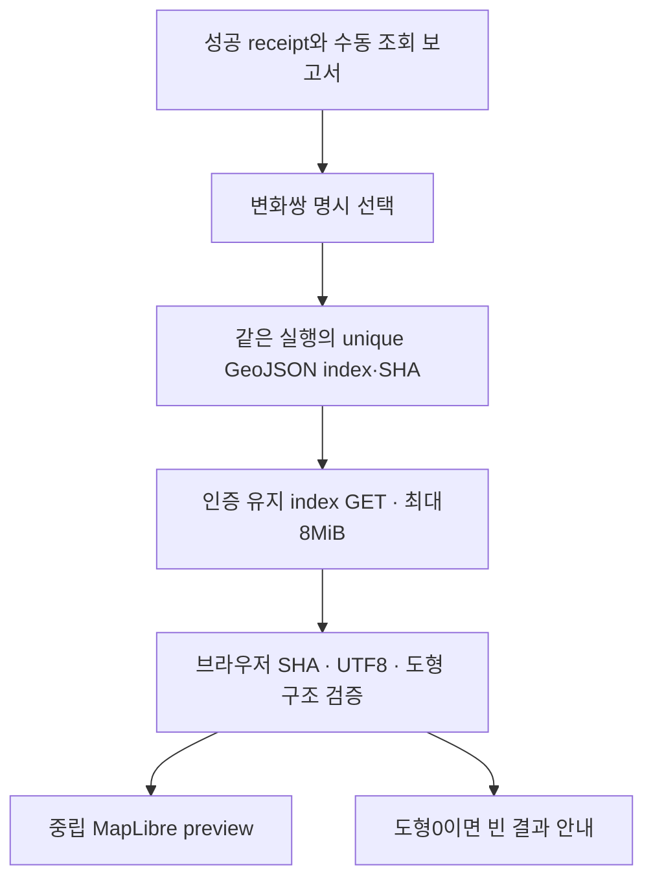

# Gate118 — 같은 실행의 변화쌍을 검증된 도형으로 미리 보기

| 필드 | 값 |
|---|---|
| updated_at | 2026-10-18 01:37:01 KST — 118 최종 전체·브라우저·보존 근거 반영 |
| source_commit | 기준 ed53f43bbbf905a0d204ab5c5d0b74d45b4162be + 118 작업파일 SHA (미커밋); 운영 적용은 별도 |
| evidence_paths | `frontend/src/lclucChangeMapAdapter.ts`; `frontend/src/LclucWorkflowChangeMap.tsx`; `frontend/src/lclucWorkflowClient.ts`; `frontend/src/LclucWorkflowPanel.tsx`; `frontend/src/lcluc-workflow.css`; `backend/app/lcluc_workflow.py`; `tests/test_lcluc_workflow.py`; `docs/implementation/118_lcluc_workflow_change_map.md`; `evidence/integration/lcluc-change-map-adapter-focused-20261018.log`; `evidence/integration/lcluc-change-map-ui-related-final-20261018.log`; `evidence/integration/lcluc-change-map-generated-fixture-20261018.json`; `evidence/integration/lcluc-change-map-independent-20261018.log`; `evidence/integration/lcluc-change-map-core-focused-20261018.log`; `evidence/integration/lcluc-change-map-core-api-final-20261018.log`; `evidence/integration/lcluc-change-map-nonempty-initial-diagnostic-20261018.log`; `evidence/integration/lcluc-change-map-ui-tests-20261018.log`; `evidence/integration/lcluc-change-map-ui-build-20261018.log`; `evidence/integration/lcluc-change-map-full-backend-20261018.log`; `evidence/integration/lcluc-change-map-live-integrity-20261018.json`; `evidence/integration/lcluc-change-map-browser-20261018.json`; `evidence/integration/lcluc-change-map-nonempty-20261018.png`; `evidence/integration/lcluc-change-map-empty-20261018.png` |
| confidence | 완료 코드·최종 로그·실제 CPU/브라우저 fixture 확인; 모의 승인과 운영 과학 승인 구분 |
| status | TESTED_SYNTHETIC 선택 변화쌍 지도 연결; 운영 원본 실행·독립 정확도 승인 BLOCKED |

## 쉬운 설명

보고서의 연도 두 개를 골라 그 실행에서 만든 변화 도형만 지도에 펼친다. 봉투의 번호와 파일 지문을 확인한 뒤 여는 것과 같다. 지도에 그림이 생겼다는 사실은 원본의 독립 정확도나 기관 승인을 뜻하지 않는다. 변화 도형이0개이면 빈 결과를 그대로 설명하고 가짜 도형을 만들지 않는다.

## 이론적 배경

파일 무결성, 렌더링 가능한 좌표, 과학적으로 맞는 변화는 서로 다른 검사다. receipt의 SHA와 받은 바이트의 SHA가 같으면 저장 목록과 같은 파일임을 확인한다. WGS84 좌표 범위·도형 구조 검사는 지도를 안전하게 그릴 수 있는지 보는 것이다. 자기 교차·구멍의 관계·정답 라벨·계절이나 센서 오차까지 증명하지 않는다.

전체 변화량은 유효 래스터 픽셀을 기준으로 계산한다. 지도 벡터는 최대5000개로 잘릴 수 있어 도형 개수나 일부 다각형 면적으로 전체 변화량을 다시 추정하지 않는다. truncated 경고가 있으면 지도는 일부 도형이고 보고서의 통계는 전체 유효 래스터 범위임을 말한다.

## 구조와 코드

`workflowChangePair`는 같은 workflow ID·trace·checkpoint·연도·pair·artifact index/SHA를 결합한다. `workflowGeoJSON`은 기존 서버 origin과 탭 세션 Bearer를 유지해 index로만 읽고 실제 누적8MiB 상한을 검사한다. 바이트 SHA가 receipt와 같아야 strict UTF8 decode 뒤 JSON/geometry guard를 통과한다. caller URL·경로를 실행하지 않는다.

`parseWorkflowChangeGeoJSON`은 FeatureCollection의 Polygon/MultiPolygon, finite2D 경위도, 닫힌4점 이상 ring, 최대5000 features/100000 vertices,0~8 class와 전환 code를 검사한다. 날짜변경선을 가로질러 fit이 모호한 경도 span/edge는 보수적으로 거부한다. 빈 결과의 bounds는 null이다. 이 범위 검사는 실제 위상 인증이 아니다.

`LclucWorkflowChangeMap`은 외부 tiles/glyph 요청 없는 중립 배경에 검증 도형만 그린다. SVG 확대·축소·전체 범위와 미인증 출처 안내를 붙인다. 위의 기존 지도·KPI·다른5개 모델은 바꾸지 않는다. pair는 빈 선택에서 시작하고 지도 읽기를 직접 눌러야 GET한다. 보고서를 읽거나 pair를 바꾸는 것만으로 파일을 자동 요청하지 않는다.

pair 변경은 지도만 비우고 receipt/report는 유지한다. 입력·receipt/report·route/back/unmount 변화는 늦은 지도 응답도 폐기한다. WebGL 오류는 안전 안내를 표시하고 보고서 통계는 남긴다. stream cancel은 best effort이며 서버 읽기·추론 취소나 파일/DB rollback이 아니다.8MiB는 payload 상한이지 GPU/RSS/CPU/시간의 전체 hard cap이 아니다.

## 실제로 발견해 수정한 계산 연결 결함

처음 nonempty 실제 CPU fixture를 만들 때115가 RUNNER_REPORT_MISMATCH로 실패했다. Rasterio가 돌려준 도형 좌표 tuple과 JSON에 저장된 list를 Python 객체 동등성으로 비교했기 때문이다. 빈 도형 시험에서는 드러나지 않았다. Root는 파일의 JSON과 반환 report를 finite canonical JSON으로 비교하도록 최소 수정했다. tuple/list의 직렬화 차이를 허용하면서 boolean과 integer의 실제 JSON 타입 변조는 계속 거부한다.

초기 diagnostic 로그를 보존하고 nonempty 실제 추론 성공·bool/int 변조 거부 회귀2개를 추가했다. 이는 원본 모델 승인이나 정규화 보정을 바꾸는 수정이 아니다. main/API/Store와 기존 상단 Workspace는 그대로다.

## 시험 증거

완료 로그에서 새 adapter13 PASS/14.751초, UI 합동23 PASS/16.725초(13+10), 독립6 PASS/0.436초를 읽었다. core19 PASS/11.800초와 core+API34 PASS/25.842초도 확인했다. 중복 묶음과 독립 시험을 전체에 더하지 않는다. 최종 전체 backend1170건 중1169 PASS·기존 Windows symlink 권한1 SKIP/389.307초/종료0이다. 전체 frontend229 PASS/25.048초·합동23 PASS/16.725초·build102 modules/21.67초를 확인했다. adapter13·독립6·core19/core+API34는 반복/교차 검증이며 전체에 더하지 않는다.

생성16×16 세 연도 영상과 손으로 설정한 미학습 TinyUNet, 명시 mock admission의 임시 장부를 사용했다. 실제 CPU 추론에서 nonempty1 Polygon·256 유효 픽셀·25600m² 변화와 빈 도형 결과를 만들었다. 물리 계산은 실제지만 승인 metadata와 모델은 시험용이며 사업지역 변화·독립 평가·운영 원본 실행 증거가 아니다.

## 실제 브라우저와 보존 범위

Root가 임시 UI5175/API8003에서 생성3연도 CPU 결과를 직접 읽고2020-2021의 Polygon1개·정점5·유효256픽셀·변화25600m²와2020-2022 첫해/마지막해 지도 표시를 확인했다.2021-2022는0도형 안내와 canvas 없음으로 확인했다. 이 수치는 시험 영상 결과이지 실제 사업지역 변화가 아니다. pair 선택만으로 지도는 생기지 않았으며 직접 읽기를 눌러야 표시됐다.

pair 변경 직후 예전 지도는 사라지고 보고서는 유지됐다. 빠른 pair 전환과 뒤로 가기 뒤 예전 지도/보고서가 되살아나지 않는 것도 확인했다. 실제 모바일·강제 네트워크 지연·인증 Bearer 브라우저 세션은 미시험이다. fixture token은 비어 있었고 Bearer/지연 처리는 별도 client/세대 시험 범위다. fixture의 vector_truncated는false이므로 잘림 경고는 단위/소스 계약 근거와 구분한다.

보호141참조·이전증거925파일·catalog14기록은 불변이다. 기존소스265개 중 허용한 core·core시험·panel/client/CSS5파일만 변경됐고 기존main/API는 불변이다. 운영 수집·학습·등록·배포·Workflow dispatch0을 유지했다. 이는 명시 추적 범위의 보존이며 원자 snapshot이나 전체 호스트 불변 인증이 아니다.

## 한계와 후속

SHA 일치·WGS84 구조와 범위 검사 ≠ topology·실출처 기관 권위·독립 정확도 인증이다. 현재 Draft·후보QA4차단·독립 라벨 미제공·외부5실행기 미제공을 유지한다. 현재6밴드 per_scene 제품 정규화·구름mask·generic DAG·표준 GMAIS Result·RAG·staging/보안/UAT는 이번에 해결하지 않는다. 운영 수집·등록·학습·배포·원본 실행은0이며 원장/lock·예약136314880B를 보존한다.

## 발표 대본

### 1분

“이제 같은 실행의 보고서에서 연도 두 개를 직접 고르고 변화 도형을 지도에서 볼 수 있습니다. 서버의 저장 목록과 브라우저가 받은 파일의 지문을 대조하고, 좌표와 도형 구조를 확인한 뒤 그립니다. 작은 시험 영상에서 계산한 변화 도형은 실제지만 승인과 모델은 시험용입니다. 독립 정확도나 운영 승인을 받은 것은 아닙니다. 도형이 없으면 빈 결과를 그대로 보여 줍니다. 지도는 최대5000개 도형으로 잘릴 수 있어 전체 픽셀 통계와 나누어 설명합니다. 원본 자료와 기존 상단 지도·지표는 바꾸지 않았습니다.”

### 5분 순서

첫1분에 봉투/파일 지문 비유와 수동 선택을 설명한다. 다음1분은 receipt→보고서→index→SHA→좌표 검사를 보여준다. 세번째1분은 실제 작은 영상과 모의 승인, nonempty/empty 차이를 말한다. 네번째1분은 래스터 전체 통계와 잘린 벡터 지도를 구분한다. 마지막1분은 늦은 응답 폐기·topology 미검증·원본 운영 차단을 설명한다.

### 10분 확장과 슬라이드

‘같은 실행 고르기’, ‘바이트와 좌표 검증’, ‘빈 지도와 일부 지도’, ‘실제 발견한 JSON 결함’, ‘남은 과학 승인’ 다섯 장으로 구성한다.5분 발표에 tuple/list 회귀2분, 날짜변경선·자원/취소 한계1분, 위상/정답 차이1분, Q&A1분을 더한다.

## Q&A

Q. SHA가 맞으면 변화가 정확한가? A. 저장 파일과 받은 파일이 같다는 뜻이다. 변화의 정답은 독립 라벨 등 별도 검증이 필요하다.

Q. 도형0개는 오류인가? A. 유효한 빈 결과일 수 있다. 가짜 도형을 만들지 않고 보고서의 전체 래스터 통계를 따로 읽는다.

Q. 지도 도형 면적을 합하면 전체 변화량인가? A. 벡터가 잘릴 수 있어 그렇게 추정하지 않는다. 전체 통계는 보고서의 유효 래스터 기준이다.

Q. 이번에 왜 backend도 바꿨나? A. nonempty 도형의 tuple/list 직렬화 차이 때문에 실제 실행이 실패하는 결함을 발견해 JSON 동치 비교만 보완했다.

Q. 이제 원본 모델이 운영 승인됐나? A. 아니다. 임시 생성 자료와 mock 승인으로 연결을 시험했고 원본 Draft·학습 차단은 보존했다.

## 근거 바로 열기

[구현 설명](../../implementation/118_lcluc_workflow_change_map.md) · [생성 CPU fixture](../../../evidence/integration/lcluc-change-map-generated-fixture-20261018.json) · [브라우저 관측](../../../evidence/integration/lcluc-change-map-browser-20261018.json) · [최종 전체 시험](../../../evidence/integration/lcluc-change-map-full-backend-20261018.log)
