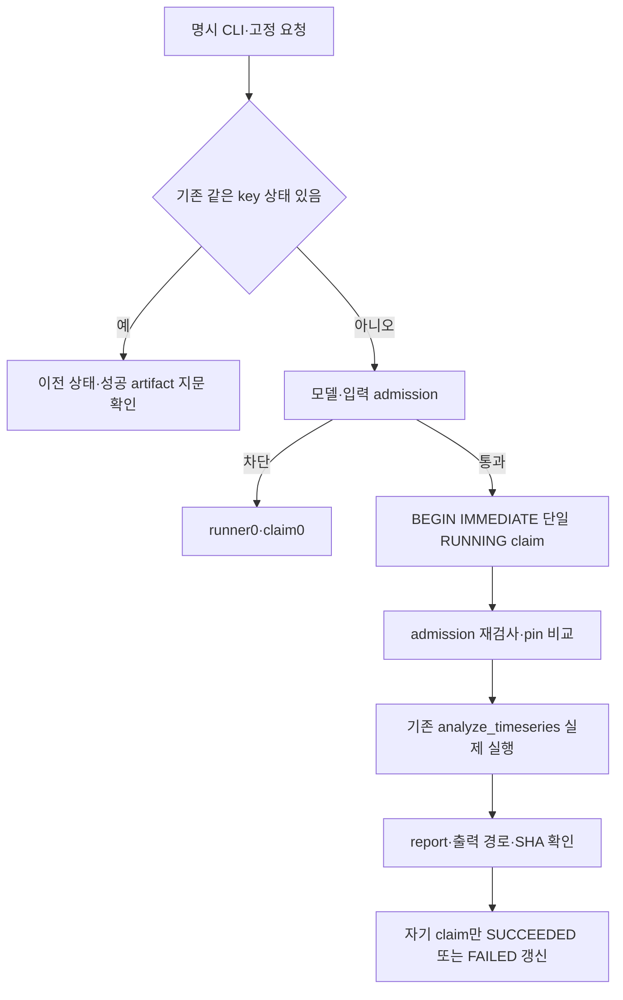

# Gate115 — 고정 Registry 입력에서 실제 LCLUC 시계열 runner로 연결

| 항목 | 내용 |
|---|---|
| updated_at | 2026-10-18 00:56 KST — 115 최종 구현·시험·보존 근거 반영 |
| source_commit | 기준 d264f81378f7fd3a2b07ab69b9193e8b3d651bc9 + 115 작업파일 SHA (미커밋); 게시·운영 적용은 별도 |
| evidence_paths | `backend/app/lcluc_workflow.py`; `scripts/run_lcluc_workflow.py`; `tests/test_lcluc_workflow.py`; `docs/implementation/115_lcluc_workflow_executor.md`; `evidence/integration/lcluc-workflow-source-freeze-20261018.json`; `evidence/integration/lcluc-workflow-focused-final4-20261018.log`; `evidence/integration/lcluc-workflow-independent-final2-20261018.log`; `evidence/integration/lcluc-workflow-independent-related-20261018.log`; `evidence/integration/lcluc-workflow-independent-review-20261018.json`; `evidence/integration/lcluc-workflow-full-tests-20261018.log`; `evidence/integration/lcluc-workflow-live-integrity-20261018.json` |
| confidence | 완료 소스·집중 시험·실제 runner 코드 확인; 합성 승인과 운영 과학 승인을 구분 |
| status | TESTED_SYNTHETIC 실제 작은CPU추론 연결; 운영 실행/과학 승인 BLOCKED; API/UI PLANNED |

## 쉬운 설명

이제 서류의 순서만 보는 단계를 넘어, 조건을 통과한 고정 입력을 기존 시계열 추론 함수에 실제로 전달하는 로컬 CLI가 생겼다. 작은 두 연도의 시험 영상으로 분류지도와 변화·전환표·보고서가 생성되는 것을 확인했다. 같은 주문은 중복 실행하지 않고, 실패 뒤 자동으로 다시 돌리지 않는다.

시험의 승인 도장은 임시 장부에 명시적으로 만든 mock이다. 실제 전문가 평가를 받았거나 현재 Draft 모델을 승인한 것이 아니다. 지금 사용자의 원본으로 실행하지 않았으며 화면/API도 아직 연결하지 않았다.

## 이론적 배경과 구조

실행 전 입장 검사는 고정 버전·파일 지문·품질/접근 상태·배포 모델의 평가 근거를 확인한다. 통과 뒤 단일 실행 권리를 SQLite transaction으로 확보하고, 바로 전과 같은 조건인지 다시 확인한 뒤 runner를 호출한다. 파일 생성과 DB 최종 상태는 한 transaction이 아니므로 분산 exactly-once나 복구 완료를 뜻하지 않는다.

## 요청과 코드 동작

`execute_lcluc_workflow(store,request)`와 `run_lcluc_workflow.py`가 새 연결이다. 요청은 schema_version/capability/trace_id/idempotency_key/model_ref/images 정확한6키다. capability는landcover.change_detection,model/input참조는id/version/sha256 정확한3키다.2~6연도는중복없는오름차순이며각행은year/input_ref/quality_report_sha256이다. caller image/checkpoint/output경로나정규화옵션을받지않는다. CLI는16KiB strict JSON과명시 --execute/--data-root/--request를요구한다. --execute없으면Store도열지않고기본운영DATA경로도없다.

모델은Deployed·정확한독립평가true·expert_independent·요청checkpoint와평가SHA결합·선언버전/훈련reportSHA·실제파일SHA를확인한다. weights_only CPU읽기와TinyUNet state shape,synthetic 정확false·reference kind를검사한다. 선언의기관권위·독립성자체를새로공인하는것은아니다. 새CLI실행에는Store생성/등록상태쓰기와실제영상읽기/파일생성이있어전체IO0이아니다.

입력은immutable DatasetVersion resolver의현재asset·manifest pin과VALIDATED/PUBLIC raster·연도·quality report SHA를확인한다. 이는등록된품질메타데이터와해시검사이며quality문서의과학적내용이나기관ACL을별도로인증한것은아니다. 영상band description은checkpoint band명과같아야하고grid는기존runner가검사한다.

## v1 지원 범위와 자원 경계

v1은global normalization을쓰는TinyUNet의작은타일이다. band1~16·patch4~256·영상폭/높이4~1024·입력파일64MiB·checkpoint8MiB·읽기추정128MiB·출력합256MiB/128파일등을검사한다. 추정량은실제전체IO·프로세스RSS·CPU시간·원자파일snapshot의하드보장이아니다. 출력합상한은생성후검사이므로디스크예약/쿼타를미리강제하지않고실패부분산출물은보존한다.

현재6밴드후보의per_scene_product_metadata는 NORMALIZATION_MODE_UNSUPPORTED로차단한다. 모든6밴드가원리상불가능하다는뜻이아니며이번fixed global계약밖이라는뜻이다. 별도연차quality mask 전달·공식제품별정규화·fullscene·genericDAG는후속이다. 현재모델의Draft·독립정답부재·후보4차단을우회하지않는다.

## 실행 권리·재관측·출력

key의SHA로local workflow ID를만들고요청전체canonical SHA와trace/고정ref snapshot을저장한다. claim은BEGIN IMMEDIATE와고유INSERT이며Store.put의덮어쓰기로경쟁하지않는다. 이미RUNNING/FAILED이면그상태를돌려주고자동재실행하지않는다. 같은key의다른요청은충돌이다. 초기admission차단은claim/출력을만들지않는다.

실제runner는기존analyze_timeseries다. 두작은연도시험에서분류TIF2개·change TIF/GeoJSON/전환CSV/변화report4개·timeseriesJSON1개로총7artifact와SHA가연결된다. 결과는LOCAL_LCLUC_WORKFLOW_ONLY이며scientific_accuracy_validated/standard_gmais_result는false다. GMAIS표준Job/Result나운영과학인증을생성하지않는다.

성공재관측은현재입력admission을다시실행하지않고저장산출물SHA를확인해기존성공을반환한다. 이것은과거성공재조회이지현재모델/자료의새실행승인이아니다. 산출물이변조되면재실행없이거부한다. 실패부분파일은보존하고정리/재시도하지않는다. crash뒤RUNNING을성공으로추정하지않으며최종DB갱신도자기claim본문이같을때만한다.

## 시험과 실제 범위 — 최종 통합 검증

최종집중17 PASS/4.203초로그를읽었다. 최초artifact개수를실제계약7개보다많게기대한시험실패와stream/finite/race/snapshot보강의중간로그를보존한다. 독립24 PASS/12.821초(구현17+별도7)·선별관련26 PASS/21.460초를읽었다. 초기독립검사의tests import경로와.runtime환경실패로그2개를보존했고새최종결과와구분한다. 최종 전체 backend 1153건 중 1152 PASS·기존 Windows symlink 권한 1 SKIP, 331.642초·종료0을 확인했다. 집중17·독립24·선별관련26은 반복 검증이므로 전체 건수에 더하지 않는다. 보호141참조·이전증거866파일·기존소스252파일·catalog14기록은 불변이며 새 소스3개는 동결 SHA와 일치한다. 운영 원본 실행·등록·수집·학습·배포는0이고 pending2배치와 예약136314880B를 보존했다.

TempStore에서만Deployed/독립평가·VALIDATED/PUBLIC을명시mock으로준비했다.16×16두영상과고정TinyUNet은실제CPU추론·변화계산을한다. 학습·전문가평가를실행하거나합성모델을운영승인한것이아니다. 현재운영DB/원본으로CLI를호출하지않았다. 음성시험은Draft/평가/버전/파일변조·합성flag·정규화·품질/접근·연도·band·자원/출력·동시claim·실패미재시도·산출물변조를확인한다.

## UI·후속 경계

이전113/114의미착수설명중단일local CLIcore는이번구현으로진행됐다. API/UI·선택변화쌍지도·같은trace탐색은116후속PLANNED이며지금화면에서실행된다고소개하지않는다. 기존genericGMAIS409/WorkflowPLAN_ONLY·GeoLLM정형조회·Ollama별도평가상태는그대로다. 구조화오류UI·공식6밴드정규화/구름mask·표준Result·운영K8s/보안/UAT도별도다.

원본·원장/lock·예약136314880B·분할·모델·후보QA4차단/학습BLOCKED·외부5실행자료/독립정답미제공을유지한다. 전체개발과10분보고는계속한다.

## 발표 스크립트

### 1분

“이번에는 서류만 검사하는 기능을 넘어, 고정된 입력을 기존 시계열 추론 함수에 실제로 전달하는 로컬 실행기를 만들었습니다. 두 개의 작은 시험 영상을 분류하고 변화지도와 전환표, 보고서7개를 만들었습니다. 같은 주문은 중복 실행하지 않고 실패 뒤 자동 재시도도 하지 않습니다. 다만 승인과 품질 도장은 임시 장부에 만든 명시적 모의 자료입니다. 현재 Draft 모델이나 실제 원본을 승인·실행한 것이 아닙니다. 현재 6밴드 자료의 제품별 정규화와 화면/API 연결은 후속이며 과학·운영 승인은 별도로 차단합니다.”

### 5분 순서

첫1분은실제runner연결과진단의차이를설명한다. 다음1분은고정참조·모델/입력입장검사를보여준다. 세번째1분은한번의claim·같은주문재관측·실패미재시도를설명한다. 네번째1분은실제작은CPU추론과7artifact·mock승인의차이를설명한다. 마지막1분은global타일한계·현재6밴드per_scene/API/UI/genericDAG미연결과운영차단을나눈다.

### 10분 확장과 슬라이드

요청·입장검사·claim상태·실제산출물·후속공백의다섯장으로구성한다. 5분뒤동시claim/변조/실패부분파일을2분,성공replay의과거시점범위를1분,정규화/품질메타데이터의한계를1분,질문을1분배정한다.

## Q&A

Q. 이제원본LCLUC가운영실행됐나? A. 아니다. 임시장부와작은시험영상에서만실제계산했다.

Q. 같은주문을다시보면추론을다시하나? A. RUNNING/FAILED는재실행하지않고성공은산출물지문확인후기존결과를반환한다.

Q. 현재6밴드후보도바로되나? A. 현재per_scene정규화계약은차단한다. v1은fixed global TinyUNet타일이다.

Q. 모의승인인데실제추론인가? A. 승인메타데이터는mock이고래스터/모델CPU계산은실제다. 과학승인은아니다.

Q. 화면과표준Result도완료인가? A. CLIcore만완료범위다. API/UI·genericDAG·표준Result는후속이다.
