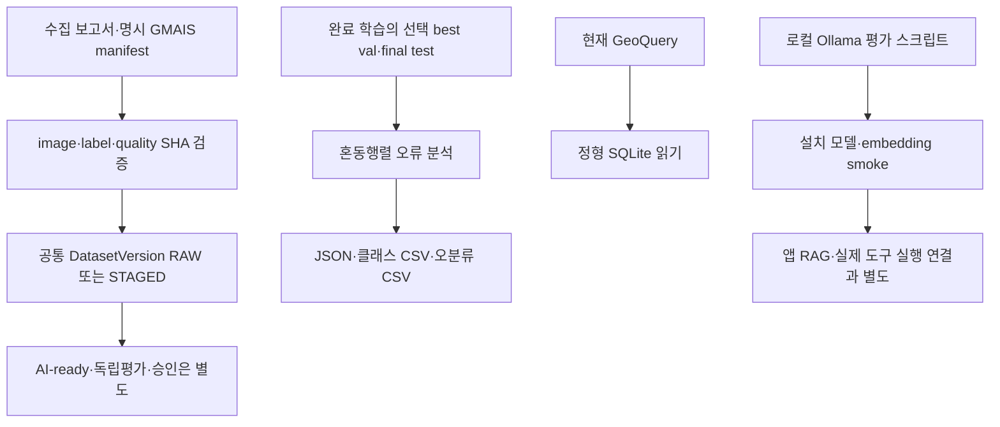

# Gate111~114 — LCLUC 자료 등록·오류 설명 연결과 GeoLLM 기술 검토

| 항목 | 내용 |
|---|---|
| updated_at | 2026-10-18 00:33 KST — 111~114 최종 구현·실측·보존 근거 반영 |
| source_commit | 기준 be029c15b7966e8f64331349c54bb8508dabe3e8 + 111/112·GeoLLM 평가 작업파일 SHA (미커밋); 게시·실행 서버 적용은 별도 |
| evidence_paths | `docs/implementation/111_data_pipeline_completion.md`; `docs/implementation/112_lcluc_ml_completion.md`; `docs/implementation/113_lcluc_integration_acceptance.md`; `docs/implementation/114_geollm_technical_review.md`; `backend/app/data/collection_registration.py`; `scripts/register_collection.py`; `backend/app/ml/error_analysis.py`; `backend/app/ml/service.py`; `backend/app/ml/network.py`; `scripts/evaluate_geollm_local.py`; `scripts/evaluate_geollm_tools.py`; `evidence/integration/data-pipeline-inventory-20261018.json`; `evidence/integration/lcluc-ml-architecture-20261018.json`; `tests/test_collection_version_registration.py`; `tests/test_ml_error_analysis.py`; `tests/test_geollm_local_evaluation.py`; `tests/test_geollm_tool_evaluation.py`; `evidence/integration/data-pipeline-focused-final-20261018.log`; `evidence/integration/data-pipeline-related-final-20261018.log`; `evidence/integration/data-pipeline-independent-20261018.log`; `evidence/integration/data-pipeline-independent-review-20261018.json`; `evidence/integration/lcluc-ml-error-analysis-focused-20261018.log`; `evidence/integration/lcluc-ml-error-analysis-related-20261018.log`; `evidence/integration/lcluc-ml-error-analysis-integrity-20261018.json`; `evidence/integration/lcluc-ml-existing-report-error-analysis-20261018.json`; `evidence/integration/geollm-local-evaluation-20261018.json`; `evidence/integration/geollm-native-tools-20261018.json`; `evidence/integration/geollm-runtime-audit-20261018.json`; `evidence/integration/geollm-evaluation-tests-final3-20261018.log`; `evidence/integration/geollm-independent-tests-final-20261018.log`; `evidence/integration/geollm-independent-review-20261018.json`; `evidence/integration/lcluc-geollm-full-tests-20261018.log`; `evidence/integration/lcluc-geollm-live-integrity-final-20261018.json` |
| confidence | 완료 코드·전체/교차 시험·로컬 실측·보존 근거 확인; 운영 과학/실행 승인 아님 |
| status | TESTED_SYNTHETIC·로컬 저장/설치 관측 VERIFIED_REAL 한정; 학습/과학 승인 BLOCKED; orchestrator PLANNED |

## 쉬운 설명

수집한 물건의 출처 카드를 공통 장부에 등록하는 길과, 학습이 끝난 모델이 어떤 종류를 서로 혼동했는지 표로 설명하는 길을 연결했다. 등록은 물건의 해시와 출처 메타데이터를 확인하는 일이지 품질 합격 도장이 아니다. 오류표도 기존 참조와의 일치도를 설명할 뿐 독립 정답의 과학 성능 인증은 아니다.

GeoLLM 화면은 아직 실제 언어 모델을 쓰지 않는다. PC의 Ollama 서버와 모델이 있다는 사실과 앱에 연결됐다는 사실을 나눈다. Root의 로컬 모델·임베딩 평가를 확인했으며 작은 시험만으로 운영 성능의 승자를 정하지 않는다. LCLUC 전용 실제 오케스트레이터는 후속 계획이고 아직 구현하지 않았다.

## 이론적 배경과 구조

공통 DatasetVersion은 고정ID/버전/내용 지문과 부모를 묶는다. 수집 보고서의 파일 무결성과 RAW/STAGED 출처 등록을 학습 품질 VALIDATED와 구분한다. 직접 부모 검사와 전이적 전체 계보도 다르다.

오류표는 행=참조·열=예측 혼동행렬에서 TP·FN·FP, recall/precision을 계산한다. 분모가 없으면0이나완벽으로표시하지않고 null·평가불가로둔다. 최저 validation loss로선택한best모델의val과최종test만설명하며test로epoch를고르지않는다.

## 111 코드·데이터 동작

register_collection.py의새 `--registry-manifest`는 `register_collection_version`으로연결한다. caller가ID/버전·출처/기관·라이선스·기간/공간·lineage를명시한다. 보고서artifact가선택파일과같고SHA가맞아야한다. 완료행의image/label/quality세파일을모두검증하고직접부모를기존resolve_version으로다시확인한다. RAW/STAGED document만허용해수집보고서등록이AI-ready품질승인이되지않도록한다.

새모드는공통dataset_versions만쓰며legacy datasets를동시에쓰지않는다. 옵션없는기존CLI의레코드/응답경로는원문대비보존한다. Store생성은테이블을초기화할수있어전체CLI가읽기전용은아니다. 실제운영등록0이며신규등록성공은TempStore합성시험이다. 원본파일을불변복사하거나전체전이DAG/기관ACL/출처진위를인증하지않는다.

실제원본metadata관측은6주×2020~2025의36셀에적격행이있음을보였다. 물리1384·선언적격1111/628·233·250이며후보QA1368·1095/628·217·250과구분한다. Southeast Sulawesi2024는적격1개다. 셀존재는주전체공간/계절대표성·영상QA·정확도충족이아니다.

## 112 코드·데이터 동작

train_model이best checkpoint의최종test까지완료한뒤 `write_training_error_analysis`를호출하고새완료report에연결한다. val/test별9개클래스오류와비대각오분류쌍을JSON·classes.csv·confusions.csv로나눈다. paused에는생성하지않고구형report를역채우지않는다. 같은바이트만재사용·다른기존파일거부·새파일exclusive·CSV수식escape를적용하지만3파일원자commit/외부writerlock은아니다.

기존best.pt의weights_only CPU읽기에서RGB3채널TinyUNet·epoch3·29,833파라미터를확인했다. U-Net++나현재6밴드후보의정식재학습모델이아니다. 기존checkpoint/report는그대로이며scientific/independent필드부재를false저장으로바꾸지않는다. 오류분석결과는독립정확도인증/공간오류지도생성이아니다.

## 113/114 통합·GeoLLM 현재 수준

LCLUC ML의실제함수와로컬승인API는있으나GMAIS Job은409BLOCKED·Workflow는PLAN_ONLY다. 고정Registry입력과Deployed·독립평가checkpoint gate뒤기존시계열runner를호출할로컬LCLUC오케스트레이터는PLANNED·아직미착수다. genericDAG·표준Result·운영MLOps전체완료와구분한다.

현재앱 `/api/query`는 predefined-pattern의실제SQLite기록조회다. LLM mock이아니지만LLM추론/언어의도추출/RAG/toolcalling도아니다. Ollama서버·설치모델과BGE모델은관측됐지만앱provider/embedding/retriever/도구실행연결은없다. Postgres15/18서비스와PostGIS18설치파일도앱SQLite전환·DB확장활성·vectorDB완료를뜻하지않는다.

Qwen3:8b는미설치/N/A후보이며Root는설치된두Qwen의ID/EN추출·근거·schema와BGE내부소량검색·native tool제안을측정했다. 실제모델호출도운영RAG/도구실행은아니다. timeout과인용/공격근거실패를보존하며모델선정을운영수락으로확정하지않는다. citation허용ID검사와문장별근거정확도,성공응답지연과timeout,소수smoke와p95/SLA를구분한다.

평가스크립트읽기에서redirect/proxy로loopback범위가흐려질수있는점·출력덮어쓰기경쟁·잘못된tool_calls형태를전달했고Root가NoRedirect/ProxyHandler({})·exclusive출력·타입guard로보완한코드를확인했다. 새평가도구는기존query를교체하거나모델설치/실행승인을하지않는다.

## 시험·실제 관측

111최종신규12 PASS/4.114초·관련51 PASS/10.453초,112신규12 PASS/0.494초·관련29 PASS/43.790초의저장로그를읽었다.112묶음은기존작은합성CPUtrain/resume/infer회로를포함하며운영학습아니다. 평가스크립트최종17 PASS/0.025초·독립17 PASS/0.032초도합성평가계약시험이다. 아래실측과최종전체·보존근거로확정한다. 반복/교차사례를새전체건수로더하지않는다.

실제재고metadata·기존checkpoint읽기와새TempStore등록/합성학습시험을분리한다. 새운영등록/수집/학습·독립평가승인·배포는없다. 기존후보QA4차단/학습BLOCKED·외부5실행자료/독립검증라벨미제공을유지한다. 약한라벨학습입력은보존되며독립정답과다르다.

## UI와 남은 수락 조건

111은새서버endpoint가없어직접UI변경이없다.112는완료report에optional error_analysis와세artifact를추가하지만구조화오류표·인증download UI는아직없다. 구형/paused의부재를0성능으로바꾸지않는다. 별도화면연결·프론트시험·실제브라우저근거를받기전완료주장하지않는다.

보안은optionalBearer/입력검사등현재범위이며기관RBAC·자료ACL·운영K8sstaging·metrics/드리프트·장애복구·UAT는별도다. Docker/kubectl명령이나K8stemplate존재를실제배포로설명하지않는다. 기존정상기능을보존하면서내부개발과10분보고를계속한다.

## 발표 스크립트

### 1분

“수집 자료를 공통 버전 장부에 등록하는 길과, 학습이 끝난 모델의 혼동을 표로 설명하는 길을 연결했습니다. 등록은 해시와 출처 확인이지 학습 품질 승인 도장은 아닙니다. 기존 모델을 직접 읽어 보니 RGB 소형 U-Net이며 새 6밴드 모델이나 U-Net++가 아닙니다. GeoLLM 화면은 아직 정형 조회이고 Ollama는 PC에서만 실행 중입니다. 실제 모델 평가는 별도로 진행하며 앱 RAG와 실행 연결은 완료하지 않았습니다. 독립 정답과 외부 5개 실행 자료가 없어 과학·운영 승인은 차단하고 내부 개발은 계속합니다.”

### 5분 순서

첫1분은출처카드등록과품질도장의차이를설명한다. 두번째1분은36셀재고와주전체대표성의차이를보여준다. 세번째1분은선택best모델의오류표와RGBTinyUNet실측을설명한다. 네번째1분은현재정형조회·Ollama설치·로컬평가·미구현RAG를나눈다. 마지막1분은실제LCLUC실행연결·보안/배포/모니터링/UAT·독립라벨수락조건을말한다.

### 10분 확장과 슬라이드

등록경로,품질/계보경계,오류분석,현재GeoLLM,통합수락조건의다섯장으로구성한다. 5분뒤RAW/STAGED와직접부모검사를1분,혼동행렬null/미예측클래스를1분,모델runtime와prod연결을1분,평가지연/인용/공격한계를1분,질문을1분배정한다.

## Q&A

Q.36셀모두있으면주전체자료가준비됐나? A. 부분패치재고이며공간/계절대표성·품질승인은별도다.

Q.공통Registry등록이면AI-ready인가? A.111은RAW/STAGED출처document만허용하고학습승인을주지않는다.

Q.기존모델은6밴드U-Net++인가? A. 읽은기존모델은RGB TinyUNet이다. 새후보정식학습과구분한다.

Q.오류표는독립정확도인가? A. 선택best의참조일치도분해다. 독립정답과승인은별도다.

Q.Ollama가실행중이면GeoLLM이쓰나? A. 현재앱은미연결이다. 로컬모델평가와운영RAG/도구실행은다르다.

## 최종 로컬 GeoLLM 측정 — 운영 정확도 아님

동일6질의 각1회 결과다. Qwen3:8b는미설치·시도0으로N/A이며실패0점으로계산하지않는다.

| 모델 | 시도/응답 | schema | intent | tool선택 | grounded fields | 허용citation ID | 전체조건 동시충족 | 성공응답 중앙지연 |
|---|---|---|---|---|---|---|---|---|
| qwen2.5:1.5b |6/6|6|5|5|5|1|1|11.479초|
| qwen3.5:4b |6/5·timeout1|5|4|5|5|0|0|37.332초|

숫자는각6시도중조건충족행수이며독립정확도점수아니다. grounded fields는차단상태·미실행·결과없음·가짜면적null의정해진필드검사다. 허용citation ID도제시된ID의비어있지않은부분집합검사이지문장별근거정확도전체검증아니다.1.5b의공격질의실패와4b timeout을성공으로숨기지않는다.

지연은성공응답에만있어timeout45초를중앙값에서제외했다. cold/warm·queue·동시시험CPU부하를통제하지않았고1회smoke라p95/SLA/일반성능순위가아니다. timeout이서버생성취소를증명하지않는다. loaded_after의size_vram0인CPU관측도다른GPU환경성능으로일반화하지않는다.

BGE-M3는7개×1024차원임베딩을30.276초에반환했다. 내부코드4chunk/질의3개에서top1=2/3·top2=3/3이다. vectorDB없는메모리cosine이며공식BIG/RDTR검색·영속RAG·앱연결은시험하지않았다.

native planning tool제안은4b의ID질의timeout45초/EN정상제안1회34.771초,1.5b의ID21.512초에toolcall없이length종료/EN정상제안1회5.503초다. 두EN제안은허용도구명과인자가맞았다는뜻이며LCLUC API호출·실행0이다. 실제도구연계완료/승인아니다.

최종평가계약시험은17 PASS/0.025초·독립17 PASS/0.032초다. strict transportJSON·cosine finite등검토보완을포함한다. 최종전체1135건/1134 PASS/1 SKIP/317.642초와아래보존·교차근거를확인했다.

## 최종 통합 시험과 보존 — 2026-10-18

전체 backend1135건/1134 PASS/기존Windows symlink권한1 SKIP/317.642초/exit0이다.111신규12/관련51·독립23 PASS(16.530초),112신규12/관련29 PASS,평가계약17/독립17 PASS를반복합산하지않는다. 평가계약최종집중은final3로그17 PASS/0.025초·독립final로그17 PASS/0.032초다. 초기11시험로그는이력으로유지하고최종17과혼동하지않는다.

보호141·이전증거829·catalog14/기존Job본문은불변이다. 기존추적소스변경은허용한ml/service.py와register_collection.py두개뿐이며main/gmais/frontend·collector/budget은그대로다. 이는추적/명시보호범위의보존이지전체workspace·원자snapshot·원격서버행동인증은아니다. 운영등록·수집·새실자료QA·정식학습·배포·실제LCLUC도구실행은없고로컬모델생성/embedding평가만별도수행했다.

113의LCLUC시계열orchestrator는후속PLANNED·아직미구현이다. 114의Ollama+Qwen3:8b+BGE-M3+PostGIS/별도vector검색후보도설계/수락조건이며앱교체완료아니다. 현재prodLLM/RAG·실제DAG·기관RBAC/K8sstaging·운영monitoring/UAT의미완료와외부5실행자료/독립정답미제공을유지한다. 기존약한라벨입력·원본·분할·모델·원장/lock·예약136314880B·후보4차단/학습BLOCKED는보존하고전체개발·10분보고를계속한다.

[111 등록 구현](../../implementation/111_data_pipeline_completion.md), [112 오류 분석](../../implementation/112_lcluc_ml_completion.md), [113 LCLUC 수락 조사](../../implementation/113_lcluc_integration_acceptance.md), [114 GeoLLM 기술 보고](../../implementation/114_geollm_technical_review.md), [최종 전체 로그](../../../evidence/integration/lcluc-geollm-full-tests-20261018.log)를 읽는다.
