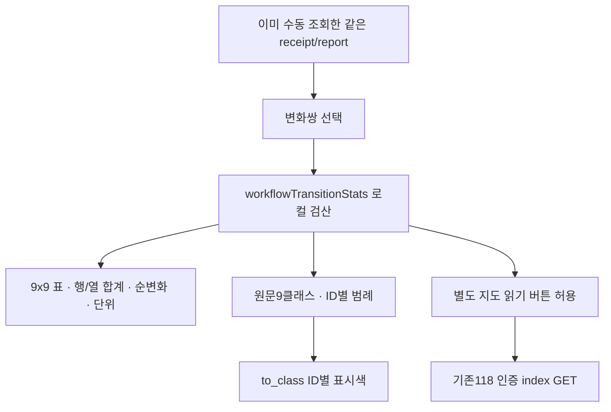

# Gate119 — 전이행렬과 지도 범례를 같은 보고서에 연결

| 필드 | 값 |
|---|---|
| updated_at | 2026-10-18 01:52:34 KST — 119 최종 프론트·build·실제 브라우저·보존 근거 반영 |
| source_commit | 기준 984666cac6529f6034fab84171461dbf7c51f8b6 + 119 작업파일 SHA (미커밋); 운영 승인과 별도 |
| evidence_paths | `frontend/src/lclucTransitionAdapter.ts`; `frontend/src/LclucTransitionSummary.tsx`; `frontend/src/LclucWorkflowChangeMap.tsx`; `frontend/src/lcluc-workflow.css`; `evidence/integration/lcluc-transition-adapter-focused-final-20261018.log`; `evidence/integration/lcluc-transition-ui-related-20261018.log`; `evidence/integration/lcluc-transition-independent-20261018.log`; `evidence/integration/lcluc-transition-generated-fixture-20261018.json`; `docs/implementation/119_lcluc_transition_matrix.md`; `evidence/integration/lcluc-transition-ui-tests-20261018.log`; `evidence/integration/lcluc-transition-ui-build-20261018.log`; `evidence/integration/lcluc-transition-ui-build-initial-20261018.log`; `evidence/integration/lcluc-transition-browser-20261018.json`; `evidence/integration/lcluc-transition-live-integrity-20261018.json`; `evidence/integration/lcluc-transition-matrix-final-20261018.png`; `evidence/integration/lcluc-transition-class-map-20261018.png` |
| confidence | 완료 소스·최종 로그·실제 CPU 보고서/브라우저 확인; 산술 정합과 과학 승인 구분 |
| status | TESTED_SYNTHETIC 저장 통계 검산·표시; 독립 정확도/운영 승인 BLOCKED |

## 쉬운 설명

지도 옆에 ‘무엇에서 무엇으로 바뀌었는가’를 보여 주는9×9 장부를 붙였다. 행은 이전 연도의 클래스이고 열은 이후 연도의 클래스다. 같은 클래스 칸은 유지, 다른 클래스 칸은 변화다. 장부의 합계와 보고서의 전체 수치가 맞을 때만 표와 지도 읽기를 허용한다. 합계가 맞는 것은 독립 정답 평가와 다르다.

## 이론적 배경

픽셀 행렬 P의 P[i,j]는 이전 클래스i에서 이후 클래스j가 된 유효 픽셀 수다. 행 합계는 이전 분포, 열 합계는 이후 분포다. 면적 행렬 A의 열 합계에서 행 합계를 빼면 클래스 순변화다. A의 비대각 합계는 변화 면적이며 전체 면적으로 나눈 값이 면적 기준 변화율이다. 분모0이면 변화율은null, ‘정의되지 않음’으로 표시한다.0%로 추정하지 않는다.

픽셀 수와 면적은 별도 집계다. 면적 방식은 보고서의 투영 격자 또는 타원체 측지 방식만 받는다. ha 표시는 m²를10000으로 나누는 단위 변환이며 새 공간 면적 재계산이 아니다. 면적 합계의 오차는 max(1e-6m²,1e-8×max(1,전체m²)), 무차원 변화율 오차는1e-8을 적용한다. 면적 오차를 비율 허용오차로 재사용하지 않는다.

## 실제 구조와 코드

`workflowTransitionStats`는118의 pair binding을 재사용한다. report와 해당 pair의 class_names9개가 순서와 원문까지 같아야 한다. 같은 이름도 숫자 ID로 구분하며 새 모델 분류 정의를 만들지 않는다.9×9 픽셀은 음수 없는 안전 정수, 면적은 유한한 음수 없는 수로 검사한다. 픽셀/면적0의 대응·전체 픽셀합·전체/변화 면적합·순변화·변화율과 statistics_basis를 대조한다. 반환 행렬/클래스 배열은 원문과 분리한 복사본이다.

`LclucTransitionSummary`는 픽셀/m²/ha 선택,9×9 표, 이전·이후 합계, 순변화, 실제 원문 클래스 이름과 ID별 범례를 표시한다. 화면 면적은 소수6자리까지 반올림하지만 검산은 원래 수치로 한다. 지도 fill은 to_class ID의 고정 palette를 쓴다. palette는 시각화 색상이며 공식 taxonomy·모델 성능·과학 승인 의미가 아니다.

선택 시 이미 읽은 보고서를 메모리에서 검산하므로 새 GET이나 추론은0이다. 지도 GeoJSON은118처럼 별도 버튼을 눌러야 읽는다. 검산 오류이면 표와 지도 읽기를 거부하고 값을 추정·보정하지 않는다. 기존 상단 지도/KPI·다른5모델은 바꾸지 않는다.

## 전체 래스터와 벡터의 차이

행렬과 합계는 전체 유효 래스터 기준이다. 최대5000개로 잘린 지도 도형을 합산한 통계가 아니다. vector_truncated는 별도 경고로 표시한다. 지도에 변화 도형이0개여도 유효 래스터와 유지 대각선 통계는 있을 수 있다. 빈 지도만으로 전체 면적0이나 모델의 정확함을 추정하지 않는다.

## 시험과 현재 범위

완료 로그에서 adapter12 PASS/0.427초, UI 합동21 PASS/1.681초(12+9), 독립8 PASS/0.604초를 읽었다. Root는 기존 생성3연도 CPU 보고서로 방향·256픽셀·25600m²·순변화±25600, 유지 pair의 변화0, 단위/분모0·오염 거부를 독립 검산했다. 생성 영상·손으로 정한 미학습 모델·명시 mock admission이며 운영 자료나 독립 정확도 시험이 아니다.

최종 전체 frontend250 PASS/29.208초·build104 modules/19.37초/종료0을 확인했다. 합동21(12+9)/1.681초·독립8/0.604초는 반복/교차 근거이며 전체에 더하지 않는다. backend1170/1169 PASS/기존1SKIP는118의 이전 회귀이며 이번에는 재실행하지 않았다. 이번 backend/API/Store/client·118 adapter는 바뀌지 않았다.118의 전체 backend1170건/1169 PASS/기존1SKIP/389.307초는 이전 회귀 근거이며 이번 새 시험으로 표현하지 않는다.

## 실제 브라우저·초기 실패·보존

임시 UI5175/API8003에서 pair를 고르기 전 행렬이 없고,2020-2021 선택 후 trees행→grass열256픽셀, m²에서는25600, ha에서는2.56을 확인했다. trees 순변화−2.56ha·grass+2.56ha, 실제 원문9클래스와 grass의 ID2 연두색 Polygon도 확인했다. 이 값은 생성16×16 영상 결과이지 사업지역의 실제 변화 면적이 아니다.

2021-2022는 grass 이전/이후2.56ha·순변화0·변화율0이며0도형 안내 뒤에도 행렬은 유지됐다.2020-2022 첫해/마지막해 표와 pair 변경 시 이전 지도 제거, 뒤로 가기 뒤 예전 표/지도 미표시도 확인했다. 모바일·강제 지연·인증 Bearer·오염 행렬·분모0null 보고서·truncated=true는 실제 브라우저 재현하지 않았다. 해당 예외/경고는 단위·소스 계약 근거와 분리한다.

최초 build는 MapLibre match 표현식의 동적 spread가 필요한 tuple 타입을 충족하지 못해 TS2352로 실패했다. 명시9개 ID/color tuple로 고쳐 최종 build를 통과했고 초기 로그를 보존했다. 기존 bundle 크기 경고는 남으며 최종 빌드 실패가 아니다.

보호141참조·이전증거952파일·catalog14기록은 불변이다. 기존소스269개 중 허용한 지도 component와 scoped CSS2개만 변경됐고 backend/API/client·118 adapter는 불변이다. 운영 수집·학습·등록·배포·Workflow dispatch는0이다. 보존은 이 추적 범위의 확인이며 전체 호스트나 원자 snapshot 인증이 아니다.

## 한계와 후속

장부 합계의 일관성 ≠ 독립 정확도·실출처 권위·기관 승인이다. 현재 Draft·후보4차단·독립 라벨/외부5실행자료 부재·6밴드 per_scene·구름mask·표준Result·운영RAG/staging/보안/UAT 공백을 해소하지 않았다. 원본·모델·분할·원장/lock·예약136314880B는 보존하고 운영 수집·학습·등록·배포·실행0을 유지한다.

## 발표 대본

### 1분

“지도 옆에 변화의 내역서를 붙였습니다. 행은 이전 클래스, 열은 이후 클래스이고 같은 클래스 칸은 유지입니다. 픽셀과 면적을 따로 합산하고 이전·이후·순변화가 보고서와 맞는지 확인합니다. 면적은 제곱미터와 헥타르로 바꿔 볼 수 있습니다. 이름은 실제 보고서의9개 원문을 쓰고 색은 숫자 ID별 표시용입니다. 잘린 지도 도형과 전체 래스터 통계를 혼합하지 않습니다. 작은 시험 보고서의 계산 일관성을 확인한 것이며 실제 원본의 독립 정확도나 운영 승인은 여전히 별도입니다.”

### 5분 순서

첫1분은9×9 장부 비유와 행/열 방향을 설명한다. 다음1분은 행/열 합계·순변화를 보여준다. 세번째1분은 픽셀/m²/ha와 분모0을 설명한다. 네번째1분은 실제 보고서 원문 클래스·색상과 전체 래스터/일부 벡터 차이를 설명한다. 마지막1분은 새 조회 없는 로컬 검산·오류 거부·시험과 운영 승인 차이를 말한다.

### 10분 확장

‘행렬의 방향’, ‘합계와 순변화’, ‘단위와 오차’, ‘지도와 범례’, ‘검증의 범위’ 다섯 장에 오염 회귀2분·면적/비율 오차1분·분모0/빈 지도1분·Q&A1분을 추가한다.

## Q&A

Q. 행과 열을 바꾸어 읽어도 되나? A. 아니다. 행은 이전, 열은 이후다. 순변화는 이후에서 이전을 뺀 값이다.

Q. ha로 바꾸면 새 분석인가? A. 아니다. 이미 검산한 m²를10000으로 나누어 표시한다.

Q. 색상이 공식 분류 규칙인가? A. 아니다. 원문 클래스 이름을 유지하고 숫자 ID에 정한 표시색을 붙인다.

Q. 합계가 맞으면 모델이 정확한가? A. 내부 산술 정합일 뿐이다. 독립 정답과 과학 승인 검증은 별도다.

Q. pair를 고를 때마다 서버를 실행하나? A. 아니다. 이미 받은 보고서를 로컬 검산한다. 지도 파일도 별도 버튼을 눌러야 GET한다.

## 근거 바로 열기

[구현 설명](../../implementation/119_lcluc_transition_matrix.md) · [최종 프론트 시험](../../../evidence/integration/lcluc-transition-ui-tests-20261018.log) · [브라우저 관측](../../../evidence/integration/lcluc-transition-browser-20261018.json) · [보존 근거](../../../evidence/integration/lcluc-transition-live-integrity-20261018.json)
