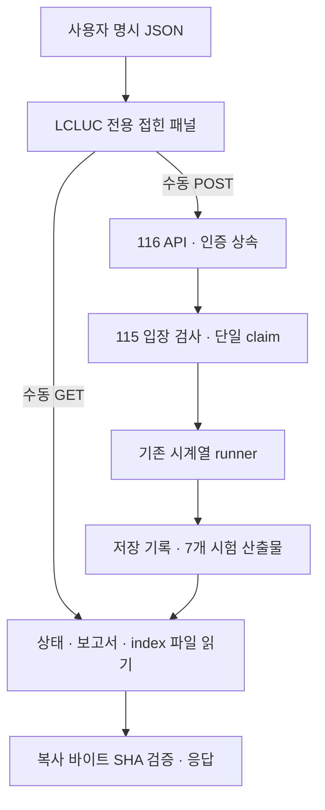

# Gate116/117 — LCLUC 실행기를 수동 API와 화면에 연결

| 필드 | 값 |
|---|---|
| updated_at | 2026-10-18 01:19:39 KST — 116/117 최종 전체·브라우저·보존·CSS build 반영 |
| source_commit | 기준 b5b18ebbef60faf61871a5ae20020504c136c710 + 116/117 작업파일 SHA (미커밋); 운영 적용은 별도 |
| evidence_paths | `backend/app/lcluc_workflow_api.py`; `backend/app/main.py`; `tests/test_lcluc_workflow_api.py`; `frontend/src/LclucWorkflowPanel.tsx`; `frontend/src/lclucWorkflowAdapter.ts`; `frontend/src/lclucWorkflowClient.ts`; `frontend/src/lcluc-workflow.css`; `frontend/src/ModelAnalysisWorkspace.tsx`; `docs/implementation/116_lcluc_workflow_api.md`; `docs/implementation/117_lcluc_workflow_ui.md`; `evidence/integration/lcluc-workflow-api-focused-final2-20261018.log`; `evidence/integration/lcluc-workflow-api-independent-tests-20261018.log`; `evidence/integration/lcluc-workflow-api-route-preservation-tests-20261018.log`; `evidence/integration/lcluc-workflow-ui-related-final-20261018.log`; `evidence/integration/lcluc-workflow-ui-tests-final-20261018.log`; `evidence/integration/lcluc-workflow-ui-build-final-20261018.log`; `evidence/integration/lcluc-workflow-ui-browser-20261018.json`; `evidence/integration/lcluc-workflow-api-live-integrity-20261018.json`; `evidence/integration/lcluc-workflow-api-live-route-20261018.json`; `evidence/integration/lcluc-workflow-ui-related-final3-20261018.log`; `evidence/integration/lcluc-workflow-ui-tests-final2-20261018.log`; `evidence/integration/lcluc-workflow-ui-build-final2-20261018.log`; `evidence/integration/lcluc-workflow-api-full-tests-20261018.log`; `evidence/integration/lcluc-workflow-api-related-20261018.log`; `evidence/integration/lcluc-workflow-ui-build-final3-20261018.log`; `evidence/integration/lcluc-workflow-ui-synthetic-desktop-final2-20261018.png` |
| confidence | 완료 소스·최종 로그·실제 임시 서버 브라우저 근거 확인; 모의 승인과 운영 과학 승인 구분 |
| status | API/UI 연결 TESTED_SYNTHETIC·실제 로컬 브라우저 확인; 운영 원본 실행/과학 승인 BLOCKED |

## 쉬운 설명

115에서 만든 실행기에 접수 창구와 결과 열람 창을 붙였다. 사용자가 고정 모델과 연차 자료를 직접 제출하면 기존 실행기가 실제 계산한다. 상태 확인과 보고서·파일 받기는 과거 실행을 읽는 기능이다. 창구가 열렸다는 이유로 현재 Draft 모델이나 원본 자료를 승인한 것은 아니다.

## 이론적 배경

실행과 조회를 나누면 결과 열람이 새 추론을 일으키지 않는다. 요청 지문과 저장 입력을 묶으면 다른 주문의 응답을 잘못 표시하는 일을 줄인다. 다운로드는 저장 허용목록의 번호로만 요청하며, 서버가 복사한 바이트의 SHA를 검사해 전송한다. 지문 일치는 파일 무결성 근거이며 기관 권위·과학 성능 인증과 다르다.

## 실제 구조

## 코드와 입력 → 처리 → 출력

- `create_lcluc_workflow_router(get_store)`는 기존 Store를 받아 새 네 경로를 연결한다. main은 router import/include만 추가한다. core115는 그대로다.
- `POST /v1/lcluc/workflows`는 exact6 JSON과 16KiB 상한을 검사하고 threadpool에서 실행한다. 완료까지 기다리는 동기 요청이며 background queue가 아니다.
- `GET /v1/lcluc/workflows/{id}`는 저장 상태만 읽고 성공 산출물 전체의 현재 SHA를 확인한다. RUNNING/FAILED를 자동 재시작하지 않으며 admission을 다시 판정하지 않는다.
- `/{id}/report`는 같은 실행의 연도·checkpoint·경로와 결합된 원문 timeseries JSON을 반환한다. `/{id}/assets/{index}`는 허용목록의 0-based 번호 파일만 attachment로 보낸다.
- `LclucWorkflowPanel`은 LCLUC 화면에만 기본 접혀 있다. 빈 JSON/조회 ID에서 시작하며 위 지역·연도에서 참조를 자동 추정하지 않는다. 기존 SVG·6개 모델 레이아웃을 유지한다.
- `prepareWorkflow/workflowResponse`는 요청·ID·snapshot 결합을 검사한다. `workflowFetch/workflowAsset`는 기존 API origin과 탭 세션 Bearer를 사용한다. Windows 경로 표기는 보존하되 URL에는 경로 대신 ID와 index를 쓴다.

## 상태를 읽는 법

| 관측 | 의미 |
|---|---|
| POST409 BLOCKED receipt | 실행 전 차단. claim/분석 출력이 없으므로 같은 ID의 GET은404 |
| POST409 error | 같은 키의 다른 요청 등 고정 오류. 차단 receipt와 구별 |
| RUNNING200 | 실행 중 또는 중단 후 미완료 기록. 자동 재개 없음 |
| FAILED200 | 실패 기록. HTTP200을 계산 성공으로 해석하지 않음 |
| SUCCEEDED200 | 로컬 실행 완료. 과학 인증 false·표준 GMAIS Result false |
| replayed true | 과거 기록 읽기. 현재 모델의 새 실행 승인 아님 |

## 파일·인증·늦은 응답

허용 파일은 동일 실행 namespace 아래 기록된 산출물뿐이다. 경로 이탈·symlink/junction·변조·읽는 중 성장을 거부한다. 상태 검사의 합산 상한은256MiB, 파일 하나64MiB, report8MiB다. 이미 검증한 복사 바이트를 응답하므로 이후 원본을 다시 여는 FileResponse와 다르다. 동시 요청 전체의 RSS·CPU·시간 hard cap이나 파일/DB 원자 snapshot을 제공하지 않는다.

기존 전역 인증을 상속한다. 토큰 미설정 시 기존 로컬 선택적 인증도 유지되므로 기관 RBAC를 새로 완성한 것은 아니다. no-store/nosniff와 고정 안전 오류를 사용한다. UI의 입력 편집·이동·뒤로 가기·표시 중단은 늦은 응답 표시만 폐기한다. 이미 시작한 서버 추론 취소·파일 삭제·DB rollback이 아니다. 자동 polling/POST/retry/resume은 없다.

## 시험 증거와 현재 범위

완료 로그를 읽었다. API 집중15 PASS/18.676초, 독립23 PASS/20.003초(기존17+별도6), 기존 route 보존24 PASS/2.756초다. 최종 새 UI15 PASS/12.831초, 전체 frontend206 PASS/24.216초, 최종 build100 modules/13.01초다. scoped hover/focus CSS만 마지막에 보완해 build를 재확인했다. TS 동작은 바뀌지 않았으며 초기14/205와27.25/20.80초 build는 이전 로그로 보존한다. 반복·교차 검증을 합산해 새 전체 건수로 만들지 않는다. 초기/중간 API 시험 오류와 최종 로그는 구분해 보존한다.

명시 mock admission의 TempStore와16×16 두 연도 영상에서 실제 CPU 추론·7개 산출물·상태/보고서/파일 SHA를 검증했다. 운영 원본이나 실제 독립 평가를 사용한 성공이 아니다. Root 임시 서버5175→8003 실제 브라우저 연결과 보존 근거를 확인했다. 최종 전체 backend1168건 중1167 PASS·기존 Windows symlink 권한1 SKIP/406.540초/종료0이다. API 집중15/18.676초·관련59/29.615초·독립23/20.003초·기존 route24/2.756초는 반복·교차 근거이며 전체에 더하지 않는다. 기존5174에는 패널과 잘못된 빈 요청의 제출 비활성화를 확인했으며 운영 원본으로 성공 실행하지 않았다.

## 실제 브라우저와 보존 확인

임시 UI5175→API8003에서 명시 POST가 SUCCEEDED·7개 산출물을 반환했다. 승인 metadata는 mock이고 입력은 생성한16×16 두 연도 영상이다. 실제 브라우저에서 historical 조회의 replayed true, 2020/2021 보고서·유효256픽셀·변화0m²를 확인했다. 전환표 CSV936B의 SHA는 저장 receipt와 일치했다. 이는 fixture의 계산 결과이며 실제 사업지역 변화가0이라는 뜻이 아니다.

뒤로 가기 뒤 이전 receipt가 남지 않았고 다른5개 모델에는 패널이 없었다. 기존5174 사용자 탭과 운영 자료를 보존하면서 새 패널·잘못된 빈 요청 제출 비활성화를 확인했다. 기존8002 API에서는 없는 ID404·빈 JSON400만 확인했으며 운영 dispatch는0이다. 브라우저 fixture는 토큰이 비어 있었고 인증401은 격리 API 시험 근거다. 모바일·강제 지연 응답 주입은 실제 브라우저에서 시험하지 않았다.

보호141참조·이전증거889파일·catalog14기록은 불변이다. 기존 추적소스258개 중 허용한 main 배선·Workspace mount·기존 AST 보존 시험2개만 바뀌었고 나머지는 불변이다. 전체 workspace 무변경이나 운영 독립 승인으로 확대하지 않는다.

## 한계와 다음

현재 Draft·독립 검증 라벨 미제공·후보QA4차단은 유지한다. global 정규화 경로만 지원하며 현재6밴드 per_scene 제품 정규화·구름mask는 차단/후속이다. 선택 변화쌍 지도는118 후보이며 이번에는 표와 파일 열람만 연결한다. generic DAG·표준 GMAIS Result·기관 승인·RAG·K8s staging·보안/UAT 완료가 아니다. 외부5개 모델 실행자료 미제공과 원본·원장/lock·예약136314880B 보존도 유지한다.

## 발표 대본

### 1분

“이번에는 LCLUC 실행기에 사용자가 직접 요청하는 화면과 API를 붙였습니다. 고정된 모델과 연차 자료를 제출하고, 실행 상태와 보고서, 검증된 파일을 수동으로 확인합니다. 상태 조회는 추론을 다시 돌리지 않습니다. 작은 시험 영상의 계산은 실제지만 승인 도장은 임시 장부의 모의 자료입니다. 현재 Draft 모델과 원본 자료를 운영 실행하거나 과학적으로 승인한 것은 아닙니다. 입력을 바꾸거나 화면을 떠나면 늦은 결과 표시를 버리지만 서버 계산을 취소하지는 않습니다. 지도 변화쌍과 현재6밴드 제품 정규화는 후속입니다.”

### 5분 발표 순서

접수 창구 비유와 실행/조회 차이를1분, 고정 요청·입장 검사·claim을1분 설명한다. 상태표의409/200·재관측을1분, 보고서/파일 검증·실제 작은 추론과 mock 승인의 차이를1분 설명한다. 마지막1분은 화면 중단과 서버 취소의 차이, 과학·지도·6밴드 후속을 설명한다.

### 10분 확장

슬라이드는 ‘고정 주문’, ‘실행과 조회’, ‘검증 파일’, ‘시험의 범위’, ‘남은 승인’ 다섯 장으로 구성한다. 위5분에 인증·변조/성장 경계2분, 늦은 응답1분, 자원/원자성 한계1분, Q&A1분을 추가한다.

## Q&A

Q. 화면에서 현재 원본을 실행했나? A. 아직 운영 원본 실행은0이다. 성공 시험은 임시 자료와 명시 mock 승인으로 분리한다.

Q. 상태 조회가 새 실행인가? A. 아니다. 저장 기록과 산출물 SHA를 읽는 historical GET이다.

Q. HTTP200이면 성공인가? A. 아니다. RUNNING/FAILED도200이며 receipt 상태를 읽어야 한다.

Q. 표시 중단은 취소인가? A. 아니다. 화면의 늦은 응답만 버리고 서버 작업은 취소하지 않는다.

Q. 이제 지도와6밴드·표준Result도 완료인가? A. 아니다. 이번은 local 실행 접수와 읽기 UI이며 나머지는 별도 후속이다.

## 근거 바로 열기

[API 구현 설명](../../implementation/116_lcluc_workflow_api.md) · [UI 구현 설명](../../implementation/117_lcluc_workflow_ui.md) · [브라우저 관측](../../../evidence/integration/lcluc-workflow-ui-browser-20261018.json) · [최종 전체 시험](../../../evidence/integration/lcluc-workflow-api-full-tests-20261018.log)

마지막 scoped hover/focus 보완은 글자 대비를 위한 CSS 변경이다. 최종 build100 modules/13.01초를 확인했다. 같은 TS 동작의 프론트206 PASS/24.216초와 신규15 PASS/12.831초를 다시 실행한 것으로 꾸미지 않고 유지한다. 브라우저 hover의 배경/글자 대비도 Root가 확인했다. 기존 bundle 크기 경고는 남으며 빌드 실패가 아니다.
