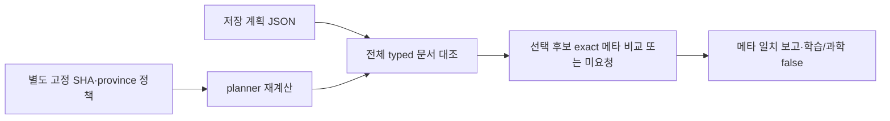

# Gate ML Split Plan Validation 20261017 — 저장 계획의 독립 검산

| 필드 | 값 |
|---|---|
| updated_at | 2026-10-17 23:36 KST — Git 상태 메타데이터 정정; 본문은 해당 Gate 기준 |
| source_commit | d474d5bce6c2a6c4bd8ba141c9256d15f6004631 (108까지 구현 검토 기준; 이 메타데이터 정리는 후속 문서 커밋) |
| evidence_paths | `backend/app/ml/split_validation.py`; `scripts/validate_training_split_repair.py`; `docs/implementation/44_ml_split_repair_validation.md`; `evidence/integration/ml-split-validation-tests-20261017.log`; `evidence/integration/ml-split-validation-independent-20261017.log`; `evidence/integration/ml-split-validation-full-tests-20261017.log`; `evidence/integration/ml-split-repair-validation-live-final-20261017.json`; `evidence/integration/ml-split-validation-live-integrity-20261017.json` |
| confidence | 코드·합성시험·실자료메타재계산/최종명령근거; raster/공간/과학미검증 |
| status | VERIFIED_REAL: 메타대조·CLI; TESTED_SYNTHETIC: 변조/경계시험; 학습 BLOCKED |

## 한 문장·1분 비유

저장된 견적서를 그 안의 숫자만 믿지 않고 원장과 별도 계산식으로 다시 검산했다. 실제 재료의 상태를 다시 측정하거나 작업을 시작한 것은 아니다. 계획 무결성과 학습 준비도를 구분한다.

## 왜·이론·5분 흐름

저장계획이 source SHA·정책까지 조작됐다면 자체기재값만 믿는 검사는 의미가 작다. 호출자가 독립 고정한 source/readiness SHA·province split로 기존 planner를 재실행하고 문서 전체를 비교한다. 키순서는 무관하지만 키집합·배열순서·원소·타입은 정확히 같아야 한다. true/1·1/1.0을 구분하고 중복키·비유한JSON·미지필드/실행플래그 변조를 거부한다.

## 코드·입력·후보·출력

`backend/app/ml/split_validation.py:validate_split_repair_plan`, `load_json_document`, CLI `scripts/validate_training_split_repair.py`가 구현이다. `--plan`은독립실험정책파일이며 `--saved-plan`과다르다. 정책도strict JSON·전후SHA를검사한다.

후보path/SHA를함께주면원본보존row/index/순서·lineage·후보버전/status·executed/learning_ready=false까지예상문서와대조한다. 후보를생성/발행하지않는다. 미지정이면NOT_REQUESTED/candidate_integrity_valid=null/reference=null이며존재판정이아니다. 명시파일부재는실패다.

입력경로는서로달라야하고전후SHA·재계산중변경을검사한다. 기본은stdout,새evidence출력은프로젝트evidence안의exclusive create만허용하며입력/기존파일/바깥경로덮어쓰기를거부한다. evidence는UTF8,console은ASCIIescape로CP949를지원한다. 순차관측검사는OSlock·원자적snapshot·검사후불변성보장이아니다.

## 실제 결과·실패 보완

원본source의year문자열기존계약과정수전용검사가충돌했다. 원본을고치지않고정수/ASCII4자리문자열을허용하고bool/float/잘못된문자열은거부했다. 이어메타대조/UTF8evidence저장성공후CP949stdout에서경로문자출력이실패했다. ASCIIescape stdout/stderr 회귀를추가했다.

최종 `ml-split-repair-validation-live-final-20261017.json`은CP949명령exit0·METADATA_INTEGRITY_VERIFIED근거다. 초기live파일은메타대조후콘솔실패의중간이력이다. 최종계획예상은제외16·적격1,095/train628·val217·test250이고원본은1,111/628·233·250불변이다. 후보는이번명령에서미지정/미발행이며NOT_REQUESTED는존재확인이아니다.

raster_files_rehashed/spatial_overlap_rechecked/exact_class_counts_recomputed/ready_for_training/training_executed/scientific_accuracy_validated는false다. bare부족·공간누출재검사·독립라벨/전문가승인과학습gate는남는다.

## 시험·보존·UI 영향

관련17 PASS/7.544초·독립17 PASS/8.900초,전체338건/113.601초/OK(skipped=1)=337 PASS·1 SKIP다. 독립시험을전체에중복합산하지않는다. 기존OSsymlink권한1SKIP/mock경계PASS를구별한다. 보호6SHA(원본Catalog/원장/manifest/readiness/upstreamOpenAPI/기존계획)는불변이다.

새공개API·navigation/화면상태계약없는내부읽기CLI라이번UI수정·브라우저재검증은불필요했다. 직전UI49PASS/독립49·build69modules18.53초는기존카탈로그단위근거다. 향후API/UI노출은계약인계와실제화면검증을별도완료해야한다.

fresh복구조사/기존계획재검증도VALID_BLOCKED·실행false다. pending2건terminal/source쌍이없어예약136,314,880B를보존하고원장/lock·수집/학습은바꾸지않았다. 정확히한번정산하는coordinator와완전계측은후속이다.

## 발표·10분 확장·질문

30초: “계획서는 독립 검산으로 맞음을 확인했지만 실제 자료는 바꾸지 않았습니다. 후보 발행과 raster·공간·클래스 준비성 검사는 다음 단계이며 학습 승인은 그대로 차단입니다.”

1분/5분대본은[발표문서](../presentations/1MIN_5MIN_SCRIPT.md)의최신절을쓴다.10분은typed equality·후보미요청·순차SHA한계·CP949중간실패/최종명령·학습gate를확장한다.

Q1.1,095가새재고인가? A. 계획예상이며원본1,111불변이다.

Q2.null이면후보없음인가? A. 미요청이다.

Q3.메타성공이면학습가능? A. raster/공간/클래스/승인은별도다.

Q4.처음파일도성공인가? A. 메타성공후stdout실패여서최종명령근거는final이다.

Q5.왜UI안바뀌나? A. 공개API/화면계약이없는내부단위다.

[DEMO](../presentations/DEMO_STORY.md)의계획검증읽기시연을사용한다. 코드·설계/사용법·시험·인계·이해자료를같이갱신하고전체개발·10분보고는유지한다.
