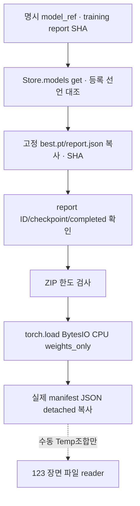

# Gate124 — 고정 모델 파일에서 실제 checkpoint manifest를 읽기

| 필드 | 값 |
|---|---|
| updated_at | 2026-10-18 02:47:32 KST — 124 최종 독립·실제 임시 checkpoint·보존 근거 반영 |
| source_commit | 기준 816515ead72faa53eda2e96a9826748aed0896f7 + 124 작업파일 SHA (미커밋); 실행 gate 변경 없음 |
| evidence_paths | `backend/app/ml/model_checkpoint_manifest.py`; `tests/test_model_checkpoint_manifest.py`; `backend/app/ml/per_scene_normalization_files.py`; `evidence/integration/model-manifest-read-agent-focused-final-20261018.log`; `evidence/integration/model-manifest-read-root-related-20261018.log`; `evidence/integration/model-manifest-read-runtime-20261018.json`; `evidence/integration/model-manifest-read-live-integrity-20261018.json`; `docs/implementation/124_model_checkpoint_manifest.md`; `evidence/integration/model-manifest-read-independent-20261018.json`; `evidence/integration/model-manifest-read-independent-20261018.log`; `evidence/integration/model-manifest-read-agent-focused-20261018.log` |
| confidence | 완료 소스·최종14/관련40/독립8·실제 Temp6시나리오·보존 확인; 모델 manifest와 state/승인 구분 |
| status | TESTED_SYNTHETIC 고정 모델 checkpoint manifest 읽기; Dataset/Workflow/과학·실행 승인 BLOCKED |

## 쉬운 설명

123은 caller가 준 모델 설명을 믿고 세 역할 파일을 대조했다. 이번에는 모델 장부의 고정 ID·버전·두 파일 지문으로 실제 checkpoint를 찾아 그 안의 manifest를 읽는다. 보고서에 복사해 둔 input_signature를 모델 내부 설명의 대용으로 쓰지 않는다. 하지만 내부 설명을 읽었다고 가중치가 모델에 맞는지나 추론·승인을 검증한 것은 아니다.

이번 범위는 모델 참조 결합뿐이다. DatasetRegistry·장면별 파일·모든 연도·품질mask와 실행기 연결은 후속이다. Temp에서123과 수동으로 함께 호출한 것은 제품의 Workflow 연계 완료가 아니다.

## 이론적 배경

학습보고서의 서명 복사본과 checkpoint 안의 실제 manifest는 다른 근거다. 모델 장부의 버전 선언이 같은 checkpoint SHA·training-report SHA에 연결됐는지 확인하고, 그 지문과 일치하는 복사 바이트를 decode해야 원본 모델 파일의 manifest를 읽었다고 말할 수 있다. 다만 등록 metadata는 caller 진술이므로 기관 권위를 인증하지 않는다.

weights_only와 CPU 로드는 일반적인 실행 객체 복원을 줄이기 위한 제한이다. ZIP/바이트 한도를 더해도 악의적 tensor metadata의 CPU/RSS/시간 DoS를 모두 제거하는 sandbox는 아니다. 설치된 Torch와 호출 환경의 allowlist 정책을 상속하며 전역 목록을 지우거나 추가/교체하지 않는다. 신뢰할 수 있는 내부 파일에 한정하는 경계를 유지한다.

## 실제 구조

## 코드·입력 → 처리 → 출력

`read_pinned_model_checkpoint_manifest(store, model_ref, training_report_sha256)`는 exact3 model_ref와 고정 SHA를 검사하고 models get1회로 등록 선언을 읽는다.100 provenance의 CONSISTENT_UNVERIFIED·원형 version·record checkpoint/report SHA가 요청과 같아야 한다. 부모 metadata 일치가 권위 인증은 아니다.

경로는 models/{id}/best.pt와report.json만 받는다.123의 root/path/snapshot reader로 checkpoint최대8MiB·report2MiB를 복사하고 SHA를 확인한다. report의 model ID·checkpoint SHA·completed와 선택 version을 확인한다. input_signature는 manifest 대용으로 읽지 않는다.

ZIP은 저장형 ZIP_STORED·단일 prefix·중복/경로이탈/암호화 없음·최대512멤버·개별8MiB·전체선언32MiB·data.pkl2MiB를 검사한다. 그 복사 바이트만 BytesIO에서 map_location cpu·weights_only=True로 load한다. tiny_unet 구조 이름과 dict 형식을 확인하고 manifest를 순수 JSON tree로 분리 복사한다. 깊이16·node65536·dict128키·문자열/정수/유한수·2MiB 예산을 검사하며 tensor/custom 객체·순환을 거부한다.

반환 status는 BLOCKED 또는 MANIFEST_BOUND_UNVERIFIED다. checkpoint_artifact_verified/training_report_artifact_verified는 역할별 bytes 확인 뒤 부분적으로true일 수 있다. 앞의 flag만true여도 전체 status가BLOCKED일 수 있으므로 두 flag만 보고 성공을 추정하지 않는다. state_dict_verified/source_authority_verified/scientific_accuracy_validated/execution_authorized/workflow_supported는 항상false다. state_dict를 load_state_dict로 대입하거나 shape 호환/forward·학습을 하지 않는다.

## 시험 증거와 실제 발견한 조건 오류

집중최종14 PASS/5.810초·관련40 PASS/7.241초(신규14+provenance12+123files14)를 읽었다. 최초 집중13건 중5실패는 새 코드가 Torch의 safe_globals 목록이 비어 있어야 한다고 잘못 가정한 조건 때문이다. 실제 Torch는 기본 등록을 포함했다. 그 guard를 제거하고 전역 allowlist를 추가/clear/replace하지 않는 방식으로 수정했다. 최초 로그를 보존하고 최종 통과와 구별한다.

Root는 Torch2.14.0+cpu에서 실제 미학습6밴드 TinyUNet checkpoint를 저장하고6시나리오를 확인했다. 실제 manifest가 report의 미끼 input_signature 대신 반환됐고,123의 Temp GeoTIFF/근거와 수동 조합해도 실행flag는false였다. 반환값을 바꿔도 다음 읽기는 원본 manifest를 유지했다. checkpoint/report bytes 변조와 원형 패딩 version 불일치를 거부했다. 모델 forward·학습·운영 checkpoint 로드는0이다.

보호141참조·기존소스281개 전체·이전증거1035파일·catalog14·예약136314880B는 불변이다. 최종 독립8 PASS/0 SKIP/1.921초·종료0과 구현 문서124를 확인했다. 집중14/관련40·독립8·Temp6시나리오는 반복/교차 근거이며 새 전체 시험 수로 합산하지 않는다. 이번 신규 내부 reader는 API/UI/기존 Workflow에 연결하지 않았고 기존 제품 소스가 불변이라 전체 backend/frontend/build/browser는 재실행하지 않는다.1184 backend/261 front는120/121 이전 이력이다.

## 독립 검증으로 확인한 실제 범위

독립8건은 실제 CPU checkpoint와 ZIP513멤버·legacy/압축/중복/traversal/data.pkl없음의 load 전 거부, unsupported class의 제한 load1회/False fallback없음, bad manifest tree·detached·같은 복사 BytesIO와 원형 Unicode 패딩 version을 확인했다. 설치 Torch2.14.0+cpu의 ambient safe_globals73개는 전후 불변이며 새 코드가 추가/clear/replace하지 않았다. 정상 실행 성능이나 기관 승인이 아니라 reader의 경계 시험이다.

state_dict가 없거나 비어 있어도 manifest 읽기만 성공할 수 있다. 따라서 architecture 이름과 actual manifest 추출을 가중치 호환/모델 정체·과학 성능 검증으로 표현하지 않는다. manifest.version이 Dataset 버전일 수 있으므로 모델의 명시 version과 같아야 한다고 새 조건을 발명하지 않는다. manifest 안의 caller 경로나 execution_authorized 같은 이름은 내부 metadata이며 외부 공개/승인 계약으로 자동 전달하지 않는다.

기존 핵심8개 소스와 tracked source 바이트가 모두 불변이다. API/UI/런타임 gate를 수정하지 않은 새 내부 reader이므로 신규·관련·독립·실제 Temp/보존 범위로 검증하고 전체 backend/프론트/build/browser는 이번에 다시 실행하지 않았다.

## 한계와 후속

실제 checkpoint manifest 결합은 완료 범위지만 DatasetRegistry·123 scene·전연차·품질mask·학습/배포 gate 연결은 미구현 후속이다. 신고된 manifest의 물리적 의미나 실제 tensor 호환·학습성능·독립성·공식 제품 출처를 승인하지 않는다. 복사별 순차 snapshot은 다중파일/Store의 원자 시점 보장이나 모든 외부 writer 경쟁 제거가 아니다.

ambient allowlist를 상속하고 별도 프로세스 격리를 하지 않는다. weights_only·ZIP_STORED/멤버 상한이 악의적 tensor DoS·전체 CPU/RSS/time hard cap을 보장하지 않는다. 기존 global1~16밴드·per_scene 전달 미연결·Draft·후보4차단·독립 라벨/외부5실행자료 부재·원본/모델/원장/lock 보존을 유지한다.

## 발표 대본

### 1분

“이제 모델 장부의 고정 버전과 파일 지문으로 실제 checkpoint를 찾아 그 안의 설명을 읽습니다. 보고서에 복사된 설명을 대용으로 쓰지 않습니다. 다만 모델 내부 설명을 읽는 것과 가중치 호환성·추론·과학 승인은 다릅니다. 작은 임시 미학습 모델로 지문 변조와 설명 복사본의 독립성을 확인했고 실제 운영 모델은 열지 않았습니다. 장면과 모든 연도, 품질mask·Workflow 연결은 다음 일입니다. 안전한 읽기 한도가 있어도 악의적 파일에 대한 완전한 sandbox는 아니므로 신뢰할 수 있는 내부 파일이라는 경계를 유지합니다.”

### 5분 순서

첫1분은 보고서 복사본과 실제 모델 내부 설명을 구분한다. 다음1분은 Store 고정 version/SHA와 실제 두 파일 대조를 보여준다. 세번째1분은 ZIP/weights_only/manifest 분리를 설명한다. 네번째1분은 역할별true와 state_dict/승인false·임시6시나리오를 설명한다. 마지막1분은 Dataset/연차/mask 미연결과 sandbox 한계를 말한다.

### 10분 확장

‘고정 모델 찾기’, ‘실제 manifest’, ‘bytes와 weights의 차이’, ‘실제 실패와 수정’, ‘다음 연결 공백’ 다섯 장에 safe_globals 조건 오류2분·ZIP/manifest 예산1분·부분 flag/순차 snapshot1분·Q&A1분을 추가한다.

## Q&A

Q. report.input_signature를 돌려주는가? A. 아니다. SHA가 일치하는 checkpoint 복사 바이트에서 actual manifest를 읽는다.

Q. state_dict 호환과 추론도 검증됐나? A. 아니다. load_state_dict/forward를 하지 않았고 관련flag는false다.

Q. weights_only면 악성 모델에 완전히 안전한가? A. 아니다. ambient 정책을 상속하며 tensor DoS·시간/RSS hard cap 격리가 아니다.

Q.123과 조합했으니6밴드 Workflow도 연결됐나? A. Temp의 수동 조합일 뿐 제품 Dataset/연차/mask/Workflow는 미연결이다.

Q. 운영 checkpoint를 열거나 새 학습했나? A. 아니다. 실제 미학습 Temp checkpoint 저장/읽기만 시험했다.

## 근거 바로 열기

[구현 설명](../../implementation/124_model_checkpoint_manifest.md) · [독립 검토](../../../evidence/integration/model-manifest-read-independent-20261018.json) · [실제 Temp 대조](../../../evidence/integration/model-manifest-read-runtime-20261018.json) · [보존 근거](../../../evidence/integration/model-manifest-read-live-integrity-20261018.json)
