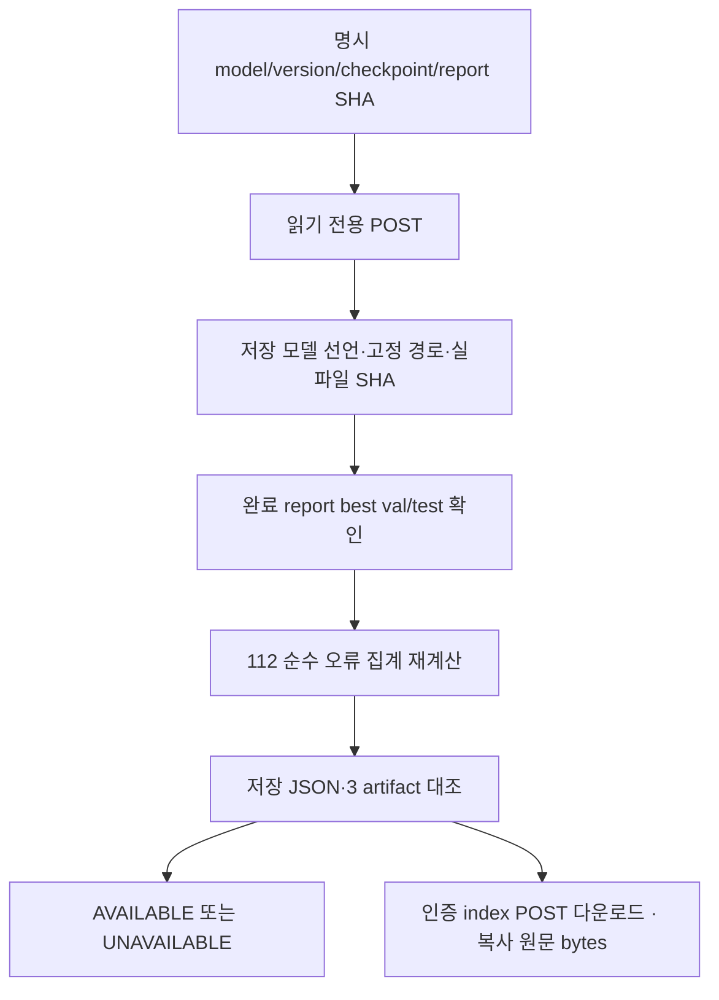

# Gate120/121 — 고정 모델의 오류 분석을 읽고 설명하기

| 필드 | 값 |
|---|---|
| updated_at | 2026-10-18 02:13:16 KST — 120/121 최종 전체·실제 임시/legacy 화면·보존 근거 반영 |
| source_commit | 기준 1be3014cfef3d50a940dacf0583155456a670350 + 120/121 작업파일 SHA (미커밋); 운영 승인은 별도 |
| evidence_paths | `backend/app/model_error_analysis_api.py`; `tests/test_model_error_analysis_api.py`; `backend/app/ml/error_analysis.py`; `docs/implementation/120_model_error_analysis_read.md`; `evidence/integration/model-error-analysis-api-focused-final-20261018.log`; `evidence/integration/model-error-analysis-api-related-20261018.log`; `evidence/integration/model-error-read-route-guards-20261018.log`; `frontend/src/ModelErrorAnalysis.tsx`; `frontend/src/modelErrorAnalysisAdapter.ts`; `frontend/src/modelErrorAnalysisClient.ts`; `frontend/src/model-error-analysis.css`; `docs/implementation/121_model_error_analysis_ui.md`; `evidence/integration/model-error-analysis-ui-related-final2-20261018.log`; `evidence/integration/model-error-analysis-ui-tests-final-20261018.log`; `evidence/integration/model-error-analysis-ui-build-final-20261018.log`; `evidence/integration/model-error-read-independent-20261018.json`; `evidence/integration/model-error-read-browser-20261018.json`; `evidence/integration/model-error-read-live-integrity-20261018.json`; `evidence/integration/model-error-read-backend-all-20261018.log` |
| confidence | 완료 소스·최종 로그·임시 HTTP/브라우저와 legacy 미확보 확인; 독립 과학 승인 아님 |
| status | TESTED_SYNTHETIC 오류분석 API/UI·실제 legacy pin 미확보; 독립 정확도/운영 승인 BLOCKED |

## 쉬운 설명

모델 성적표의 틀린 항목을 읽는 창구를 붙인다.112가 완료 학습 때 저장한 오류 JSON과 CSV를 모델 ID·버전·checkpoint·학습보고서 지문에 묶어 읽는다. 파일이 없으면 ‘미확보’라고 말한다. 새로 시험을 치르거나 없는 성적을0점으로 만들지 않는다. Draft의 과거 성적표 조회도 승인이나 배포는 아니다.

## 이론적 배경

이번 혼동행렬의 행은 참조 클래스, 열은 예측 클래스다.119의 행=이전/열=이후 전이행렬과 다르다. 클래스i의 TP는 대각선, FN은 참조 행합−TP, FP는 예측 열합−TP다. recall은 TP/참조 행합, precision은 TP/예측 열합이다. omission은 FN/참조 행합, commission은 FP/예측 열합이다. 각 분모가0이면 해당 비율은null·평가 불가이며0%로 채우지 않는다.

val은 best epoch 선택에 사용하고 test는 선택 뒤 고정 모델의 오류를 읽는다. test로 epoch를 다시 고르지 않는다. 참조가 약한 라벨이면 이 값은 그 참조와의 일치도다. 독립 전문가 정답 정확도·과학 승인과 같지 않다. 공간 오류지도나 새 독립 평가를 만든 것도 아니다.

## 구조

## 코드와 데이터 동작

`create_model_error_analysis_router(get_store)`는 기존 인증을 상속하고 caller Store의 models get만 사용한다. `read_model_error_analysis`는 exact3 요청(schema_version/model_ref/training_report_sha256)·16KiB·고정 ID/버전/SHA를 확인한다. 새 학습·추론·등록·Store 쓰기를 하지 않는다.

`POST /v1/models/error-analysis`는 고정 자료를 읽는 POST이며 실행 API가 아니다. `POST /v1/models/error-analysis/assets/{index}`는 같은 pins를 다시 검증해 JSON/클래스CSV/오분류쌍CSV의0/1/2번 파일을 반환한다. caller 파일 경로를 받지 않는다. 기존 models/{id}/best.pt·report.json·고정3파일만 지원하고 다른 이름을 추정하거나 누락 선언을 역채우지 않는다.

checkpoint는 최대64MiB SHA 읽기이며 torch 모델 로드는 하지 않는다. report와 artifact각각 최대8MiB, strict finite JSON·selected_epoch와 history validation의 typed 동치·완료 상태·model/checkpoint를 검사한다.112의 순수 집계로 저장 val/test 혼동행렬을 재검산하고 저장 error_analysis/JSON과 비교한다. 새 픽셀 예측이나 재평가는 아니다.

CSV는 SHA/size·고정 이름을 확인한 원문 바이트로 제공한다. formula escape를 유지하며 통계에서 CSV를 새로 직렬화해 동일성을 주장하지 않는다. no-store/nosniff·기존 Bearer 인증을 유지한다. 공개 오류는400/413/404/409/503의 고정 안전 envelope이며 원문 경로/예외를 노출하지 않는다.

## 상태·한계

AVAILABLE은 저장 자료의 pin/산술 정합이 확인됐다는 뜻이다. UNAVAILABLE이면 analysis=null/artifacts=[]이며 version 선언 부재 또는 오류분석 미확보를 구분한다. 없는 통계를0으로 채우거나 자동 생성하지 않는다. legacy 실제 모델에는 version 선언·reportSHA·오류분석 근거가 없다는 현재 사실과 합성 성공을 분리한다.

파일별 전후 size/mtime/inode/resolve·SHA와 namespace를 확인하지만 여러 파일/DB의 원자 snapshot·모든 TOCTOU를 제거하지 않는다. 위조한 metadata와 해시가 모두 일관될 수도 있어 기관 권위를 인증하지 않는다. 다운로드 때 다시 확인하므로 조회 뒤 변경되면 실패할 수 있다. 기관 RBAC·과학 승인·학습 준비도도 별도다.

## 시험 증거

120 집중최종14 PASS/2.695초·관련48 PASS/7.665초, Root 기존 route 보존24 PASS/4.333초 로그를 읽었다. TempStore·known9×9 confusion·임의 checkpoint bytes와 실제112 writer를 사용했고 모델 로드/학습0이다. 실제 파일/SHA/CSV와 nullable 통계·Draft 읽기·미확보/무생성·오염·안전 오류·동시 reader를 확인한 합성시험이다. 실제 junction을 만든 것이 아니라 platform predicate를 주입한 경계 시험이다. 최초12와 최종14는 중복 합산하지 않는다.

121 UI와 임시 실제 브라우저·보존 근거를 확인했다. 신규 UI11 PASS/4.141초·전체 frontend261 PASS/26.266초·build108 modules/21.85초다. 최종 전체 backend1184건 중1183 PASS·기존 Windows symlink 권한1 SKIP/399.529초/종료0이다. 신규 UI11 PASS/4.141초·전체 frontend261 PASS/26.266초·build108 modules/21.85초도 확인했다. 집중14/관련48/route24와 독립 live HTTP6개 점검은 반복·교차 근거이며 전체 건수에 더하지 않는다.6개 live HTTP 점검은 단위시험 건수로 합산하지 않는다.

## 121 실제 화면과 검증한 범위

`ModelErrorAnalysis`는 선택 모델에 기본 접힌 패널로 붙는다. 정확한 저장 version 선언·checkpoint/report SHA가 없으면 ‘고정 참조 미확보·artifact 존재 미확인’과 비활성 버튼을 표시한다. dataset_version이나 latest로 대체하지 않는다. 선택/패널 열기만으로 조회하지 않고 버튼을 누를 때만 읽기 POST한다.

클라이언트는 같은 pins·exact 응답·val/test의9개 클래스와 오분류쌍을 검산한다. 다운로드는 기존 세션 Bearer를 유지하고 fixed index에 같은 body로 요청해 실제 크기/8MiB/브라우저 SHA를 확인한 뒤 저장한다. 선택·pin·route/back/unmount 변경은 이전 결과와 늦은 응답을 폐기하며 서버 읽기 자체를 롤백하지 않는다.

임시5175→8003에서 구성한 보고서로 Validation 참조12·오분류5, water precision60%/recall75%, bare precisionnull·recall0%를 확인했다. Test 참조10·오분류3에서 bare 두 비율은null이다. null과 실제 분모가 있는0%를 구별하는 시험이며 사업 모델의 실제 성능 수치가 아니다. checkpoint는 실행 불가 opaque 시험 bytes로 모델 로드·학습·새 추론은0이다.

최종 JSON 다운로드12276B/SHA와 초기 CSV1616B/SHA를 확인했다. 선택/뒤로 가기 결과 제거와 최종 fixture console 오류0을 확인했다. 초기에는 두 sibling의 같은 key가 React 경고를 만들었고 신규 key만 errors: prefix로 고쳐 초기 로그를 보존했다. AVAILABLE 뒤에도 조회 전 미검증 문구가 남던 시제도 읽기 성공 시점 설명으로 고쳤다.

기존5174의 실제 legacy Draft는 saved report 파일은 있지만 version 선언·training_report_sha256·report.error_analysis가 없다. 고정 참조 미확보·조회 비활성화와 오류0을 확인했으며 실제 metric을0으로 추정하지 않았다. 모바일·브라우저 Bearer/강제 지연·취소·변조 asset 주입은 미재현으로 남긴다. 해당 경계는 client/단위시험과 분리한다.

보호141참조·이전증거974파일·catalog14기록·예약136314880B는 불변이다. 기존 source270개 중 허용한 main·ModelReview·기존 route AST 시험2개만 변경됐고 나머지는 불변이다. 운영 수집·학습·등록·배포·Workflow 실행은0이다.

## 발표 대본

### 1분

“완료된 모델이 어떤 클래스를 놓치고 어떤 클래스로 잘못 예측했는지 읽는 창구를 붙였습니다. 같은 모델 버전과 파일 지문에 묶인 과거 오류분석만 읽고 새 학습이나 평가를 하지 않습니다. 이번 표는 행이 참조, 열이 예측이라 연도 간 변화표와 다릅니다. 참조나 예측이 없어 계산할 수 없는 비율은 평가 불가로 남깁니다. 파일이 없으면 미확보이며0점으로 채우지 않습니다. 약한 라벨과의 일치도는 독립 정확도·기관 승인과 구분하고 현재 Draft와 학습 차단을 유지합니다.”

### 5분 순서

첫1분은 과거 성적표 읽기 비유와 실행 API 차이를 설명한다. 다음1분은 모델/버전/checkpoint/report SHA와3파일을 연결한다. 세번째1분은 행=참조/열=예측·TP/FN/FP·null을 설명한다. 네번째1분은 val/test·약한 라벨 일치도와119 전이표 차이를 설명한다. 마지막1분은 실제 legacy 미확보와 합성 성공, 원자성/승인 한계를 말한다.

### 10분 확장

‘고정 성적표’, ‘오류의 방향’, ‘놓침과 과검출’, ‘미확보와 평가 불가’, ‘승인과 읽기’ 다섯 장에 typed 오염/SHA 회귀2분·CSV 원문1분·TOCTOU/기관 권위1분·Q&A1분을 추가한다.

## Q&A

Q. POST면 학습/실행인가? A. 이번 endpoint는 pins로 저장 성적표를 읽는 POST이며 새 학습·추론을 하지 않는다.

Q. null은 정확도0%인가? A. 아니다. 참조나 예측의 분모가 없어 해당 비율을 평가할 수 없다는 뜻이다.

Q.119 변화표와 같은가? A.119는 이전→이후, 이번은 참조→예측 비교다.

Q. 약한 라벨 일치도가 높으면 독립 승인인가? A. 아니다. 독립 정답/전문가 평가와 운영 승인은 별도다.

Q. 실제 legacy 모델 파일이 없으면? A. 미확보로 표시하고 파일이나 수치를 자동 생성하지 않는다.

## 근거 바로 열기

[API 계약](../../implementation/120_model_error_analysis_read.md) · [UI 설명](../../implementation/121_model_error_analysis_ui.md) · [실제 화면 관측](../../../evidence/integration/model-error-read-browser-20261018.json) · [최종 전체 시험](../../../evidence/integration/model-error-read-backend-all-20261018.log)
