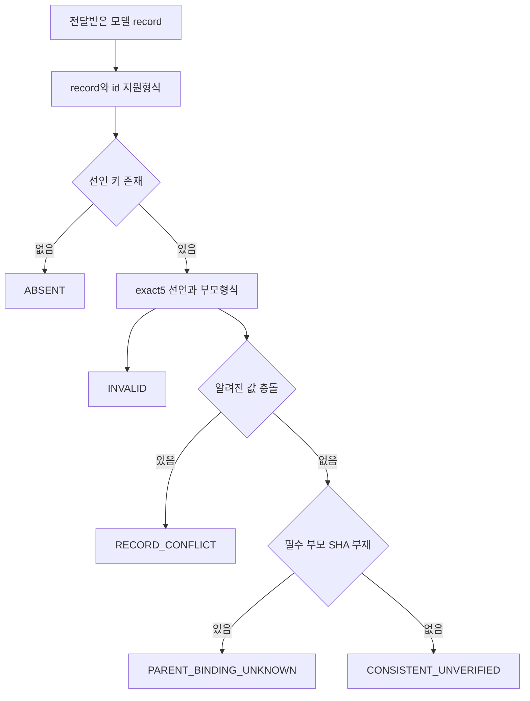

# Gate Model Provenance 20261017 — 등록 메모의 저장 metadata 관측

| 필드 | 값 |
|---|---|
| updated_at | 2026-10-17 23:36 KST — Git 상태 메타데이터 정정; 본문은 해당 Gate 기준 |
| source_commit | Git 연결됨; 문서 작성 시 변경분 미커밋, evidence snapshot SHA로 추적 (원격 기준 d483d25) |
| evidence_paths | `backend/app/model_registration_provenance.py`; `tests/test_model_registration_provenance.py`; `evidence/integration/model-provenance-focused-20261017.log`; `evidence/integration/model-provenance-catalog-observation-20261017.json`; `docs/implementation/100_model_registration_provenance_observation.md`; `evidence/integration/model-provenance-related-20261017.log`; `evidence/integration/model-provenance-independent-20261017.log`; `evidence/integration/model-provenance-live-integrity-20261017.json` |
| confidence | 순수helper·합성시험·실제저장metadata만; 등록출처/실파일/권위 미검증 |
| status | TESTED_SYNTHETIC: helper; VERIFIED_REAL: 기존선언ABSENT metadata; API/UI/resolver 미연결 |

## 쉬운 설명

보관함의 모델 카드에서 버전 메모가 있는지 보고 카드 안의 지문끼리 맞는지 비교한다. 파일 자체를 꺼내 보거나 메모 작성자를 확인하지 않는다. 카드가 일관돼도 복사하거나 위조한 카드일 수 있다. “권위를 확인하지 않았다”는 표시는 기존 모델 기록의 과학 검증 값을 바꾸었다는 뜻도 아니다.

## 이론적 배경

97~99의 선택 선언은 caller metadata이며 source/shape만으로 작성 경위를 인증할 수 없다.100은 이를 해소한 resolver가 아니라 부재·형식무효·기록충돌·부모근거부재·일관하나미검증을 구분하는 순수 관측이다. 보고서/파일을 추가로 읽지 않고 전달받은 record의 알려진 필드만 본다. dataset_version은 읽거나추정하지않는다.

## 구조와 코드

`inspect_model_registration_provenance(record)`는exact10결과를반환한다. schema_version/scope/status/declaration_present/bindings/issue와authority_verified·artifact_bytes_verified·execution_authorized·scientific_accuracy_validated의4false다. rawid/version/SHA/URI/예외값을반환하지않고고정code/field와상태만준다.

record는exactdict이며id는96문자규칙을쓴다. 유효record의선언키부재는ABSENT이고bindings3개모두NOT_CHECKED다. 이경로는선택parent필드를검증하거나datasetversion을읽지않는다. 선언키가명시null이면INVALID이며부재로바꾸지않는다.

선언은97의exact5/source/schema/문자/SHA를검사한다. 존재하는부모checkpoint/trainingreportSHA와optionalrawmodel_version도형식을먼저본다. 형식무효가충돌보다우선한다. 형식이맞으면SHA부모부재MISSING·동일MATCH·차이MISMATCH,optionalrawversion부재는NOT_RECORDED다. 알려진충돌은다른부모부재보다우선해RECORD_CONFLICT이며충돌이없고필수SHA부모부재면PARENT_BINDING_UNKNOWN이다. optionalrawversion부재자체는정상이며두SHA부모가맞으면CONSISTENT_UNVERIFIED일수있다.

## 검증 근거

집중12 PASS/0.302초다. exact형태·id/선언/부모타입·문자/SHA·단계우선순위·부재/null·optionalversion·privacy/원형불변·unknowncycle/거대값미순회·IO금지를합성시험했다. 위조rawmetadata도일관하면CONSISTENT_UNVERIFIED이고실제checkpoint를바꾼뒤에도같은관측이남는회귀는실파일검사를하지않는한계를보인다.

읽기전용실제catalog14기록과SHA는전후같았다. 기존모델1개는선언ABSENT/bindingsNOT_CHECKED였다.4false는이번진단이권위·실바이트·과학·실행을검증하지않았다는뜻이다. 기존모델의science필드를false로설정/확정하거나부재null을대체한것이아니다. 운영등록0·resolver미연결이다.

관련47 PASS/13.447초·독립12 PASS/0.185초와최종보존을확인했다. 새순수helper가제품경로에미연결이므로이번전체backend/프론트/build/browser를재실행하지않는다. 직전998/997PASS/기존1SKIP/366.134초는98/99역사근거이며100의새전체회귀성공으로표시하지않는다.

## 한계와 상태

CONSISTENT_UNVERIFIED는카드안의알려진선언일관성이다. 복사/위조·등록경위·기관권위·checkpoint/report현재bytes·원자snapshot·TOCTOU·실제modelversion/실행승인을보장하지않는다.4false는진단의범위만이며기존record의다른평가결과를뒤집지않는다.

purehelper의IO없음과실제catalog를읽은Root관측의DB읽기는구분한다. 원본·원장/lock·예약136314880B·분할·모델·원본5차단/후보4차단은그대로다. 새공개API/UI·등록/역채움·Job/executor·실자료QA/정식학습·배포는없다. 실제resolver는계속BLOCKED다.

## 1분 발표

“모델 카드의 버전 메모가 없거나 잘못됐는지, 카드 안의 지문끼리 충돌하는지 나누는 작은 진단을 만들었습니다. 메모가 일관돼도 파일을 읽거나 작성자를 인증한 것은 아니므로 일관하지만 미검증이라고 표시합니다. 이번 진단의 과학·권위 확인false는 기존 모델 값을 바꾸는 뜻이 아닙니다. 실제 기존 모델은 메모가 없었고 기록은 그대로였습니다. 새 기능은 내부 순수 함수이며 화면과 resolver에 아직 연결하지 않았습니다.”

## 5분 발표 순서

1. **0~1분:** 파일을 꺼내지 않고 모델 카드만 보는 비유를 말한다.
2. **1~2분:** 다섯 관측 상태와 부재/null을 나눈다.
3. **2~3분:** 형식무효·알려진충돌·부모부재의우선순서를설명한다.
4. **3~4분:** 합성위조/파일변조회귀와실제ABSENT관측을구분한다.
5. **4~5분:** 진단false범위·전체회귀미재실행·API/UI/resolver미연결을말한다.

10분 설명에서는optionalrawversion부재정상·unknown필드미순회·safe10키·실바이트/권위검증공백을추가한다. 슬라이드는 “카드관측”, “다섯상태”, “충돌우선”, “증거범위”, “출처인증공백”이다.

## Q&A

**CONSISTENT면 출처를 인증했나?** 아니다. record내의선언이일관한다는뜻이다.

**진단sciencefalse가 기존 모델평가를 바꾸나?** 바꾸지않는다. 이번진단이과학성을검증하지않았다는범위표시다.

**파일이 바뀌면 잡아내나?** 파일을읽지않아잡아내지않는다. metadata만본다.

**model_version이 없으면 무조건 오류인가?** optionalrawversion부재는NOT_RECORDED이며필수SHA부모와다르다.

**새 전체 시험이나 화면을 실행했나?** 이번제품미연결pure단위는관련/독립시험만수행하고이전전체/화면이력과구분한다.

## 이후 갱신

관련·독립·보존을읽고INDEX·변경이력·계약·Orchestrator·MLOps·구조·용어·발표·FAQ·시연을함께갱신했다. 다음은읽기전용진단API계약검토PLANNED다. 다섯상태/진단false범위·안전노출·storedsource와실파일/권위를분리할계약을검토하며현재endpoint/UI/resolver구현은없다. 전체개발과10분보고는계속된다.

## 최종 관련 검증과 보존

집중12 PASS/0.302초·관련47 PASS/13.447초·독립12 PASS/0.185초다. 신규12개는관련에포함하며반복/fixture를새전체통과수로합산하지않는다. 이번새순수helper는기존제품호출이없어전체backend·프론트/build/browser를재실행하지않았다. 직전998/997PASS/기존1SKIP/366.134초는98/99의이전전체근거다.

보호141참조·기존core70·catalog14·기존제품소스와이전증거662파일이같았다. 실제저장모델1개는declarationABSENT이며파일·권위·과학·실행을확인하지않았다.4false는이관측의미검증범위이지기존모델record를false로변경한것이아니다. 운영등록·JobPOST·역채움·executor·실자료QA·정식학습은0이다.

지정한보호범위의대조이며전체workspace/원자snapshot/등록기관권위인증이아니다. 모델resolver·API/UI는미연결이고기존등록/승인gate는그대로다.
