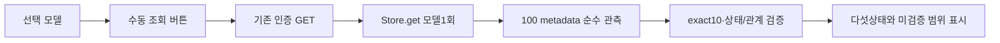

# Gate Model Provenance API UI 20261017 — 저장 모델카드의 수동 조회

| 필드 | 값 |
|---|---|
| updated_at | 2026-10-17 23:36 KST — Git 상태 메타데이터 정정; 본문은 해당 Gate 기준 |
| source_commit | d474d5bce6c2a6c4bd8ba141c9256d15f6004631 (108까지 구현 검토 기준; 이 메타데이터 정리는 후속 문서 커밋) |
| evidence_paths | `backend/app/main.py`; `tests/test_model_registration_provenance_api.py`; `docs/implementation/101_model_registration_provenance_api.md`; `docs/implementation/102_model_registration_provenance_ui.md`; `frontend/src/ModelRegistrationProvenance.tsx`; `frontend/src/modelRegistrationProvenanceAdapter.ts`; `frontend/src/modelRegistrationProvenanceAdapter.test.mjs`; `evidence/integration/model-provenance-api-related-20261017.log`; `evidence/integration/model-provenance-api-live-api-20261017.json`; `frontend/src/ModelReview.tsx`; `frontend/src/model-registration-provenance.css`; `evidence/integration/model-provenance-api-focused-20261017.log`; `evidence/integration/model-provenance-api-focused-corrected-20261017.log`; `evidence/integration/model-provenance-api-focused-final-20261017.log`; `evidence/integration/model-provenance-api-independent-20261017.log`; `evidence/integration/model-provenance-api-live-ui-20261017.json`; `evidence/integration/model-provenance-api-full-tests-20261017.log`; `evidence/integration/model-provenance-api-live-integrity-20261017.json`; `evidence/integration/model-provenance-api-next-review-20261017.json`; `evidence/integration/model-provenance-ui-related-20261017.log`; `evidence/integration/model-provenance-ui-tests-20261017.log`; `evidence/integration/model-provenance-ui-independent-20261017.log`; `evidence/integration/model-provenance-ui-build-20261017.log`; `evidence/integration/model-provenance-ui-desktop-20261017.png` |
| confidence | 격리 API/adapter·실제 저장metadata ABSENT GET; 파일/권위/승인 미검증 |
| status | TESTED_SYNTHETIC: 다섯상태·오류·지연; VERIFIED_REAL: 기존ABSENT GET만; 전체개발미완료 |

## 쉬운 설명

선택한 모델 카드의 버전 메모를 읽는 조회 창을 붙였다. 버튼을 눌러야 읽고 모델을 고르는 것만으로 자동조회하지 않는다. 메모가 없거나 충돌하는 상태를 구분하지만 파일을 꺼내거나 작성자의 권위를 확인하지는 않는다. 화면의 “이번 진단에서 미검증”은 기존 모델 평가값을 false로 바꿨다는 뜻이 아니다.

## 이론적 배경

100은메모리에주어진record를보는순수함수였다.101은기존Store에서모델을한번읽어그결과를그대로내고102는수동조회결과를안전하게표시한다. purehelperIO0과API의DB읽기1회를구분한다. 응답에는모델IDwrapper가없어client의요청세대는stale표시방어이지서버모델신원인증은아니다.

## 구조와 코드

`GET /api/models/{identifier}/registration-provenance`는기존auth와recordhelper를쓴다.100exact10·5상태는모두200이다. 없는모델은기존404,HTTPException은그대로전달하고그외예외/import실패는상세없는고정503이다. 자산/체크포인트/report읽기/hash·등록/쓰기·resolver는없다. DB읽기1은Store내부파싱/자원하드상한을뜻하지않는다.

`ModelRegistrationProvenance`는선택모델하위keyedchild다. 모델선택/패널열기/렌더로자동GET하지않고기존SVG버튼으로명시조회한다. 전용adapter가exact10·bindings3·정확bool4false·상태/presence/issuecode-field·충돌/부재우선순서를검사한다. 임의원문·hash·경로·서버예외를표시하지않고401/403/404/503을고정안내로바꾼다.

새조회는이전결과/오류를먼저지우고동기pending으로중복클릭GET을막는다. 모델변경은key로폐기하고route/back/hash/unmount와id/generation이늦은결과/오류/busy를버린다. 응답IDwrapper/서명은없어이표시방어를신원인증으로부르지않는다. 화면이동은서버읽기취소가아니고목록새로고침으로자동재조회하지않는다.

## 검증 근거

API관련56 PASS/17.124초·독립9 PASS/2.156초·최종집중9 PASS/1.858초다. 실제main의route/auth/record AST를격리앱/TempStore에서검증했다. 다섯상태·get1/put0·원SQLite불변·기존목록동등·401/404·safe503/import예외를확인했다.

초기socket.socket클래스mock이Windows TestClient eventloop socketpair/isinstance를깨뜨렸다. 초기실패/중간중지로그를보존하고시험guard만socket.create_connection차단으로바꿨다. 제품코드결함이나초기성공으로표시하지않고최종집중로그를쓴다.

실제API8002와UIproxy5174의기존모델200ABSENT·없는404각2조회는저장metadata범위다. catalog14SHA는전후같고등록/JobPOST0이다. auth/503/다른4상태는격리합성근거이며운영자료에오류를주입하지않았다. UI신규19/705.4679ms·전체172/7657.7741ms·독립19/1064.0661ms와build93modules/28.54초PASS를확인했다. Pythonhelper15case교차는19시험안에포함되며별도로더하지않는다. 실제브라우저는ABSENT만확인했고backend최종1019건/1018 PASS/기존1 SKIP/381.288초·종료0과보존근거를확인했다.

## 한계와 상태

ABSENT/INVALID/CONFLICT/UNKNOWN/CONSISTENT_UNVERIFIED는저장메모의관측이다. 일관해도복사/위조·기관권위·실파일bytes·등록출처/명시호출·과학/실행승인은미검증이다. 네false는이번진단범위이지기존model승인값을false로바꾸거나독립평가를무효화한것이아니다.

기존version/declaration부재를datasetversion으로채우지않고등록/역채움/QA학습·executor는없다. 원본5차단/후보4차단·예약136314880B·환불0과실제modelresolverBLOCKED는그대로다. 운영조회200을모델승인이나전체프로젝트완료로표현하지않는다.

## 1분 발표

“선택 모델의 등록 메모를 버튼으로 읽는 화면을 붙였습니다. 없거나 잘못된 메모, 충돌과 근거 부족을 나누고 일관해도 미검증이라고 표시합니다. 현재 파일이나 작성자를 확인한 것은 아니기 때문입니다. 이번진단의 과학·권위 미검증은 기존모델값을 바꾼 뜻도 아닙니다. 실제 기존모델은 메모가 없었고 없는모델의404도 확인했습니다. 다른상태와 지연오류는 격리시험입니다. 조회일 뿐 등록·학습·실행을 시작하지 않습니다.”

## 5분 발표 순서

1. **0~1분:** 모델카드를 수동으로 읽는 창 비유를 말한다.
2. **1~2분:** purehelper와Store읽기·다섯상태를나눈다.
3. **2~3분:** exact응답정합·4false·stale방어/신원인증차이를설명한다.
4. **3~4분:** 실제ABSENT/404와합성다른상태·환경시험실패를구분한다.
5. **4~5분:** 실파일/권위/과학미검증과등록·실행없음을말한다.

10분 설명에서는socketguard실패수정·HTTPException/503경계·optionalversion·현재모델IDwrapper부재·UI세대를추가한다. 슬라이드는 “수동조회”, “다섯상태”, “안전표시”, “실제와합성”, “검증공백”이다.

## Q&A

**200이면 승인된 모델인가?** 아니다. 부재와무효도정상관측200이다.

**과학false면 기존평가가 취소됐나?** 이번진단의미검증범위이며기존필드수정이아니다.

**파일hash를 다시 계산하나?** 저장metadata만읽고파일은읽지않는다.

**늦은응답 방어가 모델신원도 인증하나?** 화면오표시를막는client세대방어다. 신원인증wrapper/서명은없다.

**실제다섯상태를 모두 봤나?** 실제기존ABSENT와404만확인했다. 다른상태/503/auth는격리합성이다.

## 이후 갱신

최종UI/build·브라우저·backend전체/보존근거를읽고INDEX·변경이력·계약·Orchestrator·MLOps·06·구조·용어·발표·FAQ·시연을함께갱신했다. 다음은PLANNED계약검토다. Workflow fullJob의model_ref와저장모델metadata를연결할별도읽기관측계약에서부재·미발견·무효·충돌·unknown을먼저정의할계획이다. 기존89출력/model_verifiedfalse를조용히바꾸지않고modelresolver·권위/실행승인·자동모델선택·dataset_version대체는추가하지않는다. 현재구현0이다. 전체개발과10분보고는계속된다.

## 실제 UI102 관측 범위

실제5174/#/view/6에서8check를확인했다. 모델미선택패널없음·선택후미조회표시·수동버튼2회ABSENT와3NOT_CHECKED·미검증설명/기존전이·배포disabled·선택해제/재선택/route/back결과폐기를확인했다.1449×1087 문서/패널overflow0·제목겹침0·버튼/제목SVG가있었다. 관측시점최근20개warning/error를시작시각으로필터한범위는비었으며전체역사console0은아니다.

실제는ABSENT만이며다른4상태·auth503·오염응답·강제지연/동시클릭은격리근거다. back은완료조회뒤로서inflight취소검증이아니다. 자동표시결과가없음을관측했지만백그라운드네트워크부재를브라우저계측한것은아니다. 수동only는source/격리시험근거와나눈다.

모델선택의기존readiness GET와checkpoint검증은유지된다. 새metadataendpoint자체의assetread0을화면전체의파일읽기0으로확대하지않는다. client세대와선택ID는표시방어이며응답모델신원인증은아니다. 운영등록/JobPOST0이다.

## 최종 회귀와 보존

최종 backend 전체 **1019건 중1018 PASS·기존 Windows symlink 권한 제약1 SKIP**,381.288초·종료0이다. deterministic 경계시험은 통과했다. 이전100에서전체를재실행하지않았던이력과구분하며이번전체에는100신규12+API신규9가포함된다. 관련56/독립9·UI19/172/독립19·15교차사례를backend전체에별도더하지않는다.

최종front172 PASS/7657.7741ms·신규19/705.4679ms·독립19/1064.0661ms·build93modules/28.54초PASS다. 기존chunk경고는남는다. 실제화면/서버GET와합성auth/503·타상태/경합을분리한다.

보호141참조·기존core와100helper71개·catalog14·Job2본문·이전증거679파일은같았다. 기존추적허용수정은main.py와ModelReview.tsx뿐이다. 양쪽은이전snapshot에있어이번additionalbaseline은0이다. 지정한범위의대조이며전체workspace나원자snapshot인증은아니다.

실제기존모델ABSENT와404만관측했고운영등록·JobPOST·역채움·resolver/executor·실자료QA·정식학습은0이다.4false는진단의미검증범위이고기존모델값·독립평가를변경하지않았다. 원본5차단·후보4차단·예약은유지한다.
