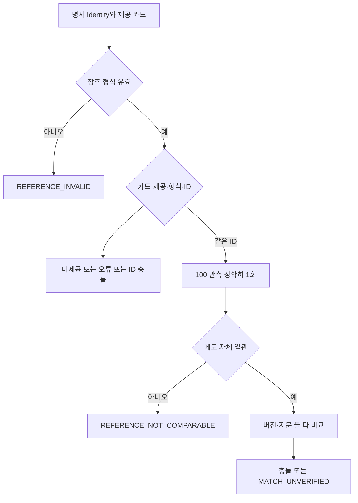

# Gate 103 — 명시 모델 참조와 제공 카드의 비교

| 항목 | 내용 |
|---|---|
| updated_at | 2026-10-17 23:36 KST — Git 상태 메타데이터 정정; 본문은 해당 Gate 기준 |
| source_commit | Git 연결됨; 문서 작성 시 변경분 미커밋, evidence snapshot SHA로 추적 (원격 기준 d483d25) |
| evidence_paths | `backend/app/model_reference_record_comparison.py`; `tests/test_model_reference_record_comparison.py`; `docs/implementation/103_model_reference_record_comparison.md`; `evidence/integration/model-reference-record-focused-20261017.log`; `evidence/integration/model-reference-record-related-20261017.log`; `evidence/integration/model-reference-record-independent-20261017.log`; `evidence/integration/model-reference-record-catalog-observation-20261017.json`; `evidence/integration/model-reference-record-live-integrity-20261017.json` |
| confidence | 완료 코드·보존 로그 확인; 새 비교는 합성 검증, 운영 참조 인증 아님 |
| status | TESTED_SYNTHETIC; 실제 catalog 보존만 VERIFIED_REAL; 학습 BLOCKED; 후속 PLANNED |

## 쉬운 설명

배송 주문서에 적은 상품 이름·버전·지문을, 옆에 놓인 상품 카드와 맞춰 보는 작업이다. 카드를 가져오는 일과 실제 상품을 여는 일은 하지 않는다. 카드가 전달되지 않았다는 결과를 “창고에서 찾아봤지만 없다”로 말하면 안 된다. 복사한 카드도 글자가 같으면 일치할 수 있다.

최고 상태인 `MATCH_UNVERIFIED`는 선언끼리 같다는 뜻이다. 모델 파일의 존재·진위·품질이나 사용 허가를 뜻하지 않는다. 기존 모델 평가값을 바꾸지도 않는다.

## 이론적 배경

검사에는 선후 관계가 있다. 먼저 참조 형식과 ID를 확인한다. 다른 ID의 카드는 내부 버전 조사에 쓰지 않는다. 같은 ID일 때만 100의 등록 메모 관측을 한 번 수행한다. 그 메모가 자체적으로 일관할 때만 버전과 checkpoint 지문을 비교한다. 두 비교 결과는 모두 남기되 대표 오류는 버전 불일치를 먼저 표시한다.

## 코드와 데이터 동작

`compare_model_reference_record(reference_identity, model_record=None)`의 첫 입력은 정확히 `id/version/sha256` 세 키다. 전체 GMAIS `model_ref`와 다르다. 선택적 role·URI를 가진 원 요청의 검증과 명시 추출은 호출자 책임이며 자동으로 필드를 버리거나 추출하지 않는다.

참조 `None`은 `REFERENCE_INVALID`다. 카드 `None`은 `RECORD_NOT_PROVIDED`이며 DB 미발견 관측이 아니다. 카드 타입·ID 오류는 `RECORD_INVALID`, ID 불일치는 `REFERENCE_CONFLICT`다. ID가 다르면 100 호출은 0회, 같으면 정확히 1회다. 100의 부재·잘못된 선언·내부 충돌·부모 근거 부족은 embedded 관측과 `REFERENCE_NOT_COMPARABLE`로 구분한다.

출력은 고정 12키이며 여섯 상태를 갖는다. 내부 관측은 100의 고정 10키 객체 또는 null이다. 버전은 원문 그대로 비교하므로 ` v2 `와 `v2`는 다르다. `inspection_calls`는 100 함수 호출 수이지 DB나 파일 검사 수가 아니다. 예외는 순수 함수 밖으로 전파하며 후속 API의 안전 오류 처리는 아직 연결하지 않았다.

권위·실바이트·실행·과학·`model_verified` 다섯 축은 항상 false다. 이는 이 진단의 미검증 범위다. 기존 레코드의 scientific 필드 부재나 평가 기록을 덮어쓰지 않는다. dataset_version은 읽거나 모델 버전으로 대체하지 않는다.

## 시험 증거와 실제 관측

- 신규 14 PASS / 0.381초, 관련 50 PASS / 16.590초, 독립 14 PASS / 0.319초다. 신규는 관련 묶음에 포함되며 반복 시험을 더하지 않는다.
- 합성 시험은 형식·순서·100 호출 수·내부 상태·두 binding과 오류 우선순위·패딩·예외 전파·입력 불변·파일/DB/network 호출 금지를 확인했다. 작은 TempStore 등록 카드의 일치와 파일 변조 뒤 같은 관측은 실파일 검증이 없다는 한계의 시험이다.
- 실제 catalog 14행과 모델 1개의 버전 선언 부재만 보존 관측했다. 새 비교 함수에 운영 Workflow 참조를 넣은 실험이 아니다. 새 비교의 상태는 **TESTED_SYNTHETIC**이다.
- 보호 참조 141개·기존 core 71개·기존 제품·이전 증거 706개·catalog 14행은 불변이다. 운영 등록·Job 제출·새 QA·훈련은 없다.
- 이번 전체 backend·프론트·build·브라우저 재실행은 없다. 기존 호출자가 없는 내부 순수 기능이기 때문이다. 이전 전체 1019건/1018 PASS/1 SKIP/381.288초는 101/102의 역사 근거다.

## 한계와 다음 단계

같은 모양의 위조 카드와 참조도 일치할 수 있다. 현재 checkpoint 바이트, 레코드를 고른 출처, 기관 권위, 실제 capability, 과학·실행 승인은 검증하지 않는다. 기존 API/UI·Workflow 89/94·승인 gate에 연결하지 않아 직접 UI 변경이나 실행 서버 적용도 없다. 기존 후보 QA의 4차단과 학습 BLOCKED를 유지한다.

다음은 기존 89 fullJob 결과가 MATCH일 때만 optional model_ref를 명시 추출하여 제공 카드와 비교하는 별도 wrapper 계약 검토다. **PLANNED이며 코드·resolver·API/UI 연결은 없다.** 기존 89 출력과 false 축은 그대로 둔다. 전체 개발과 10분 보고는 계속된다.

## 발표와 Q&A

### 1분 대본

“주문서의 모델 이름과 버전, 지문을 제공된 모델 카드와 맞추는 내부 함수를 만들었습니다. 카드를 조회하거나 파일을 열지는 않습니다. 카드가 안 왔다는 결과와 데이터베이스에서 못 찾았다는 결과는 다릅니다. 이름이 같은 카드의 메모가 자체적으로 맞을 때만 버전과 지문을 비교합니다. 모두 같아도 일치하지만 미검증이라고 표시합니다. 복사한 카드도 같을 수 있기 때문입니다. 관련 50개와 독립 14개 시험을 통과했고 실제 등록이나 학습은 하지 않았습니다.”

### 5분 발표 순서

첫 1분에는 주문서와 카드 비유를 설명한다. 다음 1분에는 미제공과 미발견, 전체 model_ref와 명시 identity의 차이를 설명한다. 세 번째 1분에는 ID와 내부 메모, 버전·지문의 검사 순서를 보여준다. 네 번째 1분에는 합성 시험과 실제 catalog 보존 관측을 나눈다. 마지막 1분에는 복사 카드의 한계와 미연결 상태, 후속 wrapper 계획을 설명한다.

### 10분 확장과 슬라이드

슬라이드는 목적, 검사 흐름, 여섯 상태, 증거, 미검증 경계 순서로 구성한다. 5분 설명 뒤에는 version/SHA 동시 불일치와 100 호출 수를 2분, 파일 변조 뒤 동일 관측 사례를 1분, API/UI 미연결과 다음 계획을 1분, 질문을 1분 배정한다.

Q. 카드가 없다는 결과는 서버에서 못 찾았다는 뜻인가? A. 아니다. 이 함수에는 조회가 없고 카드가 전달되지 않았다는 뜻이다.

Q. 일치하면 파일도 맞는가? A. 파일을 열지 않는다. 원본 인증·현재 바이트·사용 허가는 별도다.

Q. 실제 기존 모델을 검증했나? A. 이번 실제 자료는 catalog 보존만 확인했다. 새 비교의 성공은 합성 자료로만 시험했다.

## 연결 근거

[구현 계약](../../implementation/103_model_reference_record_comparison.md), [완료 코드](../../../backend/app/model_reference_record_comparison.py), [독립 시험 로그](../../../evidence/integration/model-reference-record-independent-20261017.log)를 확인한다.
