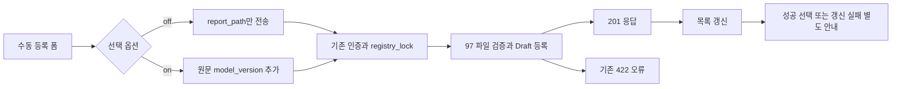

# Gate Model Version Registration API UI 20261017 — 선택 메모의 수동 등록 연결

| 필드 | 값 |
|---|---|
| updated_at | 2026-10-17 23:36 KST — Git 상태 메타데이터 정정; 본문은 해당 Gate 기준 |
| source_commit | d474d5bce6c2a6c4bd8ba141c9256d15f6004631 (108까지 구현 검토 기준; 이 메타데이터 정리는 후속 문서 커밋) |
| evidence_paths | `backend/app/main.py`; `frontend/src/ModelReview.tsx`; `frontend/src/modelVersionRegistrationAdapter.ts`; `frontend/src/modelVersionRegistrationAdapter.test.mjs`; `docs/implementation/98_model_version_registration_api.md`; `docs/implementation/99_model_version_registration_ui.md`; `evidence/integration/model-version-api-related-20261017.log`; `evidence/integration/model-version-ui-related-20261017.log`; `evidence/integration/model-version-ui-tests-20261017.log`; `evidence/integration/model-version-ui-build-20261017.log`; `frontend/src/model-version-registration.css`; `evidence/integration/model-version-api-independent-20261017.log`; `evidence/integration/model-version-api-live-api-20261017.json`; `evidence/integration/model-version-api-live-ui-20261017.json`; `evidence/integration/model-version-api-full-tests-20261017.log`; `evidence/integration/model-version-api-full-tests-corrected-20261017.log`; `evidence/integration/model-version-api-live-integrity-20261017.json`; `evidence/integration/model-version-api-original-main-20261017.py`; `evidence/integration/model-version-api-original-ui-20261017.tsx`; `evidence/integration/model-version-api-next-review-20261017.json`; `evidence/integration/model-version-ui-independent-20261017.log`; `evidence/integration/model-version-ui-related-layout-20261017.log`; `evidence/integration/model-version-ui-tests-layout-20261017.log`; `evidence/integration/model-version-ui-build-layout-20261017.log`; `evidence/integration/model-version-ui-desktop-final-20261017.png` |
| confidence | 완료 route/adapter·격리 AST/TempStore/mock 시험; 운영 성공 등록 미검증 |
| status | TESTED_SYNTHETIC: 성공 등록; VERIFIED_REAL: 음성 API/UI만; 운영 성공등록0·전체개발미완료 |

## 쉬운 설명

기존 실험 보관 창구에 선택 버전 메모 입력란을 붙였다. 선택하지 않으면 예전 접수표 그대로 보낸다. 선택하면 적은 글자를 그대로 전달한다. 접수가 성공한 뒤 목록 화면을 새로고치지 못한 것은 접수 실패와 다르므로 같은 등록을 반복하지 않도록 안내한다. 화면을 떠난다고 이미 진행 중인 등록이 취소되지는 않는다.

## 이론적 배경

97의 내부 선택 옵션을 기존 Draft 등록API와ModelReview에연결했다. 생략과명시null은서로다르고서버는키존재여부로분기한다. 화면은기본off/빈입력·수동버튼만사용한다. 등록은상태변경이가능한행동이므로실환경검사는없는안전한보고서의422까지만하며성공201은격리근거로구분한다. caller선언은기관권위·원본인증·과학/실행승인이아니다.

## 구조와 코드 연결

`POST /api/models/register-experiment`는model_version키가없으면기존두인자호출,있으면값을그대로keyword전달한다. null/bool/빈값을생략으로바꾸지않는다. 기존파일/완료/SHA/중복검사가먼저이며없는report422는파일경계관측이지versionguard실행증거가아니다. 원unknownextra무시정책과201/422·인증·registry_lock을유지한다.

`modelRegistrationBody`는off일때입력값이남아도정확한report_path단독body다. on이면문자지원범위를검사하고패딩포함원문을보낸다. Pythonstrip집합/Unicodecodepoint·256/257·U+FEFF차이를교차검증했으며클라이언트검사가서버검증을대체하지않는다. dataset_version/경로/파일명으로version을추정하지않는다.

`ModelRegistrationFlight`와synchronousin-flight는연속중복호출을막는다. 등록중경로·옵션·version·모델선택을비활성화하고route/back/hash/unmount세대가늦은모델선택·오류·busy표시를폐기한다. 응답성공뒤에는화면을떠났어도onChanged로목록을갱신한다. refresh실패는등록실패와구분해반복등록대신목록확인을안내한다. 자동재등록·서버취소/rollback은없다.

## 검증 증거

API관련48 PASS/19.174초(신규11포함)다. 원mainbyte핀의auth/app/실제decoratorroute AST를추출한격리FastAPI로kwargs/201/422/lock을검증했다. fullmain초기화·CORS·운영카탈로그성공검증은아니다. 생략응답/headers/rawSQLitebody/put순서동등,명시null/paddingmock전달,97을쓴TempStore작은완료파일성공과충돌/중복/오류우선·401잠금이전거부를확인했다.

UI신규16 PASS/856.2352ms·전체153 PASS/6663.9031ms·build89modules/25.41초PASS다. 기존chunk크기경고는남는다. mock/실제Python문자계약·동시호출·route/backforward/unmount·201뒤refresh실패를시험했다. mockID/지문을운영checkpoint검증으로표현하지않는다. API독립11/3.141초·UI독립16/631.258ms와 실제음성검사·corrected최종전체/보존근거를확인했다.

## 한계와 상태

성공등록은TempStore/AST/mock의TESTED_SYNTHETIC이다. 실제운영성공등록·새모델/데이터작성은이번검증대상이아니다. 기존모델version/declaration/과학필드부재는역채움하지않고dataset_version을대신쓰지않는다.

caller메모의source/shape는명시호출출처인증이나권위version영수증이아니다. Draft/independentfalse/새성공recordsciencefalse와기존oldscience부재를구분한다. 두쓰기부분실패·동시경쟁·전역immutable·실제modelresolverBLOCKED는그대로다. 승인·정식학습·배포를추가하지않는다. 원본5차단·후보4차단·예약136314880B·환불0을유지한다.

## 1분 발표

“기존 Draft 등록 창구에 모델 버전 메모를 선택해서 적는 입력란을 연결했습니다. 기본은 꺼져 있고 선택하지 않으면 예전 요청 그대로입니다. 선택한 값도 보정하지 않고 기존 파일 검사 뒤 검토합니다. 등록 성공 후 목록 새로고침만 실패한 경우를 따로 알려 중복 등록을 피합니다. 화면 이동은 서버 취소나 되돌리기가 아닙니다. 성공은 임시 Store와 mock으로 검증하며 실제 운영에서는 안전 오류만 확인했습니다. 메모는 권위·과학·실행 승인이 아닙니다.”

## 5분 발표 순서

1. **0~1분:** 보관 창구의 선택 메모 입력 비유를 말한다.
2. **1~2분:** off/body생략과명시null·파일오류우선순서를설명한다.
3. **2~3분:** busy/세대·화면이동과서버취소차이·refresh실패를나눈다.
4. **3~4분:** AST/TempStore/mock성공과실제안전422를구분한다.
5. **4~5분:** caller메모·부분실패·권위resolver·승인한계를말한다.

10분 설명에서는Pythonstrip/Unicode교차·201후onChanged·기존lock/인증·rawrecord동등과비트랜잭션한계를추가한다. 발표슬라이드는 “선택메모”, “요청과등록”, “성공과표시”, “검증범위”, “남은권위계약”순서다.

## Q&A

**off여도 적은 버전을 보내나?** 보내지 않는다. 기존report_path단독요청이다.

**null은 생략으로 바뀌나?** 아니다. 키가 있으면 원형 전달하고 기존 파일 검사 뒤97이 거부한다.

**목록 갱신 실패면 다시 등록하나?** 서버201 뒤면 등록 성공과 별개다. 반복하지 말고 목록을 확인한다.

**화면을 떠나면 등록이 취소되나?** 표시를 폐기할 뿐 서버 취소나 rollback은 아니다.

**실제 성공 모델을 등록했나?** 성공은 격리 검증이다. 운영 카탈로그 성공 등록은 없다.

## 이후 갱신

독립·실제안전HTTP/브라우저·corrected전체회귀·보존을읽고INDEX·변경이력·계약·Orchestrator·MLOps·06·구조·용어·발표·FAQ·시연을함께갱신했다. 다음은PLANNED읽기검토다. 모델등록출처의미검증/부재/충돌을구분할읽기전용진단계약을정의한뒤구현여부를정할계획이다. declaration의source/shape로권위를추정하거나dataset_version대체/역채움·승인·executor를추가하지않는다. 현재구현0이다. 전체개발과10분보고는계속된다.

## 실제 음성 검사와 화면 관측

API8002의없는report4회(생략/정상명시/null/alias)는모두같은422파일경계오류였다. 파일검사가version보다먼저이므로이관측을명시versionpositive나서버aliasguard성공으로표현하지않는다. catalog14 SHA는같고운영성공등록은0이다.

실제5174/#/view/6의8check는기본off/빈reportdisabled,선택후빈version안내·latestlocal차단,패딩v1원형/활성,없는report422뒤성공없음/재활성,off복귀·완료422뒤뒤로이동freshform과SVG/넘침을확인했다. 음성등록클릭1회이며성공등록은0이다. 최종보고서입력은비우고옵션off로남겼다.

최초이미지에서details제목과도움말겹침을발견해새scopedCSS로보완했다.1449×1087 최종겹침/가로넘침은없었다. 편집중CSSimport-before-file의일시적Vite HMR오류1건을보존했고reload후정상렌더를확인했다. 역사console0으로주장하지않는다. browserback은완료422뒤이며inflight서버취소검증이아니다. 성공등록·지연/동시클릭·refresh실패는격리시험범위다. 최종CSS후관련16/2254.1292ms·전체153/8686.1211ms·build90modules/27.52초PASS와backend최종보존을확인했다. 초기89modules/25.41초로그는이력으로보존한다.

## 전체 회귀 환경 재시도

첫 전체 실행은 PYTHONPATH에프로젝트의.runtime/backend/tests를빠뜨려648건·327.484초에서import오류31개로실패했다. fastapi/jsonschema/app를못찾은실행환경오류이며통과근거가아니다. 원로그는그대로보존하고정해진PYTHONPATH로corrected로그에재실행했다. 최종998건/997PASS/기존1SKIP/366.134초·종료0을확인했다. 초기실패와환경수정뒤최종실측을구분해기록한다.

## 최종 회귀·보존·적용 범위

corrected backend 최종 **998건 중997 PASS·기존 Windows symlink 권한 제약1 SKIP**,366.134초·종료0이다. deterministic 경계시험은 통과했다. 최초환경실패648건/import31과혼동하지않는다. 신규API11개는전체에포함되고관련48·독립11·UI16/153/반복layout·세부사례를backend전체에더하지않는다.

최종layout프론트는관련16 PASS/2254.1292ms·전체153 PASS/8686.1211ms·build **90modules/27.52초PASS**다. 초기build89/25.41초와분리한다. CSS추가뒤실제로그의90modules를기준으로정정했고초기로그는덮어쓰지않았다. chunk경고는기존한계다.

보호141참조·기존core70·catalog14·Job2본문·이전증거631파일은같았다. ModelReview가이전snapshot에없어수정전원문을additionalbaseline1개로명시해비교했다. 기존허용변경은main.py와ModelReview.tsx두파일이다. 변경후코드로기준을역산하지않았고전체workspace/원자snapshot인증도아니다.

실제API는없는report422의음성4회,브라우저는폼/음성422의8check범위이며성공201·선언지문연결·지연/동시/refresh실패는격리증거다. 운영성공등록·JobPOST·역채움·executor·실자료QA·정식학습은0이다. 기존준비성/승인/비트랜잭션한계를유지한다.
