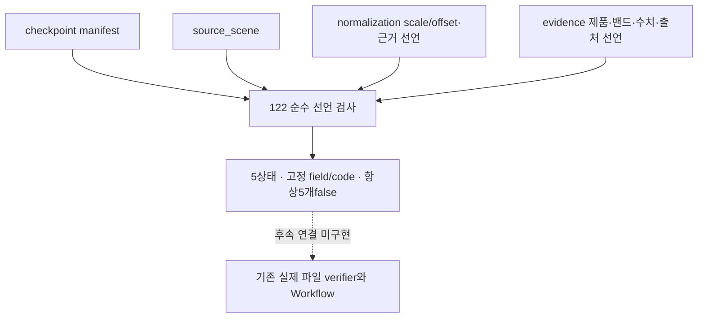

# Gate122 — 6밴드 per_scene 정규화의 선언 계약을 따로 검사하기

| 필드 | 값 |
|---|---|
| updated_at | 2026-10-18 02:23:44 KST — 122 최종 독립·임시 파일 경계·보존 근거 반영 |
| source_commit | 기준 9a79c3db77e3a94936ab74597939b5bf5630e2c3 + 122 작업파일 SHA (미커밋); 실행 gate 변경 없음 |
| evidence_paths | `backend/app/ml/per_scene_normalization_contract.py`; `tests/test_per_scene_normalization_contract.py`; `backend/app/ml/normalization.py`; `backend/app/lcluc_workflow.py`; `evidence/integration/per-scene-contract-focused-20261018.log`; `evidence/integration/per-scene-contract-existing-boundaries-20261018.log`; `docs/implementation/122_per_scene_normalization_contract.md`; `evidence/integration/per-scene-contract-independent-20261018.json`; `evidence/integration/per-scene-contract-independent-20261018.log`; `evidence/integration/per-scene-contract-runtime-boundary-20261018.json`; `evidence/integration/per-scene-contract-runtime-boundary-20261018.log`; `evidence/integration/per-scene-contract-live-integrity-20261018.json` |
| confidence | 완료 코드·집중14/기존4/독립7·임시 파일 대조6시나리오·보존 근거 확인; 선언과 실제 파일/권위 구분 |
| status | TESTED_SYNTHETIC per_scene 선언 진단; 실제 Workflow 연결/기관·과학·실행 승인 BLOCKED |

## 쉬운 설명

영상마다 다른 보정값을 쓰려면 모델이 기대하는 밴드 순서, 영상 제품 이름, 보정 근거의 이름과 숫자가 먼저 맞아야 한다. 이번에는 그 서류들을 서로 비교하는 작은 검산기를 만들었다. 서류가 맞아도 실제 파일 지문을 읽거나 실행을 허가하지 않는다. 기존 실행기와 연결되지 않은 순수 진단이다.

‘6밴드라서 무조건 금지’는 정확하지 않다.115 local Workflow는 global 정규화에서1~16밴드를 받는다. 현재6밴드 자료는 per_scene_product_metadata 방식이며115가 그 방식과 필요한 source_scene/normalization 근거를 전달하지 못하는 것이 연결 공백이다.122가 이 gate를 완화하거나 실행 지원을 추가한 것은 아니다.

## 이론적 배경

채널별 보정은 입력값 x에 scale을 곱하고 offset을 더하는 변환이다. scalar는6개 채널에 같은 값을 적용하고 길이6 배열은 밴드별 값을 쓴다. scale은 양수·유한, offset은 유한이어야 한다. 모델/영상/제품 근거의 밴드 순서가 다르면 수치가 올바르더라도 다른 채널에 적용될 수 있어 일치 여부를 따로 확인한다.

선언 비교와 실제 파일 검증은 다르다. 이번 helper는 SHA 문자열이64자리 형식인지 검사할 뿐 해당 파일을 열거나 선언 SHA를 실제 바이트와 대조하지 않는다. 기존 `verify_inference_normalization`은 영상·evidence·source metadata 파일 SHA를 확인하지만 출처 진술 자체를 기관 인증으로 공인하지 않는다. 두 역할을 대체하거나 같은 검증이라고 부르지 않는다.

## 실제 구조

## 코드·입력 → 처리 → 출력

`inspect_per_scene_normalization_contract(checkpoint_manifest, source_scene, normalization, evidence)`는 dict당 최대128필드·exact 기본형을 검사한다. 추가 metadata 값은 순회/직렬화하지 않는다. mode가 없거나 다른 유효 문자열이면 OUT_OF_SCOPE를 반환하고 나머지 자료를 검사하지 않는다. global이 통과했다는 뜻이 아니라 이 진단 범위 밖이라는 뜻이다.

대상 mode는 per_scene_product_metadata다. 모델 bands는[1,2,3,4,5,6], 이름은 B02/B03/B04/B08/B11/B12의 같은 순서여야 한다. source_scene의 제품 ID·image SHA 선언·밴드, normalization의 scale/offset·evidence 경로/SHA, evidence의 verified_product_metadata 문자열·제품/밴드/수치·source URL/metadata 경로/SHA 선언을 검사한다. 제품 ID·밴드·scale/offset이 서로 맞아야 한다. URL/경로는 문자열 검사만 하며 파일이나 네트워크를 열지 않는다.

수치는 bool/문자열/tuple·비유한·과도한 정수·잘못된 배열 길이를 거부한다. 필수 키 부재는 INCOMPLETE, 명시 null/잘못된 형식은 INVALID다. 형식 확인 뒤 제품/밴드/수치의 선언 불일치는 DECLARATION_MISMATCH다. 모두 일치해도 DECLARATIONS_CONSISTENT_UNVERIFIED이며 issue가null이다. OUT_OF_SCOPE까지 포함해 상태는5개다.

모든 결과의 execution_authorized/artifact_bytes_verified/source_authority_verified/scientific_accuracy_validated/workflow_supported는false다. 해당 진단이 확인/승인하지 않았다는 뜻이며 기존 모델이나 파일 상태를false로 바꾼다는 뜻이 아니다. safe issue에는 고정 code/field만 넣고 입력 원문을 돌려주지 않는다.

## 시험 증거와 현재 범위

집중14 PASS/0.031초·기존4 경계 PASS/8.994초 로그를 읽었다. 선언 일치/불일치·부재/null·band순서·scalar/배열·수치형·문자/한도·원문 불변·추가 값 미접근·파일/네트워크 호출 없음의 합성 검증이다. 기존4시험은 실제 ML 파일 verifier·6밴드 per_scene 근거 필수와115 배포/band gate 경계의 회귀이며 새 helper가 실행기에 연결됐다는 증거가 아니다.

최종 독립7 PASS/0.014초를 확인했다. 독립 전체 audit1.030초와 unittest 시간은 구분한다. Root 임시 파일 대조6시나리오도 통과했다. 보호141참조·기존소스277개 전부·이전증거1006파일·catalog14기록·예약136314880B는 불변이다. 신규 미연결 pure helper와 기존 소스 불변 범위에 맞춰 이번 전체 backend/프론트/build/브라우저는 재실행하지 않았다. 기존 backend1184/1183 PASS/1SKIP와 frontend261은120/121의 이전 근거이며 이번 새 전체 실행으로 표현하지 않는다. 기존 제품/API/UI/실행 gate는 바꾸지 않은 신규 pure helper 단위다. 공개 화면 계약이 없어 이번 UI 수정·build·브라우저 재시험 대상은 없다.

## 임시 파일에서 확인한 선언/실파일 경계

Root는 Temp 디렉터리에6밴드 래스터·evidence JSON·source metadata XML을 만들어 비교했다. 처음에는 선언 진단과 기존 실파일 verifier가 각자 범위에서 통과했다. 영상 바이트, evidence 바이트, source metadata 바이트를 각각 바꾸면 선언 입력이 같아 새 helper는 계속 consistent지만 기존 verifier는 거부했다. 형식상 정상인 image SHA 선언만 바꾸어도 실제 바이트 대조는 새 helper가 수행하지 못한다. 제품 ID 불일치는 양쪽이 거부했다. 이6시나리오는 생성 임시 파일 경계 확인이며 실제 제품 자료의 보정 정확도 시험이 아니다.

임시 파일은 정리 전에 복원했고 입력 metadata는 불변이다. checkpoint 로드·학습·추론·운영 자료 접촉은0이다. 순수 helper의 IO0과 기존 verifier가 임시 파일을 읽어 SHA를 검사한 사실을 분리한다. 이 관측은 앞으로 실제 연결에서 두 검증층을 유지해야 하는 이유다.

scalar1과 배열[1.0]*6은 성분별 수치 동등으로 비교할 수 있다. 기존 global 계수와 scene 계수가 같아야 한다는 조건은 추가하지 않았다. 실제 float32 변환 뒤 유한성/정밀도·물리 단위/스펙트럼·품질mask는 이 진단 범위가 아니다. opaque 경로/URL 형식 통과가 경로 탈출 방지나 공식 출처 확인을 뜻하지 않는다.

## 한계·다음

DECLARATIONS_CONSISTENT_UNVERIFIED ≠ 실제 바이트 일치·기관 권위·보정의 물리적 타당성·과학 승인·Workflow 실행 지원이다. 기존 verifier·source metadata pin·경로/한도·실제 영상과 연결하는 단계는 별도 후속이다. 기존 global-only를 임의로 per_scene로 바꾸거나 보정값을 추정하지 않는다. 현재 Draft·후보4차단·독립 라벨/외부5실행자료 부재·원본/분할/모델/원장/lock·예약136314880B를 유지한다.

## 발표 대본

### 1분

“6밴드 실행을 잇기 전에 모델과 영상, 제품 보정 근거의 서류가 맞는지 검사하는 작은 함수를 만들었습니다. 제품 ID와 밴드 순서, 곱셈과 덧셈 보정값을 비교합니다. 서류가 일치해도 실제 파일을 읽거나 실행을 승인하지 않습니다. 모든6밴드가 금지된 것은 아닙니다. 현재 로컬 실행기는 global 방식에서1~16밴드를 받고, 영상별 보정 자료를 전달하는 경로가 빠져 있습니다. 이번은 그 연결을 위한 선언 계약이며 실제 실행·과학 승인·기관 인증과 나누어 설명합니다.”

### 5분 순서

첫1분은 영상별 보정 서류 비유와6밴드 오해를 정리한다. 다음1분은 scale×영상+offset과 밴드 순서를 설명한다. 세번째1분은4입력/5상태를 보여준다. 네번째1분은 선언 SHA와 실제 파일 SHA·출처 권위의 차이를 설명한다. 마지막1분은 미연결 pure helper·기존 gate 보존·후속 연결을 말한다.

### 10분 확장

‘밴드 수와 정규화 방식’, ‘선언 계약’, ‘부재와 불일치’, ‘파일 검증 경계’, ‘실행 연결 후속’ 다섯 장에 scalar/배열·타입 회귀2분·OUT_OF_SCOPE1분·출처/물리 타당성1분·Q&A1분을 추가한다.

## Q&A

Q.6밴드는 전부 실행 불가인가? A. 아니다.115 global은1~16밴드를 지원한다. 현재 per_scene 자료의 전달 공백과 구분한다.

Q. consistent면 영상 지문도 맞나? A. 아니다. SHA 선언 형식만 검사하며 파일 바이트를 읽지 않는다.

Q. global OUT_OF_SCOPE는 통과인가? A. 아니다. 이 per_scene 진단의 대상이 아니라 나머지 검사를 하지 않았다는 뜻이다.

Q. 기존 실제 verifier를 대체하나? A. 아니다. 실제 파일 대조와 기관 권위 한계를 따로 유지한다.

Q. 화면/실행 gate도 바뀌었나? A. 아니다. 새 내부 pure helper이며 API/UI/Workflow에 연결하지 않았다.

## 근거 바로 열기

[구현 설명](../../implementation/122_per_scene_normalization_contract.md) · [독립 검증](../../../evidence/integration/per-scene-contract-independent-20261018.json) · [실파일 경계 대조](../../../evidence/integration/per-scene-contract-runtime-boundary-20261018.json) · [보존 근거](../../../evidence/integration/per-scene-contract-live-integrity-20261018.json)
