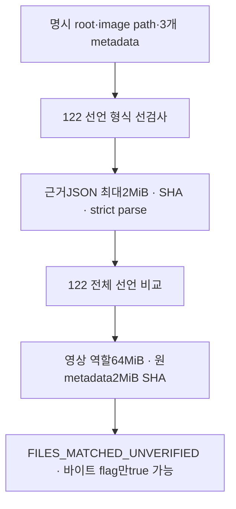

# Gate123 — per_scene 선언을 실제 세 역할 파일의 바이트와 대조

| 필드 | 값 |
|---|---|
| updated_at | 2026-10-18 02:34:55 KST — 123 최종 독립·실제 임시 junction/bytes·보존 근거 반영 |
| source_commit | 기준 9c5acb431392f3e94e7e6e361737c0e8ef4002ed + 123 작업파일 SHA (미커밋); 실행 gate 변경 없음 |
| evidence_paths | `backend/app/ml/per_scene_normalization_files.py`; `tests/test_per_scene_normalization_files.py`; `backend/app/ml/per_scene_normalization_contract.py`; `backend/app/ml/normalization.py`; `evidence/integration/per-scene-files-focused-final-20261018.log`; `evidence/integration/per-scene-files-related-20261018.log`; `evidence/integration/per-scene-files-runtime-comparison-20261018.json`; `evidence/integration/per-scene-files-live-integrity-20261018.json`; `docs/implementation/123_per_scene_normalization_files.md`; `evidence/integration/per-scene-files-independent-20261018.json`; `evidence/integration/per-scene-files-independent-20261018.log`; `evidence/integration/per-scene-files-independent-initial-20261018.json`; `evidence/integration/per-scene-files-independent-initial-20261018.log` |
| confidence | 완료 코드·최종14/관련28/독립9·실제 Temp6시나리오·보존 확인; caller SHA와 Registry/모델 신원 분리 |
| status | TESTED_SYNTHETIC 한정 파일 SHA·선언 대조; Workflow/과학/실행 승인 BLOCKED |

## 쉬운 설명

122가 서류끼리 맞는지 봤다면123은 서류에 적힌 파일 지문이 실제 파일 바이트와 같은지 확인한다. 영상 역할·보정 근거JSON·원 metadata 세 역할을 명시한 root 아래에서 읽는다. 지문이 맞아도 그 파일이 정상 영상인지, 보정이 물리적으로 옳은지, 모델이 승인됐는지는 확인하지 않는다. 지금 실행기/API/UI에는 연결하지 않았다.

## 이론적 배경

SHA는 같은 역할의 선언과 읽은 바이트를 연결한다. evidence JSON의 지문을 먼저 확인하고 그 복사본을 strict parse한 뒤122로 제품/밴드/scale/offset 선언을 대조한다. 그 다음 영상과 원 metadata 지문을 확인한다. 역할별 순차 snapshot이며 세 파일을 같은 순간에 묶는 원자 snapshot은 아니다.

파일 무결성과 래스터 유효성은 다르다. image라는 역할로 지정한 일반 바이트도 선언 SHA와 같으면 이 reader는 성공할 수 있다. header·CRS·mask·스펙트럼·float32 변환·정확도는 후속 검증이다. checkpoint_manifest도 caller가 공급한 metadata이며 모델 파일을 열거나 실제 checkpoint와 묶지 않는다.

## 구조와 코드

`verify_per_scene_normalization_files(data_root, checkpoint_manifest, source_scene, normalization, image_path)`는 절대 root를 요구한다. UNC 형태는 stat 전에 거부하고 root/조상과 상대 경로의 symlink/junction·alias·dot/dotdot·drive/ADS·끝점 공백/점·이탈을 거부한다. mapped drive가 실제 네트워크인지 OS 전체를 인증하지는 않는다. 명시 HTTP fetch나 URL 해석/접속은 없다.

`_snapshot`은 열기 전 path stat, open fd fstat, 읽은 뒤 fd/path/resolve/크기·시간·inode/dev를 비교한다.1MiB 이하 chunk로 한도+1 성장도 거부한다. image는 hash만 누적하고 evidence JSON만 복사한다. evidence JSON은 duplicate/비유한/잘못된 UTF8·surrogate·깊이64/노드65536을 거부한다.2MiB 파일 상한은 Python object/RSS/CPU/시간 전체 hard cap이 아니다.

mode가 global 등 OUT_OF_SCOPE이면 root/파일도 읽지 않는다. 대상 per_scene은 evidence SHA를 확인한 실제 JSON을122에 넣고 제품/밴드/수치 선언이 맞아야 영상·원metadata를 확인한다. 앞 역할이 실패하면 뒤 역할은 NOT_CHECKED로 남을 수 있으며 부분 MATCH가 전체 성공은 아니다. 입력 파일/metadata를 수정하거나 SHA를 자동 재고정하지 않는다.

## 출력과122와의 차이

exact12 결과의 status는 BLOCKED/OUT_OF_SCOPE/FILES_MATCHED_UNVERIFIED다. declaration_observation은122 결과를 원형 의미로 포함하며 file_bindings는 세 역할별 NOT_CHECKED/MATCH/MISMATCH다. issue는 고정 code/field만 반환하고 caller 경로·URL·원문 bytes는 노출하지 않는다.

FILES_MATCHED_UNVERIFIED일 때만 artifact_bytes_verified=true가 될 수 있다.122 내부 관측의 bytes flag는 여전히false다.123이 직접 읽은 세 역할의 bytes 대조와122의 순수 선언 검사를 구분한다. checkpoint_artifact_verified/source_authority_verified/scientific_accuracy_validated/execution_authorized/workflow_supported는 항상false다. 다른 파일/모델의 검증이나 기존 상태값 변경으로 확대하지 않는다.

## 시험 증거

집중최종14 PASS/0.810초·관련28 PASS/1.309초를 읽었다. 관련은 신규14+122의14이며 반복 합산하지 않는다. 초기14/1.143초도 보존한다. Root는 실제 Temp6밴드 GeoTIFF/evidence JSON/XML에서 기존 verifier와 새 reader가 같은 정상 자료를 통과함을 확인했다. 영상·evidence·metadata 각 bytes 변조는 거부했다. evidence SHA를 재고정해도 제품 ID가 다르면 거부했다. 비래스터 bytes가 SHA만 맞아 통과한 경우로 header 미검증 경계를 실증했다.6시나리오는 별도 경계 실험이며 단위시험 수에 더하지 않는다.

Temp 파일은 복원/정리했고 checkpoint load·추론·학습·운영 자료 접촉은0이다. 보호141참조·기존소스279개·이전증거1019파일·catalog14기록·예약136314880B는 불변이다. 최종 독립9 PASS/0 SKIP/1.294835초·종료0과 구현 문서123을 확인했다. 집중14/관련28·독립9·Root 임시6시나리오는 중복/교차 근거이며 새 전체 시험 수로 합산하지 않는다.

## 독립 junction 검증과 실제 연결 미완료

독립 검토는 Temp에서 실제 Windows junction을 생성해 root와 child 경로 거부를 확인했다. 링크만 비재귀로 해제하고 target sentinel이 보존됐으며9건 모두 통과·SKIP0이다. 초기 독립 시험은 이 Python 환경의 Path.is_junction 미지원으로 실패했고 lstat reparse-tag 검사로 시험만 정정했다. 초기 JSON/로그를 보존했으며 제품 결함 수정이나 새 source 변경으로 설명하지 않는다.

123의 ‘고정’은 caller가 제공한 세 역할 SHA에 대조한다는 뜻이다. Registry ID/version/ref를 조회하거나 같은 모델 버전에 결합하지 않는다. checkpoint_manifest도 공급한 Python metadata이며 실제 checkpoint 파일 신원은 미검증이다.124 후속은 이 Registry/실제 모델 참조와 장면별 근거를 결합하는 계약 검토·구현이다. 아직 연결 완료가 아니며 성공 결과를 실행 payload나 승인으로 자동 전달하지 않는다.

## 한계와 후속

이 reader는 runtime/API/UI/Workflow에 미연결이다. 기존 source279개 전부 불변인 내부 추가이므로 집중·관련·독립/파일 경계 시험으로 검증하며 이번 전체 backend/frontend/build/browser는 재실행하지 않는다.1184 backend·261 front는120/121 이전 근거다. 기존115 global-only와1~16밴드 지원·현재 per_scene 전달 공백은 그대로다. 모든6밴드 금지가 아니다.

3role 순차 snapshot은 동시 원자 snapshot이 아니고 외부 writer·mapped drive·전체 TOCTOU/기관 권위/물리적 보정 타당성을 보장하지 않는다. 실제 checkpoint·header/CRS/형상·mask·float32·모델 독립평가·분할/학습 gate는 별도다. 원본·모델·분할·원장/lock과 운영 Draft·후보4차단·독립라벨/외부5실행자료 부재를 유지한다.

## 발표 대본

### 1분

“앞에서는 보정 서류끼리 숫자가 맞는지 봤고, 이번에는 세 파일의 실제 지문을 읽습니다. 영상 역할 파일과 보정JSON, 원 metadata가 선언된 지문과 같은지 한도 안에서 확인합니다. 다만 지문이 맞는 파일이 정상 영상이나 공인 제품이라는 뜻은 아닙니다. 모델 파일과 좌표계·구름mask·과학 정확도도 별도입니다. 임시 파일을 바꾸어 거부되는 경계와 일반 bytes도 지문만 맞으면 통과하는 한계를 함께 시험했습니다. 실행기와 화면은 아직 연결하지 않았고 현재 원본과 학습 차단은 유지합니다.”

### 5분 순서

첫1분은122 서류 대조에서123 실파일 지문 대조로 넓어진 범위를 설명한다. 다음1분은 evidence→선언검사→image/metadata 순서를 보여준다. 세번째1분은 역할별 한도·부분 MATCH/NOT_CHECKED를 설명한다. 네번째1분은 Temp 변조 거부와 비래스터 성공의 한계를 설명한다. 마지막1분은 checkpoint/위상/과학·기관 승인/실행 연결 후속을 말한다.

### 10분 확장

‘서류와 실파일’, ‘한정된 reader’, ‘세 역할과 순서’, ‘지문 검증의 한계’, ‘실행 연결 전 남은 일’ 다섯 장에 경로/경쟁 회귀2분·JSON 예산1분·순차 snapshot 한계1분·Q&A1분을 추가한다.

## Q&A

Q. 바이트 flag true면 모델도 검증됐나? A. 아니다. 세 역할만 읽었고 checkpoint_manifest는 caller metadata다.

Q. image 역할 파일이면 정상 래스터인가? A. header를 읽지 않으므로 아니다. 일반 bytes도 SHA가 맞으면 통과할 수 있다.

Q. 세 파일을 같은 순간에 검사하나? A. 순차 snapshot이며 동시 원자 snapshot이 아니다.

Q. UNC를 막으면 네트워크 파일이 전부 차단되나? A. 명시 UNC를 stat 전에 거부하지만 mapped drive의 물리적 위치까지 보장하지 않는다.

Q. 이제 per_scene 실행이 연결됐나? A. 아니다. 내부 reader만 추가했고 기존115 gate/API/UI는 그대로다.

## 근거 바로 열기

[구현 설명](../../implementation/123_per_scene_normalization_files.md) · [독립 검토·junction](../../../evidence/integration/per-scene-files-independent-20261018.json) · [임시 실파일 대조](../../../evidence/integration/per-scene-files-runtime-comparison-20261018.json) · [보존 근거](../../../evidence/integration/per-scene-files-live-integrity-20261018.json)
