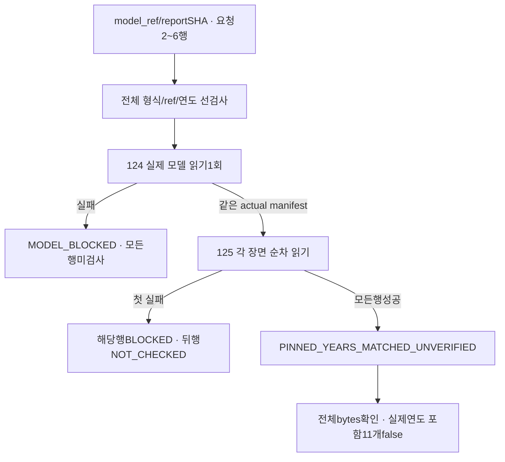

# Gate127 — 같은 모델 설명으로 요청2~6연도의 등록 자료를 순차 확인

| 필드 | 값 |
|---|---|
| updated_at | 2026-10-18 03:21:12 KST — 127 최종 관련/독립·Temp연차/시간미검증·운영count/보존 반영 |
| source_commit | 기준 49d0531440fc062e30e2307a58c9d6c7846a0548 + 127 작업파일 SHA (미커밋); 실행 gate 변경 없음 |
| evidence_paths | `backend/app/ml/pinned_annual_normalization.py`; `tests/test_pinned_annual_normalization.py`; `backend/app/ml/model_checkpoint_manifest.py`; `backend/app/ml/registered_per_scene_files.py`; `evidence/integration/annual-normalization-agent-20261018-focused.log`; `evidence/integration/annual-normalization-operating-inventory-20261018.json`; `docs/implementation/127_pinned_annual_normalization.md`; `evidence/integration/annual-normalization-root-related-20261018.log`; `evidence/integration/annual-normalization-runtime-20261018.json`; `evidence/integration/annual-normalization-live-integrity-20261018.json`; `evidence/integration/annual-normalization-independent-20261018.json`; `evidence/integration/annual-normalization-independent-20261018.log` |
| confidence | 완료 소스·집중9/관련46/독립7·실제 Temp6시나리오·운영count/보존 확인; 요청라벨과 시간/독립성 구분 |
| status | TESTED_SYNTHETIC 요청2~6연도 읽기 결합; 실제 연도/QA/mask/과학·실행 승인 BLOCKED |

## 쉬운 설명

한 장면만 읽던 연결을 요청한2~6개 연도의 자료 묶음으로 늘렸다. 모델은 한 번 읽고 같은 실제 manifest로 장면을 차례로 검사한다. 먼저 요청 전체 형식을 확인하고 어느 한 행이 실패하면 뒤 행은 ‘미검사’로 남긴다. 요청에 적힌 연도가 실제 촬영연도와 같다는 검증은 아직 하지 않는다.

따라서 이 기능은 요청 연도표에 따른 읽기다. 모든 연차 자료 확보·시계열 독립성·품질·실행 준비를 승인하는 기능이 아니다. 운영 DatasetVersion은 여전히0개이며 성공 시험은 Temp 등록 자료다.

## 이론적 배경

동일 모델 manifest를 공유하면 행마다 다른 모델 설명을 끼워 넣거나 모델 파일을 반복 load하는 일을 줄인다. 요청 전체의 형식 오류를 Store 접근 전에 거부하면 뒤쪽 오류 때문에 불필요한 앞행 IO가 생기는 것도 막는다. 실패 뒤 NOT_CHECKED를 보존하면 미검사 자료를 통과로 요약하지 않는다.

그러나 연도 라벨과 실제 시간 근거는 다르다. 같은 물리 파일을 다른 등록 ID로 가리킬 수 있고 같은 SHA도 여러 ID에 있을 수 있다. image ID/version의 중복 금지가 물리 장면·공간/시간 독립성이나 실제 연도 검증은 아니다. 다음128의 manifest temporal binding과 따로 구분한다.

## 구조

## 코드·입력 → 처리 → 출력

`inspect_pinned_annual_normalization(store, model_ref, training_report_sha256, requested_years)`의 각 행은 year/image_ref/evidence_ref/metadata_ref exact4다.2~6행·exact int1900..2200·엄격한 오름차순·유일 연도·모든 ref 형식을 먼저 검사한다. 각 행의 역할3key는 달라야 하고 행들 사이 image의 ID/version도 달라야 한다. evidence/metadata를 모든 연도에서 별개로 강제하는 정책은 발명하지 않는다.

잘못된 요청은 INVALID_INPUT·Store0이다. 모델은124 한 번만 읽고 실패하면 MODEL_BLOCKED로 끝난다. 정상 global 모델은 모델 record/checkpoint/report를 읽은 뒤 OUT_OF_SCOPE이며 scene 호출0이다. ‘global은 전체 IO0’이 아니라 ‘무효 요청은 IO전 거부, 정상global은 모델만 읽음’으로 설명한다.

per_scene actual manifest를 같은 객체로125에 순차 전달한다. 각 행은 MATCHED_UNVERIFIED/BLOCKED/NOT_CHECKED를 구분하고 nested scene 관측·고정 issue를 남긴다. 실패에서 즉시 중단하며 그 뒤 행은 읽지 않는다. checked_rows와 scene_observation_calls는 검사 시도이며 성공 행 수가 아니다.

exact24는 모델/행 관측·호출/검사 시도·checkpoint/report 이력과 전체 registry/artifact flag를 반환한다. 전체 registry/artifact flag는 모든 행 성공 경로에서만 계산한다. 앞행의 부분 true를 전체 성공으로 올리지 않는다. state/header/QA/mask/기관/ACL/다른부모/과학/실행/Workflow와 temporal_year_verified의11개 flag는 항상false다.

## 시험과 운영 상태

집중9 PASS/8.756초를 읽었다. 실제 Temp 미학습 CPU checkpoint와2개/6개 등록 장면 읽기, 모델1회·같은manifest·전체요청 선검사·중간실패/뒤미검사·부분flag·global모델만 읽기·입력/파일 무변경을 검증한 합성시험이다. 운영 모델 load·학습·forward·추론은0이다. 최종 관련46 PASS/19.993초·독립7 PASS/0 SKIP/7.603초·종료0과 문서127을 확인했다. 집중9·관련46(9+10+14+13)·독립7·Temp6시나리오는 반복/교차 근거이며 새 전체 시험 수로 합산하지 않는다. 보호141·기존source287개 전체·이전증거1080·catalog14·예약136314880B는 불변이다.

03:16 운영 SQLite URI mode=ro count는 legacy datasets6개·models1개·전체14기록·DatasetVersion0개다. 새 helper가 운영 자료를 등록하거나 연도를 확보한 것은 아니다. 원본 모델/영상 파일을 열지 않은 count 관측과 Temp 실파일 읽기를 구분한다.

## 실제 Temp·독립 검토가 보여 준 시간/중복 한계

Root는 실제6밴드 Temp GeoTIFF3개·등록9버전·미학습 CPU checkpoint로6시나리오를 확인했다. 정상3행은 torch.load1회·Store.get10회다. 모든 manifest temporal은2021인데 요청은2021/2022/2023이어도 이 범위에서 성공하며 temporal flag는false였다. 이는 실제연도를 확인하지 않는다는 명시 한계의 증거이고 정확한 연차 자료 확보의 증거가 아니다. bool year는Store0, 마지막 실패는 앞2행 관측 유지, 첫 실패는 뒤2행 미검사였다.

독립7건은 별도18등록버전·CPU checkpoint로2/6행의 get7/19회와 동일manifest 재사용·원본DB/입력 snapshot 불변을 확인했다. manifest temporal2024와 요청2020~2025도 이 범위에서 성공했고 다른 ID가 같은 경로/bytes를 가리키는 alias도 허용됨을 실증했다. 등록ID 유일성을 물리 장면 독립성으로 바꾸어 설명하지 않는다. 새 제품 결함이나 초기 실패는 없었다.

## 한계와 후속

requested year는 caller 라벨이며 실제 Registry manifest/header의 시간 범위와 대조하지 않는다. temporal_year_verified는false이고128 후속이다. 격자/CRS·장면 독립성·품질보고서/mask·실행 gate도 미검증이다. 새 연도를 생성하거나 누락 자료를 수집/역채움하지 않는다.

124/125의 ambient Torch·tensor DoS 미격리·Store decode 후 한도·순차 snapshot·명시 source/내부role/PUBLIC 정책 한계를 상속한다. 다중행/Registry/파일 원자 시점·전체 CPU/RSS/time hard cap은 없다. runtime/API/UI/기존115 실행과 연결하지 않은 내부 reader이므로 이번 전체 backend/front/build/browser는 재실행하지 않는다.1184/261은 이전120/121 근거다. global-only/현재Draft·후보4차단·독립 라벨/외부5실행자료 부재와 원본/원장/lock/예약을 보존한다.

## 발표 대본

### 1분

“같은 모델 파일의 실제 설명으로 요청한 두 개에서 여섯 개 연도의 자료를 차례로 읽도록 넓혔습니다. 요청 전체 형식을 먼저 보고 모델은 한 번만 읽습니다. 한 행이 실패하면 뒤 행은 검사하지 않았다고 남깁니다. 다만 요청표의 연도가 실제 촬영연도인지 확인한 것은 아닙니다. 다른 등록 ID가 같은 물리 파일을 가리킬 수도 있어 독립성이나 시계열 품질 승인과 구별합니다. 실제 운영 DatasetVersion은0개이며 성공은 임시 자료의 읽기 시험입니다. 연도 근거와 품질mask·실행 연결은 후속입니다.”

### 5분 순서

첫1분은 한 장면에서2~6행 요청표로 넓힌 범위를 설명한다. 다음1분은 전체 선검사·모델1회·같은manifest를 보여준다. 세번째1분은 첫 실패와 뒤 NOT_CHECKED를 설명한다. 네번째1분은 요청 라벨과 실제 연도·다른ID와 물리 독립성 차이를 말한다. 마지막1분은 운영 DatasetVersion0과128/QA/mask/실행 후속을 정리한다.

### 10분 확장

‘연차 요청표’, ‘모델1회’, ‘실패와 미검사’, ‘연도/독립성 미검증’, ‘다음 시간 binding’ 다섯 장에 입력/ref 회귀2분·aggregateflag1분·순차IO/자원한계1분·Q&A1분을 추가한다.

## Q&A

Q.127이 모든 연차 자료 확보를 증명하나? A. 요청2~6행 읽기이며 운영 등록 자료는0개다.

Q.요청2020이면 실제2020영상인가? A. 아직 manifest/header 연도 대조를 하지 않았다. temporal flag는false다.

Q.다른 image ID면 독립 자료인가? A. 같은 파일/물리장면/SHA alias가 가능해 독립성 증명이 아니다.

Q.앞행 성공이면 뒤행 실패도 전체true인가? A. 아니다. 뒤 미검사와 부분 이력을 보존하고 aggregate는 전체 성공에서만 계산한다.

Q.모델을 매 행 읽거나 실행하나? A. 모델manifest는1회 읽고 재사용하며 추론/학습은 하지 않는다.

## 근거 바로 열기

[구현 설명](../../implementation/127_pinned_annual_normalization.md) · [독립 검토](../../../evidence/integration/annual-normalization-independent-20261018.json) · [실제 Temp연차 대조](../../../evidence/integration/annual-normalization-runtime-20261018.json) · [보존 근거](../../../evidence/integration/annual-normalization-live-integrity-20261018.json)
