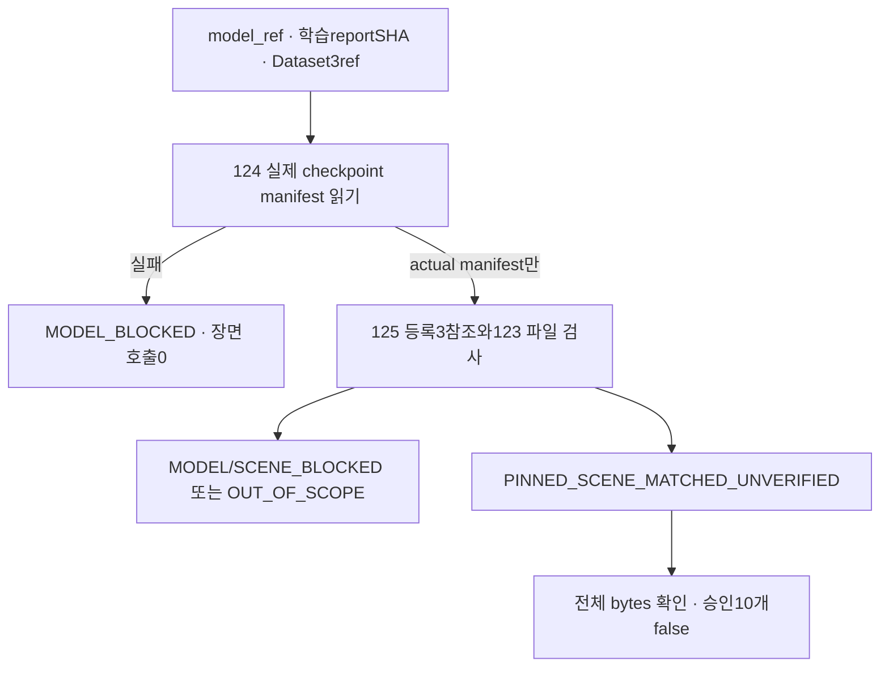

# Gate126 — 실제 고정 모델 manifest와 등록 한 장면을 자동 결합

| 필드 | 값 |
|---|---|
| updated_at | 2026-10-18 03:13:14 KST — 126 최종 독립·관련·Temp 결합·운영 count/보존 근거 반영 |
| source_commit | 기준 2a980f91eeb86ff61df65eed5c4f2d266aa5f540 + 126 작업파일 SHA (미커밋); 실행 gate 변경 없음 |
| evidence_paths | `backend/app/ml/pinned_scene_normalization.py`; `tests/test_pinned_scene_normalization.py`; `backend/app/ml/model_checkpoint_manifest.py`; `backend/app/ml/registered_per_scene_files.py`; `evidence/integration/pinned-scene-agent-20261018-focused.log`; `evidence/integration/pinned-scene-runtime-20261018.json`; `evidence/integration/pinned-scene-operating-inventory-20261018.json`; `docs/implementation/126_pinned_scene_normalization.md`; `evidence/integration/pinned-scene-root-related-20261018.log`; `evidence/integration/pinned-scene-runtime-initial-20261018.log`; `evidence/integration/pinned-scene-live-integrity-20261018.json`; `evidence/integration/pinned-scene-independent-20261018.json`; `evidence/integration/pinned-scene-independent-20261018.log` |
| confidence | 완료 코드·집중10/관련37/독립8·실제 Temp6시나리오·운영 count/보존 확인; 관측과 승인 구분 |
| status | TESTED_SYNTHETIC actual 모델manifest와 등록 한 장면 자동 읽기 결합; 운영 자료/과학·실행 승인 BLOCKED |

## 쉬운 설명

124는 실제 모델 파일의 설명을 읽고125는 등록한 장면 파일을 읽었다.126은 두 단계를 내부 함수 하나로 이어 모델 파일에서 읽은 manifest만 장면 검사에 전달한다. caller가 따로 모델 설명이나 파일 경로를 바꿔 끼우는 입력은 없다. 한 장면의 읽기 연결이며 모든 연도·품질·실행기와 연결한 것은 아니다.

## 이론적 배경

출처가 다른 복사 설명을 수동으로 끼워 넣는 대신 고정 모델의 관측 결과를 다음 단계에 직접 전달하면 입력 결합의 공백을 줄인다. 그러나 결합은 합성 검증 범위이고, metadata와 bytes의 일치가 모델 호환·정답·기관 권한·실행 승인은 아니다. 각 하위 단계의 부분 확인 이력과 전체 결합 성공을 나누어야 한다.

## 구조

## 코드·입력 → 처리 → 출력

`inspect_pinned_scene_normalization(store, model_ref, training_report_sha256, image_ref, evidence_ref, metadata_ref)`는 caller manifest/path 인자를 받지 않는다.124를1회 호출하고 MANIFEST_BOUND_UNVERIFIED가 아니면 MODEL_BLOCKED로 끝나125를 호출하지 않는다. 정상 모델이면 같은 관측의 checkpoint_manifest를125에1회 전달한다. report.input_signature나 복사 manifest로 대체하지 않는다.

정상 경로는 models get1회와 DatasetVersion get3회, 실제 checkpoint/report/장면 역할 파일 읽기를 포함한다. global 모델은124 모델 파일을 읽은 뒤125에서 OUT_OF_SCOPE가 될 수 있다. 따라서126의 global 결과를 전체 IO0으로 부르면 안 된다. 해당 장면의 Registry/files를 읽지 않는 것과 모델 단계 읽기를 구별한다.

exact20은 model_observation/scene_observation,checkpoint/report/registry 확인 이력, 전체 artifact flag와 항상false인10개 검증/승인 축을 반환한다. 상태는 MODEL_BLOCKED/SCENE_BLOCKED/OUT_OF_SCOPE/PINNED_SCENE_MATCHED_UNVERIFIED다. 모델 실패는 scene null·호출0, 장면 실패는 모델 bytes 확인 이력이 남을 수 있다. aggregate artifact_bytes_verified는 양쪽 전체 성공과 checkpoint/report/scene bytes 조건이 모두 맞을 때만true다. 부분 flag로 전체 성공을 추정하지 않는다.

10개false는 state_dict/header/QA본문/mask/기관권위/ACL/다른lineage부모/독립과학/실행/Workflow다. READ_ONLY 결합은 과거 관측이며 현재 배포·Deployed·학습/실행 gate를 통과시킨 것이 아니다. Draft·synthetic 시험 모델도 읽을 수 있지만 승인으로 승격하지 않는다.

## 시험·운영 재고

집중10 PASS/3.261초를 읽었다. 실제 Temp CPU TinyUNet6 checkpoint와 등록3버전·6밴드 GeoTIFF/evidence/XML을 사용한6시나리오에서 actual manifest 전달·report 미끼 무시·legacy부재와3역할 변조 거부를 확인했다. 학습·forward·load_state_dict·운영 모델 load는0이며 임시 미학습 checkpoint를 읽은 사실과 구분한다.

03:09 운영 SQLite URI mode=ro count는 DatasetVersion0개·legacy datasets6개·models1개·전체14기록이다. 따라서 Temp 등록 연결 성공을 운영 DatasetVersion 확보나 등록 진행으로 표현하지 않는다. 최종 관련37 PASS/12.616초·독립8 PASS/0 SKIP/2.808초·종료0과 문서126을 확인했다. 집중10·관련37(10+14+13)·독립8·Temp6시나리오는 반복/교차 근거이며 새 전체 시험 수로 합산하지 않는다. 보호141·기존source285개 전체·이전증거1065·catalog14·예약136314880B는 불변이다.

## 최종 독립과 초기 실행 환경 오류

독립8건은 별도의 실제 Temp3등록버전과 TinyUNet6 CPU checkpoint로 exact20/false10·모델 실패scene0·global 모델만 읽기·세 역할 변조·없는 자료·부분 이력·무쓰기를 확인했다. 이전125의 같은 이름 시험을 다시 실행한 것으로 치환하지 않았다. 동결 source SHA와 기존 핵심/추적 소스는 일치하며 새 제품 결함은 없었다.

Root runtime의 최초 import 실패는 PYTHONPATH에서 .runtime이 빠져 jsonschema를 찾지 못한 실행 환경 오류였다. 소스 수정 없이 환경을 정정해 같은6시나리오를 통과했다. 초기 로그를 보존하며 모델 결함이나 helper 수정으로 표현하지 않는다. 실제 Temp checkpoint load는 했지만 운영 모델 load·forward·load_state_dict·학습·추론은0이다.

## 한계와 후속

124/125/123의 순차 snapshot·Store DB 원문 decode 후 tree cap·ambient Torch allowlist/weights_only·tensor DoS 미격리·품질/기관 승인 한계를 그대로 상속한다. 같은 시점의 다중파일/Registry transaction·전체 CPU/RSS/time hard cap은 없다. 원본 또는 기관 출처의 물리적 장면·header/mask/과학 성능을 인증하지 않는다.

이번은 실제 모델과 등록 **단일 장면**의 자동 내부 읽기 결합이다. 전연차127·QA본문/mask·runtime/API/UI·기존115 실행기 연결은 미구현 후속이다. 기존 global1~16밴드·per_scene 실행 차단·운영 Draft·후보4차단·독립 라벨/외부5실행자료 미확보·원본/원장/lock·예약 보존을 유지한다. 새 내부 helper와 기존 코드 불변 범위에 맞춰 이번 전체 backend/front/build/browser는 재실행하지 않으며1184/261은120/121 이전 근거다.

## 발표 대본

### 1분

“모델 파일의 실제 설명과 등록 장면 파일을 한 함수로 이어 읽도록 만들었습니다. 사용자가 따로 모델 설명이나 경로를 바꿔 넣지 않고 같은 checkpoint에서 읽은 manifest만 전달합니다. 모델 단계가 실패하면 장면을 읽지 않습니다. 작은 임시 모델과 등록 자료에서 연결과 변조 거부를 확인했지만 실제 운영 DatasetVersion은 아직0개입니다. 한 장면의 읽기 연결이므로 모든 연도와 품질mask, 화면·실행기까지 끝난 것은 아닙니다. 바이트 일치와 독립 정확도·기관·실행 승인은 나누어 설명합니다.”

### 5분 순서

첫1분은124/125 두 창구를 잇는 비유를 든다. 다음1분은 actual manifest 전달·caller 설명 부재를 보여준다. 세번째1분은 모델/장면 실패와 부분 확인 이력을 설명한다. 네번째1분은 Temp6시나리오와 운영 DatasetVersion0을 구분한다. 마지막1분은 단일 장면과 전연차127·QA/mask/실행 후속을 말한다.

### 10분 확장

‘고정 모델’, ‘같은 manifest’, ‘한 장면 결합’, ‘관측과 승인’, ‘전연차 후속’ 다섯 장에 global 모델 IO 경계2분·부분 flag/순차 snapshot1분·Torch/DB 한계1분·Q&A1분을 추가한다.

## Q&A

Q. caller manifest를 넣을 수 있나? A. 없다.124 실제 checkpoint에서 읽은 manifest만125에 전달한다.

Q. global OUT_OF_SCOPE면 아무 파일도 안 읽었나? A. 모델 단계는 읽었을 수 있다. 장면 단계 미검사와 구분한다.

Q. aggregate bytes true면 실행 가능한가? A. 아니다.10개 승인/검증 축은false이며 기존 gate는 그대로다.

Q. 운영 자료도 등록됐나? A. 운영 DatasetVersion은0개다. 성공은 Temp 등록 자료의 읽기 결합이다.

Q. 모든 연도/품질mask/화면도 연결됐나? A. 아니다. 단일 장면 내부 helper이며127 등 후속이다.

## 근거 바로 열기

[구현 설명](../../implementation/126_pinned_scene_normalization.md) · [독립 검토](../../../evidence/integration/pinned-scene-independent-20261018.json) · [Temp 실제 결합](../../../evidence/integration/pinned-scene-runtime-20261018.json) · [운영 재고 count](../../../evidence/integration/pinned-scene-operating-inventory-20261018.json) · [보존 근거](../../../evidence/integration/pinned-scene-live-integrity-20261018.json)
