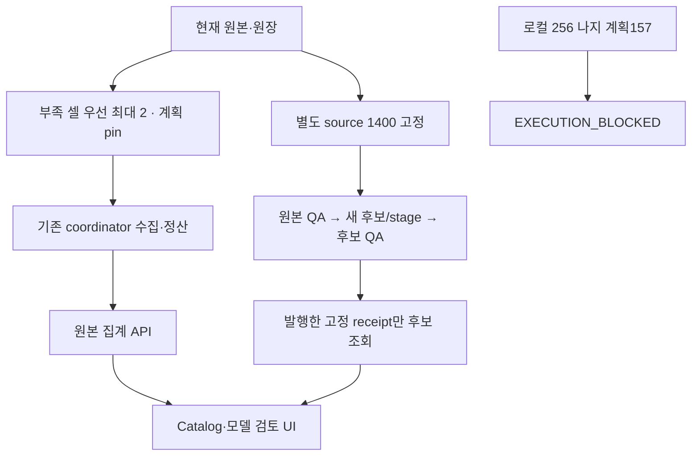

# Gate156 — 부족 셀 우선 수집과 별도 누출제외 후보 QA·현황 UI

| 필드 | 값 |
|---|---|
| updated_at | 2026-10-18 10:45:15 KST — 원본1464/1164 실제UI·격리288 PASS 확정; round4 계획/159 QA 진행 분리 |
| source_commit | 기준 76949f650123653f30841507feebc7678aaea151 + 148–157 검증 작업파일 raw SHA (관측 시점 작업파일; 최종 Git 게시의 바이트 보존은 별도 확인) |
| evidence_paths | `docs/implementation/152_priority_collection.md`; `docs/implementation/152_targeted_bare_collection_rfc.md`; `docs/implementation/153_priority_collection_split_candidate_qa.md`; `docs/implementation/154_collection_progress_ui.md`; `docs/implementation/155_collection_priority_status_contract.md`; `docs/implementation/157_targeted_bare_plan.md`; `scripts/collect_training_priority.py`; `backend/app/collection_priority_status.py`; `backend/app/data/targeted_bare_plan.py`; `frontend/src/CollectionProgress.tsx`; `frontend/src/collectionProgressAdapter.ts`; `evidence/integration/priority-collection-final-20261018.json`; `evidence/integration/priority-collection-root-tests-final-20261018.log`; `evidence/integration/priority-root-related-20261018.log`; `evidence/integration/collection-progress-ui-focused-final-20261018.log`; `evidence/integration/collection-progress-ui-frontend-20261018.log`; `evidence/integration/collection-progress-ui-build-final-20261018.log`; `evidence/integration/targeted-bare-plan-local-20261018.json`; `evidence/integration/priority-collection-round2-final-20261018.json`; `evidence/integration/priority-ml-20261018-summary.json`; `evidence/integration/priority-ml-20261018-final-verification.json`; `evidence/integration/priority-ml-ui-receipt-20261018.json`; `evidence/integration/priority-collection-independent-20261018.json`; `evidence/integration/collection-progress-ui-candidate-browser-20261018.json`; `evidence/integration/collection-progress-ui-candidate-refresh-final-20261018.png`; `evidence/integration/collection-progress-ui-candidate-refresh-dom-20261018.txt`; `evidence/integration/priority-root-related-final-20261018.log`; `evidence/integration/priority-status-tests-final-20261018.log`; `evidence/integration/priority-collection-round3-final-20261018.json`; `evidence/integration/priority-status-api-final-restored-20261018.json`; `evidence/integration/priority-frontend-isolated-source-20261018.json`; `evidence/integration/priority-frontend-isolated-build-20261018.log`; `evidence/integration/priority-frontend-isolated-tests-initial-20261018.log`; `evidence/integration/priority-frontend-isolated-tests-20261018.log`; `docs/implementation/159_next_collection_candidate_qa.md`; `evidence/integration/priority-frontend-isolated-tests-fixtures-partial-20261018.log`; `evidence/integration/collection-progress-ui-final1464-browser-20261018.json`; `evidence/integration/collection-progress-ui-final1464-dom-20261018.txt`; `evidence/integration/collection-progress-ui-final1464-candidate-20261018.png` |
| confidence | round3 정산·153 후보1106 실제QA·최신1464 UI·격리frontend288 PASS/build120 확인; 159 최종은 별도 대기 |
| status | VERIFIED_REAL 실제수집·153 고정후보QA·최신UI / 157 실행BLOCKED·나지4차단 / round4 PLANNED·159 QA 진행 |

## 쉬운 설명

부족한 주·연도를 먼저 골라 같은 예산으로 최대 두 작업을 수집한다. 첫 실행에서 새 32개 중 19개 적격이 늘었지만 나지는 14픽셀뿐이라 학습 부족은 남는다. 창고 수량을 늘리는 일, 학습용 세트를 고르는 일, 품질을 승인하는 일은 서로 다르다. 다음 수집과 새 후보 QA는 최종 근거를 받기 전 완료로 쓰지 않는다.

## 이론적 배경

전체 목표 부족은 max(0, 1200-적격 합계)다. 균형 계획 부족은 주·연도 36개 셀 각각의 max(0, 28-셀 적격)을 합한 값이다. 한 셀의 초과분으로 다른 셀의 부족을 빼지 않는다. 목표 수량은 공간 대표성·장면 독립성·클래스 균형·정확도 승인이 아니다.

수집 원본은 실행 중 바뀔 수 있다. 실제 QA는 고정 SHA의 사본을 사용해야 같은 행 집합에 대해 후보를 만들고 검사할 수 있다. 이 고정 cohort에 이후 수집 행이 자동 포함됐다고 말하지 않는다. 충돌 행은 새 후보에서만 제외하고 원본 삭제나 split 재배정은 하지 않는다.

## 구조

## 코드와 데이터 동작

152의 collect_training_priority는 round-robin 뒤의 실제 목록에 부족량 정렬을 연결한다. 같은 key/config 충돌·pending·settled·이미 적격인 물리 창을 검사하고 최대 1~2건만 선택한다. 같은 원장·4GiB·3000개 상한·2worker·전역 2초 간격·첫 429 공유 중단을 유지한다. 새 예산이나 기존 pending 재시도·환불은 없다. 실행 직전 expected plan SHA를 다시 확인한다.

잘못된 pin 뒤 service Event 참조가 남는 경계는 첫 실행 종료 후 정리했다. wrapper의 stdout/stderr 전달도 보강했다. 첫 실행의 child stdout이 비어 있던 사실은 보존하고, source history·파일·원장·정산 JSON으로 실제 결과를 확인한다. 계획 pin은 선택 시점 관측이며 다중 파일의 원자 snapshot은 아니다.

## 첫 우선 수집의 실제 결과

남동술라웨시 2024 g03과 고론탈로 2025 g03은 정산 완료다. 원본 1400/1122에서 물리 1432·적격 1141·적격 외 291로 늘었고 split은 658/233/250이다. 새 32행 중 19개가 적격이며 신규 나지 저장 참조는 14픽셀이다. 셀 부족은 151→132, 전체 1200 목표 부족은 78→59다.

기존 1400행과 pending 두 건의 예약 136314880B를 보존했다. round1 잔여 예산은 2297868407B다. 이는 순차 읽기로 확인한 정산·저장 집계이며 새 native QA가 아니다. round2 EastJava 2025 g01/g02는 두 건 모두 수집 실패·정산 완료다. 시작·전송·정산·적격 증가를 구분하고 최종 수치를 추정하지 않는다.

## 153의 고정 원본과 새 후보

source 1400행/적격 1122개 snapshot SHA921152…의 실제 QA는 230.906초에 끝났다. split 639/233/250, 차단 5건, 검증 파일 4385개를 확인했다. 나지 픽셀은 1418/209/1025이고 충분한 기여 패치는 모두 0개다.

새 후보는 충돌 16행을 제외해 별도 생성·staging한 적격 1106개 cohort다. 기존 1095 후보·원본·분할·모델은 불변이다. 새 후보의 실제 QA와 영수증은 완료됐고4건 나지 차단을 확인했다. metadata 충돌 0만으로 완전 공간 독립성이나 과학 승인을 주장하지 않는다. 이후 수집 행은 이 QA에 자동 포함되지 않는다.

## 154/155의 현황 화면

원본 집계는 manifest quality_status와 저장 참조 histogram 기준이다. native_raster_reverified·learning_ready·science는 false다. UI는 물리=적격+적격 외, 주·연도·split 합계, gap·비율·flags를 검산한다. 미확보/null을 0으로 바꾸지 않는다.

candidate_quality는 명시 발행 receipt와 source/candidate/QA SHA를 확인한다. 현재 원본과 다른 cohort인지 표시하고 pointer가 없으면 후보 미확보로 남기고 최종 pointer 발행 뒤 실제 후보를 확인했다. 원본 값이나 과거 후보로 대체하지 않는다. Catalog는 부모의 기존 GET을 재사용하고 모델 검토는 진입 시 한 번 읽기와 수동 새로 조회를 지원한다. 자동 polling·수집·학습·승인은 없다.

실제 5174/API8002에서 1432/1141/291, split 658/233/250, 부족 59/132의 동적 표시를 확인했다. 1573px 화면의 가로 넘침은 0이며 관측 범위 console warn/error는 0이다. 모바일·강제 지연·인증 실패는 실브라우저에서 재현하지 않았다. API PID8564의 /api/health 200과 catalog14 SHA 보존을 확인했고 첫 /health 404는 별도 보존했다.

## 157은 로컬 계획만 검산한다

실제 반텐 val2020 라벨의 256창에서 source code8 2411픽셀, inside1.0을 확인했다. 고정 목록 1526개 image의 실제 SHA·헤더와 양의 면적 겹침 0을 110.0058014초에 관측했다. 이는 VERIFIED_REAL_LOCAL 약한 라벨과 목록 범위 검사다.

pending 전체·SWIR/SCL 보조 영역·선택될 Sentinel/B02·새 scene split veto·배타 출력·최종 품질/나지·coordinator는 미연결이다. 성공도 LOCAL_TARGETS_VERIFIED_EXECUTION_BLOCKED와 EXECUTION_GUARDS_NOT_CONNECTED다. 새 다운로드·품질 적격·학습 차단 해소는 0이며 후보 10개 전체의 독립성을 검증하지 않았다.

## 시험과 한계

152 정리·전달 보강의 최종 관련은 30 PASS/1.901초, 추가 관련은 47 PASS/11.479초다. 초기 집중 9 PASS/1.129초와 합산하지 않는다.155 초기 13/1.105초·27/2.313초와 최종 14/1.002초도 각각의 이력이다.

154 집중은 8 PASS/1.1917267초, 전체 front는 288 PASS/43.7817264초, build는 123모듈/41.81초다. 최종 build에 병행 Toolbox 변경이 포함됐으며 다른 기능까지 실제 브라우저 인증한 것은 아니다.157 집중 8 PASS/6.799초와 실제 로컬 검산은 별도다.

후보 실제 QA는 완료됐다. 후보 UI는 실제 화면에서 확인했다. 진행 중인 수집 원본·원장은 실행별 근거와 구분한다. round2 실패·정산은 아래 확정 근거로 구분한다. 학습·독립 정답·기관·배포 승인은 남아 있다. 기존 148–151 본문과 Gate를 보존하고 완료 사실만 추가했다. 전체 프로젝트는 미완료다.

## 발표 대본

### 1분

“부족한 주와 연도를 먼저 수집해 첫 두 작업에서 32개 패치, 19개 적격이 늘었습니다. 나지는 14픽셀이라 부족 해결은 아닙니다. 전체 목표 부족 59개와 지역·연도 균형 부족 132개는 다릅니다. 화면은 현재 원본과 고정 후보를 구분합니다. 새 후보 QA는4나지차단으로 끝났고 두 번째 수집은 실패했으며, 나지 위치를 찾았어도 실행 안전 연결은 아직 차단돼 있습니다.”

### 5분·10분

5분은 두 부족량, 제한 수집, 고정 후보 QA, UI와 관측 시각, 표적 차단을 각각 1분씩 설명한다.10분은 원본과 cohort SHA 1분, 나지 세 조건 1분, pending 보존 1분, Q&A 2분을 더한다.

## Q&A

Q.151개 부족은 모두 해결됐나? A.round1 셀 부족은 132이며 이후 최종 수집 결과를 기다린다.

Q.나지 14픽셀은 기여 patch인가? A.한 patch에 최소 256픽셀이 필요하며 5개 기여·0.5% 조건도 별도다.

Q.새 후보 1106은 최신 원본인가? A.source1400 snapshot만 포함하며 후속 수집은 별도다.

Q.표적 2411픽셀이면 바로 수집하나? A.실행 guard가 미연결이어서 차단이다.

Q.현황 UI가 학습을 허용하나? A.저장 집계의 읽기이며 학습 준비·과학 승인은 false다.

## 근거

[우선 수집152](../../implementation/152_priority_collection.md) · [고정 후보153](../../implementation/153_priority_collection_split_candidate_qa.md) · [UI154](../../implementation/154_collection_progress_ui.md) · [API155](../../implementation/155_collection_priority_status_contract.md) · [표적 계획157](../../implementation/157_targeted_bare_plan.md)

round2 최종: EastJava2025 g01/g02는 모두 AOI 중심점이 COG 범위 밖이어서 failed였다. 원장 정산은 끝났지만 수집 성공은 아니며 신규 물리·적격·나지는 0이다. 계상 비용은1325635B, 잔여2296542772B이고 누계1432/1141/291·목표부족59·셀부족132는 유지됐다.429는 false이며 기존 pending 두 건과136314880B 예약을 보존했다. round2 stdout은 worker 시작/종료 각각2개를 전달했고 첫 round stdout 부재 이력과 다르다. 상태·수치는 각 실행 시점의 순차 관측이며 실제 후보 QA에 자동 포함되지 않는다.

153 최종 실제 QA: 고정 원본 1400행/적격 1122개(639/233/250)의 차단 5건을 230.906초에 확인했다. 반텐 16행을 새 후보에서만 제외해 1384행/적격 1106개(639/217/250)가 됐다. 후보 QA는 239.188초에 나지 차단 4건과 학습 준비 false를 확인했다. 보존 행과 원본의 일치·완전한 제외/보존 partition·scene/source group/image SHA의 분할 간 충돌 0을 추가 검산했다. 파일 4335개의 SHA도 9.125초에 다시 계산해 불일치 0이었다. 원본 snapshot SHA921152…·정책·구1095 후보는 불변이며 이후 1432행 수집은 이 QA에 포함되지 않는다. 공유 source 차단 미관측은 완전 공간 독립성·현장 정답·과학 승인과 다르다.

현재 round3 EastJava2025g03·Gorontalo2022g03의 제한2건을 시작했으며 실정산·적격 증가량은 아직 대기다. round1/2 완료 값과 실행 중인 round3를 구분한다. 후보 pointer는 source/candidate/QA 세 pin을 검산해 발행했고 API 후보 available=true·현재 원본과 cohort 일치=false를 확인했다. 후보의 실제 화면 표시와 원본 cohort 불일치 경고를 최종 검증했다.

독립 수집 감사는 첫32개 patch의 실제2097152픽셀을 읽어 SHA·valid/inside·품질·나지 계수와 source crops를 확인했다.15.2078273초에19적격/적격 내 나지14픽셀을 재확인했고 기존1400행 canonical·pending예약은 불변이었다. 초기 감사 helper 오류 두 번은 제품 실패와 구분해 원로그로 보존한다. 이는 원본 현황API의 저장집계와 별도 실제 native 감사이며 독립 현장 정답 인증은 아니다.

154 최종 실브라우저는 현재 원본1432물리/1141적격/291적격 외·split658/233/250·목표부족59/셀부족132와 고정 후보1106적격·split639/217/250·차단4건·ready=false를 분리 표시했다. 현재 원본 SHA7eac…와 후보 생성 원본 SHA921152…가 달라 새 수집분을 자동 포함한 후보가 아니라는 경고를 확인했다. 수동 새로 조회 시 이전 표를 지우고 단일 busy 뒤 재표시했고 관측 console error/warn0·가로 넘침0이었다. 최초 후보 GET은 수 분 걸렸으므로 SLA로 표현하지 않는다. 모바일·강제 지연·인증 실패는 실제 화면 미재현이며 단위 시험과 구분한다.

최종 추가 관련 회귀는48 PASS/5.326초다. stale 현재 원본 SHA를 먼저 확인해 과거 readiness4335개 불필요 재해시를 생략하되 source_matches_current_manifest=false 판정은 유지했다. 실제 서버 재적용·성능 SLA는 코드 시험과 별도다. 이전47 PASS/11.479초와 묶음을 합산하지 않는다.153의 source1400/후보1106 결과는 확정했으며, 별도로 시작한159 source1432 snapshot QA와 round3 제한 수집은 아직 진행 중이다. 이후 결과를 이번153 cohort에 소급하지 않는다.

### round3 완료 후 관측 정정 — 앞선 수집·UI 수치는 각 시점 이력

10:35:17 round3는 두 작업 정산을 마쳤다. 신규 물리32개·적격23개·저장 참조 나지148픽셀을 더해 누계1464물리/1164적격/300적격 외, split681/233/250이다. 셀 부족은132→109, 전체1200 목표 부족은36이다. 이번 세 round 합계는 신규64물리·42적격·저장 나지162픽셀, 계상87636806B이며 잔여2254269438B다.429는false,실행 잠금은 정상 해제됐고 기존 pending 두 건의136314880B는 보존했다. 나지162픽셀을 새 기여 patch·분할별0.5%·학습 차단 해소로 해석하지 않는다.

기존 UI의1432/1141 관측은 당시 이력이다. API8002를 PID36400으로 재적용해 /api/health200·catalog14 SHA 보존을 확인했다. 최신 GET의 원본1164와 고정 후보1106은 서로 다른 cohort이며 source_matches_current_manifest=false다. 실제 새 UI refresh 확인은 후속이다. GET15.838초는 한 번의 관측이며 SLA가 아니다. 기존153 후보의 나지4차단·4335파일 pin 불일치0과 구1095 보존은 그대로다.

159는1432행 snapshot을 고정한 별도 후속이다. 원본 단계의 적격1141/차단5건·164.672초 관측과 진행 중인 전체 후보 생성/QA를 구분한다. 이후 round3의 새32행은 이 snapshot에 포함되지 않는다. 최종 후보 수량은 영수증·summary·파일 재검산이 끝나기 전 확정하지 않는다.

Root는 병행 Toolbox 작업을 제외한 공개 HEAD와 이번7개 frontend 파일만 격리해 build120모듈/32.33초를 통과했다. 최초 격리시험193 PASS/33 FAIL은 fixture 미수출 ENOENT 이력으로 보존했다. fixture 연결 후 현재 로그는260건 중254 PASS/6 FAIL/22.7347215초이며 최종 검증은 아직 대기다. 초기 fixture 준비 오류와 이후6 FAIL의 원인·최종 결과를 구분해 확인하며 이 실패를 숨기거나 전체 통과로 기록하지 않는다. 앞선 front288/병행 build123과 격리 build120은 서로 다른 소스 범위다.

격리 frontend 최종 정정: 공개 HEAD76949와 동결된 이번 UI7파일만 합친 범위에서288 PASS/0 FAIL/36.4999934초, build120모듈/32.33초를 확인했다. 병행 Toolbox WIP·App·PShell 변경은 이 격리 범위에 포함하지 않았다. 최초33 FAIL은 evidence fixture 미수출, 다음6 FAIL은 Python 시험 import 의존성 연결 누락이었다. 원로그를 보존하고 fixtures/backend/contracts/tests/.runtime/scripts 참조 junction을 보완해 제품 소스 변경 없이 최종 통과했다. 복사·pin metadata 출력 뒤 cp949 경로 print 오류도 준비 도구 이력으로 보존하며 복사 실패나 제품 결함으로 확대하지 않는다. 앞선254 PASS/6 FAIL은 보완 전 이력이며 현재 최종으로 사용하지 않는다. 최신 원본1464/1164의 실제 UI refresh와159 후보 QA는 별도 후속이다.

최신 UI 실제 재조회 확정: 응답 시각2026-10-18 10:41:01 KST의 실제5174→8002 화면은 원본1464물리/1164적격/300적격 외·split681/233/250·목표 부족36/셀 부족109·source SHA c57a…를 표시했다. 고정 후보는 source1400 SHA921152…의1106적격(639/217/250)·나지4차단·ready=false를 유지했고 현재 원본과 불일치 경고를 확인했다. 관측 console error/warn0·가로 넘침0·동결 UI7개 SHA 불일치0이다. 모바일·강제 지연은 실브라우저 미검증이며 저장 품질 집계를 새 native QA로 해석하지 않는다.

격리 frontend 최종288 PASS/36.4999934초·build120모듈/32.33초와 초기 준비 오류 이력을 분리했다. 이전1432 UI는 당시 관측으로 보존한다. round4 반텐2025 g01/g02는 계획 선정만 했으며 아직 실행 전이다.159의 source1432 기반 새 후보 native QA는 진행 중이고 source1400 기반153 후보 완료와 구분한다. 현재 원본1464나 round4 결과를159 QA에 자동 포함됐다고 쓰지 않는다. 전체 개발·독립 정답·나지 보완·기관/학습/배포 승인은 계속 미완료다.

### Root 후속 관측 — 2026-10-18 10:46 KST

4차 반텐2025 g01/g02는 계획뿐인 이전기록 이후 PID22020으로 실제시작했다. launch JSON의 plan4268eb34bcdb78d6c9efdc08b1c6020eaf0ad2f5ce8fb5e9bfe179dfd2f1d496를 고정했고 worker_started2건을 관측했다. 완료·추가적격은 아직확인하지 않았다.1464/1164는완료된3차기준이며159 고정1432후보QA와 구분한다. 근거:evidence/integration/priority-collection-round4-launch-20261018.json.

### 159 후속 후보 QA 완료 — 2026-10-18 10:48 KST

PLANNED→VERIFIED_REAL(고정 원본의 파일/래스터 검사 범위):1432행 시점 원본의 새후보는 반텐16행을 제외해1416행/1125적격(train658/val217/test250)이다. sourceQA164.672초·candidateQA216.0초·별도4435파일 SHA10.328초 검사에서 불일치0·source identity 교차분할0을 확인했다. 나지1432/209/1025픽셀·기여0/0/0·차단4·학습미준비/독립정확도미검증은 유지된다. 부가 connectivity 진단은1001820쌍이 기존100만cap을 넘어 NOT_CAPTURED_BUDGET이며 가드를 완화하지 않았다. 최신1464 원본의 나머지23적격은 포함하지 않는다. UI pointer는 아직검증된153의1106후보를 표시한다.1125후보의 API/UI 승계는 다음작업이며 실제화면 반영완료로 표현하지 않는다. 근거:docs/implementation/159_next_collection_candidate_qa.md,evidence/integration/priority-ml-next-20261018-summary.json,priority-ml-next-20261018-final-verification.json.

### 161 후속 UI·수집 완료 근거 — 2026-10-18 10:54 KST

VERIFIED_REAL(수집·파일검사·실제조회범위):4차완료1496물리/1196적격(681/265/250),셀부족97/목표부족4,원본val나지600픽셀·기여1개다. 검증후보1125(658/217/250)를3핀검산·이전receipt보존후UIpointer로승계했고실제브라우저에서차단4·미준비·현재원본과고정source불일치를확인했다. 최신55적격은후보QA밖이다. 나지0.5%/기여5개·독립정답·표적집행미연결차단은미해소다.5차동자바2021 g02/g03 PID33756은시작/완료미확인이다. 보고10분ACTIVE와실제collector/학습0을구분한다. 쉬운설명·이론·동작·증거·발표·Q&A는[161 이해노트](../gate-notes/GATE_CANDIDATE159_UI_ROUND4_20261018.md)에모았다.
