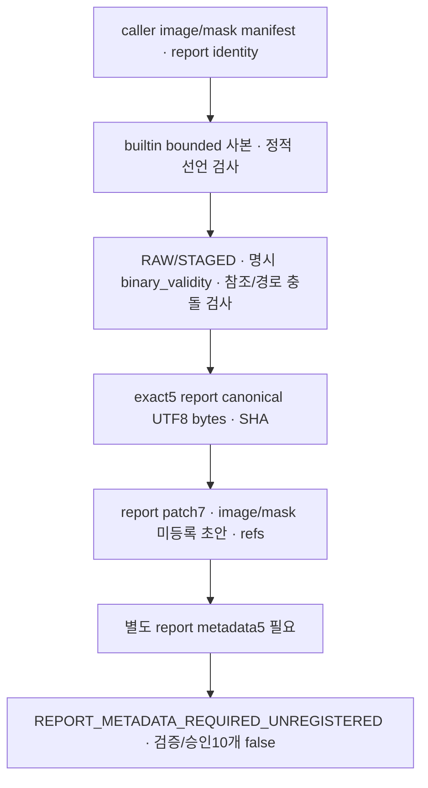

# Gate138 — 품질 보고서 바이트와 미등록 연결 초안의 준비

| 필드 | 값 |
|---|---|
| updated_at | 2026-10-18 05:52:09 KST — 138 최종 관련·독립·미등록 초안/소비 반례·보존 반영 |
| source_commit | 기준 f01752a699497e94bece097865c862e1173d5bf1 + 138 작업파일 raw SHA (게시 전 검증 시점; 후속 Git 게시의 바이트 보존은 별도 확인) |
| evidence_paths | `backend/app/data/quality_mask_bundle.py`; `tests/test_quality_mask_bundle.py`; `evidence/integration/quality-mask-bundle-agent-20261018.log`; `docs/implementation/138_quality_mask_bundle.md`; `evidence/integration/quality-mask-bundle-root-related-20261018.log`; `evidence/integration/quality-mask-bundle-independent-20261018.json`; `evidence/integration/quality-mask-bundle-independent-20261018.log`; `evidence/integration/quality-mask-bundle-independent-initial-20261018.json`; `evidence/integration/quality-mask-bundle-independent-initial-20261018.log`; `evidence/integration/quality-mask-bundle-live-integrity-final-20261018.json`; `evidence/integration/quality-mask-bundle-operating-inventory-20261018.json` |
| confidence | 완료 소스·집중9/관련39/독립7·실제 Temp 소비와 반례·보존 확인; 순수 준비와 작성/등록·승인 구분 |
| status | TESTED_SYNTHETIC 미등록 보고서 초안 준비; 별도 메타데이터/파일/등록·품질/과학/실행 승인 BLOCKED |

## 쉬운 설명

137은 진단을 읽는 화면을 연결했지만, 그 진단에 필요한 보고서를 실제로 생산하는 공백은 남아 있었다.138은 그중 입력 선언에서 보고서 내용을 조립하는 준비 함수만 만들었다. 양식의 일부를 채우고 내용의 지문을 계산하지만 파일을 저장하거나 등록하지 않는다. 특히 보고서 자체의 출처·범위·기간·품질 상태·접근 등급은 영상에서 복사해 만들어 내지 않고 호출자가 따로 제공해야 한다고 명시한다.

## 이론적 배경

파일 지문과 선언문 생성은 다른 작업이다. 입력의 영상·마스크 SHA는 호출자가 준 선언이고 이번에는 파일을 읽어 확인하지 않는다. 새 report SHA는 함수가 만든 canonical UTF-8 보고서 바이트의 지문일 뿐, 디스크에 그 파일이 존재한다는 뜻이 아니다. 보고서의 내용이 영상을 가리킨다는 사실과 보고서 자체의 기관 출처는 구분해야 한다.

등록 manifest에는 source·spatial·temporal·quality_status·access_class가 필요하다. 보고서의 기관·라이선스·적용 범위가 영상과 같다고 임의로 복사하면 출처를 발명하게 된다. 따라서 exact7 report_manifest_patch만 반환하고 이5개 메타데이터는 미제공 상태로 남긴다. 불완전 patch는 등록용 완성 manifest가 아니다.

## 구조

## 코드·입력 → 처리 → 출력

`prepare_quality_mask_bundle(image_manifest,mask_manifest,report_identity)`는 실제 builtin dict/list와 유한 JSON 값만 복사한다. depth16·nodes8192·dict128/list1024·string4096·정수53bit·encoded budget256KiB와 순환을 검사한다. image/mask의 GMAIS형 선언 중 지원하는 정적 부분과 RAW/STAGED만 받는다. 로컬 schema 파일이나 Registry를 열지 않으므로 전체 공식 schema 통과를 보증하는 함수는 아니다.

report identity는 id/version/artifact_uri의 exact3다. image/mask/report의 id/version 쌍은 서로 달라야 한다. report 경로는 안전한 상대 선언이어야 하고 image/mask와 충돌하지 않아야 한다. colon·절대경로·dot segment·빈 경로 조각·끝 공백/점 등을 거부한다. 문자열 경로 검사일 뿐 실제 파일·junction·디스크 위치 검증이 아니다. 원형 버전과 URI는 보존하되 경로 비교 시 slash를 정규화한다.

mask.source.mask_semantics는 정확한 binary_validity/정수1·0 선언이어야 한다. 누락·bool·SCL을 추정/변환하지 않는다. 이미지에 quality_report_ref가 이미 있으면 명시 report 경로와 정규화 후 같아야 한다. image와mask가 다른ref로 같은 파일/SHA를 선언하는 것은 이 준비 단계에서 가능하므로 물리적 마스크 성립을 보증하지 않는다.

생성 보고서 exact5는 schema_version1/scope LCLUC_QUALITY_MASK_EVIDENCE/image_ref/mask_ref/quality_status다. image의 RAW/STAGED 선언을 보고서 내용에 넣지만 실제 QA를 승인하지 않는다. sort_keys·compact·ensure_asciiFalse·allow_nanFalse로 만든 bytes와 SHA를 반환한다. image 초안의 quality_report_ref를 연결하고 mask 초안은 의미 선언을 그대로 보존한다.

## 반환값과 필요한 별도 메타데이터

exact22의 성공적 준비 상태는 `REPORT_METADATA_REQUIRED_UNREGISTERED`다. 등록 완료나 승인 완료라는 이름이 아니다. report_manifest_patch는 schema_version/dataset_id/version/data_type/sha256/artifact_uri/lineage의7필드다. lineage의 quality_input_image·quality_input_mask는 내부 소비 역할이며 기관 공식 표준을 확정하지 않는다.

report_metadata_required는 source/spatial/temporal/quality_status/access_class의5개다. 영상의 source/spatial/temporal을 report에 자동복사하지 않는다. report 본문이 가진 quality_status와 report 자산 자체의 quality_status 메타데이터가 필요한 것은 서로 다른 층이다. 초안과 refs는 detached 사본이고 입력을 수정하지 않는다.

artifact_bytes_verified·registry_references_verified·registry_registered·quality_report_verified·quality_mask_verified·source_authority_verified·scientific_accuracy_validated·execution_authorized·state_dict_verified·workflow_supported10개는 항상false다. 실제 바이트·헤더·mask값·기관ACL·과학·실행을 검사하지 않는다. 반환 bytes의 지문 계산을 원영상 파일 검증이나 Registry 조회로 승격하지 않는다.

## 시험 근거와 소비자 호환의 범위

집중9 PASS/1.103초를 읽었다. 순수 함수 시험은 open/stat/resolve·Store.get/put·cold schema를 금지하고도 준비되는지, 입력과 출력 사본 분리·RAW/STAGED 보존·정적 형태/날짜·bounded tree·선언/경로/참조 충돌을 확인한다. same URI/SHA alias 허용은 아직 물리검사가 없음을 보여준다.

별도 시험 caller가 부족한 report 메타데이터5개를 명시한 뒤 Temp에 bytes를 쓰고 세 manifest를 등록해131/133 reader로 소비한다. 이 setup의 파일쓰기·등록과 reader의 실제파일 읽기를 준비 함수의 기능으로 설명하지 않는다. 함수만으로 실제 report 파일·완성 Registry version·운영 생산자가 생기지는 않는다. 최종 관련39 PASS/9.865초·독립7 PASS/0 SKIP/1.4408525초·exit0과 보존 근거를 확인했다. 집중/관련/독립 반복은 합산하지 않는다.

## 최종 독립 소비·반례·보존

독립 실제 fresh Temp는6밴드 영상·checkerboard 마스크128/128/256·report bytes에 caller 메타데이터5개를 명시했다. 시험 setup이 SQLite에3버전을 등록한 뒤131/133을 읽기 전용으로 각각 소비했고 get총6회·DB/전체 파일 불변·과학/실행false를 확인했다. 준비 함수의 파일·Registry 작업은0이다. 정상 소비 응답을 모의로 성공시킨 것이 아니며 호출 감시·무쓰기 guard만 시험에 사용했다.

nodata0·값255·RESTRICTED는 준비가 성공해도 소비자가 각각 intrinsic validity·binary값·PUBLIC 조건에서 차단했다. 입력 SHA는 선언이라 파일 의미를 검증하지 않는다는 실제 반례다. 초기 독립7 PASS/1.121839초는 guard assertion 강화 전 통과 이력으로 initial 파일에 보존하고 최종7/1.440853초와 합산하지 않는다. source72750fe9...3945/test1bfa06a5...ffa6의 동결 SHA는 최종 근거와 일치했다.

05:51 최종 보존 검사에서 보호141·기존 소스314개 전체·이전 증거1275개·catalog14행 canonical SHA·예약136314880바이트가 불변이었다.05:47 운영 count는DatasetVersion0·legacy datasets6/models1이다. 운영 파일·모델 load·수집·등록·훈련·추론·배포·Workflow dispatch는0이다. 이번 전체 backend/front/build/browser를 재실행하지 않았고137의 전체1359건(1358 PASS/1 SKIP)·front271은 이전 근거다.

보고서 경로를 image 초안에 추가하면 manifest 내용이 바뀐다. 이미 등록된 같은 id/version을 덮을 권한을 부여하지 않으며 caller가 새 미등록 id/version을 명시해야 할 수 있다. 함수가 version을 증가시키거나 Registry를 역채우지 않는다. report_bytes만 Python bytes라 반환 전체를 그대로 JSON serialize할 수 없고, 실제 저장은 별도 후속이다.

## 한계와 다음 작업

138의 준비 함수는137 UI/API와 미연결이고 자동조회 가능한 등록자료를 만들지 않는다. 이번 공개 계약/UI·기존 소비자131~137·실행 gate·원본·원장·예약은 바꾸지 않는다. 새 미연결 순수 함수라 이번 전체 backend/frontend/build/browser 재실행은 하지 않으며137의1359/271 결과는 이전 근거다.

다음139는 caller의 report 메타데이터를 완성하는 내부 계약 후보(PLANNED)다. 실제 writer·Registry 등록·기존nodata0에서 파생 mask 생성·수집기 연결·band description·기관/QA/학습·실행 승인은 별도다. 기존 자료에 의미를 소급 선언하거나 자동VALIDATED로 바꾸지 않는다.

## 발표 대본

### 1분

“품질 보고서를 준비하는 작은 함수를 만들었습니다. 영상과 마스크의 명시 선언을 받아 보고서 내용과 지문, 미등록 연결 초안을 돌려줍니다. 파일을 쓰거나 등록하지는 않습니다. 보고서 자체의 출처와 범위·기간·상태·접근 등급은 호출자가 따로 제공해야 하며 영상에서 복사해 만들지 않습니다. 시험에서 별도 임시 자료를 작성·등록하면 기존 진단이 읽을 수 있는지 확인하지만, 준비 함수가 운영 생산자까지 완성한 것은 아닙니다.”

### 5분

첫1분은 양식을 채우는 준비와 파일·등록을 구분한다. 다음1분은 영상/마스크의 선언 SHA와 새 report 바이트 SHA의 차이를 설명한다. 세 번째1분은 exact5 본문·patch7·별도 메타데이터5를 보여준다. 네 번째1분은 caller가 Temp 작성·등록한 소비자 호환 시험을 분리해 소개한다. 마지막1분은10개false·RAW/STAGED·139 메타데이터 완성과 실제 writer 후속을 정리한다.

### 10분 확장

‘생산 공백의 일부’,‘양식과 출처’,‘바이트와 지문’,‘준비/작성/등록/소비’,‘운영까지 남은 일’ 다섯 장에 입력 사본/경로 경계2분·같은 파일 alias 한계1분·Q&A2분을 더한다.

## Q&A

Q. report 파일이 생성됐나? A. 함수는 메모리의 bytes만 반환하며 파일을 쓰지 않는다.

Q. report manifest를 바로 등록하나? A.5개 별도 메타데이터가 없어 patch는 등록용 완성 manifest가 아니다.

Q. source를 영상에서 복사하면 되지 않나? A. 보고서 자체의 출처를 증명하지 못해 자동복사하지 않는다.

Q.131/133 소비 성공이면 운영 등록인가? A. 시험 caller의 Temp 작성·등록 setup이며 운영은 아니다.

Q.137 화면에서 자동조회 가능한가? A. 미연결·미등록이므로 아니다. 실제 producer/writer는 후속이다.

## 근거 바로 열기

[준비 함수](../../../backend/app/data/quality_mask_bundle.py) · [집중 시험](../../../evidence/integration/quality-mask-bundle-agent-20261018.log)

[구현 설명](../../implementation/138_quality_mask_bundle.md) · [관련 회귀](../../../evidence/integration/quality-mask-bundle-root-related-20261018.log) · [독립 Temp 소비](../../../evidence/integration/quality-mask-bundle-independent-20261018.json) · [최종 보존](../../../evidence/integration/quality-mask-bundle-live-integrity-final-20261018.json)
