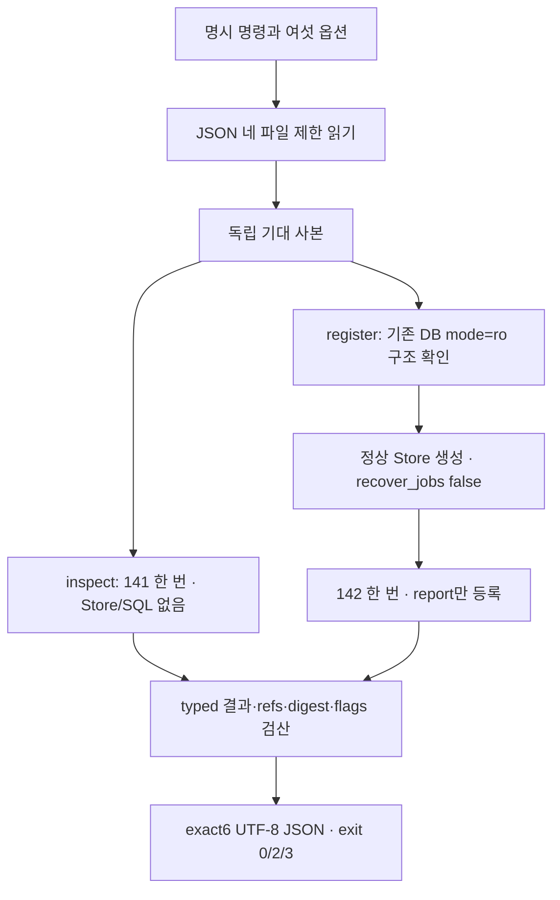

# Gate143 — 품질 보고서의 명시 CLI 점검과 등록

| 필드 | 값 |
|---|---|
| updated_at | 2026-10-18 06:50:08 KST — 143 명시 CLI·최종 시험·운영 보존 반영 |
| source_commit | 기준 e3262a3acb09f89a48124cfc9f32c20bb923975a + 143 검증 작업파일 raw SHA (게시 전 검증 시점; 후속 Git 게시의 바이트 보존은 별도 확인) |
| evidence_paths | `scripts/quality_report_cli.py`; `tests/test_quality_report_cli.py`; `docs/implementation/143_quality_report_cli.md`; `evidence/integration/quality-report-cli-agent-20261018.log`; `evidence/integration/quality-report-cli-agent-initial-20261018.log`; `evidence/integration/quality-report-cli-root-related-20261018.log`; `evidence/integration/quality-report-cli-independent-20261018.py`; `evidence/integration/quality-report-cli-independent-20261018.json`; `evidence/integration/quality-report-cli-independent-20261018.log`; `evidence/integration/quality-report-cli-live-integrity-final-20261018.json`; `evidence/integration/quality-report-cli-operating-inventory-20261018.json` |
| confidence | 집중 11 PASS/12.558초·관련 90 PASS/37.707초·독립 10건 9 PASS/1 SKIP/33.0078190초; 실제 Temp subprocess·모의 오류·운영 미실행 구분 |
| status | TESTED_SYNTHETIC 명시 CLI 점검·Temp 등록; 운영 등록 0·품질/과학/실행 승인 BLOCKED |

## 쉬운 설명

준비된 보고서를 명령줄에서 점검하거나 등록하는 진입점을 추가했다. 파일 점검인 inspect는 DB가 없어도 된다. register는 기존 영상·마스크 버전과 DB를 확인한 뒤 보고서 한 버전만 등록한다. 창구에서 서류를 검토하는 일과 장부에 접수하는 일을 나눈 것과 같다. 접수됐어도 내용의 진실·품질·실행 승인까지 얻은 것은 아니다.

## 이론적 배경

CLI는 호출자와 내부 함수 사이의 계약 경계다. 잘못된 입력을 일찍 닫고 결과를 다시 검산하며 종료 코드로 다음 행동을 구분해야 한다. 특히 저장 후 응답을 확인하지 못하면 이미 commit됐을 수 있다. 따라서 실패처럼 보인다는 이유로 쓰기 0·rollback 완료·재시도 안전을 주장하지 않는다.

정적 --help를 제외하면 결과는 UTF-8 JSON 한 개다. 원문 인자와 예외를 오류에 넣지 않지만 정상 payload의 caller metadata나 상대 URI를 자동 비식별화한 것은 아니다.

## 구조

## 코드와 입력 → 처리 → 출력

`scripts/quality_report_cli.py`의 run(argv)는 종료 코드와 wrapper를 반환하고 main은 stdout 한 줄 JSON을 출력한다. 기본 명령이나 환경 root는 없다. inspect 또는 register와 data-root/image-manifest/mask-manifest/report-identity/report-metadata/manifest-output-uri 여섯 옵션을 명시한다. data_root는 기존 절대 경로다. JSON 입력 경로는 별도 명시 파일이며 data_root 안에 있다고 추정하지 않는다.

argv는 builtin str 최대 32개, 각 4096자다. 같은 옵션의 반복과 약칭을 거부하며 `--flag value`와 `--flag=value` 혼합도 중복 검사한다. JSON 네 파일은 각각 256KiB 이내로 O_RDONLY 누적 읽기와 fd/lstat·부모 identity를 확인한다. strict UTF-8·중복 key·NaN/Infinity·float overflow·surrogate·깊이 16·정수 16자리 및 53-bit 범위와 bounded builtin 사본을 검사한다. 이 제한은 직접 JSON 경계이며 기존 source 전체 SHA나 DB decode·전체 CPU/RSS/SLA의 hard cap이 아니다.

inspect는 141을 한 번 호출한다. Store 생성·SQL·원영상/마스크 읽기는 없고 보고서 두 파일과 cold 로컬 schema 읽기는 가능하다. DB 없는 실제 Temp subprocess 성공과 별도 Store/SQL 호출 0 guard를 구분해 확인했다.

register는 기존 catalog.sqlite3 일반 파일·부모 identity를 확인하고 SQLite URI mode=ro로 records table의 kind/id/body TEXT 및 복합 PK kind/id를 확인한 뒤 연결을 닫는다. 그 뒤 기존 Store(root,recover_jobs=False)를 정상 호출한다. 생성자의 mkdir·CREATE TABLE IF NOT EXISTS 메서드는 실행되며 정상 기존 root/table에서 no-op 의도다. 모든 경쟁·journal 복구·외부 쓰기를 포함하는 물리 쓰기 0 보장은 아니다.

Store 생성 뒤 142를 한 번 호출한다. 기존 source 두 버전의 raw manifest와 실제 전체 파일 SHA를 검증한 뒤 report만 등록한다. 원영상/마스크의 byte 해시는 읽지만 native header·pixel·의미 검사는 추가하지 않는다. source 두 버전 setup·보고서 파일 작성·누락 quality_report_ref 역채움은 하지 않는다.

## 결과와 오류

wrapper는 schema_version/scope/command/status/issue/result 정확한 여섯 키다. scope는 EXPLICIT_QUALITY_REPORT_CLI_ONLY다. 자식 141 exact23과 142 exact22는 사본으로 고정한 뒤 타입·고정 refs·digest·flags·등록 기록을 검산한다. 오염 결과와 비허용 오류 code를 그대로 출력하지 않는다.

| 관측 | 종료 코드 | 의미 |
|---|---|---|
| inspect 성공 | 0 | 저장 파일·schema 점검 성공, 미등록 |
| register 성공 | 0 | report 등록 결과 확인, 미승인 |
| 입력·사전 DB·정상 자식 차단 | 2 | BLOCKED, 검산한 결과 또는 null |
| 142 결과 미확정 | 3 | commit 가능성 유지, 검산한 결과 |
| constructor 시작 뒤 예외·오염 결과 | 3 | 결과 미확정, payload null |

constructor 시작 뒤 오류나 실제 commit 뒤 예외의 result=null은 행 부재나 rollback을 뜻하지 않는다. 자동 retry·삭제·복구가 없고 이미 남은 파일과 DB를 보존한다. 정상 동일 report 재호출은 기존 142의 immutable replay 계약이며 140 writer의 선존재 파일 거부와 별개다.

동결 CLI raw SHA는 `a6fb6388674ef41ab30329ff55dcb1291e1221cb7d9d8068c7dd6689f5eed87d`, 집중 시험 raw SHA는 `37dd83beb849cc985ce4539d959be88b5de464731c21194816ec7e3cb8f0c3d1`이다.

## 시험 증거와 상태

143 최종은 집중 11 PASS/12.558초·관련 90 PASS/37.707초·독립 10건 중 9 PASS/1 SKIP/33.0078190초다. 중복 묶음은 합산하지 않는다. 초기 집중 10 PASS/14.882초는 중복 옵션 보강 전 통과 이력이며 실패가 아니다. 독립 초기 실패·cleanup 오류는 없고 실제 Windows symlink 권한 1314 제한 1건을 SKIP했다. 보호 참조 141개·기존 소스 324개·이전 증거 1366개·catalog 14행 SHA·예약 136314880B를 보존했다. 운영 DatasetVersion 0이며 운영 inspect/register·학습·추론은 실행하지 않았다. 이번 전체/backend/frontend/build/browser 재실행은 없고 137의 1358 PASS/1 SKIP·front 271은 이전 이력이다.

실제 Temp Unicode 입력·6밴드 GeoTIFF·checkerboard로 subprocess inspect/register/replay를 검증했다. noDB inspect 뒤 파일 불변, source 두 버전 setup 뒤 adapter report 한 건 등록, 같은 요청의 전체 DB/파일 불변, 131/133 읽기 소비 128/128/256을 확인했다. 이는 TESTED_SYNTHETIC 자료의 실제 프로세스 검증이며 운영 자료의 품질이나 독립 정확도 검증이 아니다.

constructor·자식 오염·실제 commit 뒤 예외는 명시 inprocess fault injection이다. 해당 Temp DB에서 report를 포함한 실제 세 행이 남아도 exit 3을 반환하고 rollback·retry·삭제를 하지 않았다. 자식 결과 사본 뒤 원래 객체가 변하는 경계도 검증했으며 실제 운영 동시성 시험으로 확대하지 않는다. symlink 실제 권한 SKIP은 모의 경계 성공으로 대체하지 않는다.

## 한계와 다음 작업

기존 설치 schema/checker의 시간대 허용 범위는 그대로다. 142의 결과 미확정·source 연결 부재·RESTRICTED 소비 차단도 유지한다. 등록은 품질·기관 ACL·과학·배포·실행 승인이 아니다. 기존 source 전체 해시와 Store JSON decode는 새 상한이 없고 경로·파일·DB의 순차 관측은 동시 원자 snapshot·TOCTOU 완전 차단·OS sandbox·반환 후 불변을 보장하지 않는다.

기존 main/API/137 UI와 collector는 변경하지 않았다. CLI만 추가했으므로 이번 frontend/build/browser와 전체 backend를 다시 실행하지 않았다. 기존 관련 회귀와 직접 subprocess·독립 시험 및 바이트 보존이 이번 근거다. 다음 144는 신규 collector 산출물의 band/mask 선언 연결을 읽고 검토하는 후보(PLANNED)이며 운영 수집 재개와 기존 자료의 의미 역채움은 별도다. 전체 프로젝트는 미완료다.

## 발표 대본

### 1분

“준비한 품질 보고서를 명령줄에서 직접 점검하거나 등록할 수 있습니다. 점검은 DB 없이 가능하고 등록은 기존 DB와 영상·마스크 두 버전이 필요합니다. 성공 0, 차단 2, 결과 미확정 3으로 나눕니다. 미확정이면 이미 저장됐을 수 있어 자동으로 다시 시도하지 않습니다. 임시 자료에서만 검증했으며 운영 등록과 품질·과학·실행 승인은 하지 않았습니다.”

### 5분

명시 입력의 필요성, 네 JSON 제한 읽기, 점검과 등록의 차이, 결과 미확정과 종료 코드, 실제 Temp 시험과 운영 한계를 각각 1분씩 설명한다. 슬라이드 제목은 ‘명시 호출’, ‘입력 경계’, ‘두 명령’, ‘세 종료 코드’, ‘관측과 승인’으로 잡는다.

### 10분 확장

위 설명에 mode=ro 사전 확인과 정상 생성자 1분, commit 뒤 예외 반례 1분, source 연결 부재와 소비 차단 1분, 질의응답 2분을 더한다. 운영 명령을 새로 실행하는 시연 대신 기록된 Temp 근거를 사용한다.

## Q&A

Q. register가 운영에서 이미 실행됐나? A. 아니다. 등록은 실제 Temp fixture에서만 실행했다.

Q. inspect가 DB를 만들 수 있나? A. Store와 SQL을 호출하지 않으며 DB 없는 정상 점검을 확인했다.

Q. mode=ro면 register 전체도 읽기 전용인가? A. 사전 구조 조회만 읽기 전용이며 그 뒤 정상 Store 생성자와 등록을 호출한다.

Q. 코드 3이면 다시 실행하면 되나? A. 이미 commit됐을 수 있어 자동 재시도나 부재를 가정하지 않는다.

Q. 오류에 경로가 없으면 모든 결과가 익명인가? A. 오류 원문은 숨기지만 정상 result의 caller metadata와 상대 URI는 원 계약대로 남는다.

Q. report 등록이면 소비와 QA도 통과하나? A. source 연결·접근 정책과 품질·과학·실행 승인은 별도다.

## 근거 바로 열기

[구현 설명](../../implementation/143_quality_report_cli.md) · [CLI 소스](../../../scripts/quality_report_cli.py) · [최종 독립 검증](../../../evidence/integration/quality-report-cli-independent-20261018.json) · [보존 감사](../../../evidence/integration/quality-report-cli-live-integrity-final-20261018.json)
