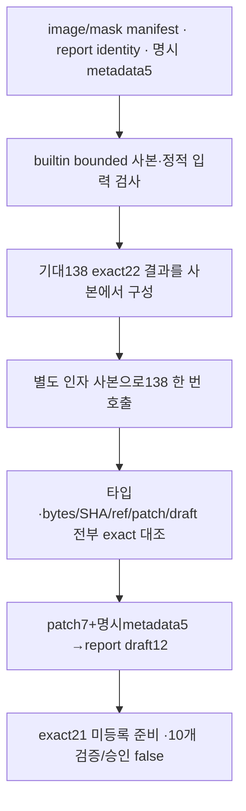

# Gate139 — 보고서 자체의 명시 메타데이터로 미등록 초안 완성

| 필드 | 값 |
|---|---|
| updated_at | 2026-10-18 06:03:05 KST — 139 재동결 초안 완성·최종 관련/독립·초기 보존·반례/보존 반영 |
| source_commit | 기준 200d22c3c7f146f795c26442eec1bd971733770d + 139 작업파일 raw SHA (게시 전 검증 시점; 후속 Git 게시의 바이트 보존은 별도 확인) |
| evidence_paths | `backend/app/data/quality_report_completion.py`; `tests/test_quality_report_completion.py`; `docs/implementation/139_quality_report_completion.md`; `evidence/integration/quality-report-completion-agent-20261018.log`; `evidence/integration/quality-report-completion-agent-final-20261018.log`; `evidence/integration/quality-report-completion-root-related-20261018.log`; `evidence/integration/quality-report-completion-root-related-final2-20261018.log`; `evidence/integration/quality-report-completion-independent-20261018.json`; `evidence/integration/quality-report-completion-independent-20261018.log`; `evidence/integration/quality-report-completion-independent-initial-20261018.json`; `evidence/integration/quality-report-completion-independent-initial-20261018.log`; `evidence/integration/quality-report-completion-live-integrity-final-20261018.json`; `evidence/integration/quality-report-completion-operating-inventory-20261018.json` |
| confidence | 재동결 소스·집중9/관련48/독립8·실제 Temp 소비/반례·보존 확인; 준비와 파일/등록·승인 구분 |
| status | TESTED_SYNTHETIC 명시 메타데이터로 미등록 초안 완성; 실제 저장/등록·품질/과학/실행 승인 BLOCKED |

## 쉬운 설명

138은 보고서 내용과 일부 등록 필드만 준비했고, 보고서 자체의 출처·범위·기간·상태·접근 등급5개를 남겨 두었다.139는 호출자가 그5개를 직접 제공했을 때12키의 보고서 manifest 초안을 완성한다. 빈 양식을 마저 채우는 일이지 파일을 발급하거나 등록을 승인하는 일은 아니다. 영상의 기관·기간을 보고서의 사실로 자동 복사하지 않는다.

## 이론적 배경

명시 선언을 완성하는 것과 선언의 진실성을 검증하는 것은 다르다. 보고서 자체의 source/spatial/temporal은 영상과 다를 수 있다. 보고서 자산의 STAGED와 본문이 가리키는 image RAW도 서로 다른 층이다. 이번 함수는 caller 선언을 보존할 뿐 어느 등급이 더 높으니 승인해도 된다는 정책을 만들지 않는다.

하위 준비 함수도 검증 경계로 본다. 결과의 dict 모양만 맞거나 boolFalse와정수0이 같다는 이유로 통과시키지 않는다. 입력 사본에서 기대하는 bytes·SHA·refs·patch·drafts·10false를 다시 만들고 정확한 타입과 원형 값으로 대조한다. float의-0.0과0.0도 canonical 표현이 다르면 구분한다. 출처 인증·실제 바이트 검증은 여전히 별도다.

## 구조

## 코드·입력 → 처리 → 출력

`complete_quality_report(image_manifest,mask_manifest,report_identity,report_metadata)`는4개 원입력을 받는다. metadata는 source/spatial/temporal/quality_status/access_class의 exact5다. builtin bounded JSON 사본·유한값·source의 institution/product/license·bbox/CRS·aware 날짜/순서·RAW/STAGED·접근 선언의 내부 subset을 검사한다. 파일 기반의 전체 schema validator를 호출하지 않으며 실제 기관/시간/공간 진실을 확인하지 않는다.

원 image/mask/identity 사본으로 기대138 결과를 구성하고 metadata를 검증한 뒤, 별도 사본을138에 넘겨 한 번만 호출한다. 잘못된 metadata면138 호출도0이다. 전달 인자를 하위가 바꾸어도 기대 결과의 사본은 유지된다. 반환은 bounded 기대 구조를 따라 exact type/key/order/value를 비교하고 custom equality를 실행하지 않는다.

정상 기대값에는 exact22·REPORT_METADATA_REQUIRED_UNREGISTERED·10false·report bytes/SHA·fixed refs·patch7·metadata 목록5·image/mask drafts가 모두 포함된다. 어느 하나가 오염돼도 PREPARATION_OUTPUT_INVALID로 차단하고 raw 예외/원경로를 내보내지 않는다. 하위 issue·추가 키·0으로 바뀐false·순서가 바뀐 lineage·변조bytes·SHA·ref 등은 성공으로 합치지 않는다.

대조 후 명시 metadata5와patch7을 겹치는 키 없이 결합해12키 report_manifest_draft를 만든다. report 본문·bytes·SHA는138과 동일하게 유지한다. report의 source/product·기간·품질 상태를 image에서 자동복사하지 않으며 report STAGED/image RAW도 caller 원형으로 남길 수 있다.

## 결과와 미검증 범위

exact21의 준비 상태는 `UNREGISTERED_REPORT_MANIFEST_PREPARED`다. 원래 image/mask 초안·report 완성 초안·본문/bytes/SHA·refs를 반환하지만 저장·등록은 하지 않는다. artifact_bytes_verified·registry_references_verified·registry_registered·quality_report_verified·quality_mask_verified·source_authority_verified·scientific_accuracy_validated·execution_authorized·state_dict_verified·workflow_supported10개는 항상false다.

image RESTRICTED/report PUBLIC을 선언해도 준비는 가능하다. 접근 등급 전파나 기관 ACL 정책을 발명하지 않으며 실제131 소비는 image의 PUBLIC 조건에서 차단될 수 있다. report 초안12키는 내부 subset에 맞춘 완성 형식이지 모든 upstream schema·실파일·QA·최소 비율·mask 정답·격자 인증이 아니다. 이미 등록된 image manifest를 덮거나 버전을 자동증가시킬 권한도 없다.

## 시험 근거와 준비/작성/등록 구분

초기 집중8 PASS/0.705초를 보존하고 재동결 집중9 PASS/1.234초·관련48 PASS/12.067초·독립8 PASS/0 SKIP/2.0615961초를 확인했다. exact21/report12·metadata원형·reportbytes 불변·no open/stat/resolve/Store/cold schema·입력/출력 분리·0vsFalse·custom equality·float-0·하위 인자 변조·정적 metadata 오류·RESTRICTED/PUBLIC 선언을 시험했다. actual Temp consumer 시험은 caller가 bytes를 작성하고 세 manifest를 등록한 뒤131/133으로 읽는 별도 단계다. 함수가 실제 파일이나 Registry를 만든 것이 아니다. 최종 관련/독립·보존 근거를 읽었으며 반복시험을 합산하지 않는다.

## 재검토 보강과 초기/최종 이력

초기 관련47 PASS/13.756초·독립7 PASS/0 SKIP/0.909638초는 초기 구현의 근거로 보존한다. 이후 검산 직후 report_bytes만 가변 producer dict에서 다시 읽는 경계가 발견됐다. 검산 뒤 producer가 바뀌면 이미 검산한 값과 다른 bytes를 반환할 여지가 있어, 새139에서 검증 기준 expected bytes로 고정했다. 기존138 이하 제품 코드는 바꾸지 않는다.

보강 전 통과를 보강 후 최종 통과로 재사용하지 않는다. agent-final·root-related-final2·재실행 독립의 새 동결 SHA와 결과를 확인해 마감했다. 초기 시험과 보강 회귀를 합산하거나 운영 자료에 적용했다고 표현하지 않는다.

## 재동결 후 최종 소비·경계 검증·보존

최종 집중9 PASS/1.234초·관련48 PASS/12.067초·독립8 PASS/0 SKIP/2.0615961초·exit0을 확인했다. 초기8/0.705초·관련47/13.756초·독립7/0.909638초는 원로그와 독립initial 파일에 보존한다. 최종 source SHA는d98c9d52e8add04b5a620d78d4e988e633477f761003ae646f6dc99906efab39, test는86f3f04a7778bd688ccb922e9dc59108dee6340d9ffbce0fa97b1894b51be07d다. 기존138 이하와 입력 원본은 바꾸지 않았다.

독립 회귀는 최종 한 표현을 이전 재읽기로 역복원한 격리 모듈의 원문 SHA가 초기0ef9...40e9와 정확히 같은지 확인했다. 명시 모의 callback이 검산 직후 producer bytes를 바꾸면 초기 버전은POISON/SHA불일치,최종은expected bytes/SHA일치였다. 제품 파일을 되돌리거나 운영 동시성을 실측한 것이 아니다.

별도 실제 fresh Temp는6밴드 영상·1밴드 마스크·완성 report를 caller setup으로 작성하고 SQLite3버전을 등록했다.131/133 읽기 get총6회·128/128/256·DB/파일 불변을 확인했다. report STAGED/image RAW/envelope RAW를 보존했고 RESTRICTED image/PUBLIC report·nodata0·255는 초안 완성 뒤 실제소비에서 차단됐다. 준비 함수의 파일/등록 작업은0이며 소비 성공을 모의한 시험이 아니다.

보호141·기존 소스316개 전체·이전 증거1291개 파일·catalog14행 canonical SHA·예약136314880바이트가 불변이다.05:57 운영 count는DatasetVersion0·legacy datasets6/models1이며 운영 등록·수집·학습·추론·배포·Workflow dispatch0이다. 이번 전체 backend/front/build/browser는 재실행하지 않았고137의 전체1359건/1358 PASS/기존1 SKIP·front271은 이전 근거다.

## 한계와 후속

138의 부족했던 명시 report 메타데이터 완성은139에서 구현했지만140의 새 경로 writer는 PLANNED다. 실제 파일 생성·overwrite 방어·등록·기존nodata0 파생mask·collector 연결·기관/QA/정책/모델/실행은 미완료다.137 API/UI도 바꾸지 않아 준비 초안이 자동 조회되지는 않는다.

기존 제품/시험·소비자·UI·원자료·원장·lock·예약을 보존하는 새 순수 함수다. 이번 전체 backend/front/build/browser 재실행은 하지 않으며137의 전체1359건(1358 PASS/기존1 SKIP)·front271은 이전 근거다. 준비 noI/O와 시험 caller setup의 파일·등록/reader I/O를 구분한다.

## 발표 대본

### 1분

“지난 준비 함수에서 비워 둔 보고서 자체의 메타데이터를 명시적으로 채우는 기능을 만들었습니다. 호출자가 출처·범위·기간·상태·접근 등급을 제공하면 등록용 초안을 완성합니다. 영상에서 사실을 복사해 만들지 않습니다. 하위 준비 결과도 타입과 바이트·지문까지 다시 확인합니다. 하지만 파일 저장과 실제 등록, 품질 합격은 하지 않습니다. 양식을 완성한 것과 공식 발급은 다르며 다음 writer 작업도 아직 계획입니다.”

### 5분

첫1분은 양식 완성과 발급을 구분한다. 다음1분은 별도 metadata5·patch7·draft12를 보여준다. 세 번째1분은 하위138 결과를 다시 대조하는 이유와False/0·bytes변조 예를 설명한다. 네 번째1분은 보고서STAGED/imageRAW·RESTRICTED/PUBLIC 선언의 한계를 보여준다. 마지막1분은 순수 함수/Temp작성·등록·소비의 구분과10false·writer후속을 정리한다.

### 10분 확장

‘보고서 자체의 사실’,‘입력 사본과 기대값’,‘정확한 결과 대조’,‘준비와 승인’,‘writer로 남은 일’ 다섯 장에 lineage/bytes·custom equality 경계2분·접근 선언과 실제소비 차이1분·Q&A2분을 더한다.

## Q&A

Q. 이제 파일이 저장됐나? A.12키 초안만 완성했고 저장은 별도다.

Q. report가STAGED면 image도승격되나? A.별도 선언이며 imageRAW를 바꾸거나 QA승인하지 않는다.

Q. report PUBLIC이면 restricted image를읽나? A.접근 정책을 새로 만들지 않으며 실제reader에서 차단될 수 있다.

Q.138 결과를 왜 다시 검사하나? A.부분/오염 결과를 완성 초안으로 승격하지 않기 위해 타입·bytes·refs까지 대조한다.

Q.등록·화면에바로연결되나? A.파일쓰기·등록·137자동연결은 아직 없다.

## 근거 바로 열기

[구현 설명](../../implementation/139_quality_report_completion.md) · [완성 함수](../../../backend/app/data/quality_report_completion.py) · [집중시험](../../../evidence/integration/quality-report-completion-agent-20261018.log)

[최종 집중](../../../evidence/integration/quality-report-completion-agent-final-20261018.log) · [최종 관련](../../../evidence/integration/quality-report-completion-root-related-final2-20261018.log) · [독립 소비/재현](../../../evidence/integration/quality-report-completion-independent-20261018.json) · [초기 독립 보존](../../../evidence/integration/quality-report-completion-independent-initial-20261018.json) · [보존 근거](../../../evidence/integration/quality-report-completion-live-integrity-final-20261018.json)
