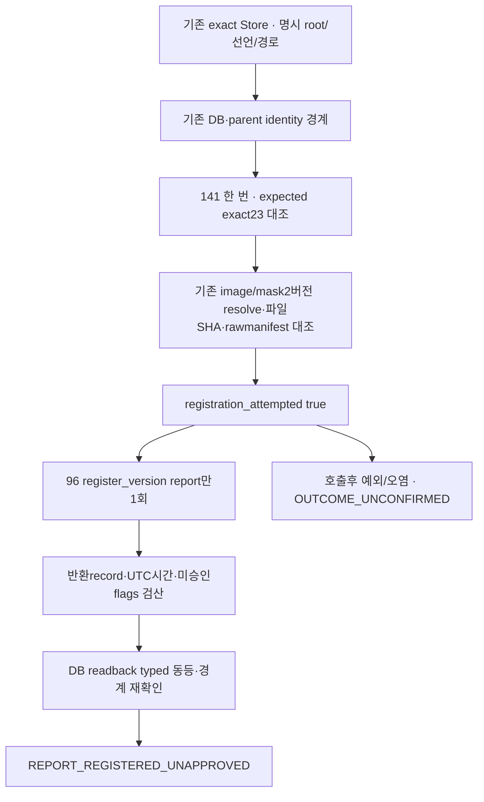

# Gate142 — 저장된 보고서 한 버전의 명시 등록과 결과 확인

| 필드 | 값 |
|---|---|
| updated_at | 2026-10-18 06:40:15 KST — 142 최종 등록 검증·독립 시험·보존 근거 반영 |
| source_commit | 기준 4f55aeb492bd81911d389ef681172265bad2b418 + 142 작업파일 raw SHA (게시 전 검증 시점; 후속 Git 게시의 바이트 보존은 별도 확인) |
| evidence_paths | `backend/app/data/quality_report_registration.py`; `tests/test_quality_report_registration.py`; `docs/implementation/142_quality_report_registration.md`; `evidence/integration/quality-report-registration-agent-20261018.log`; `evidence/integration/quality-report-registration-agent-initial-20261018.log`; `evidence/integration/quality-report-registration-agent-initial2-20261018.log`; `evidence/integration/quality-report-registration-root-related-20261018.log`; `evidence/integration/quality-report-registration-independent-20261018.py`; `evidence/integration/quality-report-registration-independent-20261018.json`; `evidence/integration/quality-report-registration-independent-20261018.log`; `evidence/integration/quality-report-registration-independent-initial-20261018.py`; `evidence/integration/quality-report-registration-independent-initial-20261018.json`; `evidence/integration/quality-report-registration-independent-initial-20261018.log`; `evidence/integration/quality-report-registration-live-integrity-final-20261018.json`; `evidence/integration/quality-report-registration-operating-inventory-20261018.json` |
| confidence | 집중 10 PASS/5.983초·관련 79 PASS/18.854초·독립 13건 12 PASS/1 SKIP/10.4445115초; Temp 등록·모의 경계·운영 보존 구분 |
| status | TESTED_SYNTHETIC 명시 Temp 보고서 등록; 운영 등록0·품질/기관/과학/실행 승인 BLOCKED |

## 쉬운 설명

141은 등록 전에 파일을 확인했고142는 호출자가 이미 만든 Registry에 보고서 한 버전을 실제 등록한다. 영상·마스크 두 버전은 미리 있어야 하며 새로 만들거나 수정하지 않는다. 등록 결과를 다시 읽어 확인한 때만 미승인 등록 성공이라고 알린다. 등록을 시도한 뒤 응답을 확인하지 못했다면 실제로 이미 저장됐을 수 있으므로 없었다고 말하거나 자동 재시도하지 않는다.

## 이론적 배경

저장 요청과 저장 결과 관측은 다르다. DB commit 뒤 예외가 발생하면 호출자는 실패를 보지만 행은 남을 수 있다. 그래서 ‘호출 전 차단’,‘등록 후 확인 성공’,‘등록 시도 후 결과 미확정’을 구분한다. 미확정의 registry_registered=false는 DB에 행이 없다는 증거가 아니다.

Registry의 고정 id/version·manifest 지문은 자산의 식별을 돕지만 품질·기관 권위·과학 정확도·실행 승인을 대신하지 않는다. 동일한 report 버전은 재호출해 같은 기록을 반환할 수 있고 충돌하는 선언은 덮어쓰지 않는다. 이것은 보고서 파일을 덮거나 원영상 버전을 갱신하는 동작이 아니다.

## 구조

## 코드·입력 → 처리 → 출력

`register_stored_quality_report(store,data_root,image_manifest,mask_manifest,report_identity,report_metadata,manifest_output_uri)`는 이미 초기화한 정확한 Store 타입과 기존 root/catalog.sqlite3만 받는다. Store를 만들거나 DB·테이블·디렉터리를 생성하지 않는다. root/DB 경로·일반파일·reparse·부모 identity·DB dev/ino를 단계마다 검사한다. 정상 SQLite 갱신의 size/mtime은 허용한다. 이 타입·경계 검사가 악의적 객체 변화나 OS sandbox를 완전히 막는 것은 아니다.

입력은 bounded 사본으로 고정한다.139 기준의 report를 재구성하고141을 별도 사본으로 한 번 호출해 기대 exact23과 타입·flags·바이트 수·SHA·refs·초안을 대조한다. 실패면 source조회·등록을 하지 않는다. 성공 뒤에는 기대 사본만 사용하며141의 가변 반환을 다시 읽지 않는다. report2파일 각2MiB와 cold schema 읽기는141의 범위다.

이어서 image/mask 고정참조에 기존 resolve_version을 각각 한 번 호출한다. 실제 source 파일 전체 SHA와 Registry manifest를 검사하고 caller raw manifest와 정확히 대조한다. 원영상/마스크 바이트 읽기는 이번에 허용하지만 GDAL/Torch·header·픽셀·의미 검사는 없다. 보고서2MiB 제한을 source 전체에 적용하지 않으며 시간·RSS hardcap도 아니다.

## source 선언과 소비 준비의 차이

기존 source버전은 caller raw manifest와 같아야 한다. image의 quality_report_ref를 자동 patch하거나 source를 새로 등록하지 않는다. caller만 경로를 추가했다면 기존 버전과 달라 차단된다. 반대로 기존 image와caller 둘 다 그 필드가 없으면 보고서 등록은 가능하지만131 소비는 필드 부재로 차단될 수 있다. 정상 소비 fixture는 처음부터 source에 그 경로를 명시한다.

따라서 report 등록 성공과 기존 source2개·mask·연차 전체의 소비 준비는 다르다. 없는 필드를 기존 immutable version에 역채우거나 자동 버전 증가로 해결하지 않는다. source refs의 이번 파일 지문·manifest 관측은 전체 DAG·자료 독립성·기관 QA 승인도 아니다.

## 등록·readback·미확정 결과

source2개가 확인된 뒤 report만 기존 register_version으로 한 번 등록한다. 직전에 registration_attempted=true로 바꾸고 이후 예외는 REGISTRATION_OUTCOME_UNCONFIRMED로 알린다. 충돌 거부·commit 뒤 오류·반환 오염·readback 실패도 그 범주다. 이미 남은 행·파일을 삭제하거나 rollback을 추정하고 자동 retry하지 않는다.

반환과 readback은 정확한6키 id/manifest/manifest_sha256/registered_at/scientific_accuracy_validated/deployment_approval이어야 한다. 기대 report와canonical SHA,고정key·정확한false2개·UTC timezone-aware isoformat 원형을 검산해 detached snapshot만 반환한다. 기록 시각 동등성은 권위 있는 실제 시각 인증이 아니다. 같은 record 재호출은 기존 registered_at과DB를 유지할 수 있다.

## exact22와 단계별 flag

상태는 BLOCKED/REPORT_REGISTERED_UNAPPROVED/REGISTRATION_OUTCOME_UNCONFIRMED다. 성공 때 registry_registered와registry_outcome_verified가true다. 단계 flags는 source_dataset_refs_verified/stored_report_files_verified/manifest_schema_verified/registration_attempted/registry_outcome_verified다. 앞선 단계가 성공하면 후행 실패에서도 refs/SHA·일부flags가 관측 이력으로 남을 수 있어 등록 확정으로 읽지 않는다.

나머지9개artifact_bytes_verified/registry_references_verified/quality_report_verified/quality_mask_verified/source_authority_verified/scientific_accuracy_validated/execution_authorized/state_dict_verified/workflow_supported는 항상false다. source파일 해시 관측은 source_dataset_refs_verified의 범위이고 전체 승인 flag로 승격하지 않는다. 등록 기록 자체의 science/deployment도false다.

## 집중 시험과 초기 이력

집중 최종10 PASS/5.983초를 읽었다. 실제 Temp Store source2등록 setup 뒤 adapter가 report1개만 등록하고141 한 번·resolve2번·register1번·source행/파일 불변·133 소비를 확인했다. 이 fixture는 all-zero여서0/256/256이며 최소 유효율 승인이 아니다.

초기 두 실행은 각각10건/9 PASS/1 FAIL·4.853초와5.038초다. 첫째는133 전체 상태 대신 약칭을 기대했고 둘째는all-zero를checkerboard로 기대한 시험 오류였다. 기대값만 실제 계약에 맞추었고 제품 source는 바꾸지 않았다. 초기와 최종은 합산하지 않는다. 관련 최종 79 PASS/18.854초와 독립 최종 13건 중 12 PASS/1 SKIP/10.4445115초를 확인했다.

commit뒤예외·0/bool오염·readback예외·db retarget·가변141반환은 명시모의 경계다. 실제 등록은 Temp만이며 운영 DB에 새 report를 등록하지 않는다. source 확인 전에 실패한 경우 register/INSERT 호출0은 모든 SQLite hot journal복구·외부쓰기까지0이라는 OS 보장이 아니다. 일반 SQLite 동작과신뢰하는로컬환경을상속한다.

## 독립 시험 구성 오류 이력과 최종 재검증

독립 초기13건은5 PASS/7 ERROR/1 SKIP이었다. SQLite 조회 helper가 context manager만 사용하고 connection을 close하지 않아 Windows의 Temp cleanup 잠금 오류7개가 발생했다. 제품 assertion 실패나 운영 DB 문제로 소개하지 않는다. 초기 py/json/log를 보존하고 시험 helper에 try/finally close를 추가해 다시 검증한다. 제품 source는 바꾸지 않는다. 최종 재실행은 13건 중 12 PASS/1 SKIP/0 FAIL/0 ERROR였으며 초기 집중 두 번과 별도 이력으로 기록한다.

초기 시험 전용 Temp 이름 7개를 명시한 TEMP 부모 안에서 읽기 조회한 결과 모두 현재 미존재였다. 재귀 삭제·잠금 정리를 실행하지 않았고 사라진 원인을 추정하지 않는다. 최종 cleanup 오류는 0이며 실제 운영 경로는 건드리지 않았다.

## 한계와 다음 작업

source 선택/해시·보고서 읽기·insert·readback은 하나의 원자snapshot이아니다.96이 등록시report파일SHA를다시확인해도 source전체를함께commit하는transaction이나반환후불변은없다. Store원문json.loads뒤boundedcopy이므로전체DBdecode/RSS상한도보장하지않는다.기관ACL·품질·독립정확도·모델/실행승인은별도다.

HTTP/CLI/UI·collector와미연결인내부어댑터라이번전체backend/frontend/build/browser는재실행하지않는다.137의전체1359건/1358 PASS/기존1 SKIP·front271은이전근거다. 다음143은caller가명시하는CLI후보(PLANNED)이며운영자동호출은아니다. 원본·원장·lock·분할·모델·예약을보존한다.

## 발표 대본

### 1분

“저장 보고서를 명시적으로 등록하는 내부 어댑터를 만들었습니다. 영상과 마스크 두 버전은 미리 있어야 하고, 파일과 등록 선언을 다시 확인한 뒤 보고서 한 버전만 넣습니다. 결과도 다시 읽어 확인합니다. 다만 등록 시도 뒤 응답이 깨지면 이미 저장됐을 수 있어 결과 미확정이라고 말하고 자동 재시도하지 않습니다. 등록 성공은 품질·과학·배포·실행 승인이 아니며 실제 시험은 임시 Registry에서만 했습니다.”

### 5분

첫 1분은 파일 점검에서 보고서 등록으로 늘어난 범위를 설명한다. 다음 1분은 기존 영상·마스크 두 버전의 선언과 파일 지문을 보여준다. 세 번째 1분은 보고서 한 건 등록과 결과 재조회를 설명한다. 네 번째 1분은 commit 뒤 오류가 날 수 있다는 예와 자동 재시도 금지를 설명한다. 마지막 1분은 등록·소비 준비·승인의 차이를 정리한다.

### 10분 확장

위 다섯 단계에 quality_report_ref 부재 반례 1분, SQLite와 원자성 한계 1분, 동일 요청 재호출과 충돌 1분, 질의응답 2분을 더한다. 실제 Temp 시험과 모의 오류 주입을 구분하고 운영 등록은 없었다고 말한다.

## Q&A

Q. 이제 운영 report가 등록됐나? A. 시험은Temp에 한정했고 운영 등록은0이다.

Q. 미확정인데 registry_registered=false면 행이 없나? A. 이미 commit됐을 수 있어 부재로 단정하지 않는다.

Q. source에 없는 quality_report_ref를 추가하나? A. 기존 immutable 버전을 바꾸지 않고 소비 차단은 별도 확인한다.

Q. image/mask를 전혀 안 읽나? A. resolve가 전체 bytes SHA를 읽지만 native header·pixel·QA는 검사하지 않는다.

Q. 등록이 품질 승인인가? A. report 등록 확인뿐이며 science/deploy와9개 미승인 flags는false다.

## 근거 바로 열기

[구현 설명](../../implementation/142_quality_report_registration.md) · [등록 어댑터](../../../backend/app/data/quality_report_registration.py) · [최종 집중](../../../evidence/integration/quality-report-registration-agent-20261018.log)

## 최종 시험·보존 근거

142 최종 검증은 집중 10 PASS/5.983초·관련 79 PASS/18.854초·독립 13건 중 12 PASS/1 SKIP/10.4445115초다. 중복 실행을 합산하지 않는다. 독립 실제 Temp 소비는 유효 128/무효 128/전체 256이며 집중 all-zero 0/256/256과 별개다. Windows symlink 권한 1314의 실제 SKIP과 모의 경계 시험을 구분한다. 보호 참조 141개·기존 소스 322개·이전 증거 1348개·운영 catalog 14행과 SHA·예약 136314880B를 보존했다. 운영 DatasetVersion은 0이며 운영 등록·학습·실행은 없다. 이번 전체 backend/frontend/build/browser 재실행은 없고 137의 전체 1358 PASS/1 SKIP·front 271은 이전 근거다.

독립 시험에서 기존 image에 quality_report_ref가 없으면 report 등록 뒤에도 131이 PATH_INVALID로 차단했다. RESTRICTED image와 PUBLIC report도 등록은 가능했지만 소비는 ACCESS_DECLARATION_BLOCKED였다. 등록이 소비 준비나 접근 승인이 아님을 실제 Temp 반례로 확인했다. 등록 전후 예외·반환 오염·DB 경로 변경은 명시한 모의 오류 주입 시험이며 운영 동시성 검증은 아니다.

[최종 독립 검증](../../../evidence/integration/quality-report-registration-independent-20261018.json) · [최종 보존 검사](../../../evidence/integration/quality-report-registration-live-integrity-final-20261018.json)
