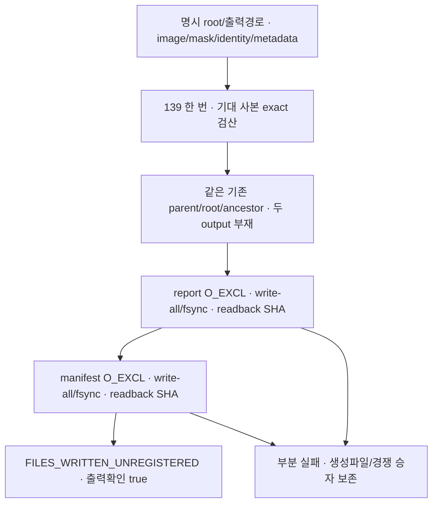

# Gate140 — 보고서와 manifest 두 새 파일의 배타적 저장

| 필드 | 값 |
|---|---|
| updated_at | 2026-10-18 06:17:16 KST — 140 최종 저장·관련/독립·부분 실패/소비 반례·보존 반영 |
| source_commit | 기준 7b538b90c069789ca24dca0a1e237bf6dec47a8c + 140 작업파일 raw SHA (게시 전 검증 시점; 후속 Git 게시의 바이트 보존은 별도 확인) |
| evidence_paths | `backend/app/data/quality_report_storage.py`; `tests/test_quality_report_storage.py`; `docs/implementation/140_quality_report_storage.md`; `evidence/integration/quality-report-storage-agent-20261018.log`; `evidence/integration/quality-report-storage-agent-initial-20261018.log`; `evidence/integration/quality-report-storage-root-related-final-20261018.log`; `evidence/integration/quality-report-storage-root-related-20261018.log`; `evidence/integration/quality-report-storage-root-related-initial-20261018.log`; `evidence/integration/quality-report-storage-independent-20261018.json`; `evidence/integration/quality-report-storage-independent-20261018.log`; `evidence/integration/quality-report-storage-independent-initial-20261018.json`; `evidence/integration/quality-report-storage-independent-initial-20261018.log`; `evidence/integration/quality-report-storage-independent-pre-native-guard-20261018.json`; `evidence/integration/quality-report-storage-independent-pre-native-guard-20261018.log`; `evidence/integration/quality-report-storage-live-integrity-final-20261018.json`; `evidence/integration/quality-report-storage-operating-inventory-20261018.json` |
| confidence | 동결 소스·집중10/관련58/독립12건(11 PASS·1 SKIP)·실제 Temp 소비/반례·보존 확인 |
| status | TESTED_SYNTHETIC 새2파일 배타적 저장; 미등록·원자료/품질/과학/실행 승인 BLOCKED |

## 쉬운 설명

139는 양식을 완성했고140은 그 보고서와 manifest를 새 파일 두 개로 저장한다. 기존 파일은 내용이 같아도 덮거나 성공 이력으로 재사용하지 않는다. 하나를 쓴 뒤 두 번째에서 실패하면 남은 파일을 삭제하지 않고 부분 결과로 남긴다. 새 출력이 지문과 같다는 확인과 원영상·마스크의 품질 또는 Registry 등록 승인은 다른 일이다.

## 이론적 배경

존재 여부를 미리 확인하는 것만으로는 검사와 생성 사이 경쟁을 막지 못한다. 실제 생성에도 O_EXCL을 사용해 다른 주체가 먼저 만든 파일을 보존한다. 그러나 두 파일을 순서대로 쓰는 것은 원자적 거래가 아니다. 파일별 fsync와 다시 읽은 SHA가 맞아도 directory fsync·모든 전원 장애·디렉터리 치환 경쟁을 해결했다는 뜻은 아니다.

‘created’는 이번 호출의 배타적 생성 관측이고 ‘verified’는 그 출력 파일의 크기·SHA 검산 완료다. 전체 stored_outputs_verified는 두 출력이 각각 순차 읽기 시점에 맞았을 때만 true다. 첫 파일이 두 번째 검사 중이나 함수 반환 뒤에도 그대로라는 동시 snapshot은 보장하지 않는다. 따라서141의 등록 전 재검증은 별도 후속이다. 이 값으로 실제 입력 영상의 바이트·헤더·mask값을 확인했다고 발표하지 않는다.

## 구조

## 코드·입력 → 처리 → 출력

`write_quality_report_files(data_root,image_manifest,mask_manifest,report_identity,report_metadata,manifest_output_uri)`는 명시 절대 기존 root와 상대 두 출력 경로를 받는다.139를 별도 사본으로 한 번 호출하고 기대 exact21과 타입·bytes/SHA·refs·draft를 대조한다. 실제 쓸 report bytes와 manifest는 검증 기준 expected 사본에서만 가져온다. 검산 뒤 mutable producer가 바뀌어도 그 값을 다시 읽지 않는다.

report와 sidecar는 같은 정규화 parent에 있어야 하며 parent·root·ancestor는 기존 일반 디렉터리여야 한다. mkdir는 없다. lstat/resolve·symlink/reparse·dev/ino를 확인한다. UNC·절대 output·ADS·dot segment·빈 조각·끝 공백/점·금지 문자·장치명·Unicode C범주를 보수적으로 거부한다. 역할 충돌은 NFC/casefold로 비교하지만 OS 모든 별칭을 증명하지는 않는다. mapped drive 매체·실제 ACL도 인증하지 않는다.

두 출력은 서로 다르고 image/mask artifact 및 sidecar의 기존 quality_report_ref와 충돌하지 않아야 한다. 새 report가 image 초안에 명시된 report target인 것은 가능하지만 실제 그 경로가 이미 있으면 내용과 종류에 관계없이 거부한다. 기존 파일이 같은 bytes여도 replay 성공이 아니다. 부재 선검사 뒤 실제 open도 O_CREAT|O_EXCL을 사용하고 가능한 플랫폼의 O_NOFOLLOW/O_BINARY를 보탠다.

각 파일은 최대2MiB다. 새 fd regular/size0 확인 뒤 short write를 처리해 끝까지 쓰고 fsync한다. 부모·fd identity/크기를 재검사한 뒤 읽기 전용 fd로 readback SHA·크기와 전후 stat을 확인한다. report와 sidecar를 묶는 transaction·directory fsync는 없다. 원영상/마스크를 열거나 Registry를 조회/등록하지 않는다.

## 결과·부분 실패·재실행 경계

exact21의 상태는 BLOCKED/PARTIAL_FILES_PRESERVED/FILES_WRITTEN_UNREGISTERED다. outputs는 report/manifest 순서의 role/created/verified/bytes 두 관측이다. 검산 미완료 bytes는null이다. preflight가 끝나면 기대 SHA·refs·상대경로가 남을 수 있어도 실제 저장 성공을 뜻하지 않는다.

하나라도 생성한 뒤 실패하면 부분 파일을 남긴다. 두 번째 경로에 경쟁 승자가 생겨도 그 파일을 덮거나 지우지 않는다. rollback·삭제·truncate·자동 retry/replay·등록·원장 수정은 없다. 다음 호출도 선존재로 거부되며 자동 복구를 추정하지 않는다.

stored_outputs_verified는 두 새 출력만 확인한다. artifact_bytes_verified·registry_references_verified·registry_registered·quality_report_verified·quality_mask_verified·source_authority_verified·scientific_accuracy_validated·execution_authorized·state_dict_verified·workflow_supported10개는 항상false다.0/1 mask의 정답·품질·기관·과학·실행 승인은 하지 않는다.

## 시험 근거와 초기/최종 구분

집중 최종10 PASS/2.185초·관련 최종58 PASS/12.861초를 읽었다. 초기 집중10/1.832초와 초기 관련58/10.422초는 보존하며 합산하지 않는다. Windows 금지 문자6개를 native file 호출 전에 PATH_INVALID로 거부하도록 보강했으며 기존 OS에서도 실제 파일 생성은 없었다. 실제 원자료 사고를 복구한 것으로 말하지 않는다.

독립 초기11건은9 PASS/1 ERROR/1 SKIP이었다. ERROR는 시험 fixture 준비에서 문자열과Path를 혼동한 오류이며 별도 initial 파일에 보존한다. 보강 전12건/11 PASS/1 SKIP/4.4781602초도 pre-native-guard 이력이다. 최종 독립12건/11 PASS/1 SKIP/6.86528초·exit0을 새 source/test 동결 SHA와 대조해 확인했다. 실제 Windows symlink 생성 권한1314 SKIP과 reparse 속성을 주입하는 모의 guard 통과는 서로 다른 근거다.

## 최종 독립·실제 저장/소비·보존

최종 집중10 PASS/2.185초·관련58 PASS/12.861초·독립12건/11 PASS/1 SKIP/6.86528초·exit0을 읽었다. 동결 source SHA220910abb10c19a07b0af458b6cdf163c16f9864c36dd123a622dbd11db91622와 test61548f8234d2cb2d5ec4428e9fa39dc789b5d138785a9ea75ffb6faeae63cbaa가 일치한다. 초기 집중10/1.832초·관련58/10.422초,초기 독립11건/9 PASS/1 ERROR/1 SKIP/2.6194645초와 보강 전12건/11 PASS/1 SKIP/4.4781602초는 별도 원문으로 보존하며 합산하지 않는다.

독립 실제 Temp에서 정확히2개의 report/sidecar 파일만 증가했고 writer의 source artifact open과 Registry 호출은0이었다.139 bytes와 저장 report가 같고 별도 schema 검산과 caller setup의 SQLite3버전 등록 뒤131/133 소비에서128/128/256·DB/전체파일 불변을 확인했다. nodata0/255/RESTRICTED는 두 파일을 저장할 수 있어도 실제소비에서 차단됐다. 저장과 원자료검증의 차이를 보여주는 반례다.

명시 모의 경쟁에서는 report 성공 뒤 다른 주체가 manifest를 먼저 생성하면 승자 bytes와report를 보존했다. 두 번째 파일을11바이트 쓴 뒤 오류가 나도 부분파일을 남기고 재호출은 수정 없이 거부했다. parent inode/reparse guard는 모의 관측이며 실제 symlink 생성은 Windows 권한1314로1 SKIP이었다. 이를 실제 링크 차단 성공으로 바꾸지 않는다.

Windows 금지 문자6개를 report/manifest 두 위치12개에 넣어 최종 PATH_INVALID·native open0·새 파일0을 확인했다. 보강 전 native도6사례에서 BLOCKED/새 파일0이었지만 오류를 명시적으로 일찍 차단하는 정책으로 보완했다. 완전한 파일시스템 sandbox 검증은 아니다.

보호141·기존 소스318개 전체·이전 증거1309개·catalog14행 canonical SHA·예약136314880바이트는 불변이다.06:06 운영 count는DatasetVersion0·legacy datasets6/models1이다. 운영 등록·수집·학습·추론·배포·Workflow dispatch0이며 기존collector·모델·원본·원장·lock·분할은 보존했다. 이번 전체 backend/frontend/build/browser 재실행은 없으며137의 전체1359건/1358 PASS/기존1 SKIP·front271은 이전 근거다.

## 한계와 후속

writer는 두 출력에만 제한되며 CLI/API/UI·Registry·137 진단 자동조회와 미연결이다. 시험 caller가 저장된 sidecar를 schema와 대조하고 임시3버전을 등록한 뒤131/133을 읽는 setup은 writer의 등록 기능이 아니다. nodata0·값255·RESTRICTED도 저장할 수 있지만 실제 소비는 차단될 수 있다.

파일별 fsync/readback은 다중 파일 원자성·directory 내구성·완전한 TOCTOU/적대적 파일시스템 격리·OS sandbox·CPU/RSS/시간 보장을 뜻하지 않는다. 다음141은 caller가 명시한 저장 report/manifest의 schema·SHA·ref를 등록 전에 읽기 전용으로 점검하는 후보(PLANNED)다. 운영 등록·QA/실행 승인은 여전히 후속이다.

이번은 기존 제품과 소비자를 바꾸지 않는 내부 writer라 전체 backend/front/build/browser 재실행은 없다.137의 전체1359건/1358 PASS/기존1 SKIP·front271은 이전 근거이며 이번 시험으로 합산하지 않는다. 운영 root에는 실행하지 않고 원본·원장·예약·모델·분할을 보존한다.

## 발표 대본

### 1분

“보고서와 manifest를 새 파일 두 개로 저장하는 기능을 만들었습니다. 기존 파일은 같은 내용이어도 재사용하거나 덮어쓰지 않습니다. 각 파일을 쓴 뒤 다시 읽어 지문과 크기를 확인합니다. 다만 두 파일 전체가 한 번에 생기는 거래는 아닙니다. 중간 실패면 남은 파일과 경쟁자가 만든 파일을 보존하며 자동 재시도하지 않습니다. 저장 성공은 새 출력만 확인한 것이고 원영상의 품질이나 등록·실행 승인은 별도입니다.”

### 5분

첫1분은 양식 준비에서 두 파일 저장으로 늘어난 범위를 설명한다. 다음1분은 기존 파일 거부와 O_EXCL의 이유를 보여준다. 세 번째1분은 write/fsync/readback SHA와 두 파일의 비원자성을 설명한다. 네 번째1분은 두 번째 생성 경쟁·부분파일 보존·재실행 거부를 보여준다. 마지막1분은 출력 확인과10개 미검증 flags·141 읽기 점검 후속을 정리한다.

### 10분 확장

‘새 파일만’,‘경로와 기존 parent’,‘배타적 생성’,‘부분 실패 보존’,‘등록 전 남은 일’ 다섯 장에 symlink 실제/모의 구분1분·producer 사본/원본 보존1분·한계/질의응답3분을 더한다.

## Q&A

Q. 같은 bytes가 있으면 성공으로 재사용하나? A. 기존 항목은 모두 거부하며 replay가 아니다.

Q. 하나만 쓰면 자동 삭제하나? A. 부분 파일을 보존하고 삭제·rollback·자동 retry하지 않는다.

Q. 출력 SHA가 맞으면 원영상도 검증됐나? A. 새 report/sidecar만 관측하며 원영상은 열지 않는다.

Q. symlink SKIP이면 reparse 검증도 없나? A. 실제 권한 제한과 모의 reparse guard를 별도로 기록한다.

Q. 이제 Registry에 등록되나? A. writer는 Store를 호출하지 않으며 등록 전 읽기 점검도 후속이다.

## 근거 바로 열기

[구현 설명](../../implementation/140_quality_report_storage.md) · [writer](../../../backend/app/data/quality_report_storage.py) · [최종 집중](../../../evidence/integration/quality-report-storage-agent-20261018.log)

[최종 관련](../../../evidence/integration/quality-report-storage-root-related-final-20261018.log) · [최종 독립/실제 저장](../../../evidence/integration/quality-report-storage-independent-20261018.json) · [초기 독립 오류 보존](../../../evidence/integration/quality-report-storage-independent-initial-20261018.json) · [보강 전 이력](../../../evidence/integration/quality-report-storage-independent-pre-native-guard-20261018.json) · [보존 근거](../../../evidence/integration/quality-report-storage-live-integrity-final-20261018.json)
