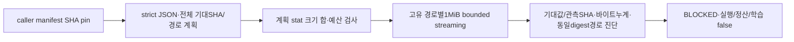

# Gate Raster Content 20261017 — 고정 기대값과 로컬 파일의 SHA 대조

| 필드 | 값 |
|---|---|
| updated_at | 2026-10-17 23:36 KST — Git 상태 메타데이터 정정; 본문은 해당 Gate 기준 |
| source_commit | Git 연결됨; 문서 작성 시 변경분 미커밋, evidence snapshot SHA로 추적 (원격 기준 d483d25) |
| evidence_paths | `backend/app/data/recovery_raster_content.py`; `scripts/inspect_recovery_raster_content.py`; `tests/test_recovery_raster_content.py`; `docs/implementation/49_recovery_raster_content_validation.md`; `evidence/integration/recovery-raster-content-tests-20261017.log`; `evidence/integration/recovery-raster-content-independent-20261017.log`; `evidence/integration/recovery-raster-content-live-final-20261017.json`; `evidence/integration/recovery-raster-content-full-tests-20261017.log`; `evidence/integration/recovery-raster-content-live-integrity-20261017.json` |
| confidence | 완료 코드·합성시험·실제 image byteSHA 순차 대조; 픽셀/공간/과학 미검증 |
| status | VERIFIED_REAL: 고정 명세와1,475 image byteSHA; TESTED_SYNTHETIC: 15시험; 실행/학습 BLOCKED |

## 쉬운 설명

봉투의 크기·주소표를 본 뒤, 이번에는 봉투 안의 모든 바이트를 작은 조각씩 읽어 저장된 지문과 비교한다. 지문이 맞으면 기록했던 파일 바이트와 같은지 알 수 있다. 사진 속 내용의 의미·정답의 품질·공간 독립성은 별도 문제다.

## 이론적 배경

검사할 명세 자체가 바뀌면 기대 지문도 바뀔 수 있으므로 caller가 manifest SHA를 명시적으로 고정한다. 그 JSON의 source_window.sha256와 patch_sha256.image를 기대값으로 사용한다. 같은 canonical 경로는 한 번만 해시하고 역할·행 index를 합친다. 기대값 누락·잘못된 형식·같은 경로의 상충값·파일 누락을 전수 계획에서 발견하면 정상 파일도 content streaming을 시작하지 않는다.

SHA256은 파일 바이트 표현의 지문이다. 동일 digest의 서로 다른 경로는 byte 동일성 진단 범위이며 픽셀 의미·다른 압축의 같은 영상·지리 독립성·split 적격성을 판정하지 않는다. 고정 기대값의 신뢰성과 영상 품질도 별도로 판단한다.

## 실제 함수와 예산 계약

`inspect_recovery_raster_content(data_root, expected_manifest_sha256, max_local_bytes=3GiB)`와 내부 CLI가 구현이다. data root 안 일반 로컬 파일만 허용하고 remote/UNC/VSI·root 이탈을 거부한다. 기본 예산은3GiB이며 정확한 정수1..3GiB만 허용한다. stat상 고유 크기 합이 예산을 넘으면 content 읽기 전에 거부한다.

`open('rb',buffering=0)`와 최대1MiB chunk를 사용한다. 실제 반환된 byte를 누계하며 파일의 남은 크기·총 남은 예산을 넘겨 요청하지 않는다. EOF 확인 여유가 있을 때만1byte를 probe하고 반환되면 그 byte도 누계한다. 정확한 예산 경계에서는 추가 read를 하지 않고 fstat/stat으로 크기를 확인한다. 조기 EOF·성장·descriptor 교체·stat/논리target·고정 manifest 변경을 거부한다.

`actual_local_bytes_read`는 대상 이미지에서 반환받은 byte다. JSON 읽기·filesystem metadata·OS cache/디스크 sector의 모든 I/O 비용을 측정한 값은 아니다. 순차 관측이지 여러 파일의 원자적 snapshot/OS lock이나 관측 metadata까지 원복하는 공격 방어 보장은 아니다.

stdlib 파일 읽기만 사용하고 GDAL/rasterio/pixel decoder·sidecar·네트워크를 사용하지 않는다. 기존 header/crop/aggregate의 미검사 flag는 해당 모듈과 당시 범위 그대로이며 새 companion의 근거와 구분한다. CLI는 streaming 전 출력 경로를 검사하고 새 evidence를 exclusive 생성한다. CP949 stdout은 ASCII escape, 파일은 UTF-8이다.

## 시험·실제 근거

최종 관련 로그는15 PASS/1.477초다. 최종 독립 로그는15 PASS/2.365초다. 이전14 PASS/1.363초와 별도 early-EOF 확인은 보완 과정 이력이며 전체 시험수에 추가하지 않는다. pin·strictJSON·전수 계획 후 stream0·상충/누락·정확 budget·고정 chunk·canonical/hardlink·관측digest그룹·불일치 제외·성장/조기EOF·stale/target변경·CP949/출력보호를 작은 fixture로 검사했다. 실제 대용량 파일을 이 합성시험에서 읽은 것은 아니다.

최종 실제 CP949 CLI exit0에서 고유1,475파일이 모두 MATCH·RECORDED_SHA_MATCH였다. 계획 크기와 실제 반환byte는 각각2,332,461,937B로 같고 명시 예산3,000,000,000B 이내다. issue0·관측 동일digest의 다른 경로그룹0이지만 **전체상태는 BLOCKED**다. caller가 고정한 manifest SHA는 `cdc374b2779dee749b57689fd90ef27e3525a48e59062343537327d0f4859a8f`다.

최종 관련15 PASS/1.477초·독립15 PASS/2.365초, 전체 `scripts/test.ps1` **418건 중417 PASS·1 SKIP/92.959초/종료0**다. 최종15개는 전체 시작 전에 작성되어418건에 포함됐으며 관련/독립/추가 early-EOF 확인을 중복 합산하지 않는다. SKIP은 기존 OS symlink 생성 권한이고 deterministic 경계 시험은 통과했다. 보호132 JSON/원장참조의 SHA·존재와 기존 계약10SHA는 불변이며 이전 추적 코드/데이터/계약 변경0이다.1,475파일 stat/처음16바이트·기록된1,475 부모목록 관측 변경0도 확인했다.

이번에는1,475 image 파일의 전체 byte SHA를 순차 streaming 시점에 기대값과 대조했다. label/quality·과거4,335파일 전체 감사·다중파일 원자적 snapshot·픽셀 의미·장면 공간/split 독립성 승인은 아니다. 같은digest 경로그룹0도 서로 다른 파일 표현의 같은 영상이나 기하 누출이 없다는 증거는 아니다. pixel decoder/GDAL/네트워크0·실행/정산/재개/학습/과학 승인false·exactly-once UNKNOWN·환불0을 유지한다. 이번 이해자료 작성에서 시험이나 실제 파일 streaming을 실행하지 않았다.

## 한계·승인·UI

전체상태는 항상 BLOCKED다. 픽셀 의미·정답/quality·기하 독립성·과학 정확도는 미검증이며 exactly-once UNKNOWN·실행/정산/자동재개/학습 승인false·환불0이다. 기존5 blocker와 원본 적격1,111/계획후보1,095·baseline Draft·pending2건 예약136,314,880B는 그대로다.

새API/화면 계약 없는 내부 CLI이므로 UI 수정·실행 frontend 반영·브라우저 재검사는 불필요하다. 후속 화면 노출은 확정 계약/증거를 web_ui에 인계해 별도 검증한다. 단일 Gate로 전체 개발이나10분 보고를 끝내지 않는다.

## 발표 1분

“파일의 크기와 좌표표에 이어 실제 바이트를 저장된 지문과 대조하는 기능을 추가했습니다. 먼저 명세의 SHA를 고정하고 모든 경로와 기대값을 검토한 뒤, 파일을1MiB 이하 조각으로 읽습니다. 실제 읽은 바이트를 예산 안에서 세고 변경이나 짧은 읽기를 거부합니다. 작은 합성자료 시험은 통과했고 실제1,475파일이 모두 기록SHA와 맞고2,332,461,937바이트를 읽었습니다. 전체418건 중417개 시험이 통과하고 기존 권한 제약1개는 건너뛰었습니다. 파일 지문 일치는 사진의 의미나 정답 품질·공간 독립성 승인과 다르므로 학습·정산·자동재개는 여전히 차단합니다.”

## 발표 5분·10분

1. **0~1분:** 봉투/지문 비유와 명세 pin 목적을 말한다.
2. **1~2분:** 전체 기대값 사전검토와 canonical 경로별1회 읽기를 설명한다.
3. **2~3분:**1MiB chunk·실제 byte 누계·EOF/budget 경계와 stat/fd 검사를 설명한다.
4. **3~4분:** 최종 관련15시험·독립15시험과 이전 보완 이력, 실제1,475 MATCH와 전체418건417 PASS·1 SKIP를 구분한다.
5. **4~5분:** byte 일치와 픽셀/공간/학습 승인 차이·UI 불필요·BLOCKED를 말한다.

10분은 SHA mismatch와 사전계획 실패 차이, 서로 다른 hardlink/canonical 경로·동일digest 진단, 정확 budget의 probe 없음, 순차 관측과 원자적 snapshot 차이, 기존 split/bare 차단을 덧붙인다.

## Q&A

**SHA가 맞으면 영상이 정확한가?** 기록된 file byte와 맞는다는 뜻이며 픽셀 의미·정답/공식 승인은 별도다.

**잘못된 기대값이 하나 있어도 일부 파일을 읽나?** 계획 전체에서 형식·상충·누락을 먼저 확인해 그러한 경우 streaming0으로 끝낸다.

**같은 경로를 여러 patch가 참조하면 반복 읽나?** canonical 경로별 한 번이며 역할·행 index를 합친다. 다른 경로 hardlink는 별도 경로다.

**동일digest 그룹은 누출 판정인가?** byte 동일성 진단이며 split·지리 독립성 판정이 아니다.

**예산은 실제 디스크 I/O 전부인가?** 대상 이미지에서 반환받은 byte 누계다. JSON/metadata/cache sector까지 측정하는 값은 아니다.

## 이후 갱신

최종 실제 JSON·전체 회귀·보호 근거를 받아 기능해설·용어·대본/FAQ·시연·INDEX·CHANGELOG를 함께 갱신했다. 다음 검증은 완료 코드/근거를 받은 뒤 새 Gate로 범위를 구분한다.
