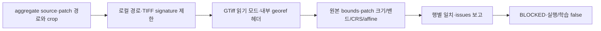

# Gate Raster Headers 20261017 — 로컬 영상 헤더와 crop 격자 대조

| 필드 | 값 |
|---|---|
| updated_at | 2026-10-17 23:36 KST — Git 상태 메타데이터 정정; 본문은 해당 Gate 기준 |
| source_commit | Git 연결됨; 문서 작성 시 변경분 미커밋, evidence snapshot SHA로 추적 (원격 기준 d483d25) |
| evidence_paths | `backend/app/data/recovery_raster_headers.py`; `scripts/inspect_recovery_raster_headers.py`; `tests/test_recovery_raster_headers.py`; `docs/implementation/48_recovery_raster_header_validation.md`; `evidence/integration/recovery-raster-headers-tests-20261017.log`; `evidence/integration/recovery-raster-headers-independent-20261017.log`; `evidence/integration/recovery-raster-headers-live-final-20261017.json`; `evidence/integration/recovery-raster-headers-full-tests-20261017.log`; `evidence/integration/recovery-raster-headers-live-integrity-20261017.json` |
| confidence | 코드·격리 GTiff fixture·실제 로컬 헤더 대조; 픽셀/내용SHA/과학 미검증 |
| status | VERIFIED_REAL: 로컬 헤더 계약; TESTED_SYNTHETIC: 17시험; 실행/학습 BLOCKED |

## 쉬운 설명

사진을 잘라낸 위치가 목록에 적혀 있는지 확인한 다음, 사진 파일 안의 크기와 좌표표를 읽어 그 위치가 맞는지 대조한다. 사진의 실제 장면 내용이나 정답 라벨을 판독하는 단계는 아니다. 파일을 열되 픽셀 배열을 읽지 않고 TIFF 내부의 메타데이터를 읽는다.

## 이론적 배경

256×256 patch는 원본의 `[x,y,256,256]` 영역을 잘라낸 결과여야 한다. 원본 크기 안에 영역이 들어가고, patch의 크기·밴드수·자료형·CRS가 계약에 맞아야 한다. 위치는 일반 affine 변환 `sourceAffine @ Affine.translation(x,y)`로 비교한다. 전체6계수를 확인하므로 회전·skew가 있는 영상도 다루며 north-up을 가정하지 않는다.

계수별 absolute1e-7·relative1e-12 허용오차는 부동소수점 반올림을 위한 수치 기준이다. 좌표계 단위가 있는 값이며 실제 센서 위치 정확도나 공식 지리학적 오차 기준으로 설명하지 않는다. 원본 affine은 finite이고 determinant가0이 아니어야 한다.

## 실제 코드와 입력 경계

`inspect_recovery_raster_headers(data_root)`와 CLI `inspect_recovery_raster_headers.py`가 새 companion이다. aggregate의 source_window.path·image_path를 읽고 label/quality 경로는 열지 않는다. 기존 crop/aggregate/terminal/원장 검사를 재실행하지 않는다. 기존 보고서의 미검사 flag는 역사적 범위 그대로 보존한다.

data root 안의 일반 로컬 파일만 허용한다. GDAL에 전달하기 전 첫8바이트에서 Classic TIFF/BigTIFF의 양 endian signature를 확인하고 VRT/XML 등을 거부한다. `rasterio.open(...,mode='r',driver='GTiff',GEOREF_SOURCES='INTERNAL')`를 사용하며 PAM 비활성·EMPTY_DIR·PROJ_NETWORK OFF·VRT Python NO 환경을 적용한다. 외부 worldfile/PAM georef를 대신 적용하지 않는다.

`dataset.read/read_masks/statistics/stats/tags`와 raster 전체 SHA를 호출하지 않는다. GDAL은 TIFF directory와 내부 좌표 메타데이터 바이트를 읽으므로 “파일을 전혀 읽지 않았다”는 표현은 틀리다. JSON의 매우 큰 crop 정수는 bounds 밖이면 affine 계산을 건너뛰어 overflow 없이 issue로 보고한다.

헤더를 경로별 캐시하고 매 사용·종료 시 stat, 논리 경로 target, aggregate SHA를 대조한다. stat/처음16바이트 샘플·부모 파일목록 보존은 raster 전체 SHA 보존 증명이 아니며 변경 없는 stat 아래의 내용 변조나 원자적 snapshot을 보장하지 않는다.

## 시험과 실제 근거 범위

관련17 PASS/14.193초·독립17 PASS/14.125초의 보존 로그를 읽었다. 격리된512×512 원본과2×2 patch, 회전/skew·tolerance·bounds·CRS/count/dtype·TIFF 종류·VRT 사전 차단·stale/retarget·픽셀 메서드 미호출·CP949/출력 보호를 검사했다. 초기14/15는 보완 전 이력이며 최종17을 사용한다. 이번 문서 작업에서 시험을 재실행하지 않았다.

최종 실제 CP949 CLI exit0에서 고유1,475개(원본91+patch1,384)가 모두 VALID_HEADER,1,384행 모두 HEADER_CONTRACT_MATCH·issue0·CONSISTENT_HEADERS였다. 전체상태는 BLOCKED다. 최종 전체 `scripts/test.ps1`은 **403건 중402 PASS·1 SKIP/95.828초/종료0**다. 기존 OS symlink 생성 권한1건을 건너뛰었으며 deterministic 경계 시험은 통과했다. 관련17·독립17은 전체403에 중복 합산하지 않는다. 보호132 JSON/원장참조의 SHA·존재와 기존 계약9SHA는 불변이고 이전 추적 코드/데이터/계약 변경0이다.1,475 raster의 stat·처음16바이트 및 기록된1,475 부모 파일목록 관측도 변경0이었다. 이는 **전체 raster 바이트 SHA 동일성 증명이 아니다**. 보존 로그와 실제 근거를 읽은 기록이며 이해자료 작성 중 재실행하지 않았다.

## 한계·UI 영향

항상 BLOCKED다. pixel/label/quality·내용 SHA·다른 파일의 동일내용·독립 기하 누출·과학 성능은 검증하지 않는다. exactly-once UNKNOWN·실행/정산/자동재개/학습/과학 승인false·환불0을 유지한다. 원본 적격1,111/계획후보1,095·기존5 blocker·terminal 없는2건과 예약 보존은 그대로다.

공개API/화면 계약을 바꾸지 않는 내부 CLI라 UI 수정·실행 서버 반영·브라우저 재검사는 불필요하다. 후속 화면 노출 시 확정 계약과 근거를 web_ui에 인계한다. 전체 개발과10분 보고는 계속한다.

## 발표 1분

“잘라낸 위성영상의 좌표 기록을 실제 파일의 크기와 좌표표에 대조하는 기능을 추가했습니다. 영상은 TIFF 내부 헤더만 읽으며 원본 범위, patch 크기·밴드·좌표계와 위치 변환을 비교합니다. 회전된 영상도 다루고 픽셀이나 라벨을 읽지는 않습니다. 격리 자료17개 시험을 통과했으며 실제1,475개 파일의 헤더와1,384행의 계약이 일치했습니다. 전체 시험403건 중402개 통과와 기존 권한 제한1개 건너뜀을 기록했습니다. 헤더가 맞아도 영상 내용의 품질과 자료 독립성, 운영 승인은 남아 있어 학습·정산·자동재개를 허용하지 않습니다.”

## 발표 5분·10분 흐름

1. **0~1분:** 사진의 크기·좌표표 비유와 기존 crop 기록 검사의 다음 단계를 설명한다.
2. **1~2분:** 원본 bounds·256×256 patch·밴드/dtype/CRS 계약을 말한다.
3. **2~3분:** affine6계수·회전/skew·수치 허용오차를 설명한다.
4. **3~4분:** 최종17개 합성시험과 실제1,475파일·1,384행 일치와 전체403건402 PASS·1 SKIP를 구분한다.
5. **4~5분:** 픽셀/정답/내용 SHA/독립성 미검사와 BLOCKED·UI 불필요를 설명한다.

10분은 strict 경로·TIFF 사전검사·PAM/PROJ 제한, 거대 좌표 overflow 회귀, stat/샘플과 전체 SHA 차이, 기존 원본1,111·계획후보1,095와 학습 차단을 덧붙인다.

## Q&A

**헤더가 맞으면 픽셀이 정확한가?** 크기/좌표 계약과 픽셀 내용·정답 품질은 별개다.

**헤더만 읽으면 파일 바이트를 읽지 않나?** TIFF 내부 메타데이터 바이트는 읽으며 픽셀 배열은 읽지 않는다.

**허용오차가 현장 정확도 기준인가?** 계수 비교의 수치 반올림 허용치이며 센서·행정경계 정확도 승인이 아니다.

**stat와16바이트가 같으면 파일이 완전히 같은가?** 전체 내용 SHA가 아니므로 완전한 암호학적 동일성 증명은 아니다.

**학습/재개가 가능한가?** 불가능하다. 내용·독립성·정산/운영 승인 미검증이며 전체 상태는 BLOCKED다.

## 다음 갱신

실제 최종 JSON·전체 회귀·보호 근거를 받아 이 Gate·기능해설·용어·시연/발표/FAQ·INDEX·CHANGELOG를 함께 갱신했다. 이후 검증 범위가 넓어지면 기존 flag의 과거 의미를 바꾸지 않고 새 Gate로 기록한다.

## 다음 작업의 현재 상태

다음 고정 JSON의 `source_window.sha256`·`patch_sha256.image`와 로컬 파일의 streaming SHA를 대조하는 단위는 **PLANNED**다. 대상 예상1,475파일/2,332,461,937B이며 현재 수행 결과가 아니다. 네트워크·픽셀 해석 없이 내용 지문을 읽는 계획이고, 그 결과도 픽셀/라벨 품질·과학/학습 승인과 구분한다.
