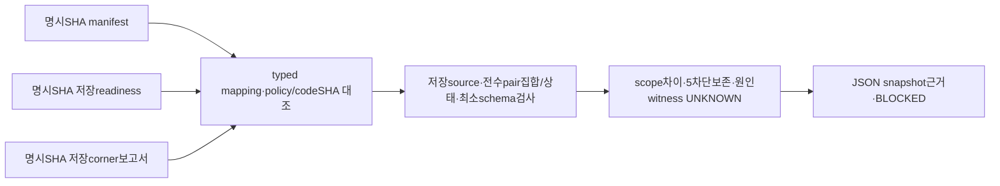

# Gate Readiness Comparison 20261017 — 저장된 적격성 결과와 물리 corner 보고서의 범위 대조

| 필드 | 값 |
|---|---|
| updated_at | 2026-10-17 23:36 KST — Git 상태 메타데이터 정정; 본문은 해당 Gate 기준 |
| source_commit | d474d5bce6c2a6c4bd8ba141c9256d15f6004631 (108까지 구현 검토 기준; 이 메타데이터 정리는 후속 문서 커밋) |
| evidence_paths | `backend/app/data/recovery_readiness_comparison.py`; `scripts/inspect_recovery_readiness_comparison.py`; `tests/test_recovery_readiness_comparison.py`; `backend/app/ml/readiness.py`; `docs/implementation/57_recovery_readiness_comparison_validation.md`; `evidence/integration/recovery-readiness-comparison-tests-20261017.log`; `evidence/integration/recovery-readiness-comparison-independent-20261017.log`; `evidence/integration/recovery-readiness-comparison-live-final-20261017.json`; `evidence/integration/recovery-readiness-comparison-full-tests-20261017.log`; `evidence/integration/recovery-readiness-comparison-live-integrity-20261017.json` |
| confidence | 코드·합성시험·실제 pinnedJSON snapshot 대조; 현재영상/기하/원인복원 미검증 |
| status | VERIFIED_REAL: 고정3JSON일관성; TESTED_SYNTHETIC: 17시험; 학습/실행 BLOCKED |

## 쉬운 설명

품질검사를 통과한 물건의 검사표와 창고 전체 사진의 위치표가 서로 다른 숫자를 갖는 이유를, 저장된 문서끼리 비교한다. 물건을 다시 꺼내 검사하지 않는다. 문서가 맞물린다는 사실과 당시 차단의 구체적 원인을 새로 증명하는 일은 구분한다.

## 이론과 중요한 차이

고정 SHA의 manifest·저장readiness·저장corner보고서를 읽고 같은명세/정책에 연결됐는지 확인한다. 물리행1,384의split848·272·264와 저장적격1,111의628·233·250은 다른집합이다. 물리corner의91source·2,227쌍 기록이 적격scene의token/bbox 검사를 대신하지 않는다.

실제readiness는 source_group/scene_id토큰과 적격bounds_wgs84 bbox로주별component를연결한다. 저장prepared_payload가null이고 적격scene/token/bbox witness가 없으면 구체적원인은 UNKNOWN_NOT_PERSISTED다. prepared_payload가있어도이번도구는PRESENT_NOT_ANALYZED로기록하며원인분기를분석하지않는다. blocker문장이나 province_groups의 west_java→banten 연결만으로 token/bbox 어느분기가 실제원인인지 추측하지 않는다. group_splits는 고정6주map이며 연결component가5개라고 그keys가오류인것도 아니다.

## 코드·검사 수준

`recovery_readiness_comparison.inspect_recovery_readiness_comparison`와 내부CLI가 구현이다. 세JSON을 각SHA로pin하고 manifest64MiB/두보고서각32MiB·strictUTF8/depth32·duplicatekey/비유한거부로읽는다. 현재code/policy SHA도대조하지만저장readiness생성시점의코드를증명하지는않는다. 현재code/policy를조사종료때다시확인하고 종료때JSON을다시읽어변경을거부한다. evidence/data 경로제한과입력덮어쓰기금지를지킨다.

manifest의source경로는canonical해석만하며 source파일을stat/open하지않는다. 현재헤더·raster/SHA·픽셀·GEOS·readiness.assess를실행하지않는다. 저장report의유일source와예상교차쌍 전체집합·typed계수·split조합·완료상태·UNKNOWN/flags·runtime/network·헤더/affine·네모서리/닫힌geometry 최소schema를확인한다. 저장좌표가실제로변환결과인지재계산하지않는다.

pair중하나라도미기재/중복/UNKNOWN/NOT_CHECKED·모순/잘못된계수면 complete=false다. positive0만으로전수DISJOINT라고요약하지않는다. complete일때만 저장corner전수disjoint/후보없음을요약한다. 후보없음요약은접촉가능성까지없다고말하거나정확독립승인으로확장하지않는다. bool과int를같게보지않고 hugeinteger/NaN도안전하게거부한다.

## 시험과 최종 실제근거

최종관련17 PASS/9.343초·독립17 PASS/8.723초의보존로그를읽었다. 초기16과중간17/8.876초는보완과정이력이다. 최종 전체 `scripts/test.ps1`은 **538건 중537 PASS·1 SKIP/174.829초/종료0**다. SKIP은 기존 OS symlink 생성 권한이며 deterministic 경계 시험은 통과했다. 관련17 PASS/9.343초·독립17 PASS/8.723초는 전체538에 중복 합산하지 않는다. 초기16과 중간17/8.876초는 검토 보완 전 이력이다. 보호132참조·기존 계약18SHA·입력3JSON의 SHA와 존재는 불변이고 이전 추적 코드·데이터·계약 변경0이다. 저장5개 blocker의 순서와 내용은 원형 그대로 보존했다. 이해자료 작성은 보존 근거를 읽었고 재실행하지 않았다. CLI의cwd상대경로를명시해석하고 equal/양방향contains논리·prepared_payload필수키·group_splits검사를보완했다. fixture는불완전report·전수source/pair집합·typedcounts/flags·runtime/network·storedcorner최소schema·prepared_payload/group_splits필수key·경로/변경/덮어쓰기방어와현재raster/GEOS/assess미호출을검사한다. 실제최종CP949 CLI exit0은 CONSISTENT_SAVED_SCOPE_METADATA·issue0이었다. 저장5blocker를유지하고 물리1,384(848/272/264)와저장적격1,111(628/233/250)을별도표시했다. 차이220/39/14는산술차이이며제외행목록/원인복원이아니다. 고정저장corner의완료일관·2,227recordeddisjoint·후보없음요약은true지만 현재기하/영상재검증은false다. prepared_payloadnull·분기UNKNOWN_NOT_PERSISTED·componentmap이분기witness가아님을기록했다. 이해자료작성에서는재시험/실자료조사를실행하지않았다.

## 한계·승인·UI

snapshot일관성은현재raster/기하·적격누출·차단원인/독립성·과학성능·기관/운영승인이아니다. 저장5 blocker·기존적격1,111/계획후보1,095·baseline Draft·terminal없는2건/예약136,314,880B를유지한다. BLOCKED·exactly-once UNKNOWN·환불0·학습/실행/정산/자동재개/과학승인false다. 원본분할/gate/policy/원장/lock/모델을변경하지않는다.

공개API/화면계약없는내부CLI라 UI변경·실행frontend반영·브라우저재검사는불필요하다. 전체개발과10분보고는계속한다.

## 발표 1분

“품질검사를 통과한 적격자료의 준비도 결과와 창고 전체 원본의 모서리근사 결과가 왜 다른지, 저장된 세문서를 비교하는 도구를 추가했습니다. 같은명세와 정책인지, 모든원본·비교쌍의 기록이 완전한지부터 확인합니다. 양수후보가0이라는 숫자만 보고 전수검사가 끝났다고 말하지 않습니다. 이번에는 실제영상이나 기하를 다시 계산하지 않았습니다. 기존준비도는 차단원인의 상세증거를 저장하지 않아 어느토큰이나bbox가 원인이었는지는 모른다고 남깁니다. 실제저장문서대조는일관됨/issue0이었지만 문서일관성과 원인증명·학습승인을 구분하고 기존다섯차단과BLOCKED를 유지합니다.”

## 발표 5분·10분

1. **0~1분:** 검사표와창고목록비유·새검사가아닌저장문서대조임을소개한다.
2. **1~2분:** 적격628·233·250과물리848·272·264, token/bbox와corner규칙차이를설명한다.
3. **2~3분:** 세SHA pin·전수집합/typed/최소schema·불완전0positive요약금지를말한다.
4. **3~4분:** 최종실제/관련·독립/전체/보호의확정근거와원인UNKNOWN을제시한다.
5. **4~5분:** 현재raster/GEOS/assess0·5 blocker유지·원본/분할불변·UI불필요·개발지속을설명한다.

10분은component5와고정group_splits6의차이·prepared_payload누락/null·과거runtime기록과현재관측차이·source경로해석과stat/open차이·부분report오류예시를덧붙인다.

## Q&A

**기존차단의원인을찾았나?** 적격witness가저장되지않아 token/bbox실제분기는UNKNOWN이다.

**연결component5개인데splitmap6개는오류인가?** 서로다른의미이며고정6주map을유지하는것이계약이다.

**새영상검사인가?** pinnedJSON대조이며현재raster stat/header·픽셀·GEOS·readiness.assess는실행하지않았다.

**positive0이면전수disjoint인가?** 전체source/pair기록과완료·상태가일관될때만그저장결과를요약한다.

**학습차단을해제하나?** 기존5 blocker·BLOCKED·false승인을유지하며gate/policy/분할을바꾸지않는다.

## 이후 갱신

문서57·최종독립/실제/전체/보호근거를받아기능해설·구조/용어·대본/FAQ/시연·INDEX·CHANGELOG를함께확정했다. 이후범위는별도Gate로구분한다.

## 다음 작업의 현재 상태

다음 향후준비성 검사의 source-group/scene-token/bbox 연결witness를 제한 저장할 계약·순수진단helper는 **PLANNED**다. 적격성 증거입력이 없으면 부재로 표시하고 과거원인을 소급추정하지 않는다. 기존assess/gate/policy/분할 변경·통합·재실행은 별도후속이며 현재 미수행이다.
