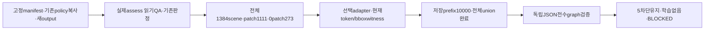

# Gate Readiness Real Diagnostic 20261017 — 학습 없는 현재 실자료 연결 관측

| 필드 | 값 |
|---|---|
| updated_at | 2026-10-17 23:36 KST — Git 상태 메타데이터 정정; 본문은 해당 Gate 기준 |
| source_commit | d474d5bce6c2a6c4bd8ba141c9256d15f6004631 (108까지 구현 검토 기준; 이 메타데이터 정리는 후속 문서 커밋) |
| evidence_paths | `docs/implementation/62_readiness_connectivity_real_validation.md`; `data/first-group/readiness-connectivity-20261017.json`; `evidence/integration/readiness-connectivity-real-preflight-20261017.json`; `evidence/integration/readiness-connectivity-real-execution-20261017.json`; `evidence/integration/readiness-connectivity-real-validation-20261017.json`; `evidence/integration/readiness-connectivity-real-independent-20261017.log`; `evidence/integration/readiness-connectivity-real-live-integrity-20261017.json`; `evidence/integration/readiness-connectivity-cli-full-tests-20261017.log`; `evidence/integration/readiness-connectivity-real-token-membership-20261017.json` |
| confidence | 현재실자료준비성관측·독립JSON연결검증; 과거생성원인/과학·운영승인 아님 |
| status | VERIFIED_REAL: 현재준비성/연결관측; 학습/과학/정산/재개 BLOCKED |

## 쉬운 설명

메모작성 옵션을 실제 검사에 한 번 켰다. 물건의 원래 검사결과는 그대로 두고, 지금 어떤표식이 연결을 만들었는지 새공책에 기록했다. 현재공책에 이유가 보인다고 과거공책을 썼을 당시의 이유까지 증명하는 것은 아니다. 학습·삭제·정책변경 없이 읽기진단을 수행했다.

## 실행·보고서·기존 판정

Root는 고정manifest와 기존saved policy의동일복사본, 명시새출력으로 CLI를1회 실행했다. exit0·70.437초이며 --execute/--resume/학습/다운로드를 요청하지 않았다. 생산코드 변경은없고61단위코드를 그대로사용했다.

새보고서는 `data/first-group/readiness-connectivity-20261017.json`,11,132,483bytes·SHA `95f7622ac72ef6a3d43aafc35a3607a4e9f39ed2912ac01280a07cc62c854e35`다. 원본saved report는덮어쓰지않았다. 두보고서의기존key/typed값은 assessed_at과새connectivity_diagnostics외모두같고5 blocker·patch628/233/250·4,335 verified_files기록도같다. 새실행은기존assess의실제영상/라벨읽기·hash·픽셀QA를수행했다. adapter안의추가source_files_read=0/pixel_arrays_read=false를 전체CLI가영상/픽셀을안읽었다는뜻으로확장하지않는다.

## 현재 scene·patch·연결

| 현재실행 범위 | train | val | test | 합계 |
|---|---:|---:|---:|---:|
| append된 scene |848|272|264|1,384|
| 적격patch |628|233|250|1,111|
|0patch scene |220|39|14|273|

이번현재관측에서1,384 scenes중273개는patch0이어도union에참여했다. 일반적으로patch수와scene수가같다는계약은아니다. 과거report에는장면목록이없으므로 역사적scene수/0patch존재·원인분기는 UNKNOWN_NOT_PERSISTED로남긴다.

현재직접cross-split token event는 scene_id문자열공유1건이다.

```text
S2A_MSIL2A_20210812T025551_R032_T48MXT_20210812T132431
west_java/test: 현재 scene_index1096, eligible_patches0
banten/val: 현재 scene_index303, eligible_patches1
두역할 scene_id · component_union_changed=true
```

source_group의주prefix는서로다르지만기존sharednamespace의scene_id가같아연결됐다. 같은토큰전체회원추가검증은28scene(scene_id역할)이며 Banten16개모두1patch, WestJava12개는0patch3개/1patch9개다. 양쪽에양수patch장면도있어 첫0patch event가충돌이0patch에만한정됐다는증거는아니다. 이번호는이번assess내부순번이며 원본manifest행번호로단정하지않는다.0patch장면하나/전부를삭제하면기존차단이해결된다는counterfactual은시험하지않았고 삭제/필터/정책변경을승인하지않는다. 현재event를과거생성원인의소급증명으로읽지않는다.



## 저장절단과 독립 검증

helper는957,036 bbox쌍·2,768 token occurrence를처리했다. 전체event는 token2,595+bbox12,424=15,019개이며10,000개를저장하고bbox5,019개는생략했다. union_complete=true·TRUNCATED_UNION_COMPLETE이고 CAPTURED_COMPONENTS_MATCH다.

저장prefix만으로cross-split bbox0을추정하지않았다. 독립reviewer가새보고서의전체projected metadata를graph/BFS로재계산해957,036쌍·모든event계수·첫10,000개모든필드·component일치를확인했고 cross-split bbox0/token1을확인했다. 이것은현재JSONmetadata의토큰/직사각형규칙검증이며 정확영상/픽셀독립성이나과학누출판정은아니다. 문서validation20항목도unittest20개가아니다.

## 자원·보존·시험의 범위

135회표본의관측peak tree RSS는214,724,608B였다. timeout600초·RSS관측기준2GiB로감시했고 중지사유는없었다. 표본RSS는hard memory cap/순간최대메모리보장이아니다.

보호132참조·24코드계약SHA·기존saved report·이전추적코드/데이터/계약은불변이며 신규코드수정0이다. 원본영상·분할·정책·원장/lock·모델·예약136,314,880B를변경하지않았다. 새policy/보고서/evidence는이번진단산출물이다. 원자적snapshot은보장하지않는다.

**이번62단위는새 unittest/full regression을실행하지않았다.**608건607 PASS·1 SKIP/207.921초는직전61코드변경로그의역사근거다. 이번증거는실제CLI1회와독립JSON검증이며이를기존608에더하거나608을다시실행했다고하지않는다. 이해에이전트는보고서만읽고 assess/원본IO/검증계산을재실행하지않았다.

## 한계·UI·진행권한

VERIFIED_REAL은현재준비성/연결관측범위이며 과학정확도·기관/운영승인·독립기하·누출해결이아니다. 기존5 blocker·학습/과학/정산/자동재개승인false·환불0·exactly-once UNKNOWN·baseline Draft·terminal없는2건을유지한다.

이번은이미허용된내부읽기진단으로수행했으며 새사용자승인이필요한절차를추가하지않는다. 과학/운영승인과내부개발진행권한은다르다. 공개API/UI계약변경이없어화면변경은필요없고 현재UI는기존readiness의5차단상태를유지한다. 새tokenwitness카드를UI에연결한것으로주장하지않는다. 전체개발과10분보고는계속한다.

## 발표 1분

“실제자료의 준비도 검사에 연결메모 옵션을 한 번 켰습니다.70.437초에학습없이끝났고 기존다섯차단과patch628·233·250은같았습니다. 현재장면은1,384개이며0patch장면273개도연결에참여했습니다. 그중현재순번1096의West Java0patch장면과303의Banten1patch장면이같은scene_id로연결됐습니다. 전체회원28개에는양쪽의양수patch장면도있어0patch만의문제로단정하지않습니다. 이사실은지금의관측이며 과거보고서의원인을소급증명하거나 그장면을삭제하면해결된다는뜻은아닙니다. 저장witness는일부생략됐지만 독립JSON전수계산으로전체연결을대조했습니다. 새시험총수를만들지않고 실제CLI와metadata증거를구분하며 학습·정책변경·원장수정없이BLOCKED를유지합니다.”

## 발표 5분·10분

1. **0~1분:** 실제읽기진단1회·새보고서·학습없음을소개한다.
2. **1~2분:** 기존보고서동등성·현재scene/patch/0patch표를설명한다.
3. **2~3분:** 현재tokenbridge와내부index·과거원인UNKNOWN·삭제반사실미검증을말한다.
4. **3~4분:**15,019event/10,000저장·독립전수bbox/token·자원관측과시험범위를구분한다.
5. **4~5분:** 과학/운영승인아님·5차단/원본유지·UI기존상태·다음읽기추적/개발지속을말한다.

10분은sharednamespace와주prefix·bbox0의독립전수근거·adapter추가IO0와실제assessIO·표본RSS한계·원본행binding후속을덧붙인다.

## Q&A

**이제과거원인이확정됐나?** 현재새event만확인했으며과거생성장면/원인은UNKNOWN이다.

**0patch273개를지우면되나?** 삭제후결과를검증하지않았고원본/필터변경을승인하지않는다.

**bboxwitness가잘렸는데0이라고어떻게아나?** 저장prefix추론이아니라독립전체projectedmetadata재계산결과다.

**이번에608시험도또했나?** 아니다.608은직전61로그이며이번은실제CLI1회·독립JSON검증이다.

**픽셀을안읽었나?** pureadapter추가IO만0이다. 실제assess는기존영상/라벨hash·픽셀QA를했다.

## 다음 작업

현재event와producttoken을원본manifest의명시province/scene_id/source_group·참조SHA에연결하는읽기lineage보고서는PLANNED다. index를원본행번호로단정하지않고 동일product전체회원·중복/모호함을기록한다. 재assess/원본영상IO·삭제/필터/정책변경없이진행한다.

## 추가 회원근거와 다음범위

현재 scene_id 토큰 `S2A_MSIL2A_20210812T025551_R032_T48MXT_20210812T132431`의 직접cross-split event는 West Java/test의 내부scene1096(0patch)→Banten/val의scene303(1patch)다. 같은토큰 전체회원은28scene 모두scene_id역할이며 Banten16개는전부1patch, West Java12개는0patch3개/1patch9개다. **양쪽에양수patch장면도있어 첫0patch event가충돌이0patch에만한정됨을뜻하지않는다.** 내부sceneindex를원본manifest행번호로단정하지않으며 삭제/필터후차단해소 counterfactual은검증/승인하지않았다. 현재관측은과거생성원인·회원/scene수의소급인증이아니고 역사근거는UNKNOWN_NOT_PERSISTED로유지한다.

다음 고정원본manifest의명시province/scene_id/source_group·참조SHA와현재내부event를대조하는 읽기lineage trace는 **PLANNED**다. 동일product전체회원·중복/모호함을기록하고 index를원본행으로추정하지않는다. 재assess/원본영상IO·삭제/필터·정책/분할변경없이진행한다.

현재 cross-split bbox교차0인데 token연결1이 남는 것은, bbox가 달라도 같은 촬영제품 ID문자열을 공유하면 같은 그룹으로 묶는 기존의 보수적 규칙을 관측한 결과다. 물리·정확픽셀 중첩이 있다고 추정하지 않고, bbox0을 학습독립성/승인으로도 해석하지 않는다. 같은제품 회원 양쪽에 양수patch장면이 있어0patch만의 문제로 좁히지 않는다.
