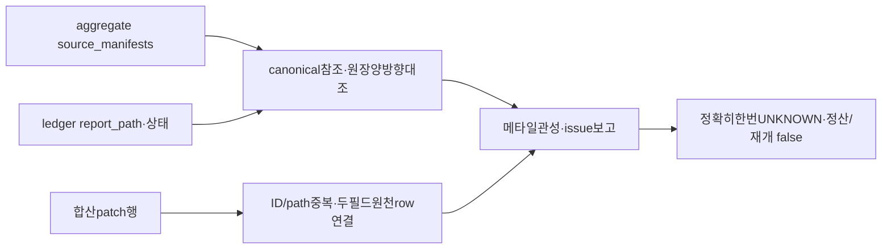

# Gate Recovery Aggregate 20261017 — 합산목록과 출처의 읽기 대조

| 필드 | 값 |
|---|---|
| updated_at | 2026-10-17 23:36 KST — Git 상태 메타데이터 정정; 본문은 해당 Gate 기준 |
| source_commit | Git 연결됨; 문서 작성 시 변경분 미커밋, evidence snapshot SHA로 추적 (원격 기준 d483d25) |
| evidence_paths | `backend/app/data/recovery_aggregate.py`; `scripts/inspect_recovery_aggregate.py`; `docs/implementation/46_recovery_aggregate_reconciliation.md`; `evidence/integration/recovery-aggregate-tests-20261017.log`; `evidence/integration/recovery-aggregate-independent-20261017.log`; `evidence/integration/recovery-aggregate-full-tests-20261017.log`; `evidence/integration/recovery-aggregate-live-final-20261017.json`; `evidence/integration/recovery-aggregate-live-integrity-20261017.json` |
| confidence | 코드·fixture·실제JSON메타연결; raster/year/province/crop·정산증명미검증 |
| status | VERIFIED_REAL: 메타출처/중복읽기; TESTED_SYNTHETIC: 경계시험; 정산/재개 BLOCKED |

## 한 문장·1분 비유

합산한 도서목록의 번호가 원천납품목록과 맞는지 검산했다. 목록 연결이 맞는 것은 실물의 모든 페이지나 정산영수증을 검사한 뜻은 아니다. 원본을 바꾸지 않고 메타데이터의 누락·중복·모호성을 드러낸다.

## 왜·이론·5분 흐름

retry/다중batch에서누락이나중복을찾으려면원장→aggregate뿐아니라참조→원장도대조해야한다. `inspect_recovery_aggregate(data_root)`는source_manifests·ledger report_path·patchID/imagepath·원천row연결을읽는다. 다른실험output은현재집계누락으로오판하지않고범위unknown/중복원장연결을별도issue로남긴다.

## 코드·계약·검사 범위

`backend/app/data/recovery_aggregate.py`,CLI`scripts/inspect_recovery_aggregate.py`가구현이다. 기존terminal의strictJSON·confinement·fingerprint를변경없이재사용한다. 기존recovery/terminal/budget/collector·원본/원장/lock·계획ID·API/UI는보존한다.

source row의`status=rgb_window_downloaded`에서(image_path,scene_id)색인을만들고aggregate의(source_window.path,scene_id)쌍을연결한다. 물리patch생성은원천row를복사해새patch_id/image_path를지정한다. 같은scene의16patch·patch0report는정상계약이고scene_id반복을패치중복으로보지않는다. 중복canonical참조는issue지만색인에원천row를가짜로중복생성하지않는다.

ledger→aggregate는settled미참조/pending참조와파일누락을구분한다. 반대방향의source ref가원장에없거나여러batch로연결되면unknown/ambiguous다. 현재범위status는pending/settled문자열만허용하고bool/숫자/미지값은INVALID다. 다른실험은OUT_OF_SCOPE이며범위미확정을임의제외하지않는다.

**연결은경로+scene_id 두필드뿐이다.** year/province·밴드/품질/CRS·cropwindow·물리중복·raster존재/bytes/SHA·patch완전성은미검사다. canonical경로resolve는raster를열거나존재/해시를인증하지않는다.

## 실제 결과

최종CP949CLI exit0·source참조113/unique113/PRESENT113,aggregate1,384행모두UNIQUE_METADATA_MATCH다. patchID/imagepath중복0·issues0,원장119건은현재115(113report+2pending)/범위밖4다. CONSISTENT_METADATA지만statusBLOCKED·exactly_once_appliedUNKNOWN·정산/실행/자동재개false·환불0·네트워크/원본쓰기0이다.

raster_files_read0·source_file_hashes_verified=false·scene_year_province_checked=false·crop_window_identity_checked=false다. 새명세나후보를발행하지않았고원본적격1,111/계획예상1,095·학습차단과pendingterminal부재는유지한다. 처음live는status대조보완전기록이고최종근거는live-final/integrity다.

## 경계·시험·보존

strictJSON/duplicate/비유한/타입을검사하며전역aggregate/ledger오류는조사를거부하고개별source오류는issue로남긴다. 경로이탈/원격/위험key·반복읽기내용변경·누락파일출현·논리target재지정을거부한다. 여러파일순차관측이며원자적snapshot/프로세스lock·journal증명은아니다.

관련16 PASS/5.357초·독립16 PASS/4.579초,전체372건/71.714초/OK(skipped=1)=371 PASS·1 SKIP다. 독립시험을전체에합산하지않고기존OSsymlink권한1SKIP/mock경계PASS를구분한다. 보호132refs(누락포함)/기존계약7SHA불변·기존추적코드/자료/계약변경0이다.

새공개API/화면계약없는내부CLI라UI수정/브라우저재검증은불필요했다. stdout/stderr는ASCIIescape·새evidence는UTF8보존이며기존/입력/data-root/바깥출력을거부한다. exit0은읽기보고성공이고실제정산·재개성공이아니다.

## 발표·10분 확장·Q&A

30초: “합산목록과원천목록의두필드연결은맞았고ID/path중복은없었습니다. 실제영상과정확히한번정산/집계됐는지는별도라차단과예약보존을유지합니다.”

1분/5분은[발표문서](../presentations/1MIN_5MIN_SCRIPT.md)의최신절을사용한다.10분은양방향unknown/ambiguity·범위구분·정상다중patch/patch0·타입/status·retarget/원자성한계를확장한다.

Q1.113과1,384는다른가? A.보고서참조와patch행이다.

Q2.중복0이면ML누출0? A.ID/path중복만검사했다.

Q3.유일연결이면전체신원보증? A.경로/scene쌍범위다.

Q4.issues0인데정산왜안하나? A.journal/exactly-once는UNKNOWN이다.

Q5.UI안바뀌는이유? A.공개화면계약없는내부단위다.

[DEMO](../presentations/DEMO_STORY.md)의aggregate읽기절을쓴다. 관련설계/사용법/시험/인계·이해자료를같이갱신하고전체개발·10분보고는유지한다.
