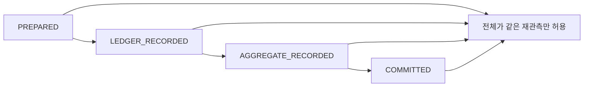

# Gate110 — 수집 복구 커밋 단계의 선언 관측 계약

| 항목 | 내용 |
|---|---|
| updated_at | 2026-10-18 00:04 KST — 110 최종 근거·사용자 확인 의존성 반영 |
| source_commit | 기준 259b5f322ae36d72f21a8aa8b8d903b98550cf4f + 110 작업 파일 SHA (미커밋); 기준 commit이 새 변경을 포함한다는 뜻 아님 |
| evidence_paths | `backend/app/data/recovery_commit_contract.py`; `tests/test_recovery_commit_contract.py`; `docs/implementation/109_area_completion_audit.md`; `scripts/collect_training_parallel.py`; `backend/app/data/budget.py`; `evidence/integration/recovery-commit-contract-focused-final-20261017.log`; `docs/implementation/110_recovery_commit_contract.md`; `evidence/integration/recovery-commit-contract-focused-20261017.log`; `evidence/integration/recovery-commit-contract-focused-final2-20261017.log`; `evidence/integration/recovery-commit-contract-related-20261017.log`; `evidence/integration/recovery-commit-contract-related-final-20261017.log`; `evidence/integration/recovery-commit-contract-related-final2-20261017.log`; `evidence/integration/recovery-commit-contract-independent-before-key-guard-20261017.log`; `evidence/integration/recovery-commit-contract-independent-20261017.log`; `evidence/integration/recovery-commit-contract-independent-final3-20261017.log`; `evidence/integration/recovery-commit-contract-preflight-20261017.json`; `evidence/integration/recovery-commit-contract-live-integrity-20261017.json`; `evidence/integration/recovery-commit-contract-external-dependencies-20261017.json` |
| confidence | 완료 코드·기존 finalize/settle·최종 시험·보존 확인; 실제 운영 복구 증거 아님 |
| status | TESTED_SYNTHETIC; 실제 복구 적용 미수행; 정산/재개·학습 BLOCKED |

## 쉬운 설명

세 장부를 고치는 과정을 “준비 → 예산 장부 기록 → 통합 목록 기록 → 실행 요약 기록 완료”로 나누고, 제출된 상태 메모가 이 순서와 맞는지 확인하는 내부 함수다. 실제 장부를 읽거나 고치고 도장을 찍는 기능은 아니다. 메모가 맞더라도 실제 저장됐는지와 정산·재개 허가는 확인되지 않는다.

실제 미완료 두 배치에는 결과 보고서가 없으므로 새 계약을 적용하지 않았다. 임의 작업ID나 예상 저장 지문을 만들어 실제 복구 성공으로 표현하지 않는다.

## 이론적 배경과 기존 공백

기존 collector의 finalize는 ledger.settle 저장 뒤 aggregate를 저장하고 마지막 run-result를 저장한다. 이미 settled인 batch의 settle 재호출은 거부한다. 여러 파일의 저장 사이에 중단될 가능성을 다루려면 단계·동일 작업·재관측을 구분해야 한다. 이것은 설계 공백의 관측 계약이며 특정 crash가 실제로 있었다는 입증이 아니다.

새 helper는 두 개의 caller 선언만 검사한다. 첫 관측은 PREPARED만 허용한다. 이후에는 바로 다음 단계 또는 전체 필드가 완전히 같은 재관측만 허용한다. 건너뛰기·역행·같은 단계의 다른 메모·작업 신원 충돌은 거부한다. 실제 journal 저장·원자적 coordinator·내구성·exactly-once 적용은 구현하지 않았다.

## 코드와 데이터 동작

`validate_recovery_commit_transition(previous,current)`는 파일·DB·network 없이 선언 두 개를 검사한다. 각 관측은 정확한11키다. schema_version,phase,phase_evidence_sha256,observed와 작업ID·batch키·config/terminal/reconciliation 지문·before·expected_after를 받는다. before/expected_after/observed는 ledger_sha256·aggregate_sha256·run_result_sha256 정확한 세 키다.

모든 dict와 키·문자·정수는 정확한 builtin 타입을 요구한다. ID는ASCII 제한문자1..128이고 SHA는소문자hex64다. None의 증거/관측은 형식 허용 뒤 누락으로 분리하며 자동 보충하지 않는다. 이전 관측을 먼저 검사하고 각각 형식 → 누락 근거 → 단계별 관측을 확인한 뒤 작업 신원과 전이 순서를 비교한다. 그래서 증거 누락이나 현재 저장값 불일치를 단계 건너뛰기 오류보다 먼저 보여줄 수 있다.

| 선언 단계 | ledger 관측 | aggregate 관측 | run-result 관측 |
|---|---|---|---|
| PREPARED |before|before|before|
| LEDGER_RECORDED |expected_after|before|before|
| AGGREGATE_RECORDED |expected_after|expected_after|before|
| COMMITTED |expected_after|expected_after|expected_after|

단계를 바꿔도 operation_id·batch_key·config/terminal/reconciliation SHA와 두 목표 map은 같아야 한다. 같은 단계면 phase_evidence를 포함한 관측 전체가 같아야 IDENTICAL_REPLAY다. before와expected_after가 같은 no-op도 허용한다. 이때 지문만으로 실제 단계 이동이나 파일 쓰기 발생을 구별할 수 없다.

반환은 고정18키이며 metadata_transition의 일관성 여부와 별개로 status BLOCKED·claim_verification UNVERIFIED·exactly_once_applied UNKNOWN이다. 정산·환불·재시작·쓰기·실행 허가와 commit_executed는false, 제안 환불과IO계수는0이다. ID·원문SHA·경로를 반환에 노출하지 않는다.

## 시험 증거

최초12 PASS 뒤 독립 검토에서 str 하위형 key가 집합 동등 비교를 통과하는 경계를 발견했다. 공개 연결 전에 len과 정확한 str key 검사를 추가했다. 이어 초기 phase 표시 추출도 키 검사 뒤로 옮겨, 잘못된 충돌 키의 equality callback을 부르지 않도록 보완했다. 두 경계를 회귀 시험으로 보강한 최종집중14 PASS/0.022초·관련67건 중66 PASS/기존1 SKIP/41.983초를 확인했다. 초기·중간 로그를 보존했고 최종독립63건 중62 PASS/기존1 SKIP/41.636초와 아래 보존 근거를 확인했다.

합성 시험은 네 단계·인접 전이·동일 재관측·역행/건너뛰기·모든 pin/map 충돌·증거 누락·관측 불일치·오류 우선순위·정확 타입과 키·입력불변·IO0·비노출을 확인한다. aggregate 저장 후 run-result가 이전값인 합성 사례는 COMMITTED로 인정하지 않는다. 실제 운영 중단·복구·파일 쓰기 시험은 아니다.

## 한계와 UI 영향

모든 SHA는 호출자의 주장이지 실파일·서명·출처 인증이 아니다. before==after 또는 위조된 메모도 형식과 값이 맞으면 일관한 전이로 관측할 수 있다. COMMITTED 문자나 IDENTICAL_REPLAY를 실제 저장·중복 정산 방지·환불·재개 승인으로 쓰지 않는다.

실제 pending두 배치 terminal 부재·예약136314880B와 원장/lock·원본·분할·모델을 유지한다. 새 helper는 실제 배치에 적용하지 않았고 기존 collector/settle·writer·API/UI와 연결하지 않았다. 이번 전체/backend/front/build/browser 재실행은 없다. 이전1069건/1068 PASS/1 SKIP/354.650초는107의 역사 근거다. 후보QA4차단·학습BLOCKED·전체 개발과10분 보고는 계속된다.

## 발표 스크립트

### 1분

“복구 과정에서 세 장부의 상태 메모가 순서에 맞는지 확인하는 계약을 만들었습니다. 준비, 예산 장부, 통합 목록, 마지막 실행 요약의 네 단계입니다. 단계는 하나씩 진행하거나 완전히 같은 메모를 다시 볼 수 있습니다. 하지만 실제 파일을 저장하거나 정산하는 기능은 아닙니다. 모든 지문도 호출자가 준 주장이라 원본 인증이 아닙니다. 실제 두 미완료 배치는 결과 파일이 없어 적용하지 않았고 예약도 그대로 보존했습니다. 메모가 일관해도 정산·환불·재개·실행은 차단합니다.”

### 5분 순서

첫1분은 세 장부와 상태 메모 비유를 설명한다. 두 번째1분은 기존 finalize의 저장 순서와 중단 지점 공백을 설명한다. 세 번째1분은 단계별before/after 표와 같은 작업·동일 재관측을 보여준다. 네 번째1분은 합성 오류·형식·키하위형 검토와시험을 나눈다. 마지막1분은 실제missing두 배치 미적용·정산/재개 미승인·다음 내구성 구현을 설명한다.

### 10분 확장과 슬라이드

기존 저장 순서, 선언 입력, 전이표, 합성 검증, 운영 적용의 공백 다섯 장을 쓴다. 5분 뒤 no-op/위조 메모의 한계를2분, 증거·관측·전이 오류 우선순위를1분, journal/원자적적용 미구현을1분, 질문을1분 배정한다.

## Q&A

Q. COMMITTED면 파일 저장이 끝났나? A. 메모의 값이 단계에 맞는다는 관측일 뿐 실제 파일을 읽지 않는다.

Q. 동일 재관측이면 정산을 다시 해도 되나? A. 정산·쓰기·실행 허가는 항상false다. 실제멱등적용은 구현하지 않았다.

Q. 두 실제pending배치가 복구됐나? A. 결과 파일이 없어 새계약을 적용하지 않았고 예약도 그대로다.

Q. before와after가 같아도 되는가? A. no-op선언은허용하지만 실제쓰기·단계를증명하지못한다.

Q. 기존 원장과요약 차이는 특정crash증거인가? A. 아니다. 차이만으로 원인이나 환불액을 확정하지 않는다.

## 사용자 확인 외부 의존성

외부5개 모델의 API·SDK·실행 코드와 독립 정확도 검증 라벨은 별도로 준비되지 않았다는 사용자 확인을 기록했다. 미제공·미연결/BLOCKED이며 기존 약한 라벨 학습 입력은 보존하지만 독립 정답과 동등하지 않다. 기존 자료의 위치를 반복 질문하지 않는다. 내부 계약·진단 개발은 계속하며 외부 자료 부재를 과학·실행 승인으로 우회하지 않는다.

## 110 최종 근거와 실제 미적용 범위

최종집중14 PASS/0.022초·관련67건 중66 PASS/기존1 SKIP/41.983초·독립63건 중62 PASS/기존1 SKIP/41.636초/exit0이다. SKIP은 기존 Windows symlink 생성 권한이며 반복과 묶음을 합산하지 않는다. 정확한 str 키 검사와 초기 표시용 phase 접근의 키검사 선행을 보강했고 초기·중간 로그도 보존했다.

보호141·이전 증거809·기존 코드·catalog14는 불변이다. 실제두배치의config/state는있지만worker-result/source보고서는각각없다. 새helper를실제배치에적용하거나가짜operationID·after pin을만들지않았다. journal생성·collector/settle변경·정산·환불·재개·수집·새QA·학습·배포·운영Job/모델등록0이다. 예약136314880B·원장/lock·원본/분할/모델·후보QA4차단/학습BLOCKED를유지한다.

이번은새미연결pure계약이므로전체backend·프론트/build/브라우저는재실행하지않았다. 이전107의1069건/1068 PASS/1 SKIP/354.650초는역사근거다. 이후 durable journal/원자적 coordinator의설계·실패/재호출검증은PLANNED이며현재구현·운영적용아니다. 외부5실행자료·독립정확도라벨미제공은사용자확인으로기록하고내부개발·10분보고는계속한다.

[구현 계약](../../implementation/110_recovery_commit_contract.md), [완료 코드](../../../backend/app/data/recovery_commit_contract.py), [최종 독립 로그](../../../evidence/integration/recovery-commit-contract-independent-final3-20261017.log), [사용자 확인 의존성](../../../evidence/integration/recovery-commit-contract-external-dependencies-20261017.json)을 읽는다.
