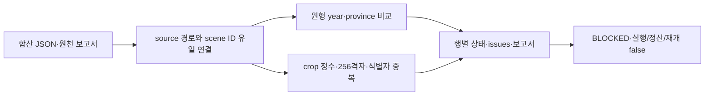

# Gate Recovery Crop 20261017 — 연도·지역·잘라낸 좌표 기록 대조

| 필드 | 값 |
|---|---|
| updated_at | 2026-10-17 23:36 KST — Git 상태 메타데이터 정정; 본문은 해당 Gate 기준 |
| source_commit | Git 연결됨; 문서 작성 시 변경분 미커밋, evidence snapshot SHA로 추적 (원격 기준 d483d25) |
| evidence_paths | `backend/app/data/recovery_crop.py`; `scripts/inspect_recovery_crop.py`; `tests/test_recovery_crop.py`; `docs/implementation/47_recovery_crop_reconciliation.md`; `evidence/integration/recovery-crop-tests-20261017.log`; `evidence/integration/recovery-crop-independent-20261017.log`; `evidence/integration/recovery-crop-full-tests-20261017.log`; `evidence/integration/recovery-crop-live-final-20261017.json`; `evidence/integration/recovery-crop-live-integrity-20261017.json` |
| confidence | 현재 코드·fixture·보존 실제 JSON 기록; raster/공간/과학/정산 승인 미검증 |
| status | VERIFIED_REAL: 로컬 메타데이터 대조; TESTED_SYNTHETIC: 경계; 실행/학습 BLOCKED |

## 쉬운 설명

납품목록의 항목번호가 맞는지 확인한 다음, 연도·지역과 잘라낸 위치의 기록까지 비교했다. 목록이 맞는 것과 실제 물건의 크기·내용·공식 인증이 맞는 것은 구분해야 한다. 원본을 고치지 않고 보고서를 남기는 점검이다.

## 이론과 계약

출처의 유일 연결 뒤 의미 필드를 비교해야 잘못된 행을 우연히 맞는 연도·지역과 대조하지 않는다. 연도는 범위가 유효한 정수 또는 ASCII4자리 문자열로 제한하고 원형 타입과 값을 보존한다. 정수2023과 문자열"2023"은 MISMATCH이고 같은 비정상 값도 INVALID다. province는 공백만 있으면 INVALID이며 누락은 UNKNOWN이다. 정규화해 문제를 숨기지 않는다.

crop은 `[x,y,width,height]`의 정확한 정수4개로 x/y가0이상·256격자, width/height가256이어야 한다. 같은 canonical source path·scene ID·crop4좌표가 반복되면 중복이다. 같은 장면의 서로 다른 crop는 정상이다. 다른 파일의 같은 영상이나 지리 중첩을 찾는 판정은 아니다.

## 실제 함수·데이터 동작

`backend/app/data/recovery_crop.py:inspect_recovery_crop(data_root)`가 aggregate와 참조 source report JSON을 읽으며 CLI는 `scripts/inspect_recovery_crop.py`다. 기존 aggregate의 원장/ref 양방향·patch ID/image path 중복 검사를 다시 실행하는 기능은 아닌 별도 companion이다.

`materialize_patches`가 source year를 복사하고 province를 batch 값으로 지정한다. source report와의 province 일치는 부분 문맥이며 batch config의 암호학적 신원·공식 행정구역·기관 승인이 아니다. 생성 과정에서 aoi가 달라질 수 있으므로 동일성을 강제하지 않는다.

strict JSON·정확한 타입·경로 제한·입력 JSON SHA/크기/누락 상태·논리 target 재대조로 잘못된 형식, 조사 중 변경과 retarget을 거부한다. 반복 읽기 캐시가 최초 근거를 덮어 변경을 숨기지 않는다. 다중 파일의 원자적 snapshot이나 OS lock은 아니다. CP949 출력은 ASCII escape를 사용하고 새 evidence 출력은 UTF-8·기존 파일 덮어쓰기 금지다.

## 실제 기록과 시험 증거

최종 CP949 CLI는 exit0이다. 이는 차단 보고서 생성 성공이며 복구 실행 성공이 아니다.

| 실제 메타데이터 요약 | 최종 값 |
|---|---|
| source 참조 / 합산 행 | 113 / 1,384 |
| 유일 source 연결 | 1,384 |
| year / province EXACT_TYPED_MATCH | 각각1,384 |
| crop VALID_METADATA | 1,384 |
| 지정 source crop 식별자 중복 / issues | 0 / 0 |
| metadata_consistency / status | CONSISTENT_METADATA / BLOCKED |
| raster_files_read | 0 |

관련14 PASS/8.084초·독립14 PASS/4.983초다. 초기 검토에서 양쪽이 같은 비정상 연도/공백 지역인 경우를 수정했으며 초기12/13은 이전 이력이다. 최종 전체 `scripts/test.ps1`은 **386건 중385 PASS·1 SKIP/111.108초/종료0**다. SKIP은 기존 OS symlink 권한이며 deterministic 경계 시험은 통과했다. 관련/독립 시험을 전체에 더하지 않는다. 이번 문서 작업은 보존 로그를 읽었으며 재실행하지 않았다.

누락 상태 포함 보호132참조와 기존 계약8SHA는 전후 같고 이전 추적 코드/데이터/계약 변경0이다. 원본 manifest·원장·lock·기존 recovery/aggregate·collector·저장계획을 보존했다. 새 공개API/화면 상태 변화 없는 내부 CLI라 UI 수정/실행 서버 반영/브라우저 재검사는 불필요했다. 직전 프론트49 PASS/build69modules18.53초는 기존 이력이다.

## 한계와 다음 Gate

`year_province_fields_checked`와 `crop_coordinate_contract_checked`의 true는 검사 시도 범위다. 전체 통과는 행별 결과와 issues를 별도로 읽는다. 실제 영상 width/height 안에서 x+256/y+256이 유효한지, CRS/transform·픽셀·기하 중첩·다른 파일 동일 SHA는 검사하지 않았다. raster bounds/geometric overlap/source hashes 확인은 false다.

exactly-once UNKNOWN·실행/정산/자동재개/ready_for_training/과학 승인false·환불0이다. terminal 없는2건·예약136,314,880B·기존5 blocker·원본 적격1,111/628·233·250·계획후보1,095/628·217·250을 바꾸지 않았다. 기존 CPU baseline은 Draft이고 후보 발행·정식 재학습은 없다.

다음 원본91이미지와 patch1,384개의 로컬 GTiff 헤더 dimensions/CRS/transform·crop bounds 대조는 **PLANNED 별도 Gate**다. 이번 결과에는 포함하지 않는다. 내용 SHA·독립성·원자 journal·정산/학습 승인은 추가 후속이다.

## 발표 1분

“이번에는 출처가 연결된1,384행의 연도·지역·잘라낸 좌표 기록까지 비교했습니다. 각 항목1,384행이 맞고 지정한 중복과 문제 기록은0입니다. 원본을 고치지 않았고 전체 소프트웨어 시험386건 중385개 통과, 기존 권한 제한1개는 건너뛰었습니다. 하지만 실제 영상 경계와 픽셀을 검사한 것은 아닙니다. 지역 기록 일치도 공식 승인과 다릅니다. 따라서 BLOCKED를 유지하며 학습·정산·자동재개는 하지 않았습니다. 다음에는 로컬 영상 헤더의 크기와 좌표 변환을 별도 검증할 계획입니다.”

## 발표 5분과 10분 확장

1. **0~1분:** 납품목록 비유와 원본을 보존하는 목적을 말한다.
2. **1~2분:** 유일 source 연결 뒤 typed year/province를 대조하는 이유, batch 지역 문맥을 설명한다.
3. **2~3분:** 256격자 crop와 중복 식별자, 같은 scene의 다른 crop가 정상임을 설명한다.
4. **3~4분:** 위 실제 요약·최종 시험·보호 SHA를 보여주고 메타 일관성과 BLOCKED를 함께 읽는다.
5. **4~5분:** 실제 raster 경계 미검사·실행/학습false·다음 PLANNED Gate를 말한다.

10분 설명은 뒤5분에 잘못된 연도/공백 province·strict JSON·stale/retarget fixture 사례, checked 시도와 성공 차이, 원형 타입 보존, 기존 누출/bare 문제와 공간 검증의 차이를 덧붙인다. 실제 성공 공간검증으로 표현하지 않는다. 전체 발표 흐름은 [발표 대본](../presentations/1MIN_5MIN_SCRIPT.md)을 사용한다.

## Q&A

**왜 issue0인데 BLOCKED인가?** JSON 계약의 일관성만 확인했으며 영상 경계·공간 독립성·완전전송·정산/승인은 미검증이다.

**지역이 맞으면 공식 경계가 맞나?** source report 문맥의 일치이며 batch 신원이나 행정 승인이 아니다.

**중복0이면 누출0인가?** 지정한 경로/scene/crop 식별자 중복만0이다. 다른 파일 동일내용·기하 중첩은 모른다.

**checked=true면 승인 가능한가?** 시도 범위 표시다. 행별 결과·남은 미검사·전체 BLOCKED를 함께 판단한다.

**화면이 바뀌었나?** 공개API/화면 계약이 없는 내부 CLI라 이번 UI 변경은 필요 없었다. 다음 화면 노출은 별도 계약·web_ui 인계·실브라우저 검증을 거친다.

## 이후 갱신

후속 Gate는 완료 코드·최종 관련/전체 로그·실자료 한계·보호 SHA·UI 영향 근거를 받은 뒤 이 Gate를 역사로 보존하고 새 Gate와 기능 문서·용어·발표/FAQ·INDEX·CHANGELOG를 함께 갱신한다. 전체 개발과10분 보고는 단일 Gate 완료로 중지하지 않는다.
