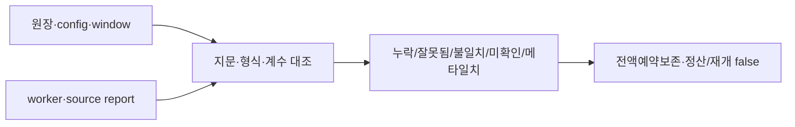

# Gate Recovery Terminal 20261017 — 종료보고서와 예산의 읽기 대조

| 필드 | 값 |
|---|---|
| updated_at | 2026-10-17 23:36 KST — Git 상태 메타데이터 정정; 본문은 해당 Gate 기준 |
| source_commit | Git 연결됨; 문서 작성 시 변경분 미커밋, evidence snapshot SHA로 추적 (원격 기준 d483d25) |
| evidence_paths | `backend/app/data/recovery_terminal.py`; `scripts/inspect_recovery_terminal.py`; `docs/implementation/45_recovery_terminal_reconciliation.md`; `evidence/integration/recovery-terminal-tests-20261017.log`; `evidence/integration/recovery-terminal-independent-20261017.log`; `evidence/integration/recovery-terminal-full-tests-20261017.log`; `evidence/integration/recovery-terminal-live-final-20261017.json`; `evidence/integration/recovery-terminal-live-integrity-20261017.json` |
| confidence | 코드·fixture·실제2batch메타/누락/보존; 완전정산/재개미검증 |
| status | VERIFIED_REAL: 누락/메타읽기; TESTED_SYNTHETIC: 경계/일치시험; 복구실행 BLOCKED |

## 한 문장·1분 비유

운송장과 정산영수증·장부의 항목을 대조하는 점검표를 추가했다. 서류 형식이 맞거나 숫자가 일치해도 실제 배송완료와 환불허가는 별도 증거가 필요하다. 이번 도구는 원장을 정산하지 않고 예약을 보존한다.

## 왜·이론·5분 흐름

terminal이 JSON객체라는 사실만으로 완료 처리하면 누락·손상·다른batch·불완전계측을 놓칠 수 있다. `inspect_recovery_terminal(data_root)`는 원장/config/window-state/worker-result/source annual report를읽고 INVALID→MISMATCH→MISSING→UNKNOWN→CONSISTENT_METADATA 우선순위로분류한다. 모든분류의최종status는BLOCKED다.

## 코드·지문·데이터 계약

실제파일은`backend/app/data/recovery_terminal.py`,CLI는`scripts/inspect_recovery_terminal.py`다. 기존recovery/planID·budget/collector는변경하지않는다. CollectionLedger를생성하거나lock획득·snapshot쓰기·네트워크수집을하지않는다.

| 대조 | 뜻 |
|---|---|
| ledger config SHA | 변환전config문서를정렬JSON으로직렬화한digest |
| window config SHA | years→periods변환후config문서digest |
| 조사전후 파일SHA | 파일자체bytes의변경/출현검사; 위configdigest와다름 |

수집config years는정수2015~2026·기본계절06-01~09-30의명시변환을반영한다. 전체collector config검증/STAC접근을실행하는것은아니다. worker key·cog/window·charged=cog+metadata·metadata read<=charged<=max·예약/전역합과예산을대조한다. bool/float/음수계수를거부하고legacy+measured<=upper와prior/상한도검사한다. source경로는해당batch의로컬report와같아야한다.

## 실제 결과와 승인 경계

실제CP949최종CLI는exit0이다. 두pending의worker-result/source report는각각없어MISSING/BLOCKED이고raw/normalized대조는각각true다. 각upper−measured33,554,432B는미계측/예약차이이며환불액이아니다. 예약총136,314,880B를보존하고proposed_refund0·settlement/execution/automatic_resume=false다.

메타일치fixture도source report의configdigest부재로신원binding UNKNOWN,완전전송계측·aggregateexactly-once UNKNOWN·process_exit_verified=false를유지한다. 차이0·lock존재·JSON정상도이를대신하지않는다. 정산coordinator·종료책임·완전계측·중복방지가후속이다.

## 경계·보완·시험

strictJSON/duplicate/비유한·일반파일/로컬경로경계·검사전후존재/크기/SHA·원래논리경로재resolve로stale/도중terminal출현/retarget을거부한다. 원자적snapshot/OSlock·조사뒤불변성은보장하지않는다. 전역원장오류는조사를거부하고개별artifact누락/INVALID는진단으로보고한다. CLI stdout/stderr는ASCIIescape·새evidence는UTF8exclusive create이며기존/입력/data-root출력을거부한다. exit0은조사성공이고BLOCKED와양립한다.

검토에서legacy boolean/상한·legacy+measured합상한·logicaltarget재대조공백을찾아수정하고회귀를추가했다. 최종관련18 PASS/7.150초·독립18 PASS/7.545초,전체356건/110.069초/OK(skipped=1)=355 PASS·1 SKIP다. 기존OSsymlink권한1SKIP/mock경계PASS와과거전체수치를구별하고독립시험을중복합산하지않는다.

존재/누락19refs전후같음·기존recovery/budget/collector2script/저장계획5SHA불변이다. 원래계획도동일ID로VALID_BLOCKED를유지한다. 수집/학습·원장/lock/예약변경은없다.

## UI 영향·발표·질문

공개API/navigation/화면계약없는내부CLI라UI수정/브라우저재검증은불필요하다. 직전UI49PASS/build69modules18.53초는기존카탈로그단위근거다. 나중API/UI노출은별도계약인계·화면/서버/브라우저검증을완료해야한다.

30초: “중단 batch의 서류와 숫자를 대조했지만 종료보고서가 없어 예약을 보존합니다. 메타가 맞아도 완전계측·정확히한번정산·재개승인은 따로 남습니다.”

1분/5분대본은[발표문서](../presentations/1MIN_5MIN_SCRIPT.md)의최신절,10분은두config지문·계수/합상한·stale/retarget·완전계측/정산한계를확장한다.

Q1.exit0이면복구? A.읽기조사성공이다.

Q2.두configSHA는다른가? A.변환전/후계약을각각대조한다.

Q3.차이는환불액인가? A.아니며예약전액보존이다.

Q4.메타일치면재개? A.완전계측·신원·종료·aggregateUNKNOWN이다.

Q5.왜UI없나? A.공개화면계약없는내부단위다.

[DEMO](../presentations/DEMO_STORY.md)의terminal읽기근거를사용한다. 코드/사용법/시험/인계·이해자료를같이갱신하고전체개발·10분보고는유지한다.
