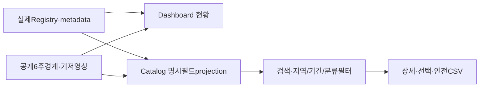

# Gate Reference UI 20261017 — PNG 참조 화면을 실제 자료 탐색에 연결

| 필드 | 값 |
|---|---|
| updated_at | 2026-10-17 23:36 KST — Git 상태 메타데이터 정정; 본문은 해당 Gate 기준 |
| source_commit | Git 연결됨; 문서 작성 시 변경분 미커밋, evidence snapshot SHA로 추적 (원격 기준 d483d25) |
| evidence_paths | `docs/implementation/33_dashboard_reference_ui.md`; `docs/implementation/34_data_catalog_reference_ui.md`; `evidence/integration/dashboard-reference-build-20261017.log`; `evidence/integration/data-catalog-reference-build-20261017.log`; `evidence/integration/reference-ui-live-20261017.json` |
| confidence | 현재코드·adapter/build·desktop/mobile·실제Registry읽기; 과학/운영승인아님 |
| status | VERIFIED_REAL: 개발UI·읽기/검색/CSV; TESTED_SYNTHETIC: adapter; 실자료학습 BLOCKED |

## 한 문장·1분 설명

주어진PNG의배치를실제조작가능한현황안내판과자료목록으로만들었다. 모양은참조하고값은실제등록자료나미확인상태로표시한다. 안내판이완성됐다고모델의과학품질이승인된것은아니다.

## 왜·이론·5분 흐름

대시보드는전체현황,카탈로그는자료선택을돕는다. PNG전체를한장이미지로붙이면탐색·필터·근거조회가불가능하므로DOM/SVG와MapLibre로재구성했다. 작은브랜드·해안사진은원본crop을사용한다.230px사이드바·제목/KPI/지도/모델·분포/작업·알림/결과패널을참조비율에맞추되482개·위험지수·진행률등가상값을복사하지않았다.

## 실제코드·입출력

`DashboardReference.tsx`/`dashboard-reference.css`, `DataCatalogReference.tsx`/`data-catalog-reference.css`, `catalogReferenceAdapter.ts`와App step0/1이구현이다. 공통Sidebar/Panel/Map/Icon을재사용한다. 기존6Workspace·위성검색/다운로드는보존했다.

실제등록6Dataset/6Agent를읽고Draft/External·미확인을구분한다. 지역OR/다른조건AND·기간교차로검색하며명시metadata없는행은제한필터에서제외한다. 품질패널은기록존재율이며정확도·권한승인이아니다. 초기화는조건·선택을지운다. CSV는선택행또는검색결과의whitelist metadata만UTF8BOM/quoting/수식삽입방지로내보내고URI/path/token은제외한다.

지도는Esri기저영상+공개6주ADM1경계다.2017년OSM/Wambacher·geoBoundaries/ODbL1.0참조이며legal_boundary_certification=false다. 모델위험예측·공식사업경계로표시하지않는다. 조회시간KST와원본최신기준일도분리한다.

## 시험·실제브라우저·한계

UIadapter19/19 PASS·1334.4995ms(카탈로그6+입력/정책/Job8+Result5),build57modules/19.20초/종료0이다. 큰MapLibre chunk경고는남는다. backend전체287건286 PASS·1 SKIP/103.726초와UI시험을합산하지않는다.

실제UI5174→동일출처DEVproxy→API8002에서검색6→baseline2021의1행→상세→CSV13열1행을확인했다. 역전기간2025→2020은오류/0결과/CSV비활성,초기화6행이며모델허브6연결도확인했다. desktop요청1672×941/실측1673×941·두화면높이941, mobile요청390×844/실측390×845·높이Dashboard2941/Catalog2607·document폭375로전체수평넘침없음이다. 픽셀완전동일성을주장하지않는다.

Catalog/원장/manifest전후SHA동일·기존표준Job2보존·신규실행기록0이다. 기관ACL·원본파일다운로드·불변버전HTTP·운영계보/API·공식RDTR·학습/과학/운영승인은후속이다. Dataset계보코어는API변경없는별도내부단위다.

## 발표·10분 확장·Q&A

30초: “참조모양을실제자료탐색으로연결했습니다. 실제6개자료와미확인상태를보여주고검색·상세·CSV·모바일을검증했습니다. 품질기록과과학승인은구분합니다.”

5분은Dashboard→Catalog→검색/상세/CSV→미확인/품질해석,10분은공개경계·시간기준·안전CSV·모바일/픽셀동일성한계를확장한다. 슬라이드: 참조와실제데이터 / 찾기와내보내기 / 기록과승인 / 검증한화면범위.

Q1.482개는어디갔나? A.예시값이며실제6행이다.

Q2.100%면정확도인가? A.기록존재율이다.

Q3.원본파일CSV인가? A.메타데이터만내보낸다.

Q4.경계공식승인인가? A.공개참조다.

Q5.전체개발완료인가? A.UI단위완료이며과학/기관/운영gate와보고는유지한다.

[DEMO](../presentations/DEMO_STORY.md)의최신화면/검색/PNG대안을사용한다. 관련설계·API/사용법·시험·인계·이해자료와UI적용근거를같은완료단위로기록했다.
