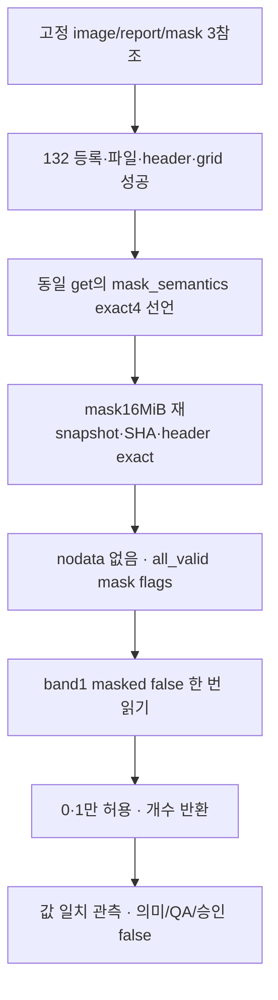

# Gate133 — 명시적 이진 마스크 선언과 실제 0·1 값 확인

| 필드 | 값 |
|---|---|
| updated_at | 2026-10-18 04:24:57 KST — 133 최종 관련·독립·Temp 이진값·보존 반영 |
| source_commit | 기준 45d4000077ff4746cb6d6e84e68e752be80bfbdc + 133 작업파일 SHA (미커밋); 실행 gate 변경 없음 |
| evidence_paths | `backend/app/ml/registered_binary_mask_values.py`; `tests/test_registered_binary_mask_values.py`; `evidence/integration/binary-mask-agent-20261018-focused.log`; `docs/implementation/133_registered_binary_mask_values.md`; `evidence/integration/binary-mask-root-related-20261018.log`; `evidence/integration/binary-mask-runtime-20261018.json`; `evidence/integration/binary-mask-live-integrity-20261018.json`; `evidence/integration/binary-mask-operating-inventory-20261018.json`; `evidence/integration/binary-mask-independent-20261018.json`; `evidence/integration/binary-mask-independent-20261018.log` |
| confidence | 완료 소스·집중9/관련40/독립8·실제 Temp7시나리오·보존 확인; 값 형식과 의미/QA/승인 구분 |
| status | TESTED_SYNTHETIC 명시 이진값 진단; 품질·기관·과학·실행 승인 BLOCKED |

## 쉬운 설명

132는 마스크가 영상과 같은 크기·좌표 격자인지 확인했다. 133은 그 위에 “1은 유효, 0은 무효로 사용한다”는 명시 선언이 있는지 보고, 실제 마스크 한 밴드의 값이 0과 1뿐인지 센다. 출석부에 표시가 두 종류뿐인지 확인하는 것과 같다. 표시가 실제 구름·유효영역을 정확히 나타내는지, 출석률이 사업 기준을 충족하는지는 별도다.

## 이론적 배경

이진값의 형식과 의미의 진실은 다르다. uint8은 0~255를 담을 수 있어 한 밴드라는 사실만으로 이진 마스크가 되지 않는다. 새 내부 계약은 정확한 정수 1과 0만 허용한다. SCL·255·반전 선언을 임의로 바꾸지 않는다. 성공 시 N = valid_pixels + invalid_pixels이며 각 값은 실제 배열의 1·0 개수다. 최소 유효율 정책은 아직 없으므로 전부 0이어도 값 형식 진단은 성공할 수 있다.

## 구조

## 코드·데이터 동작

`inspect_registered_binary_mask_values(store,image_ref,quality_report_ref,mask_ref)`는 세 참조를 복사하고 읽기 전용 proxy를 거쳐132를 한 번 호출한다. 실제 mask get에서 canonical manifest·id/version/자산 SHA·raster/PUBLIC 선언을 확인해 같은 manifest 사본을 보존한다. 추가 Store.get 없이 정상 총3회다. 132 실패면 배열 읽기를 시작하지 않는다.

명시 `source.mask_semantics`는 exact4 `{schema_version:1,kind:binary_validity,valid_value:1,invalid_value:0}`다. bool을 정수로 받지 않고, 누락·추가 키·반전·SCL을 거부한다. 선언이 통과한 뒤 mask16MiB를 다시 복사하고 SHA를 대조한다. 같은 복사 바이트의 header를132 관측과 정확히 비교하며 nodata가 없고 intrinsic mask flags가 all_valid일 때만 `dataset.read(1,masked=False)`를 한 번 호출한다.

영상 픽셀과 `read_masks`는 읽지 않는다. 하지만 전체 I/O가0은 아니다. 영상 파일은 앞선 단계에서2번, 마스크 파일은 이번 재관측을 포함해3번 읽는다. 순차 재관측은 동시 원자 snapshot이 아니다. 1024×1024·uint8·16MiB 한도가 GDAL parser의 CPU/RSS/시간 hardcap이나 OS 격리를 보장하지 않는다.

## 출력과 상태

exact19 출력은 원형 `grid_observation`, `counts`, 선언·값·자산 flags와10개 미승인 flags를 구분한다. 전체 성공은 `REGISTERED_BINARY_MASK_VALUES_MATCHED_UNVERIFIED`다. 선언 뒤 값/SHA/header가 실패하면 `mask_declaration_verified`만 true로 남을 수 있다. counts는 전체 값 검사가 성공할 때만 반환한다. nested132 성공은 이전 관측 이력이며 상위 실패를 통과로 바꾸지 않는다.

`mask_values_verified=true`는 선언한 0·1과 실제 배열의 값 일치만 뜻한다. `mask_semantics_verified`·`quality_mask_verified`·`quality_report_verified`·`minimum_validity_policy_verified`·AOI·기관·과학·실행·state_dict·Workflow의10개는 항상 false다. all-zero 성공도 품질 합격이나 사용할 픽셀이 충분하다는 판단이 아니다.

## 시험 근거

집중9 PASS/7.291초 로그와 완료 코드를 읽었다. 실제 임시16×16 배열의80개 1·176개 0, all-zero/all-one,255/SCL 거부, nodata/internal mask 거부, 선언 누락·bool·반전 거부,132 뒤 변조 거부와 같은 get 사본·입력/파일 불변을 확인하는 시험이다. 최종 관련40 PASS/16.334초·독립8 PASS/0 SKIP/6.725초를 확인했다. 반복 시험은 전체 수로 더하지 않는다.

## 최종 실제 임시 파일 대조와 보존

Root의 실제 Temp7시나리오는256×256 마스크의 혼합32768/32768, all-zero0/65536, all-one65536/0을 관측했다. 255·선언 누락·nodata·격자 shift를 거부했다. 정상 get3회·단일 mask read와 image 픽셀0, DB/파일 불변을 확인했다. 임시 fixture 생성은 reader 밖의 준비이며 운영 자료 생성이나 품질 승인이 아니다.

독립8개 시험은 새 Temp 자료로 값·선언·nodata/internal mask·후행 변조·same-get·부분 flags·한도 경계를 확인했다. source SHA는5b19a4590b2a395c63d25c6a3e0aadbe36e54c0521b7c551396ea0083dec80d2로 동결됐고 기존 소스 차이는0이다. 집중·관련·독립·Temp 시나리오는 겹치는 근거로 합산하지 않는다. 이번 실패/소스 보완 없이 최종 근거를 확인했다.

보호141참조·기존 소스299개 전체·이전 증거1169개·catalog14행 canonical SHA·예약136314880바이트는 불변이다.04:21 KST URI mode=ro 운영 count에서 DatasetVersion0·legacy datasets6/models1이다. 운영 수집·등록·학습·추론·배포·Workflow dispatch는0이며 원본·원장·lock·분할·모델은 보존한다.

## 한계와 후속

새 내부 reader는130 연차 배치·115 실행·API/UI와 미연결이다. 이번 화면·프론트·build·browser·전체 backend 재실행은 하지 않으며120/121의1184 backend·261 frontend는 이전 근거다. 운영 DatasetVersion 등록·마스크 생성·원본 보정·수집·학습·추론·배포·승인으로 연결하지 않는다. 실제 mask 의미·품질 정책과 최소 유효율, 배치 연결은 별도 후속이다.

## 발표 대본

### 1분

“영상과 마스크의 격자가 같다는 검사에서 한 단계 더 나아갔습니다. 이제 등록된 마스크에 1은 유효, 0은 무효라는 선언이 있는지 확인하고, 실제 값도 두 가지뿐인지 셉니다. 255나 다른 코드를 임의로 바꾸지 않습니다. 다만 값이 두 가지라는 사실과 구름·유효영역을 정확히 가린다는 사실은 다릅니다. 전부 0인 마스크도 값 형식 검사는 통과할 수 있지만, 사용할 자료가 충분하다고 승인하지 않습니다. 실제 품질·모델 실행과 연차 배치는 아직 연결하지 않았습니다.”

### 5분

첫1분은 출석부 표시 비유로 모양·값·의미·품질의 네 단계를 구분한다. 다음1분은 고정3참조와132의 헤더·격자 관측을 보여준다. 세 번째1분은 정확한 선언·SHA 재관측·단일 밴드 읽기를 설명한다. 네 번째1분은80/176 예와 all-zero·255·nodata 실패를 보여준다. 마지막1분은 부분 선언 true와 전체 실패,10개 미승인 flags·운영 및 배치 미연결을 설명한다.

### 10분 확장

‘격자 이후의 값’, ‘명시 선언과 재관측’, ‘0·1 개수’, ‘품질 승인과의 거리’, ‘연결 후속’ 다섯 장을 사용한다. 132 후 변조와 부분 상태에2분, 파일 읽기 횟수와 비원자 한계에1분, Q&A에2분을 더한다.

## Q&A

Q.0과1이면 좋은 마스크인가? A. 값 형식만 맞는다. 구름·유효영역 정답과 최소 유효율은 검증하지 않는다.

Q.전부0인데 성공할 수 있나? A. 그렇다. 값의 형식 진단이며 품질 승인 정책은 없다.

Q.영상 픽셀도 읽나? A. 영상은 파일 지문·header만 관측하고, 마스크 band1만 한 번 읽는다.

Q.선언 true인데 값 false일 수 있나? A. 선언을 확인한 뒤 SHA·header·값 검사에서 실패할 수 있다.

Q.SCL이나255를 자동 변환하나? A. 변환하지 않고 차단한다. 입력을 보정하거나 새 마스크를 생성하지 않는다.

## 근거 바로 열기

[완료 소스](../../../backend/app/ml/registered_binary_mask_values.py) · [집중 시험](../../../evidence/integration/binary-mask-agent-20261018-focused.log) · [독립 검토](../../../evidence/integration/binary-mask-independent-20261018.json) · [Temp 값 대조](../../../evidence/integration/binary-mask-runtime-20261018.json) · [보존](../../../evidence/integration/binary-mask-live-integrity-20261018.json) · [구현 설명](../../implementation/133_registered_binary_mask_values.md)
