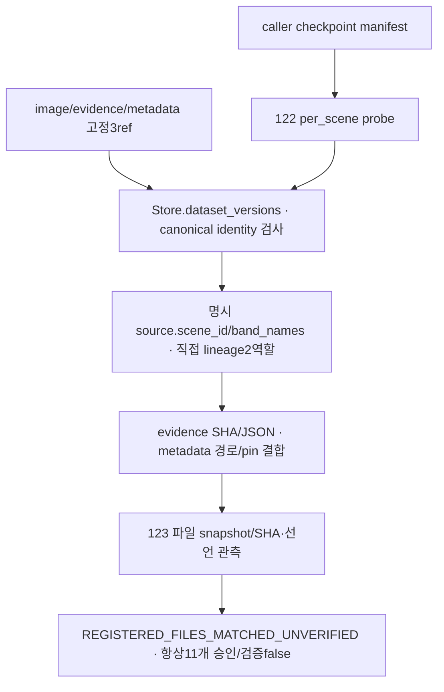

# Gate125 — 등록한 세 자료 참조를 한 장면의 정규화 파일에 연결

| 필드 | 값 |
|---|---|
| updated_at | 2026-10-18 03:01:44 KST — 125 최종 근거 및 운영 Registry count 조회 반영 |
| source_commit | 기준 4824b45aada7ba677381bdfad5a9739e12bd2dd5 + 125 작업파일 SHA (미커밋); 실행 gate 변경 없음 |
| evidence_paths | `backend/app/ml/registered_per_scene_files.py`; `tests/test_registered_per_scene_files.py`; `docs/implementation/125_registered_per_scene_files.md`; `backend/app/dataset_registry.py`; `evidence/integration/registry-normalization-agent-focused-20261018.log`; `evidence/integration/registry-normalization-root-related-20261018.log`; `evidence/integration/registry-normalization-runtime-20261018.json`; `evidence/integration/registry-normalization-live-integrity-20261018.json`; `evidence/integration/registry-normalization-independent-20261018.json`; `evidence/integration/registry-normalization-independent-20261018.log`; `evidence/integration/registry-normalization-operating-inventory-20261018.json` |
| confidence | 완료 소스·집중13/관련38/독립9·실제 Temp6시나리오·보존 확인; 등록선언과 기관/품질/실행 승인 구분 |
| status | TESTED_SYNTHETIC 명시 Dataset3참조·한 장면 파일 읽기; actual 모델 자동연계/과학·실행 승인 BLOCKED |

## 쉬운 설명

123에서는 caller가 경로와 지문을 직접 줬다.125는 등록 장부의 영상·보정근거·원 metadata 세 ID/버전/지문을 받아 같은 장면의 파일을 읽는다. 장면 ID와 밴드는 장부에 명시돼 있어야 하며 일반 제품군 이름에서 추정하지 않는다. 장부와 파일이 맞아도 실제 품질·기관 권한·과학·실행 승인은 아니다.

이번 모델 설명은 여전히 caller가 준 metadata다.124의 actual checkpoint manifest와 자동 연결하는126, 전연차·품질mask·기존 Workflow 연결은 후속이다.

## 이론적 배경

등록 참조의 ID/version은 어느 record인지, artifact SHA는 어떤 파일 바이트인지 지정한다. canonical manifest SHA는 record의 metadata 선언이 바뀌지 않았는지 대조한다. 다른 역할의 파일 SHA끼리 같아야 한다는 뜻이 아니다. evidence의 직접 부모 두 역할과 세 ref를 묶어 어떤 영상과 원 metadata를 사용한다고 선언했는지 확인한다. 그 선언이 실제 물리 장면이나 기관 권위임을 인증하는 것은 아니다.

PUBLIC은 이 내부 reader가 받아들이는 access_class 선언 정책이다. 실제 로그인 사용자·기관 ACL 허가를 검사하지 않는다. RAW부터REJECTED까지 quality 상태도 진단할 수 있어 bytes 읽기 성공을 QA·학습 승인으로 해석하면 안 된다.

## 구조와 코드

`read_registered_per_scene_files(store, checkpoint_manifest, image_ref, evidence_ref, metadata_ref)`는 정상 경로에서 dataset_versions get3회로 고정3참조를 읽는다. 같은 ID라도 version이 다르면 다른 key이며 서로 다른 세 key가 필요하다. record key/본문id·manifest dataset_id/version·artifact SHA·canonical digest·raster/document/document 타입·PUBLIC 선언을 검사한다. 기존 resolve_version/register_version/무상한 asset verifier는 호출하지 않는다.

image.source의 scene_id와 band_names는 새 내부 소비 계약의 명시 확장이다. 원 schema가 추가 source 키를 허용하지만 upstream 기관의 공식 필드가 생긴 것은 아니다. source.product를 장면 ID로 추정하지 않고 checkpoint 밴드를 source 밴드로 복사해 발명하지 않는다. 없는 legacy는 BLOCKED·무역채움이다.

evidence.lineage는 normalization_input_image와 normalization_source_metadata 두 내부 역할을 각각 정확1개 요구하고 요청 pin과 같아야 한다. 추가 부모는 허용하지만 record/asset·전이 DAG를 재귀 검증하지 않는다. 내부 role을 공식 기관 표준으로 표현하지 않는다.

실제 evidence 최대2MiB를 읽어 pin/strict JSON을 확인하고 source_metadata 경로·SHA가 등록 ref와 같아야 한다. 등록 source의 명시 필드에서 source_scene을, pin된 evidence의 scale/offset에서 normalization을 구성해123에 전달한다. 같은 evidence 계수를 다시 대조하는 것은 물리 보정값의 독립 검증이 아니다. evidence를 두 번 확인하고 영상64MiB/metadata2MiB를 검사하지만 record/파일들의 동시 원자 snapshot은 아니다.

## 결과와 한계

exact19 결과의 registry_references_verified=true는 세 metadata record의 선언 검사를 마쳤다는 뜻이다. 뒤의 scene/lineage/file이 BLOCKED여도true로 남을 수 있다. 전체 성공은 status와 file_observation을 함께 읽는다. 바깥 artifact_bytes_verified는123의 전체 FILES_MATCHED_UNVERIFIED 뒤에만true다.

checkpoint/header/QA본문/mask/기관권위/ACL/추가부모/state_dict/과학/실행/Workflow11개 flag는false다. registered quality_status는 원문을 관측할 뿐 승인하지 않는다. 모델manifest는 caller 입력이며124의 실제 checkpoint를 자동 load하지 않는다.

새 metadata tree 한도는 Store가 반환한 dict 이후에 적용된다. 기존 Store.get의 DB body json.loads에는 이 reader의 byte/RSS cap이 선행하지 않는다. canonical schema validator도 cold이면 로컬 schema 파일을 읽을 수 있다. 이 기능을 IO0·DB parser/RSS hard cap·외부 공개 보안경계로 설명하지 않는다. trusted local reader이며 API/UI/기존 gate와 연결하지 않았다.

## 시험 근거

집중13 PASS/4.377초·관련38 PASS/6.463초(신규13+DatasetVersion11+123files14)를 읽었다. 중복 합산하지 않는다. Root는 실제 Temp Registry3버전과 legacy추가record·6밴드 GeoTIFF/evidence/XML로6시나리오를 확인했다. 일반 product 이름과 다른 명시scene_id도 성공했고 legacy source필드 부재는 보충 없이 차단했다. 세 역할 바이트 변조는 각각 거부했다. RAW 진단 성공은 품질 승인이나 운영 등록이 아니다.

최종 독립9 PASS/0 SKIP/2.921초·종료0과 동결 소스 SHA 일치를 확인했다. 집중13/관련38·독립9·Temp6시나리오는 반복·교차 근거이며 새 전체 시험 수로 합산하지 않는다. 보호141참조·기존source283개 전체·이전증거1049·catalog14·예약136314880B는 불변이다. 실제 운영 Registry 접촉·모델 load·학습·추론·등록·수집·배포는0이다. 기존 제품이 불변인 미연결 reader라 이번 전체 backend/front/build/browser는 재실행하지 않았고1184/261은120/121 이전 근거다.

## 후속

126은124의 actual 고정 모델 manifest와125의 한 장면 참조를 명시 조합하는 후속이다. 아직 구현/자동연결0이며 전연차·품질mask·실행기·기관 승인도 별도다. 기존 global-only/1~16밴드 지원·per_scene 실행 공백·Draft·후보4차단·독립라벨/외부5실행자료 부재를 유지한다.

## 발표 대본

### 1분

“세 파일을 임의 경로 대신 등록된 ID와 버전, 지문으로 찾도록 연결했습니다. 영상 장부에는 장면 ID와 밴드 이름을 직접 적어야 합니다. 제품군 이름에서 추정하거나 없는 자료를 채우지 않습니다. 세 등록 기록과 파일이 맞아도 품질이나 기관 권한, 실행을 승인한 것은 아닙니다. 거절 품질 상태도 진단용으로 읽을 수 있고 PUBLIC은 실제 사용자 ACL 인증이 아닙니다. 실제 모델 내부 설명과의 자동 연결은 다음 단계이며 이번은 임시 장부와 영상으로 읽기 경계만 시험했습니다.”

### 5분 순서

첫1분은 등록 ID/version/SHA와 임의 경로 차이를 설명한다. 다음1분은 명시 scene/band·직접 부모2역할을 보여준다. 세번째1분은 canonical metadata와 실제 bytes 검사층을 나눈다. 네번째1분은 quality/PUBLIC/부분true·무역채움을 설명한다. 마지막1분은124 자동연결126·전연차/mask/실행 후속을 말한다.

### 10분 확장

‘등록참조’, ‘명시 장면’, ‘역할 계보’, ‘부분 관측과 승인’, ‘남은 모델 연결’ 다섯 장에 legacy/변조 회귀2분·DB decode/순차snapshot1분·기관/물리 검증 차이1분·Q&A1분을 더한다.

## Q&A

Q. source.product를 장면 ID로 쓰면 되나? A. 아니다. 제품군일 수 있어 명시 scene_id와band_names가 필요하다.

Q. 새 source키/lineage role은 기관 공식 표준인가? A. 기존 추가키 허용범위의 내부 소비 계약이다.

Q. PUBLIC과 bytes 성공이면 실행 가능인가? A. 아니다. 사용자 ACL·QA·모델/실행 승인은 미검증이다.

Q. registry flag true인데 전체BLOCKED일 수 있나? A. metadata 검사를 마친 뒤 lineage/file이 실패하면 가능하다.

Q. actual124와 전연차도 연결됐나? A. 아니다.126 명시 모델 조합과 전연차/mask/Workflow는 후속이다.

## 최종 독립·보존과 바로 열기

독립9건은 고정3참조·명시 source 확장·내부lineage2역할·모든quality/PUBLIC 구분·부분 flag·변조/경로·추가 부모 미조회·입력 불변을 별도 fixture로 확인했다. frozen source SHA8c36…2866과 기존 핵심/추적 소스는 불변이고 새 제품 결함은 없었다. Torch import·운영 Store/API·등록·학습·추론은0이다. 기존283개 소스 전체가 불변인 미연결 내부 reader여서 새 전체 backend/프론트/build/browser 없이 선택 검증과 보존으로 닫는다. 이전1184/261을 이번 성과로 합산하지 않는다.

[구현 설명](../../implementation/125_registered_per_scene_files.md) · [독립 검토](../../../evidence/integration/registry-normalization-independent-20261018.json) · [실제 Temp 등록자료 대조](../../../evidence/integration/registry-normalization-runtime-20261018.json) · [보존 근거](../../../evidence/integration/registry-normalization-live-integrity-20261018.json)

### 운영 DatasetVersion 재고 관측

03:01:12 KST에 Root가 운영 SQLite를 URI mode=ro로 count만 읽었다. legacy datasets6개·models1개·전체14기록이며 dataset_versions는0개다. 따라서125의 Temp 등록 검증 성공은 운영 등록 진척이 아니며 운영 고정 DatasetVersion은 미확보다. 모델/래스터 파일 load와 운영 쓰기는0이다.
