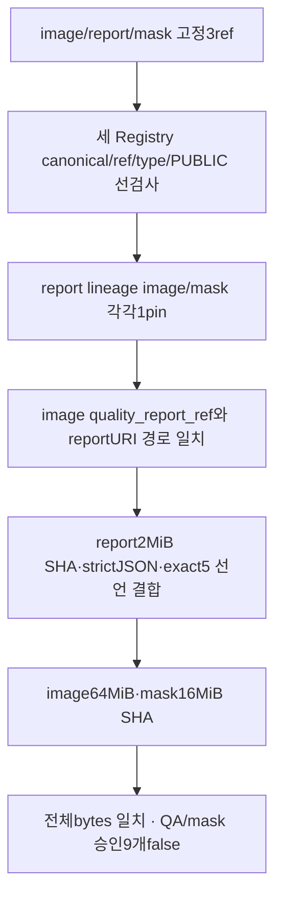

# Gate131 — 등록 품질보고서와 명시 mask의 참조·바이트를 읽기

| 필드 | 값 |
|---|---|
| updated_at | 2026-10-18 04:07:24 KST — 131 최종 역할오류 정정·관련/독립·Temp/보존 반영 |
| source_commit | 기준 e4ed88724aa96b3b08ffb574511e06bd4dc91a80 + 131 작업파일 SHA (미커밋); 실행 gate 변경 없음 |
| evidence_paths | `backend/app/ml/registered_quality_mask_files.py`; `tests/test_registered_quality_mask_files.py`; `evidence/integration/quality-mask-agent-20261018-focused.log`; `evidence/integration/quality-mask-operating-inventory-20261018.json`; `docs/implementation/131_registered_quality_mask_files.md`; `evidence/integration/quality-mask-agent-20261018-focused-final.log`; `evidence/integration/quality-mask-root-related-20261018.log`; `evidence/integration/quality-mask-runtime-20261018.json`; `evidence/integration/quality-mask-live-integrity-20261018.json`; `evidence/integration/quality-mask-independent-20261018.json`; `evidence/integration/quality-mask-independent-20261018.log` |
| confidence | 최종 소스·집중10/관련48/독립8·실제 Temp7시나리오·보존 확인; bytes/선언과 QA/mask의미/승인 구분 |
| status | TESTED_SYNTHETIC 등록3참조·QA/mask 선언과 bytes 대조; 실제 QA/mask/header·과학/실행 승인 BLOCKED |

## 쉬운 설명

영상과 품질보고서, mask 파일이 장부와 같은 파일인지 읽는 창구를 만들었다. 보고서가 어떤 영상과mask를 가리키는지 연결하지만 mask의 픽셀이나 뜻이 맞는지 평가하지 않는다. 파일 지문과 서류의 결합이 품질 합격 도장은 아니다. RAW부터REJECTED까지 진단할 수 있고 실제 QA·실행 승인은 계속false다.

## 이론적 배경

파일이 있어 지문이 맞는 것, 보고서의 참조가 같은 자료를 가리키는 것, 그 mask가 영상과 격자/픽셀 의미에서 올바른 것은 서로 다른 단계다. 이번은 앞의 두 단계다. 서로 다른 등록 ID가 같은 URI/SHA를 가리킬 수도 있어 ‘mask’ 역할 이름만으로 실제mask 성립을 증명하지 않는다.

보고서 exact5와 직접lineage 역할은 새 내부 소비 계약이다. 기존 GMAIS/115의 품질파일 존재/SHA 확인을 독립 QA 본문 검사로 표현하지 않으며 이 형식의 기존 producer를 새로 연결한 것도 아니다. legacy의 없는 ref나 빈{}를 추정/보충하지 않는다.

## 구조

## 코드·입력 → 처리 → 출력

`read_registered_quality_mask_files(store,image_ref,quality_report_ref,mask_ref)`는 서로 다른3개 ID/version key의 exact ref를 받는다. 정상경로 get3회로 record key/본문id·manifest ID/version/artifactSHA/canonicalSHA를 대조하고 타입은 raster/document/raster, access는모두PUBLIC이어야 한다. 이 세 선검사가 끝나기 전 파일을 읽지 않는다. PUBLIC은 이 reader의 선언 소비 정책이며 실제 사용자ACL 인증이 아니다.

품질보고서 manifest.lineage에 quality_input_image와 quality_input_mask를 각각 정확1개 요구하고 요청pin과 같아야 한다. image.quality_report_ref를 안전 정규화한 경로는 report artifact_uri와 같아야 한다. ref가 없거나 다르면 차단하며 다른경로/기관명/기존메모에서 추정하지 않는다.

품질보고서 최대2MiB를 복사·SHA 대조하고 strict JSON/bounded tree를 검사한다. 본문은 schema_version1/scope LCLUC_QUALITY_MASK_EVIDENCE/image_ref/mask_ref/quality_status exact5다. 두ref는 요청과 같고 quality_status는 image manifest의 선언과 같아야 한다. 그 뒤 image64MiB와mask16MiB를 SHA로 확인한다. mask는 opaque bytes이며 GDAL/NumPy·래스터header·mask픽셀을 열지 않는다. 모델load·학습·추론도 없다.

## 결과와 승인 차이

exact18의 registry_references_verified는 세 등록 metadata 관측 완료, report_bindings_verified는 보고서의 참조/품질선언 결합 완료다. 뒤파일 실패에도 부분true로 남을 수 있다. file_bindings의 report MATCH도 bytes 지문만 맞은 이력이라 JSON/의미 성공을 보장하지 않는다. status와 전체 artifactflag를 함께 읽는다.

전체상태는 BLOCKED 또는 REGISTERED_QUALITY_MASK_MATCHED_UNVERIFIED이며3파일 전체성공 뒤에만 artifact_bytes_verified=true다. quality_report_verified/quality_mask_verified/header/state/기관/ACL/과학/실행/Workflow9개flag는 항상false다. 이름에quality가 있어도 통계·허용치·픽셀 의미·독립 평가를 검증한 것은 아니다. 등록 quality_status는 모든 상태를 진단할 수 있고 REJECTED의 bytes 성공도 품질승인과 다르다.

## 시험과 현재 운영 상태

최종 집중10 PASS/5.212초를 읽었다. 초기10 PASS/4.242초는 검토 전 통과 이력이며 실패가 아니다. Temp의 등록3참조와 opaque영상/mask·strict보고서로 ref/type/PUBLIC 조기검사·lineage/경로/본문 결합·부분flag·상한·bytes변조·입력/DB 무쓰기를 시험했다. 최종 집중10 PASS/5.212초·관련48 PASS/11.419초·독립8 PASS/0 SKIP/3.723초·종료0과 문서131을 확인했다. 관련48(10+11+13+14)·집중/독립·Temp7시나리오는 반복/교차 근거이며 새 전체 시험 수로 합산하지 않는다.

04:02 운영count는 DatasetVersion0·legacy datasets6·models1·전체14기록이며 모델/래스터파일load·쓰기0이다. 새로운 보고서producer나 운영 등록을 만든 것으로 소개하지 않는다. 기존보고서가 없다고 가짜QA수치·빈{}나 mask를 생성하지 않는다.

## 검토 지적의 수정과 실제 Temp·독립 근거

독립 읽기 검토에서 재사용 JSON parser/tree 오류의 field가 normalization_evidence/checkpoint_manifest로 반환되는 역할오류를 발견했다. 신규131의 두호출 예외에서 code는 유지하고 field만 quality_report로 재포장했다. malformed JSON과 depth18 회귀를 추가해 최종10건을 통과했고 기존123/124는 바꾸지 않았다. 최종source SHA는 d20caf…5047b이며 초기통과 로그를 보존했다.

file NOT_CHECKED는 성공SHA MATCH 미확보이지 읽기시도0이 아니다. 변조파일을 이미 읽어 SHA가 불일치해도 이 상태일 수 있다. report MATCH도 bytes 이력일 뿐 envelope binding 성공이 아니고 report_bindings_verified true도 후속image/mask 성공을 보장하지 않는다. 부분flag·issue·전체status를 함께 읽는다.

Root는 fresh Temp의 실제 image/mask GeoTIFF·등록3버전으로 정상·opaque mask성공/QAfalse·report/image/mask 변조·legacy본문·보고서경로부재의7시나리오를 확인했다. reader get3회·무쓰기·Torch/Rasterio import시도0·Temp DB/파일 불변이었다. fixture가GeoTIFF여도 reader자체는 header/pixel을 확인하지 않았다.

독립8건은 동일파일을 다른ref가 가리키는 physical alias 성공이 mask의미 검증이 아님, 모든quality/PUBLIC·본문/lineage/경로·부분이력·역할별상한·입력 불변을 확인했다. 역할오류 지적은 최종 재검증으로 종결했고 추가 제품지적은 없었다. 보호141·기존source295개 전체·이전증거1138·catalog14·예약136314880B는 불변이다. 운영모델/Registry 접촉·학습·추론·등록·수집·배포0이며 이번전체/backend/front/build/browser는 재실행하지 않았다.

## 한계와 다음

123/124의 root/link/상대경로·순차snapshot·Store DBdecode 후 tree한도 등 기존 경계를 상속한다. 세 Registry/파일의 원자snapshot·모든TOCTOU 제거·전체CPU/RSS/time hardcap이 아니다. 소스URL HTTP를 열거나 네트워크라이브러리를 호출하지 않지만 mappeddrive 매체/OS전체 격리를 증명하지 않는다.

이번은 모델이나130 batch와 자동 연결하지 않은 독립 reader다.132 후속에서 mask header/grid·픽셀 의미와 batch 연결을 나누어 검토한다. 공개API/UI·runtime/기존115 gate도 미연결이다. 기존 source가 불변인 내부추가에 맞춰 이번전체 backend/front/build/browser는 재실행하지 않고1184/261은120/121 이전 근거다. 원본/모델/분할/원장/lock·Draft/학습차단·독립라벨/외부5실행자료 부재를 유지한다.

## 발표 대본

### 1분

“영상과 품질보고서, mask가 등록 장부의 같은 파일인지 읽도록 만들었습니다. 보고서가 어느 영상과mask를 설명하는지 고정 ID와 지문으로 확인합니다. 하지만 mask의 픽셀이나 격자가 올바른지, 품질이 합격인지는 아직 보지 않습니다. 거절 품질 상태도 진단용으로 읽을 수 있어 파일이 맞는다는 결과를 QA승인으로 부르면 안 됩니다. 없는 보고서나mask를 만들어 채우지 않았고 현재 운영 등록자료는0개입니다. 모델과 여러연도 연결·실행승인은 후속으로 나눕니다.”

### 5분 순서

첫1분은 장부/파일/품질의 세단계를 구분한다. 다음1분은 고정3ref와 lineage·경로 결합을 보여준다. 세번째1분은 exact5보고서와3파일 SHA를 설명한다. 네번째1분은 부분true/opaque mask·모든quality 진단을 말한다. 마지막1분은132 header/grid·픽셀/batch·운영0과 승인false를 설명한다.

### 10분 확장

‘고정3참조’, ‘보고서의대상’, ‘bytes와mask의차이’, ‘부분관측’, ‘품질후속’ 다섯 장에 lineage/상한/변조회귀2분·새내부형식/producer부재1분·비원자/DB한도1분·Q&A1분을 추가한다.

## Q&A

Q.quality_report_verified가 왜false인가? A.참조와bytes는검사하지만 QA통계/기준·품질판정은검증하지 않았다.

Q.mask파일지문이맞으면실제mask인가? A.header/grid/pixel의미는미검사이고 다른ref가같은URI/SHA를가리킬수도있다.

Q.REJECTED자료도읽히면승인인가? A.진단용bytes관측일뿐QA/실행승인은아니다.

Q.새보고서형식은기관표준인가? A.내부exact5소비계약이며기존producer/공식규격연결완료가아니다.

Q.130batch나실행UI와연결됐나? A.아니다.132후속과runtime/APIUI·승인은별도다.

## 근거 바로 열기

[구현 설명](../../implementation/131_registered_quality_mask_files.md) · [독립 검토](../../../evidence/integration/quality-mask-independent-20261018.json) · [실제 Temp 파일대조](../../../evidence/integration/quality-mask-runtime-20261018.json) · [보존 근거](../../../evidence/integration/quality-mask-live-integrity-20261018.json)
