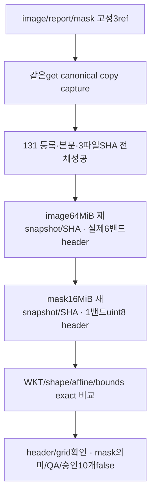

# Gate132 — 고정 품질참조의 실제 영상·mask header와 격자 확인

| 필드 | 값 |
|---|---|
| updated_at | 2026-10-18 04:18:15 KST — 132 최종 관련/독립·Temp image/mask grid·보존 반영 |
| source_commit | 기준 e994e834b7630f979d037bb52bf366f19a502a87 + 132 작업파일 SHA (미커밋); 실행 gate 변경 없음 |
| evidence_paths | `backend/app/ml/registered_quality_mask_grid.py`; `tests/test_registered_quality_mask_grid.py`; `docs/implementation/132_registered_quality_mask_grid.md`; `backend/app/ml/registered_quality_mask_files.py`; `evidence/integration/mask-grid-agent-20261018-focused.log`; `evidence/integration/mask-grid-independent-20261018.json`; `evidence/integration/mask-grid-independent-20261018.log`; `evidence/integration/mask-grid-operating-inventory-20261018.json`; `evidence/integration/mask-grid-root-related-final-20261018.log`; `evidence/integration/mask-grid-root-related-20261018.log`; `evidence/integration/mask-grid-runtime-20261018.json`; `evidence/integration/mask-grid-live-integrity-20261018.json` |
| confidence | 완료 소스·집중10/관련42/독립8·실제 Temp7시나리오·보존 확인; header/grid와 mask값/QA/승인 구분 |
| status | TESTED_SYNTHETIC 실제 image/mask header·같은 grid 진단; mask값/QA/기관/과학·실행 승인 BLOCKED |

## 쉬운 설명

131은 mask의 지문만 읽었다.132는 그 검사를 먼저 통과한 뒤 실제 파일의 header를 열어 영상은6밴드, mask는1밴드uint8인지 보고 서로 같은 격자인지 확인한다. 모양이 맞는다는 사실이 mask의 값이 구름이나 유효영역을 올바르게 뜻한다는 증명은 아니다. mask에255가 있어도 이번에는 값을 읽거나 해석하지 않는다.

## 이론적 배경

영상의 한 픽셀에 대응하는mask를 적용하려면 좌표계·폭/높이·affine·범위가 맞아야 한다. 같은 해상도라도 원점이 다르면 다른 위치의mask를 적용할 수 있다. 이번은 WKT문자열·shape·affine6계수·bounds4개를 exact 비교하며 재투영/리샘플/오차보정은 하지 않는다. 유효값 규칙·nodata/구름코드·QA기준은 다음 단계다.

같은bytes를 다시 읽는 이유는131의 첫 SHA 관측 뒤 파일이 바뀌었는지 확인하기 위해서다. 재스냅샷이 이전단계의 성공을 지우지는 않는다. 하위131의 지문확인 이력과 상위132의 현재header/전체성공을 나누어 읽는다. 두 snapshot은 같은순간의 원자관측이 아니다.

## 구조

## 코드·입력 → 처리 → 출력

`inspect_registered_quality_mask_grid(store,image_ref,quality_report_ref,mask_ref)`는 유효3ref를 복사하고131을1회 호출한다. readonly proxy가131의 실제 image/mask get에 대해 canonical ID/version/artifactSHA·raster/PUBLIC을 대조해 같은manifest copy를 반환·보존한다. 추가Storeget은0이며 정상총3회다.131 실패면 header검사를 시작하지 않는다. invalid 입력은 고정invalid131 응답으로 Store0이다.

131 전체성공 뒤 image.source.band_names가 정확한6개 순서여야 한다. 모델manifest나 파일명에서 누락밴드를 추정하지 않는다. image64MiB/mask16MiB를 다시 복사·SHA로 고정하고 그 바이트에서 TIFF/BigTIFF magic·MemoryFile GTiff를 검사한다. image는129의 실제6밴드 description/header 규칙을 그대로 사용한다. mask는 한밴드·uint8·shape1~1024·projected metre/factor1·유한north-up affine·양의extent를 요구한다.

PAM NO/EMPTY_DIR/INTERNAL georef를 제한된context로 적용하고 raw URI 대신 검증한 memory bytes만 GDAL에 준다. `.read`/`.read_masks`·sample·통계·overview를 호출하지 않는다. 그렇다고 파일IO가0은 아니다. image/mask는131의 첫SHA와132 header snapshot으로 각각2회 읽는다. report도131에서 읽는다.

## 결과와 미검증 의미

exact20은 quality_mask_observation의131 원형·image_header/mask_header·header/grid/전체artifactflag를 반환한다. 모든131/두header/격자 비교 성공 뒤에만 REGISTERED_QUALITY_MASK_GRID_MATCHED_UNVERIFIED와 세flag가true다. imageheader가 남아 있어도 mask/grid 실패면 상위flag는false다. nested131의 raster_header_verified=false는 원래bytes범위로 보존되며132 상위header확인과 모순이 아니다.

품질보고서/품질mask/pixel_values/mask_semantics/AOI/기관/과학/실행/state_dict/Workflow10개flag는 항상false다. maskdtypeuint8에 값255가 있어도 값의 의미를 확인하지 않는다. mask description/nodata·0/1·SCL·구름코드·유효영역 규칙을 추정하지 않는다. image dtype/nodata/scale-offset·픽셀유한성·모델호환/정확도도 확인하지 않는다.

의미상 같은 CRS도 WKT표기가 다르면 차단될 수 있는 엄격한내부 소비정책이다.131에서 별도ref가 같은 파일을 가리키는 것을 허용했어도132의 같은파일은 영상6밴드와mask1밴드를 동시에 만족하지 못해 차단된다. 이것도 독립취득·mask정답성 증명은 아니다.

## 시험과 현재 범위

집중10 PASS/6.446초·독립8 PASS/0 SKIP/3.575초를 읽었다. 별도 실제 Temp6밴드영상·1밴드uint8mask/3등록참조에서 get3회·각영상/mask2회읽기·파일/DB불변·pixel/mask read금지를 검증했다. shift/CRS/shape/count/dtype/회전/크기·opaque/VRT·밴드누락·131뒤bytes변조를 거부하고 오류역할/nested이력을 확인했다. mask255의 의미미해석도 명시한계로 시험했다. 새 제품지적은 없었다.

최종 관련42 PASS/29.023초·종료0과 집중10/6.446초·독립8 PASS/0 SKIP/3.575초를 확인했다. 관련42(10+10+11+11)·집중/독립·Temp7시나리오는 반복/교차 근거이며 새 전체 시험 수로 합산하지 않는다.04:11 운영count는 DatasetVersion0·legacy datasets6·models1·전체14이며 모델/래스터파일load·쓰기0이다. Temp파일 생성의 픽셀쓰기는 fixture준비이며 reader가 픽셀을 읽거나 운영자료를 만든 것은 아니다.

## 실제 Temp대조·초기 관련명령 오류·보존

Root는 실제 Temp영상/mask GeoTIFF·등록3참조의7시나리오에서 정상header/grid와 shift·CRS·폭·mask2밴드·uint16·opaque 거부를 확인했다. 모든 사례에서131 전체bytes 관측은 성공한 원형으로 남았지만132의 header/grid 실패는 상위false였다. reader는pixel/mask 배열을 읽지 않았으며 운영 모델/자료에 적용하지 않았다.

Root 최초 관련명령은 존재하지 않는 test_dataset_registry 모듈명을 지정해32실행 중31PASS+importerror1/26.398초였다. 소스결함 수정 없이 정확한 test_dataset_registry_versions로 명령을 정정해 최종42PASS/29.023초를 확인했다. 원로그와 최종로그를 분리해 보존하고 최초실패를 통과로 바꾸지 않는다.

보호141참조·기존source297개 전체·이전증거1153·catalog14·예약136314880B는 불변이다. 운영 DatasetVersion0·legacy datasets6/models1이며 운영쓰기·모델load·수집·등록·학습·추론·배포0이다. 기존제품이 불변인 새 내부reader이므로 선택검증과 보존으로 마감했고 이번전체backend/front/build/browser는 재실행하지 않았다.1184/261은120/121 이전근거다.

## 한계와 후속

이 함수는130 연차batch·모델/Workflow/APIUI와 미연결이다. 실제mask 값/의미·QA정책/기관승인은 별도 후속이다. header/grid진단만으로 학습/실행 입력으로 자동전달하지 않는다. 기존115 global-only·Draft·후보4차단·독립라벨/외부5실행자료 미확보를 유지한다.

3record와파일의 순차snapshot·Store 원문decode후한도·mappeddrive·모든TOCTOU 미제거를 상속한다. 파일상한/PAM설정은 GDAL전체외부IO·CPU/RSS/time의 OS sandbox가 아니다. 기존제품이 불변인 미연결추가라 이번전체 backend/front/build/browser는 재실행하지 않고1184/261은120/121 이전이력이다. 운영load·수집·등록·학습·추론·배포0과 원본/원장/lock/예약 보존을 유지한다.

## 발표 대본

### 1분

“품질보고서와 파일지문을 확인한 뒤 실제 영상과mask의 모양을 비교합니다. 영상은 여섯 밴드, mask는 한 밴드 uint8이어야하고 좌표계와 격자가 정확히 같아야 합니다. 첫 검사 뒤 바뀐 파일도 막기 위해 같은지문으로 다시 읽습니다. 하지만 mask의 픽셀값이나 구름·유효영역의 뜻은 읽지 않았습니다. 모양이 맞는 mask와 품질합격은 다릅니다. 임시 자료로 이 경계를 시험했고 실제 운영 DatasetVersion은0개입니다. 연차batch·실행연결과 mask의미는 후속입니다.”

### 5분 순서

첫1분은131지문에서132실제header로 넓어진범위를 설명한다. 다음1분은같은get/재snapshot·각2회읽기를 보여준다. 세번째1분은6밴드/1밴드uint8과 exactgrid를 설명한다. 네번째1분은255·nodata/구름코드/QA미검증을 말한다. 마지막1분은nestedfalse·부분header·batch/실행후속과 운영0을 설명한다.

### 10분 확장

‘파일지문 이후’, ‘영상과maskheader’, ‘같은격자’, ‘값과뜻의차이’, ‘연차/실행후속’ 다섯 장에 변조재읽기2분·VRT/격자회귀1분·비원자/GDAL한계1분·Q&A1분을 추가한다.

## Q&A

Q.uint8이면binarymask로검증된건가? A.값을읽지않으므로0/1이나구름코드의미는미검증이다.

Q.131은headerfalse인데132는true라모순인가? A.하위는bytes관측,상위는header검사로범위가다르다.

Q.추가get이없으면파일도한번만읽나? A.아니다.image/mask는SHA관측과header재snapshot으로각2회읽는다.

Q.header가일부남으면통과인가? A.전체131/두header/grid가다통과해야상위flag가true다.

Q.연차batch/실행도연결됐나? A.아니다.130batch·Workflow/APIUI와mask의미는후속이다.

## 근거 바로 열기

[구현 설명](../../implementation/132_registered_quality_mask_grid.md) · [독립 검토](../../../evidence/integration/mask-grid-independent-20261018.json) · [실제 Temp header/grid](../../../evidence/integration/mask-grid-runtime-20261018.json) · [보존 근거](../../../evidence/integration/mask-grid-live-integrity-20261018.json)
