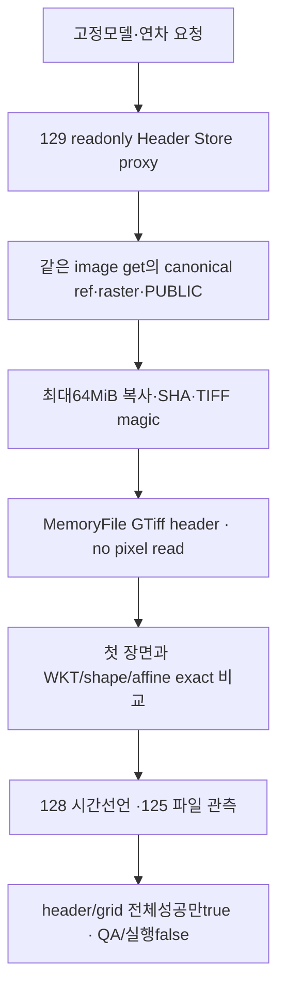

# Gate129 — 실제 영상 header와 장면 간 동일 격자 확인

| 필드 | 값 |
|---|---|
| updated_at | 2026-10-18 03:45:01 KST — 129 최종 관련/독립·실제 Temp GTiff/grid·보존 반영 |
| source_commit | 기준 97e712d4476eb00680469d40972c571172930f3f + 129 작업파일 SHA (미커밋); 실행 gate 변경 없음 |
| evidence_paths | `backend/app/ml/registry_raster_grid_normalization.py`; `tests/test_registry_raster_grid_normalization.py`; `backend/app/ml/registry_temporal_normalization.py`; `evidence/integration/raster-grid-agent-20261018-focused-final.log`; `evidence/integration/raster-grid-agent-20261018-focused.log`; `evidence/integration/raster-grid-live-integrity-20261018.json`; `evidence/integration/raster-grid-operating-inventory-20261018.json`; `docs/implementation/129_registry_raster_grid_normalization.md`; `evidence/integration/raster-grid-root-related-20261018.log`; `evidence/integration/raster-grid-runtime-20261018.json`; `evidence/integration/raster-grid-independent-20261018.json`; `evidence/integration/raster-grid-independent-20261018.log` |
| confidence | 완료 소스·집중11/관련44/독립9·실제 Temp7시나리오·보존 확인; header와 픽셀/추론/승인 구분 |
| status | TESTED_SYNTHETIC 실제 GTiff header·엄격한 장면 간 grid 진단; AOI/픽셀/QA/mask/과학·실행 승인 BLOCKED |

## 쉬운 설명

지금까지 등록문서와 파일 지문을 대조했다면 이제 실제 영상파일 안의 크기·밴드 이름·좌표계·격자를 읽는다. 여러 장면의 격자가 정확히 같은지도 본다. 픽셀값이나 구름mask를 읽어 품질·정답을 평가하지 않으며 등록 bbox와 실제 범위의 관계도 아직 확인하지 않는다.

## 이론적 배경

시점별 분류를 같은 위치끼리 비교하려면 영상의 폭/높이·좌표계·격자 변환이 맞아야 한다. affine6계수는 픽셀 좌표를 지도 좌표로 바꾼다. 이번은 북쪽이 위인 projected metre 격자만 받으며 자동 재투영·정렬·보간을 하지 않는다. 같은 grid는 비교의 한 조건이지 독립장면·정확한 관측·구름 없는 자료라는 뜻이 아니다.

CRS는 canonical WKT 문자열,shape와 affine6계수를 정확히 비교한다. 의미상 같은 CRS라도 WKT 표기가 다르면 거부될 수 있는 보수적 내부 정책이다. tolerance나 동등 CRS 추론으로 자동 보정하지 않는다.

## 구조와 코드

`inspect_registry_raster_grid_normalization`은127의 전체 요청 선검사를 재사용하고128에 readonly proxy를 전달한다. 각 실제 image get의 같은 record를 canonical/ref/type raster/PUBLIC로 검사한 뒤 파일을 읽는다. 추가 Store.get은0이지만 header를 위한 파일 복사/SHA IO는 새로 수행한다. 이후125가 같은 pin을 다시 읽으므로 파일 IO0으로 표현하지 않는다.

64MiB 이내 검증 복사 bytes의 classic/BigTIFF magic을 확인한 뒤 MemoryFile에서 driver GTiff를 강제한다. VRT 등 비TIFF는 MemoryFile 전 거부한다. PAM=NO·EMPTY_DIR·INTERNAL georef로 sidecar/디렉터리 해석을 제한한다. dataset.read/mask.read나 픽셀 배열 로드는 호출하지 않는다. 전체 영상 bytes hash와 header decode는 수행하므로 단순히 파일을 읽지 않는 기능이라고 말하지 않는다.

## header·grid 계약

영상은 폭/높이1~1024·count6이고 실제 band descriptions와 등록 source 이름이 정확히 B02/B03/B04/B08/B11/B12 순서여야 한다. projected CRS·metre 단위 factor1만 받는다. affine는 유한한 a>0/e<0/b=d=0·유한한0이 아닌 determinant, 네 모서리와 bounds는 유한하고 퇴화하지 않아야 한다. 회전/skew·경위도 CRS·다른 단위·밴드 부재는 이 소비 범위에서 차단한다.

각 장면 signature는 첫 장면의 WKT·폭/높이·affine6계수와 exact 일치해야 한다. shape/해상도만 같고 원점이 다르면 같은 grid가 아니다. 실패는 RASTER_BLOCKED와 고정 issue를 남기고 뒤 행은 기존 fail-fast를 따른다. BLOCKED 행에 header 관측이 남아도 전체 grid 성공이 아니다.

exact19는128 nested 시간관측을 보존하고 header_observations와 전체 header/grid/bytesflag를 추가한다. 모든행/시간/파일 성공 뒤에만 raster_header_verified/cross_scene_grid_verified가true다. registry_temporal_year_verified는128의 관측 의미로 복사한다. AOI/품질보고서/mask/픽셀값/state_dict/기관/과학/실행/Workflow는false다.128의 물리취득일 미검증도 그대로다.

## 시험과 최초 시험 코드 오류

집중최종11 PASS/19.150초 로그를 읽었다. 최초10건 중1ERROR는 malformed VRT Temp 파일 위에 GTiff writer로 복구하려다 GDAL이 기존VRT를 해석한 시험 setup 문제였다. 해당 Temp 파일을 unlink한 뒤 재생성하도록 시험만 고쳤고 제품 코드는 바꾸지 않았다. 제품의 VRT 거부는 TIFF magic에서 MemoryFile호출0으로 확인했다. 최초 로그와 최종 통과를 보존하고 오류 원인을 모델/reader 결함으로 바꾸어 설명하지 않는다.

최종 관련44 PASS/40.033초·독립9 PASS/0 SKIP/17.266초·종료0과 문서129를 확인했다. 집중11·관련44(11+11+9+13)·독립9·Temp7시나리오는 반복/교차 근거이며 새 전체 시험 수로 합산하지 않는다. 보호141·기존source291개 전체·이전증거1109·catalog14·예약136314880B는 불변이다.03:37 운영 count는 DatasetVersion0·legacy datasets6·models1이며 Temp 성공을 운영 확보로 표현하지 않는다.

## 실제 Temp·독립 검증의 범위

Root는 시나리오마다 새로 만든 Temp7fixture에서3GeoTIFF·9등록참조·미학습 CPU checkpoint를 사용했다. 정상은 모델load1회/get10회·header3개가 성공했다. 원점shift·밴드설명 누락/순서·경위도CRS·폭이 달라진grid·opaque bytes는 각각 RASTER_BLOCKED였다. fixture 설정/모델등록은 reader 밖의 Temp 준비이며 reader의 쓰기나 운영등록으로 계산하지 않는다.

독립9건은 별도6GTiff/18Registry·CPU2/6행에서 get7/19회·키중복0·DB/파일 무변경을 확인했다. 실제 DatasetReader.read/read_masks를 금지하고 AST 호출0도 대조했다. shift/CRS/shape fail-fast·미국foot 단위/회전/1025폭·VRT/opaque의 MemoryFile호출0·RESTRICTED의snapshot0을 확인했다. header 뒤 bytes를 바꾸면125 재SHA에서 SCENE_BLOCKED가 되고 전체header/artifactflag는false였다. 실제 Windows junction도 생성해 거부한 뒤 link만 정리하고 target을 보존했다. 새 제품 지적은 없었다.

보호141·기존source291개 전체·이전증거1109·catalog14·예약136314880B는 불변이다. 운영 모델/Registry 접촉·학습·추론·등록·수집·배포0이다. 이번은 내부 미연결 추가와 기존source불변 범위의 선택 검증이며 전체backend/front/build/browser를 다시 실행하지 않았다.

## 한계와 다음

이름이 맞는6밴드 header가 실제 스펙트럼/보정의 물리 타당성이나 픽셀 품질을 인증하지 않는다. dtype(복소수 포함)·nodata·scale/offset·픽셀 유한성/coverage는 검사하지 않으며 headertrue를 실제 TinyUNet 추론 가능으로 표현하지 않는다. 같은 grid는 기관 source/실제취득일·장면독립성·AOI나 경계 안 픽셀비율·QA/mask·모델/실행 승인과 다르다.130 후속은 Registry bbox와 실제 extent의 관계 진단이다. 아직 구현하지 않았다.

header 복사 뒤125의 pin 재읽기와 모델/파일/Registry의 순차관측은 원자 snapshot이 아니고 모든 변경경쟁을 제거하지 않는다. Store 원문 decode후한도·ambient Torch·GDAL parser와 CPU/RSS/time hardcap미보장도 상속한다. runtime/API/UI/기존115 gate 미연결이며 신규 내부 reader와 기존source불변에 맞춰 이번전체 backend/front/build/browser는 재실행하지 않는다.1184/261은120/121 이전 근거다. 원본·모델·원장/lock·Draft/학습차단을 유지한다.

## 발표 대본

### 1분

“이제 실제 영상 안의 크기와 밴드 이름, 좌표계와 격자를 읽습니다. 연도별 자료가 같은 위치의 픽셀끼리 비교될 수 있는 엄격한 조건을 확인합니다. 자동으로 영상을 옮기거나 보간하지 않습니다. 같은 격자라고 구름이 없거나 분류가 정확한 것은 아니며 픽셀과mask 품질은 읽지 않았습니다. 등록 bbox와 실제 범위의 관계도 다음 일입니다. 작은 임시 영상으로 연결을 시험하고 운영 DatasetVersion0과 원본 학습 차단은 유지합니다.”

### 5분 순서

첫1분은 같은 위치의 픽셀 비교 비유를 든다. 다음1분은 검증 bytes→TIFF magic→실제header를 보여준다. 세번째1분은 WKT/shape/affine exact grid를 설명한다. 네번째1분은 header와 pixel/mask·기관/과학 승인의 차이를 말한다. 마지막1분은130 bbox/extent·운영자료0·실행 미연결을 설명한다.

### 10분 확장

‘실제 파일형식’, ‘6밴드 header’, ‘같은 grid’, ‘품질과의 차이’, ‘AOI 후속’ 다섯 장에 VRT/시험오류2분·원점/CRS exact비교1분·순차snapshot/자원1분·Q&A1분을 추가한다.

## Q&A

Q.header를 읽으면 픽셀도 검사했나? A. 전체bytes SHA와header는 읽지만 픽셀/mask 배열·통계는 읽지 않는다.

Q.해상도만 같으면 같은grid인가? A. 아니다. WKT·폭/높이·affine6계수까지 exact 일치해야 한다.

Q.의미가 같은 CRS표기도 거부될 수 있나? A. WKT문자열 exact 정책이라 가능하다. 자동 동등성/재투영은 하지 않는다.

Q.같은grid면 QA/실행승인인가? A. 아니다. 품질mask·기관/과학/실행flag는false다.

Q.등록bbox와 실제extent도 맞나? A. 아직130 후속이다.129는 실제header와 장면간grid까지만 본다.

## 근거 바로 열기

[구현 설명](../../implementation/129_registry_raster_grid_normalization.md) · [독립 검토](../../../evidence/integration/raster-grid-independent-20261018.json) · [실제 Temp header/grid](../../../evidence/integration/raster-grid-runtime-20261018.json) · [보존 근거](../../../evidence/integration/raster-grid-live-integrity-20261018.json)
