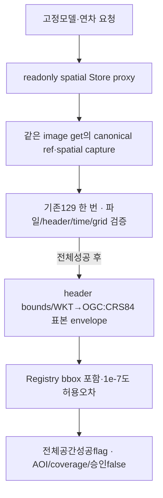

# Gate130 — 등록 bbox와 실제 영상의 표본화 WGS84 envelope를 대조

| 필드 | 값 |
|---|---|
| updated_at | 2026-10-18 03:56:57 KST — 130 최종 관련/독립·실제 Temp bbox/envelope·보존 반영 |
| source_commit | 기준 759eac034a0921f898aaf9b5e175421a222ec63f + 130 작업파일 SHA (미커밋); 실행 gate 변경 없음 |
| evidence_paths | `backend/app/ml/registry_spatial_normalization.py`; `tests/test_registry_spatial_normalization.py`; `backend/app/ml/registry_raster_grid_normalization.py`; `evidence/integration/registry-spatial-agent-20261018-focused.log`; `evidence/integration/registry-spatial-live-integrity-20261018.json`; `evidence/integration/registry-spatial-operating-inventory-20261018.json`; `docs/implementation/130_registry_spatial_normalization.md`; `evidence/integration/registry-spatial-root-related-20261018.log`; `evidence/integration/registry-spatial-runtime-20261018.json`; `evidence/integration/registry-spatial-independent-20261018.json`; `evidence/integration/registry-spatial-independent-20261018.log` |
| confidence | 완료 소스·집중10/관련41/독립8·실제 Temp7시나리오·보존 확인; 표본포함과 exact footprint/coverage 구분 |
| status | TESTED_SYNTHETIC 등록bbox가 표본화 raster envelope를 포함하는지 진단; 실제 AOI/coverage/품질/과학·실행 승인 BLOCKED |

## 쉬운 설명

129가 실제 영상 격자를 읽었다면130은 장부에 적힌 범위가 그 영상에서 계산한 경위도 사각형을 포함하는지 본다. 영상 테두리를 유한하게 표본화해 만든 envelope라 정확한 footprint나 전체 픽셀의 포함 증명은 아니다. 등록 범위가 크면 통과할 수 있지만 그 주 전체 자료가 확보됐다는 뜻은 아니다.

## 이론적 배경

투영 좌표계의 직사각형 테두리는 경위도로 바꾸면 곡선일 수 있다. `transform_bounds`에 densify_pts=21을 적용해 가장자리 표본을 추가한 경위도 envelope를 만든다. 유한 표본 근사이며 정확한 footprint를 모두 덮는 보수적 상한임을 보장하지 않는다. 유효픽셀·구름/nodata를 분석한 도형도 아니다.

Registry bbox는 EPSG:4326 또는 OGC:CRS84를 이 내부 소비 규칙에서 lon/lat 순서로 해석한다. 양 bbox에 날짜변경선 접촉±180/폭180초과·극지abs85이상을 거부한다. 세계범위 bbox도 통과시키지 않는다. 이는 신규 내부 정책이며 upstream schema나 기관 공식 공간범위를 변경한 것이 아니다.

## 구조

## 코드·입력 → 처리 → 출력

`inspect_registry_spatial_normalization`은127의 전체 요청 선검사를 재사용하고129를 한 번 호출한다. readonly outer Store proxy가125의 실제 image get에 대해 bounded/canonical ID/version/artifactSHA/digest를 확인하고 같은 copy의 spatial을 저장한다. 그 copy를129에 돌려주므로 extra Store.get은0이다. 새 image/header open도 하지 않고129가 읽은 header의 bounds/WKT를 사용한다.

등록 capture 형식/pin 오류는129 도중 앞에서 차단될 수 있다. bbox 포함 수학은129의 모든 파일/header/time/grid가 성공한 뒤 시작한다. 따라서 뒤 행 spatial NOT_CHECKED가 파일도 읽지 않았다는 뜻은 아니다. 공간 계산 첫 실패 뒤의 행은 이미129 파일 읽기를 마쳤을 수 있다. 하위 관측과 상위 검사 단계를 따로 읽는다.

변환 전에 `pyproj.network.is_network_enabled()`를 읽어true면 차단하며 전역 설정을 바꾸지 않는다. rasterio Env PROJ_NETWORK=OFF에서 `transform_bounds(header.crs_wkt,'OGC:CRS84',...,densify_pts=21)`를 수행한다. 명시 HTTP fetch는 추가하지 않지만 이 설정이 GDAL/PROJ의 모든 네트워크·CPU/RSS를 OS 수준으로 격리하지는 않는다.

등록 bbox와 변환 envelope는 유한4좌표·lon/lat 범위·퇴화 없음·위 날짜변경선/극지 정책을 통과해야 한다. 포함은 bbox.left≤envelope.left+1e-7, bottom≤...+1e-7, right≥...−1e-7, top≥...−1e-7이다. 허용오차 단위는도이며 일정한 미터거리로 부르지 않는다. 자동 재투영 파일/리샘플·bbox 보정이나 자료 역채움을 하지 않는다.

## 결과와 부분 이력

exact17은 raster_batch_observation의129 원형과 spatial_observations를 보존한다. 각 행은 NOT_CHECKED/MATCHED_UNVERIFIED/BLOCKED와 bbox/envelope·고정 issue를 남긴다. 캡처 또는 변환/포함 오류는 SPATIAL_BLOCKED, 모든행과129가 성공해야 REGISTRY_ENVELOPE_MATCHED_UNVERIFIED다.

registry_bbox_contains_raster_envelope_verified는 전체공간 성공에서만true이고 artifactflag는 하위129 전체성공에 함께 결합한다. 하위header/grid/time true는 그 검사 이력이지 공간 성공/실행승인으로 확대하지 않는다. registry_aoi_verified/physical_coverage_verified/QA보고서/mask/픽셀값/기관/과학/실행/Workflow9개는false다. 등록사각형과 근사envelope의 포함만 검사한 결과다.

## 시험과 운영 상태

집중10 PASS/17.669초를 읽었으며 이번 집중의 초기 실패는 없다. 실제 Temp의 격자/header를 하위129에서 읽은 뒤 등록공간과 비교하는 합성 검증이다. 최종 관련41 PASS/61.722초·독립8 PASS/0 SKIP/19.817초·종료0과 문서130을 확인했다. 집중10·관련41(10+11+11+9)·독립8·Temp7시나리오는 반복/교차 근거이며 새 전체 시험 수로 합산하지 않는다. 보호141·기존source293개 전체·이전증거1124·catalog14·예약136314880B는 불변이다.03:47 운영 count는 DatasetVersion0·legacy datasets6·models1이다.

## 실제 Temp·독립 검증 범위

Root는 fresh Temp7fixture로 넓은bbox·동일변환으로 만든 exactbbox·CRS84 통과와 범위밖/좁은bbox·미지원CRS·worldbbox 거부를 확인했다. 각 사례에서129 모델load1/get10/header3의 전체 파일읽기가 끝난 뒤 공간수학을 했다. 뒤행 spatial NOT_CHECKED에도 하위파일은 이미 읽힌 경계를 직접 확인했다. exactbbox는 설치 rasterio transform_bounds로 만든 참조이며 독립 지리진실/물리AOI 증거가 아니다.

독립8건은 실제2/6GTiff·18Registry·CPU checkpoint에서 get7/19회·image open4/12회·header2/6회·pixel/mask read0·DB/파일 불변을 확인했다. image open은129 header와125 SHA의 기존2N이며130 추가는0이다. 별도101edge 표본 참조와1e-9도 이내 일치·1e-7허용/2e-7거부도 확인했다. 특정fixture에서 더 조밀한 표본과 일치한 결과가 모든 변환의 수학적 보수상한/정확footprint를 증명하지는 않는다.

same-get capture·오류우선순서·미지원CRS/날짜변경선/극지·network활성화 차단/설정무변경을 검증했고 새 제품지적은 없었다. 보호141·기존source293개 전체·이전증거1124·catalog14·예약136314880B는 불변이다. 운영 모델/Registry 접촉·픽셀/mask read·추론/학습/등록/수집/배포0이며 이번 전체backend/front/build/browser는 재실행하지 않았다.

## 한계와 다음

더 큰 bbox는 통과할 수 있어 등록bbox 정확도나 주 전체 coverage를 증명하지 않는다. finite-edge 근사는 exact footprint·보수적 전체상한·독립 물리AOI·유효픽셀비율이 아니다. 실제 취득일·기관권위·QA/mask·pixel/state/과학승인을 해제하지 않는다.131은 고정 QA report와 명시mask 참조 읽기 계약 후속이며 아직 미구현이다.

129/128/127/124/125의 순차snapshot·Store decode후한도·ambient Torch·GDAL/PROJ parser 자원미격리 한계를 상속한다. 공간계산은 추가 파일을 안 열지만 전체 함수의 하위 모델/영상IO는 있다. runtime/APIUI/기존115 gate 미연결이고 기존source가 불변인 내부 추가이므로 이번전체 backend/front/build/browser는 재실행하지 않는다.1184/261은120/121 이전 이력이며 운영 모델load·수집·등록·학습·추론·배포0을 유지한다.

## 발표 대본

### 1분

“등록한 사각형이 실제 영상에서 계산한 경위도 사각형을 포함하는지 확인합니다. 영상을 새로 만들지 않고 앞 단계의 실제header에서 테두리 표본을 변환합니다. 이 사각형은 유한 표본 근사라 정확한 footprint나 모든 픽셀 포함의 증명은 아닙니다. 등록범위가 크면 통과할 수 있지만 주 전체 자료를 확보했다는 뜻도 아닙니다. 모든 header 검사를 끝낸 뒤 공간계산을 하므로 공간 미검사가 파일 미읽음을 뜻하지는 않습니다. 품질mask와 과학·기관·실행 승인은 별도이며 운영 자료 상태는 유지합니다.”

### 5분 순서

첫1분은 등록사각형과 영상envelope를 구분한다. 다음1분은 같은record capture·129 header재사용을 보여준다. 세번째1분은 edge표본/도단위허용오차·날짜변경선/극지범위를 말한다. 네번째1분은 NOT_CHECKED와 파일IO·더큰bbox 통과의 한계를 설명한다. 마지막1분은131 QA/mask·운영DatasetVersion0·실행미연결을 설명한다.

### 10분 확장

‘등록범위’, ‘실제header와 변환’, ‘표본근사’, ‘검사순서’, ‘품질후속’ 다섯 장에 offset/극지/포함 회귀2분·network설정 범위1분·순차snapshot/자원1분·Q&A1분을 더한다.

## Q&A

Q.통과하면 주 전체 coverage가 확보됐나? A. 큰등록bbox가 포함할 수 있어 실제 coverage 증명이 아니다.

Q.envelope는 정확한footprint의 보수적상한인가? A. 유한edge표본 근사이며 그런 보장은 하지 않는다.

Q.공간 NOT_CHECKED면 파일도 안읽었나? A. 포함 계산은129 전체읽기 후여서 파일은 이미 읽었을 수 있다.

Q.PROJ OFF면 모든네트워크가 격리됐나? A. 명시 설정/진단범위이며 OS차원의 GDAL/PROJ network sandbox가 아니다.

Q.QA/mask나 실행도 승인됐나? A. 아니다.131와 runtime/APIUI·운영 승인 후속이다.

## 근거 바로 열기

[구현 설명](../../implementation/130_registry_spatial_normalization.md) · [독립 검토](../../../evidence/integration/registry-spatial-independent-20261018.json) · [실제 Temp 공간대조](../../../evidence/integration/registry-spatial-runtime-20261018.json) · [보존 근거](../../../evidence/integration/registry-spatial-live-integrity-20261018.json)
