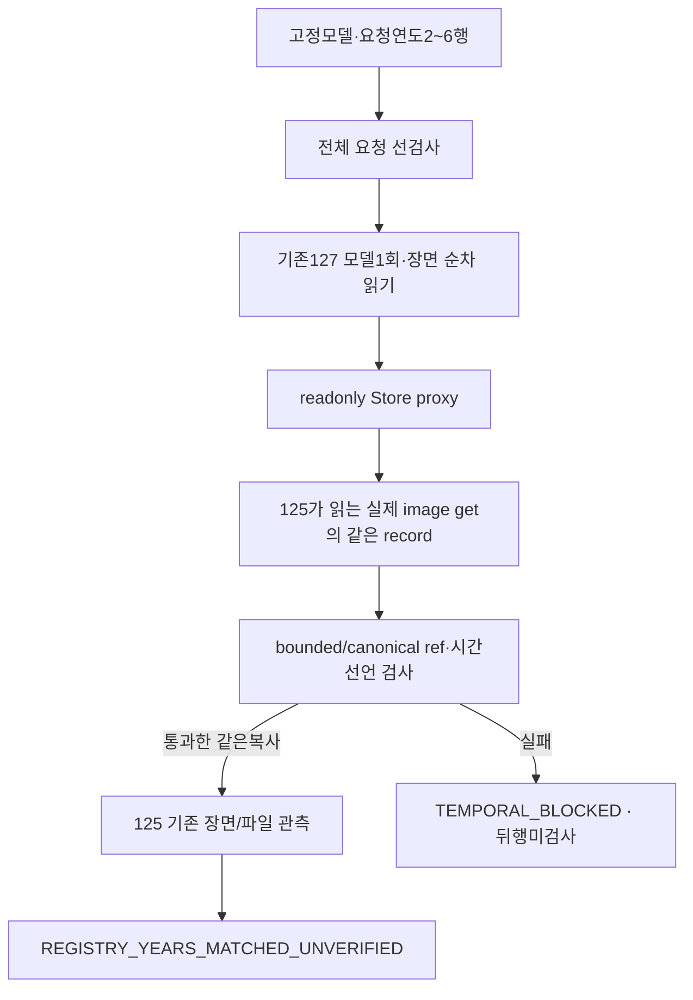

# Gate128 — 등록 영상의 시간 범위를 요청 UTC 연도에 결합

| 필드 | 값 |
|---|---|
| updated_at | 2026-10-18 03:34:26 KST — 128 최종 관련/독립·실제 Temp UTC시간·운영count/보존 반영 |
| source_commit | 기준 0ff71266aae84e14fe8620bdafe56725d7fd5c80 + 128 작업파일 SHA (미커밋); 실행 gate 변경 없음 |
| evidence_paths | `backend/app/ml/registry_temporal_normalization.py`; `tests/test_registry_temporal_normalization.py`; `backend/app/ml/pinned_annual_normalization.py`; `evidence/integration/temporal-normalization-agent-20261018-focused-final.log`; `evidence/integration/temporal-normalization-agent-20261018-focused.log`; `evidence/integration/temporal-normalization-live-integrity-20261018.json`; `evidence/integration/temporal-normalization-operating-inventory-20261018.json`; `docs/implementation/128_registry_temporal_normalization.md`; `evidence/integration/temporal-normalization-root-related-20261018.log`; `evidence/integration/temporal-normalization-runtime-20261018.json`; `evidence/integration/temporal-normalization-independent-20261018.json`; `evidence/integration/temporal-normalization-independent-20261018.log` |
| confidence | 완료 source·집중11/관련47/독립7·실제 Temp7시나리오·보존 확인; 등록선언과 물리취득일 구분 |
| status | TESTED_SYNTHETIC 등록 시간선언과 요청연도 결합; 물리취득연도/QA/mask/과학·실행 승인 BLOCKED |

## 쉬운 설명

127은 요청표의 연도만 따라 읽었다.128은 같은 조회에서 읽은 영상 Registry manifest의 시작·끝 시간이 그 요청 UTC 연도 안에 있는지 확인한다. 장부에 적힌 날짜를 대조한 것이며 실제 촬영일을 영상이나 공식 원문에서 인증한 것은 아니다. 시간선언 일치와 물리적 취득연도를 구분한다.

## 이론적 배경

시간대가 다르면 달력에 적힌 연도와 UTC 연도가 다를 수 있다. 시작/끝을 알려진 offset으로 UTC에 변환해 요청연도1월1일≤start≤end<다음연도1월1일을 요구한다. 전체 window가 그 연도 안이어야 하며 경계를 일부 겹치는 것만으로 통과하지 않는다. 시간은 최대9자리 소수초를 정수 nanosecond로 비교해 경계의 반올림을 줄인다.

이 정책은 새 내부 소비 계약이다. upstream Registry schema나 기관 표준의 허용 범위를 바꾼 것이 아니다. 같은 get의 manifest를 복사·canonical 검산한 뒤 시간검사와125에 함께 전달해 별도 재조회에서 서로 다른 record를 보는 공백을 줄인다. 다중파일/DB 원자 snapshot이나 기관의 실제 취득일 인증은 아니다.

## 구조와 코드

`inspect_registry_temporal_normalization`은 기존127 upfront 요청 검사를 재사용한다. 무효 입력은 고정 invalid127 응답을 만들어 Store0으로 끝낸다. 유효 요청은 readonly proxy를127에 전달한다. proxy는125의 세 get 중 각 행 첫 image get에서만 실제 record를 관측하고 나머지 호출은 그대로 전달한다. 추가 Store get은0이다. 뒤행image key가 앞행metadata key로 쓰여도 호출 위치로 구분해 미래행을 미리 검사한 것처럼 만들지 않는다.

영상 record key/본문id·requested ID/version/artifactSHA와 canonical manifest digest를 대조한다. 같은 복사 manifest의 temporal을 검사하고 upstream canonical/schema도 통과해야 그 복사본을125에 준다. BLOCKED 관측의 manifest_sha256은 검증 전 계산한 후보 digest일 수 있으므로 지문 존재를 검증 성공으로 읽지 않는다. row status와 전체flag를 함께 읽는다.

## 날짜와 결과 계약

calendar는 정확히 gregorian이다. 날짜는 ASCII 숫자·대문자T/Z 또는 명시offset, 소수초1~9자리만 지원한다. 실제 달력/시분초·offset범위를 검사하고 알 수 없는offset -00:00, 달력오류·역전window·요청 UTC 연도 밖을 거부한다. 소문자나 일반 파서가 정규화할 수 있는 잘못된 날짜를 보정하지 않는다. 물리/기관 날짜나 모든 국제시간 표현을 지원한다고 일반화하지 않는다.

exact13은 batch_observation의127 원래 관측과 temporal_observations를 보존한다. temporal issue가 있으면TEMPORAL_BLOCKED, 전체 batch/모든 시간관측 성공이어야REGISTRY_YEARS_MATCHED_UNVERIFIED와 registry_temporal_year_verified true다. artifactflag도 전체시간/bytes성공에서만true다.127 nested temporal_year_verified는 원래false로 남으며128의 등록선언 검증 범위와 모순이 아니다.

physical_acquisition_year_verified/source_authority_verified/scientific_accuracy_validated/execution_authorized/workflow_supported는false다. nested state/header/QA/mask/ACL·다른부모 한계도 그대로다. 등록된 시간선언의 정합과 실제 영상 취득연도·정확도·실행승인을 구분한다.

## 시험과 운영 상태

집중최종11 PASS/13.072초를 읽었다. 최초10 PASS/12.528초는 통과한 초기 로그로 보존하며 실패였다고 설명하지 않는다. 최종 회귀에는 invalid 요청의 고정 invalid127 응답으로 IO0을 유지하는 경계를 보강했다. 최종 관련47 PASS/27.445초·독립7 PASS/0 SKIP/9.008초·종료0과 문서128을 확인했다. 집중11·관련47(11+9+14+13)·독립7·Temp7시나리오는 반복/교차 근거이며 새 전체 시험 수로 합산하지 않는다.

보호141·기존source289개 전체·이전증거1094·catalog14·예약136314880B는 불변이다.03:26 운영 count는 DatasetVersion0·legacy datasets6·models1·전체14기록이다. Temp 성공을 운영 연차 확보/등록진척으로 표현하지 않는다. 운영 모델/영상load·수집·등록·학습·추론·배포0을 유지한다.

## 최종 Temp·독립 검증의 범위

Root는 실제 Temp3GeoTIFF·등록9역할·CPU checkpoint로7시나리오를 확인했다. 정상은 모델load1회·get10회로 추가 시간조회가 없다. 요청2024와 등록2023은 차단됐고 local2021-12-31T23:30-01:00은 UTC2022로 바뀌어 요청2022에 일치했다. 끝이 다음 Jan1인 첫행은 차단되고 뒤2행은 미검사, 중간 -00:00도 거부했다. 반환 record의 시간/canonicalSHA 변경은 mock 경계이며 DB를 쓰거나 운영 자료를 바꾼 것이 아니다.

독립7건은 별도 Temp18record와 CPU2/6행에서 get7/19회·각key1회·원본DB/입력 불변을 확인했다. offset/1ns 역전/달력/ASCII/-00·같은get에서 정합적으로 바뀐 metadata의 연도차단·앞metadata가 미래image key와 겹치는 경우 현재image만 관측함을 검증했다. 물리취득일과127 nested temporalfalse도 유지됐다. 새 제품 결함이나 초기 실패는 없고 초기10통과와 최종11통과는 중복 합산하지 않는다.

보호141참조·기존source289개 전체·이전증거1094·catalog14·예약136314880B는 불변이다. 운영 모델/Registry 접촉·학습·추론·등록·수집·배포0이다. 기존 제품 소스가 불변인 미연결 reader이므로 이번 전체backend/front/build/browser 재실행은 없으며1184/261은 이전120/121 근거다.

## 한계와 후속

같은 get의 시간선언 일치가 실제 취득일·장면독립성·grid/CRS·품질/mask·기관 권위/ACL을 증명하지 않는다.129는 실제 raster header와 cross-scene grid 진단 후속이며 아직 미구현이다. runtime/API/UI/기존115 실행 연결과 과학승인도 후속이다.

기존127의 모델1회/순차scene·Store DB decode후한도·ambient Torch/tensor DoS 미격리·다중파일/Registry 원자 시점 미보장·전체CPU/RSS/time hardcap없음을 상속한다. 내부 미연결 reader이므로 이번전체 backend/front/build/browser는 재실행하지 않고1184/261은120/121 이전 근거로 남긴다. global-only·Draft·후보4차단·독립라벨/외부5실행자료 미제공을 보존한다.

## 발표 대본

### 1분

“요청표의 연도만 보던 기능에 등록 영상의 시작·끝 시간 대조를 붙였습니다. 같은 장부 조회의 설명을 복사해 UTC로 바꾸고 전체 기간이 요청연도 안인지 확인합니다. 추가로 장부를 다시 읽지 않습니다. 다만 장부 날짜가 맞는다는 사실이 실제 촬영일을 인증한 것은 아닙니다. 실제 영상의 header나 격자·구름mask는 다음 일이고 운영 DatasetVersion은 아직0개입니다. 임시 자료로 날짜 경계와 중간 실패를 시험하며 과학·기관·실행 승인은 계속 분리합니다.”

### 5분 순서

첫1분은127 요청라벨과128 등록날짜 차이를 설명한다. 다음1분은 UTC 연도window와 offset 예를 보여준다. 세번째1분은 같은 get/같은copy·추가조회0을 설명한다. 네번째1분은 실패 후보digest와 전체flag·nested temporalfalse를 구분한다. 마지막1분은 물리취득일/129header/grid·mask/실행 후속을 말한다.

### 10분 확장

‘요청과 등록 시간’, ‘UTC경계’, ‘같은record결합’, ‘관측flag’, ‘물리자료 후속’ 다섯 장에 leap/offset/nanosecond회귀2분·이미지role위치1분·snapshot/기관한계1분·Q&A1분을 추가한다.

## Q&A

Q.등록 연도flag가true면 실제촬영연도도 맞나? A. 아니다. 물리취득연도flag는false다.

Q.시간대가 달라도 달력 연도만 보면 되나? A. UTC로 변환한 시작·끝 전체가 요청연도 안이어야 한다.

Q.BLOCKED인데digest가 있으면 검증 성공인가? A. 후보 계산값일 수 있어 rowstatus/전체flag를 함께 읽는다.

Q.127안의 temporalfalse와 모순인가? A.127은요청라벨범위,128은등록선언검증으로 구분한다.

Q.실제header와grid도 검증됐나? A. 아니다.129후속이며 현재API/UI/실행도미연결이다.

## 근거 바로 열기

[구현 설명](../../implementation/128_registry_temporal_normalization.md) · [독립 검토](../../../evidence/integration/temporal-normalization-independent-20261018.json) · [Temp UTC시간 대조](../../../evidence/integration/temporal-normalization-runtime-20261018.json) · [보존 근거](../../../evidence/integration/temporal-normalization-live-integrity-20261018.json)
