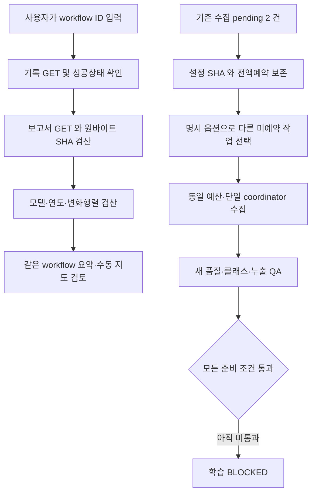

# 147 마감·148 수집 계속·149 학습자료 보완·150 서비스 감사 해설

| 필드 | 값 |
|---|---|
| updated_at | 2026-10-18 10:07 KST — 전체 backend1450 PASS/2 SKIP·수집1400/1122·고정후보1095·localhost 복원 최종 |
| source_commit | 147 완료 `76949f650123653f30841507feebc7678aaea151`; 148/149/150 작업파일 근거 |
| evidence_paths | docs/implementation/147_geollm_workflow_evidence_ui.md; 148_collection_resume_audit.md; 149_training_data_remediation_audit.md; 150_service_recovery_audit.md; evidence/integration/collection-resume-host-events-20261018.json |
| confidence | 전체 backend1450 PASS/2 SKIP; 실제 수집·고정후보 QA/4285 재해시·localhost GET/브라우저·보존 근거 확인 |
| status | 147 TESTED_SYNTHETIC·Git 완료; 수집·고정후보 QA·localhost API 복원 VERIFIED_REAL; 학습 BLOCKED |

## 1. 쉬운 설명 — 지금 무슨 일이 끝났고 무엇이 남았나

147 통합 마무리는 ‘완성한 화면을 기존 분석 기록과 정확하게 연결하고, 오류 상황까지 시험한 뒤, 설명서와 Git 에 함께 고정하는 일’이다. 분석 영수증에 적힌 ID·모델·연도·파일 지문이 보고서와 같은지 검사하고, 지도와 수치표도 같은 분석에서 나왔는지 확인한다. 이전 보고의 미커밋 상태와 달리 147 은 위 커밋으로 완료됐다. 150 감사에서 UI 소스·시험 6 개 SHA 도 대조했다. 전체 사업 완료나 현재 서비스 접속 성공을 뜻하지 않는다.

멈춘 수집은 1,384 개 패치 전체가 아니라 **반텐 2023·서자바 2023 의 추가 공간창 2 건**이다. 여섯 밴드가 모두 있어야 영상 조립과 패치 생성이 가능한데 반텐은 B02/B03/B04/B08/B11, 서자바는 B02/B03/B04 까지만 남았다. 마지막 완성 보고서가 없어 학습 패치로 세지 않는다. 두 작업의 각 68,157,440 바이트 예약도 총 136,314,880 바이트 그대로 보존한다.

학습 보완은 사진 장수 늘리기 외에 시험문제 중복 제거, 드문 토지유형 확보, 지역·연도 편중 해소, 독립 정답 준비를 함께 수행하는 일이다. 맨땅인 ‘나지’가 핵심 부족 클래스다. 검증용 자료에 47 픽셀만 더 넣으면 된다는 뜻이 아니다.

## 2. 이론적 배경

SHA-256 은 파일 내용의 지문이다. 지문이 맞으면 저장된 보고서와 같은 바이트라는 근거가 되지만 지도분류가 현실과 맞다는 보증은 아니다. 원본 scene 은 위성이 한 번 관측한 장면이고 patch 는 그 조각이다. 같은 장면 조각을 검증용과 시험용에 나눠 넣으면 독립 시험이 약해진다.

클래스 대표성은 세 기준이 다르다. ① 분할별 나지 총 픽셀 최소 256, ② 패치 한 장에 나지 256 픽셀 이상인 ‘기여 패치’를 분할별 최소 5 장, ③ 전체 유효 픽셀 중 나지 비율 최소 0.5%다. 첫째만 충족해도 둘째·셋째는 계속 실패할 수 있다. ESRI 원분류 8 이 모델 class7 로 매핑되는 나지이며, 원분류 8 과 모델 class8 을 혼동하지 않는다.

## 3. 코드·데이터 동작

`frontend/src/geollmWorkflowEvidenceClient.ts`는 `/v1/lcluc/workflows/{id}`와 `/report`를 인증 GET 으로만 읽는다. RUNNING/FAILED 면 보고서를 읽지 않는다. `geollmWorkflowEvidenceAdapter.ts`가 SHA·모델·연도·전이행렬을 검산하고 `GeoWorkflowEvidence.tsx`가 표시한다. ID 편집·이동·중단은 예전 표시와 지연 응답을 제거한다. 서버 실행 취소·새 추론·LLM 답변 생성이 아니다.

`scripts/collect_training_parallel.py`의 `continuation_jobs`와 `--continue-unrelated-pending`는 같은 ledger 의 pending key/config SHA 를 비교한다. 일치하는 기존 pending 만 새 실행 후보에서 제외한다. 기본 모드는 기존 재실행 차단을 유지한다. 옵션 자체는 lock 해제·예약 환불·다운로드를 하지 않으며 실제 실행에는 단일 실행자와 별도 lock 인계 근거가 필요하다.

자료 버전은 다음처럼 분리한다.

| 자료 | 물리 행 | 적격 | train/val/test | 저장 차단 |
|---|---:|---:|---|---:|
| 보존 원본 | 1,384 | 1,111 | 628/233/250 | 5 |
| 기존 누출제외 후보 | 1,368 | 1,095 | 628/217/250 | 4 |

후보는 같은 2021 Sentinel scene 에서 나온 반텐 검증 16 행을 제외하고 서자바 시험을 남긴 자료다. 원본을 지우거나 자동 교체하지 않았다. 후보도 나지 비율 3 건과 validation 나지 픽셀 1 건으로 준비 false 다. 새 수집 산출물은 검사를 마친 뒤 별도 버전으로 판단해야 하며 이 두 고정 수치를 자동 갱신한 것으로 보지 않는다.

| 나지 기준 | train | validation | test |
|---|---:|---:|---:|
| 보존 진단 나지 픽셀 | 1,418 | 209 | 1,025 |
| 최소 256 총픽셀까지 부족 | 0 | 47 | 0 |
| 나지 256 이상인 기여 패치 | 0 | 0 | 0 |
| 비율 | 약 0.003532% | 약 0.001494% | 약 0.006307% |

기여 패치 기준은 각각 5 개, 비율 기준은 각각 0.5%다. 별도 수집계획의 6 주×6 년 36 칸·칸당 적격 28 목표까지 부족 151 개는 나지 차단과 별도다. 남동술라웨시 2024 는 1 개(27 부족), 고론탈로 2025 는 8 개(20 부족)다.

## 4. 실제 시험과 원인 증거

147 은 집중 9 PASS, 독립 7 PASS, 전체 frontend280 PASS, build116 modules, 관련 backend34 PASS 다. 서로 겹쳐 합산하지 않는다. 실제 main Temp8003/Vite5180 브라우저에서 401·성공 3 변화쌍·지도·9×9 행렬·404·상태/ID 전환을 확인했다. 영상은 합성, 모델은 미훈련 TinyUNet, 승인은 모의 metadata 이므로 상태는 TESTED_SYNTHETIC 이다. 150 은 시험 재실행 대신 완료파일 SHA 와 실제 프로세스·catalog 보존을 감사했다.

148 신규 단위시험은 Temp ledger7 PASS 로 기본 차단·명시 제외·SHA 불일치거부·같은 예산·기존예약보존을 확인했다. 이것만으로 실제 수집 성공을 확정하지 않는다. 감사에서 기존 부분 파일·원장·lock 보호 52 개가 유지됐다.

Windows 이벤트 41/6008 로 비정상 호스트 종료 사실은 확인됐다. 그러나 6008 의 이전 종료시각 10 월 16 일 16:53:55 와 collector 마지막부분 파일 17:04 경 사이 시각이 맞지 않아 정확한 수집 종료시각과 직접 원인은 미확정이다. 기록된 429 회로는 false 이고 예산 잔액도 있어 429·예산 소진을 원인으로 단정하지 않는다. 미완료 fetch 의 예약상한과 계측기록 차이 32MiB 역시 환불 가능한 금액이 아니다.

150 의 09:46 관측은 frontend5174·Ollama11434 만 실행, API8002 없음이다. 기존 인증 설정은 환경/알려진파일/사용자 입력에서 재사용할 값을 찾지 못했다. 신규 secret 이나 인증 우회 없이 API 복원은 보류했다. 이 제한은 독립 collector 재개 조건과 다르다.

## 5. 다음 보완과 사용 시 주의

나지 선별표에는 선언량 256 이상인 train2/test1 패치가 있으나 모두 품질 부적격이다. 남술라웨시 2022(545 픽셀), 고론탈로 2024(271), 서자바 2020(1,171)을 더 맑은 동년 관측으로 검토할 수 있다. validation 반텐은 새 공간 조사부터 필요하다. 선언량은 약한 참조이고 실제 QA 나 현장 정답이 아니므로 품질 문턱을 낮추거나 부적격을 적격으로 바꾸지 않는다. 현재 CLI 에는 이 선별표를 곧바로 나지 우선 job 으로 실행하는 필터가 없다.

보완 순서는 ① 기존 후보의 누출제거 근거 유지 ② 부족 지역·연도와 나지 공간 조사 ③ 동년 영상/ESRI 라벨·공간분리·예산에 맞춘 명시 job ④ 새 산출물 전체 QA 와 준비도 ⑤ 조건 통과 후 학습 ⑥ 독립 정답 평가와 운영 승인이다. 실제 지역기관 역할·BIG 승인·컨소시엄 R&R 은 미확정이며 이 개발자료로 확정하지 않는다.

## 6. 발표 스크립트

### 1 분

“147 번은 저장된 분석의 영수증과 보고서·지도·수치를 같은 ID 로 확인하는 화면을 마무리한 것입니다. 코드와 오류 시험·브라우저 확인·설명서가 Git 에 함께 반영됐습니다. 멈춘 수집은 전체 자료가 아니라 반텐과 서자바 2023 의 추가창 두 개이며, 부분 파일과 예산 예약은 보존하고 다른 새 작업부터 진행할 수 있게 했습니다. 학습은 아직 차단입니다. 같은 위성장면이 시험과 검증에 겹친 문제를 제외한 후보는 이미 있지만, 맨땅 사례가 세 분할 모두 부족합니다. 사진 총장수와 맨땅 비율, 지역·연도 균형을 따로 보완하고 다시 검사해야 합니다.”

### 5 분

첫 1 분은 147 을 ‘영수증 대조’로 설명하고 Git 완료와 현재 API 미접속을 구분한다. 다음 1 분은 두 중단창의 부분 밴드·종료보고서부재·예약보존을 설명한다. 다음 1 분은 원본 1111 과 후보 1095 의 차이, 반텐 16 행 제외 이유를 설명한다. 다음 1 분은 나지 256 픽셀·기여 5 패치·비율 0.5%의 세 조건을 비교한다. 마지막 1 분은 실제 수집 관측·새 QA·학습·독립평가·승인 순서와 다음 확인 시점을 안내한다. 수집 수치가 있으면 아래 후속 관측의 기준시각을 함께 읽는다.

발표 제목 예시: ‘147: 분석 근거를 묶는 화면’, ‘중단 두 창과 안전한 계속’, ‘총장수와 독립성은 다르다’, ‘나지·연도·정답의 보완 순서’.

## 7. 예상 질문과 답변

1. **147 이 끝났으면 지금 바로 접속되나?** 코드·검증·Git 통합은 끝났다. 현재 API 서비스가 없는 상태는 별도 150 감사에 기록했다.
2. **수집 자료가 유실됐나?** 보존 원본 1384 개가 사라진 문제가 아니다. 추가 2 창의 밴드조립이 미완료다.
3. **컴퓨터 재부팅이 원인인가?** 비정상종료 사실은 확인됐으나 시각 충돌과 collector 종료 로그 부재로 직접 원인은 미확정이다.
4. **기존 예약을 취소하면 되나?** 실제전송 정산근거가 없어 전액보존하며, 다른미예약작업만 동일예산에서 진행한다.
5. **1095 개 후보면 학습 가능한가?** 누출 1 차단이 줄었지만 나지 4 차단이 남아 아직 false 다.
6. **47 픽셀만 더 받으면 되나?** 아니다. 패치당 256 이상인기여 패치 5 개와 전체 0.5%도 각각 통과해야 한다.
7. **151 개를 모으면 모든문제가 해결되나?** 그것은 지역·연도별 계획 부족이다. 나지 대표성·누출·독립 정답은 별개다.
8. **ESRI 가 정답 아닌가?** 동년공개참조이나 약한라벨이다. 현장·전문가 독립평가를 대신하지 않는다.
9. **나지가 있는 3 패치를 바로 쓰면 되나?** 모두품질 부적격이므로 제외유지하고 동년의 더맑은관측 가능성을 조사한다.
10. **코드시험통과가 정확도검증인가?** 계약·오류처리의근거이며 실자료의 과학정확도·기관 승인은 별도다.

## 8. 후속 운영 관측 — 시작과 성공은 구분

**VERIFIED_REAL — 2026-10-18 09:52:13 KST:** Root가 기존 ledger/aggregate/run/plan 4개 원바이트를 `data/collection-continuation-backup-20261018`에 복사하고 SHA를 대조했다. 프로세스 부재를 두 번 확인한 뒤 기존 빈 execution.lock을 원본 archive로 보존하고, 기존 collector가 O_EXCL로 잠금을 재획득하여 최대2건(bounded2) 실행을 PID532로 시작했다. 인계 근거는 `evidence/integration/collection-resume-handover-20261018.json`이다. 신규 옵션의 Root 집중시험은7 PASS/1.962초다. 초기 실행 시점에는 stdout과 작업자·전송 성공 근거가 없어 다운로드 완료나 적격 증가를 선언하지 않았다. 기존 pending2건의 전액예약과 부분파일을 보존하는 방식이다.

이후 수집 결과·프로세스 변화·149 실제 raster 재진단은 최종 근거가 확보되면 아래에 추가한다. 단순 프로세스 시작은 worker 시작·바이트 전송·최종 QA 성공과 서로 다르다.

### 149 보완 조사 — 새로 찾은 것은 ‘검토 위치’

실제 로컬 반텐 ESRI 라벨17개를 읽은 조사에서256×256 크기의 나지 검토창10개를 찾았다. 각 창은 원분류8이256픽셀 이상이고 공개 경계와 기하 면적비95% 이상이다. 원본 라벨 SHA도 전후 확인했다(`ml-resume-audit-20261018-local-banten-label-search.json`). 이는 VERIFIED_REAL인 로컬 약한 라벨 검색 결과다. 여러 연도와 겹치는 공간이 포함되어 독립10곳·적격10패치·현장 정답 확보라고 부를 수 없다.

이 작은 창 자체는 기존 영상창 밖이지만 기존1024×1024 수집 크기로 넓히면 모두 기존 영상창과 겹친다. 따라서 현재 규격으로 즉시 실행 가능한 새1024 후보는0개다. 중복방지 기준을 낮추지 않고256 타겟 수집을 기존 예산·정합·공간분리와 연결하거나 더 먼 나지 공간을 찾는 일이 다음 구현 대상이다.

기존 후보의 훈련주 고유위치는 남술라웨시56·고론탈로64·남동술라웨시53·동자바44, 주별 적격 패치는216·154·127·131이다. 이미 충족한 주별 최소32위치/50패치를 현재 차단 이유로 설명하지 않는다. 현재 후보의 저장 차단4건은 나지 비율3건과 validation 나지 총픽셀1건이다.

## 최종 수집 관측 — 2026-10-18 09:57 KST

**VERIFIED_REAL:** 최대2건 실행이 `finished_bounded_parallel_stage`로 끝났다. `run-result.json`에서 submitted2/finalized2, 종료 이유 `bounded_batch_count`, circuit=false를 확인했다. 남술라웨시2021-g03은 거의 숲인 참조창이라 기존 다양성 정책으로 보류되어 신규패치0, 계상1190529B다.2022-g03은16패치를 만들었고 계상18358118B다. 합계19548647B는 새 두 작업의 HTTP 본문 계측·계상 범위이며 기존 두 중단 작업의 정산이 아니다.

누계는 **물리1384→1400(+16), 적격1111→1122(+11)**이다. stdout의 두 worker 종료·run-result·독립 observation이 일치한다. 새16패치 모두가 적격인 것은 아니다. 기존 반텐/서자바 pending2의 예약136314880B는 보존했고 환불하지 않았다. 최대2건이 끝나 정상 종료한 상태를 새로운 고장이나 무제한 수집 실행중으로 보고하지 않는다.

**학습 QA 범위:** 최초 실제 raster 재검사는 assess 반환 후 최종 SHA 대조에서 병렬 collector의 원본 aggregate·원장 갱신을 감지해 성공summary 없이 종료됐다. 실패근거를 보존했고 이를 성공으로 숨기지 않았다. 재검사는 고정1095개 후보·정책·실파일과 실행 전 보존 사본을 기준으로 범위를 분리해1회 진행한다. 이 고정 후보 재검사와 신규수집분을 포함한 새 후보 QA는 별개이며, 최신1122 적격 수집누계가 정식 학습 승인이라는 뜻은 아니다.

근거: `evidence/integration/collection-resume-audit-20261018-observation-005717992597.json`, `collection-resume-live-20261018-stdout.log`, `data/first-group-training-esri-v1/run-result.json`, `ml-resume-audit-20261018-failed-stability.json`, `docs/implementation/148_collection_resume_audit.md`, `149_training_data_remediation_audit.md`. 최종 lock·보호파일·전체회귀 및 고정후보 재검사 결과는 후속 확정 절을 참조한다.

### 09:58 최종 정산·품질 관측

독립 `collection-resume-audit-20261018-final-outcome.json`은 train/val/test 적격639/233/250, 신규16중 적격11·부적격5를 확인한다. **신규 패치의 나지(ESRI 원분류8·모델 class7) 픽셀 총수는 전체·적격 모두 **0픽셀****으로, 이번 수집이 나지 차단을 해결했다고 보고하지 않는다. 전체 예산 신규 잔여2341906244B, 기존 pending2건만 남고 실행lock은 해제됐다.429 활성=false다. COG19070976B와metadata477671B 합계19548647B가 계상됐다. 상태는 정상 최대2건 종료이며 collector 계속실행중이 아니다.

### API 복원 후속 — 앞선 offline은 과거 관측

Root가 기존 `main.authorized`의 토큰 미설정 localhost 개발 모드를 확인한 뒤 기존 코드·토큰·브라우저 인증 설정을 바꾸지 않고8002 API를 PID33956으로 복원했다. API와 Vite는 모두127.0.0.1에만 바인딩했다. 앞선150의 인증 재사용 조건부 보류는 초기 보수적 판단 이력이며 현재의 영구 차단이 아니다. 실제 GET·브라우저·catalog 보존 최종 검증은 담당의 후속 근거에서 확정한다. API 실행과 학습 준비·모델 승인도 별개다.

## 10:01 KST 확정 — 고정 후보 재검사와 서비스 복원

**VERIFIED_REAL:** 고정1095후보의 실제 raster 재검사는296.625초에 완료됐다. 고정 후보·정책·과거 QA·수집 전 보존 사본4개 SHA가 유지됐고, 파일 기록4285개를 검증했다. 적격628/217/250, 나지 차단4건, `ready_for_training=false`, `scientific_accuracy_validated=false`가 과거 후보 QA와 같음을 확인했다. summary의 `same_as_stored_candidate_QA` 아래 true는 ‘과거 결과와 같음’이라는 비교 결과이며 준비·정확도 승인 true가 아니다. 새1122 수집누계에 대한 새 후보 QA는 여전히 별도 후속이다. 최초 병렬수집 pin 대조 실패도 보존했다(`ml-resume-audit-20261018-candidate-only-summary.json`).

**VERIFIED_REAL:** 10:01:35 API PID33956에서 `/healthz`, `/readyz`, `/api/health`와 Vite5174 경유 `/api/health`가 모두GET200으로 응답했다. 기존 사용자 탭의 상태 새로고침에서도 ‘로컬 분석 서버 연결됨’을 확인했다. catalog14행의 raw·canonical SHA가 전후 같고 현재 access log의 POST는0이다. API/Vite는127.0.0.1이며 토큰 미설정인 기존 localhost 개발 모드, 인증·토큰·브라우저 설정 변경0이다. 앞선 API offline/보류는 초기 관측 이력이다. 이 복원은 공유 운영 배포·모델 정확도·학습 준비 인증이 아니다(`147-local-service-restore-20261018-verified.json`).

## 최종 동결 — 2026-10-18 10:07 KST

이번148 변경 뒤 전체 백엔드 회귀는 **1452건 중1450 PASS·2 SKIP·1046.064초·종료0**이다(`collection-resume-root-full-20261018.log`, `collection-resume-closeout-20261018.json`). 두 SKIP은 Windows 실제 symlink 권한 제한으로, `test_collection_recovery.RecoveryPlanTests.test_artifact_symlink_cannot_read_outside_data_root`와 `test_source_raster_registration_cli.SourceRasterRegistrationCLITests.test_actual_symlink_to_catalog_rejected_or_permission_skip`이다. 후자는1314 권한 오류를 명시한다. 이전145 전체1431 PASS·1 SKIP은 과거 이력이며 이번 결과와 구분한다. 집중7·독립7·전체 회귀는 겹치므로 합산하지 않는다. 코드시험 통과는 운영 모델 정확도·독립 정답·기관 승인이 아니다.

고정1095후보는 실제 QA 뒤4285파일을28.188초에 다시 SHA 계산하여 불일치0을 확인했다(`ml-resume-audit-20261018-final-verification.json`). 후속150 실제 브라우저에서 서버 연결과147 빈 ID/조회 disabled를 확인했고 catalog14행 SHA 보존·운영 POST0을 유지했다. 전체 프로젝트는 미완료이며 학습은 나지4차단으로 BLOCKED다.

**PLANNED — 다음152:** 기존1024창을 넓혀 받으면 중복되는 반텐 나지 검토 위치를256×256 표적창으로 명시 계획하는 RFC를 작성 중이다. 이는 아직 실행 코드나 새 수집 성공이 아니다. 원본 정합·동년 참조·공유 예산·고정 split·기존 공간/scene 중복 방지·품질 검사를 보존하는 설계가 필요하다. 기존 pending2건 정산을 합성하거나 중복방지 기준을 낮추지 않는다.
