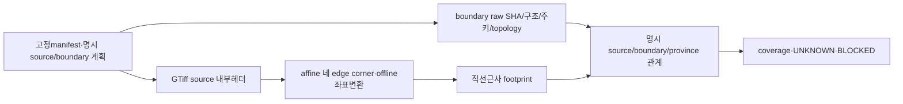

# Gate Source Footprints 20261017 — 영상 네 모서리와 명시 주 경계의 관계

| 필드 | 값 |
|---|---|
| updated_at | 2026-10-17 23:36 KST — Git 상태 메타데이터 정정; 본문은 해당 Gate 기준 |
| source_commit | d474d5bce6c2a6c4bd8ba141c9256d15f6004631 (108까지 구현 검토 기준; 이 메타데이터 정리는 후속 문서 커밋) |
| evidence_paths | `backend/app/data/recovery_source_footprints.py`; `scripts/inspect_recovery_source_footprints.py`; `tests/test_recovery_source_footprints.py`; `docs/implementation/55_recovery_source_footprints_validation.md`; `evidence/integration/recovery-source-footprints-tests-20261017.log`; `evidence/integration/recovery-source-footprints-independent-20261017.log`; `evidence/integration/recovery-source-footprints-live-final-20261017.json`; `evidence/integration/recovery-source-footprints-full-tests-20261017.log`; `evidence/integration/recovery-source-footprints-live-integrity-20261017.json` |
| confidence | 코드·합성시험·실제 source헤더/corner근사·명시주관계; 픽셀/정확외곽/독립성 미검증 |
| status | VERIFIED_REAL: source91/corner관계86·부분coverage; TESTED_SYNTHETIC: 16시험; 학습/실행 BLOCKED |

## 쉬운 설명

지도 조각끼리의 관계에서 한 걸음 나아가, 사진 파일의 네 모서리를 지도 위에 옮겨 명시된 주 경계와 닿는지 비교한다. 네 점을 직선으로 잇는 임시 윤곽이므로 사진의 모든 가장자리와 픽셀이 실제로 어디까지 들어가는지 계산한 것은 아니다. 원본 영상이나 경계를 재투영해 저장하지 않는다.

## 이론과 근사 범위

GTiff 내부 width/height·CRS·affine으로 pixel-edge의 `(0,0),(width,0),(width,height),(0,height)` 네 모서리를 만든다. 회전/skew affine도 적용하고 axis-aligned bbox로 대체하지 않는다. 임시 네 좌표를 EPSG:4326으로 변환한 뒤 직선 Polygon으로 잇는다.

pyproj는 `always_xy=True`, `errcheck=True`, `allow_ballpark=False`, `only_best=True`를 사용하고 변환 중 네트워크를 끈다. 이전 네트워크 상태는 finally에서 복원하고 종료 상태도 확인한다. 비유한/경위도 범위 밖·날짜변경선 wrap·변환/엔진 오류는 UNKNOWN이다. runtime 버전과 상태가 불명확하면 성공을 추정하지 않는다.

좌표 변환의 비선형 가장자리를 촘촘하게 표본화하지 않으므로 정확한 raster footprint가 아니다. footprint와 주 도형의 떨어짐·접촉·양수면적교차는 이 근사 다각형 관계다. 픽셀 포함 비율·측지/정확 면적·scene독립성·학습분할 누출 해결과 구분한다.

## 코드·오류 계층

`recovery_source_footprints.inspect_recovery_source_footprints(data_root, expected_manifest_sha256, max_source_headers=128, max_relations=256, **limits)`와 내부CLI가 구현이다. 고정 manifest와 명시 경로/SHA·파일존재·canonical상충·주이름·예산을 먼저 검사한다. preplan 오류는 source header0/관계0이다. source header/관계예산은 각1..10,000 정확한 정수 범위다.

boundary raw 내용/SHA/구조/geometry 진단의 issue는 해당 주 관계를 UNKNOWN으로 남기지만 **유효 preplan 아래 source header 독립 진단은 계속**한다. 이 경우 “모든 검사 중단”으로 설명하지 않는다. 다만 strict 인코딩/JSON·자원 한도·경로/stale 같은 global 안전 오류는 전체 실패이며 모든 boundary 오류를 계속 처리한다고 말하지 않는다. legacy 경계양키부재도 UNKNOWN이며 기본 경계/다른 주이름을 추정하지 않는다. 같은 source header는 한 번 읽고 같은(source,boundary,province)조합은 행 참조를 모아 한 번 진단한다.

source는 로컬 GTiff 읽기모드·INTERNAL georef·PAM NO·EMPTY_DIR·PROJ_NETWORK OFF·VRT Python NO 헤더만 읽고 픽셀·전체 source SHA는 읽지 않는다. 기대SHA는 형식/상충 검사다. boundary raw는1회 SHA/구조로 읽고 manifest는별도64MiB/처음·종료2read다. stat/논리target/manifest 재확인도 원자snapshot/OSlock은 아니다. bounded 입력은 hard CPU시간보장이 아니다.

## 시험과 최종 실제근거

최종 관련16 PASS/9.217초·독립16 PASS/10.829초다. 초기14는 오류계층/네트워크최종복원 확인2개 보완 전 이력이며 전체에 추가하지 않는다. 최종 전체 `scripts/test.ps1`은 **506건 중505 PASS·1 SKIP/161.521초/종료0**다. SKIP은 기존 OS symlink 생성 권한이고 deterministic 경계 시험은 통과했다. 관련16 PASS/9.217초·독립16 PASS/10.829초는 전체506에 중복 합산하지 않는다. 초기14시험은 오류계층·최종 network복원 확인2개를 보완하기 전 이력이다. 보호132참조와 기존 계약16SHA는 불변이며 이전 추적 코드·데이터·계약 변경0이다.91 source+1 boundary의 stat·처음16바이트와92부모 파일목록 관측도 변하지 않았다. 원자적 snapshot·현재 source 전체SHA 보존 증명은 아니며 이해자료 작성은 보존 근거를 읽고 재실행하지 않았다. fixture 범위는 회전/skew·UTM always_xy/offline복원·변환오류/날짜변경선·cache/미기재·오류계층·pixel/SHA trap·변경/출력보호다. 실제 최종 CP949 CLI exit0에서 source header91개와 corner-only footprint91개가 모두 유효했고86(source,boundary,province)관계는 모두 POSITIVE_AREA_OVERLAP·issue0이었다.1,304참조/legacy80 UNKNOWN으로 KNOWN_CORNER_DIAGNOSTICS_PARTIAL/INCOMPLETE_BOUNDARY_REFERENCES·BLOCKED다. Shapely2.1.2/GEOS3.13.1·pyproj3.7.2/PROJ9.5.1이 관측됐고 변환 네트워크entry=false/exit=false·복원true였다. 양수교차는 원본영상 전체가 주 안에 있거나 픽셀비율·정확footprint·독립성을 증명한 결과가 아니다. 이해자료 작성은 시험·실자료조사를 실행하지 않았다.

## 한계·승인·UI

네 모서리 직선근사는 curved-edge densification·정확footprint·픽셀inside비율·정확/측지면적·source대source교차·분할누출 해결·독립성·공식경계/권한·과학 성능 승인이 아니다. 임시 좌표 변환이며 원본geometry/raster의 재투영·repair·쓰기는 없다. 평면degree²를 사업면적으로 제시하지 않는다.

기존적격1,111/계획후보1,095·ML5 blocker·baseline Draft·terminal없는2건/예약136,314,880B·exactly-once UNKNOWN을 유지한다. BLOCKED·학습/실행/정산/자동재개/과학 승인false·환불0이다. 내부CLI/APIUI계약불변이라 UI변경·브라우저재검사는 불필요하며 전체개발/10분보고는 계속한다.

## 발표 1분

“경계조각끼리 비교하던 범위에 실제 영상의 맥락을 추가했습니다. 원본영상 헤더의 네 모서리를 좌표계에 따라 지도 위로 옮기고 명시된 주 경계와 관계를 진단합니다. 회전된 영상도 처리하지만 네 점을 직선으로 잇는 근사이므로 정확한 영상 윤곽이나 픽셀 포함 비율은 아닙니다. 변환은 네트워크를 끄고 수행한 뒤 이전 상태로 복원합니다. 원본 영상과 경계를 재투영해 저장하거나 고치지 않습니다. 실제91개 임시윤곽과86개 양수교차를 확인했지만 부분검증이며 지역과 닿는다는 진단을 자료독립성이나 학습승인으로 바꾸지 않습니다. 기존 차단과 미기재UNKNOWN을 유지합니다.”

## 발표 5분·10분

1. **0~1분:** 사진 네 모서리를 지도에 옮기는 비유와 임시 근사임을 소개한다.
2. **1~2분:** pin/명시계획·header·affine회전/skew·edge corner를 설명한다.
3. **2~3분:** offline pyproj strict선택·always_xy·finally복원·UNKNOWN과 오류계층을 말한다.
4. **3~4분:** 최종 source/관계/runtime·관련/독립/전체/보호가 확정된 범위만 제시한다.
5. **4~5분:** 픽셀inside비율/정확footprint·면적/분할독립 미검증과 BLOCKED·UI불필요·전체개발지속을 말한다.

10분은 preplan/header0와boundary진단뒤header계속의 차이, 날짜변경선/곡선가장자리 제한·cache/관계조합, network복원불명확issue·sourceSHA재해시false를 덧붙인다.

## Q&A

**영상이 주 안에 몇% 들어가나?** 픽셀 포함 비율을 계산하지 않고 네모서리 직선근사의 관계만 진단한다.

**원본영상을 재투영했나?** 임시 네 좌표만 변환했고 원본raster/geometry를 쓰거나 재투영저장하지 않았다.

**boundary가 잘못되면 header도 읽지 않나?** 사전계획 오류면header0이다. 이후 boundary내용/SHA/geometry issue는 sourceheader독립진단을 계속하며 주관계를UNKNOWN으로 남긴다.

**source SHA도 다시 확인했나?** 현재 모듈은 헤더만 읽으며 전체 source내용SHA를 재해시하지 않았다.

**학습누출이 해결됐나?** source대source/분할독립성은 검사하지 않았고 기존5 blocker·BLOCKED를 유지한다.

## 이후 갱신

문서55·최종 관련/독립/실제/runtime/전체/보호 근거를 받아 기능해설·구조/용어·발표/FAQ/시연·INDEX·CHANGELOG를 함께 확정했다. 다음 검증은 별도Gate로 범위를 구분한다.

## 다음 작업의 현재 상태

다음 source대source 모서리근사와 고정split 연결·교차후보 진단은 **PLANNED**다. readiness.default_policy의 실제 province_splits 계약을 먼저 확인하고 물리1,384행의 source맥락과 적격patch집합을 구분해 mapping·전체pair예산을 계획한다. 원본 분할 재배정·후보발행·학습을 수행하지 않는 별도단위이며 근사교차finding은 표본독립성 증명이나 기존5차단 해제가 아니다. 현재 source_to_source_intersections_checked/training_split_leakage_resolved=false를 유지한다.
