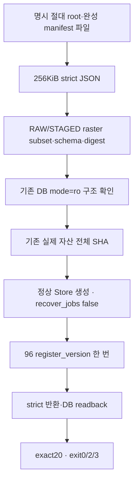

# Gate146 — 단일 source raster 버전의 명시 등록 CLI

| 필드 | 값 |
|---|---|
| updated_at | 2026-10-18 07:38:19 KST — 146 자기참조 보강·최종 시험/보존 확정 |
| source_commit | 기준 f4565f5ff9b743cfd51cea087bbcf7d2e840729f + 146 검증 작업파일 raw SHA (게시 전 검증 시점; 후속 Git 게시의 바이트 보존은 별도 확인) |
| evidence_paths | `scripts/register_dataset_version.py`; `tests/test_source_raster_registration_cli.py`; `evidence/integration/source-raster-registration-cli-agent-20261018.log`; `evidence/integration/source-raster-registration-cli-self-catalog-reproduction-20261018.py`; `evidence/integration/source-raster-registration-cli-self-catalog-reproduction-20261018.json`; `evidence/integration/source-raster-registration-cli-self-catalog-reproduction-20261018.log`; `evidence/integration/source-raster-registration-cli-agent-initial-20261018.log`; `docs/implementation/146_source_raster_registration_cli.md`; `evidence/integration/source-raster-registration-cli-independent-20261018.py`; `evidence/integration/source-raster-registration-cli-independent-20261018.json`; `evidence/integration/source-raster-registration-cli-independent-20261018.log`; `evidence/integration/source-raster-registration-cli-independent-initial-20261018.py`; `evidence/integration/source-raster-registration-cli-independent-initial-20261018.json`; `evidence/integration/source-raster-registration-cli-independent-initial-20261018.log`; `evidence/integration/source-raster-registration-cli-live-integrity-final-20261018.json`; `evidence/integration/source-raster-registration-cli-operating-inventory-20261018.json`; `evidence/integration/source-raster-registration-cli-root-related-20261018.log`; `evidence/integration/source-raster-registration-cli-root-related-initial-20261018.log`; `evidence/integration/source-raster-registration-cli-live-integrity-initial-20261018.json`; `evidence/integration/source-raster-registration-cli-final-processes-20261018.json` |
| confidence | 집중 12 PASS/1 SKIP/10.075초·관련 126 PASS/1 SKIP/46.970초·독립 10 PASS/1 SKIP/25.6986765초; Temp 재현/최종 거부/운영 미실행 구분 |
| status | TESTED_SYNTHETIC source manifest 명시 등록; 운영 등록 0·형식/품질/기관/과학/실행 승인 BLOCKED |

## 쉬운 설명

호출자가 완성한 source manifest 한 개를 기존 Registry에 명시적으로 등록할 수 있다. 이전 report 등록은 source 영상·mask가 미리 있어야 했으므로 그 준비 경계를 CLI로 열었다. 장부에 물건의 이름과 지문을 접수하는 기능이며 물건이 실제 영상인지, 품질이 좋은지 인증하는 기능은 아니다. 임시 자료에서만 실행했고 운영 등록은 하지 않았다.

## 이론적 배경

선언·파일 SHA·등록 기록은 서로 다른 관측이다. schema와 digest가 맞아도 파일의 물리 형식이나 내용의 진실은 별도 검사다. 그래서 opaque bytes에 raster 선언과 같은 SHA를 주면 등록될 수 있다는 반례를 명시한다. 파일·기관·과학·실행 승인 flags를 단순 등록 성공으로 올리지 않는다.

또 저장 전 검증과 commit 뒤 응답 확인은 원자적이지 않다. constructor 시작 뒤 오류는 이미 DB에 영향을 주었을 수 있어 미확정으로 알린다. 행이 없었다거나 rollback됐다고 말하지 않고 자동 재시도·삭제를 하지 않는다.

## 구조

## 코드·입력 → 처리 → 출력

`scripts/register_dataset_version.py`는 --data-root와 --manifest 두 옵션을 요구한다. 기본 운영 경로·환경 root·자동 metadata 생성이 없다. 명시 root는 기존 절대 경로이며 manifest 파일은 143의 strict 읽기로 각 256KiB·UTF-8·중복 key/비유한 값·깊이·builtin 사본·파일과 부모 경계를 검사한다. 인자는 최대 여덟 개·각 4096자이며 중복 옵션과 약칭을 거부한다. --help만 정적 도움말이고 나머지는 UTF-8 JSON 한 개다.

138의 선언 subset으로 RAW/STAGED raster와 고정 ref·안전 상대 URI를 확인하고 기존 96 canonical_manifest의 full schema 및 반환 manifest/digest를 타입까지 기대 사본과 대조한다. 실제 파일 SHA는 verify_artifact와 등록 함수가 기존 정책으로 읽는다. 그 제한은 직접 manifest JSON 범위이며 전체 source hash·Store DB decode·시간/RSS hard cap은 아니다.

기존 catalog의 schema와 identity를 mode=ro로 읽고 연결을 닫은 뒤 정상 Store(root,recover_jobs=False)를 생성한다. 생성자의 mkdir/CREATE IF NOT EXISTS는 실행되며 정상 기존 root/table에서 no-op 의도다. 모든 경쟁·journal 복구를 포함한 물리 쓰기 0이나 OS sandbox는 아니다.

96 register_version을 한 번 호출해 고정 id/version을 유지한다. 기존 같은 선언 replay는 확인하고 다른 선언은 덮어쓰지 않는다. source 선언·원파일·부모 lineage·보고서·기관 metadata를 자동 생성하거나 역채우지 않는다. strict 반환 record와 readback의 manifest/digest·UTC시간·미승인 상태를 확인한 사본만 반환한다.

## 상태와 flags

exact20 scope는 EXPLICIT_SOURCE_RASTER_REGISTRATION_CLI_ONLY다. 성공은 SOURCE_RASTER_REGISTERED_UNAPPROVED/exit0, 초기 차단은 BLOCKED/exit2, Store 초기화 시작 뒤 오류는 REGISTRATION_OUTCOME_UNCONFIRMED/exit3다. store_initialization_started와 registration_attempted는 별개다. 성공 때 registry_registered와 registry_outcome_verified만 등록 범위에서 true이며 나머지 9개 artifact/품질/기관/과학/모델/실행 flags는 false다.

고정 ref/digest는 실패에도 계획 이력으로 남을 수 있어 등록 확정과 구분한다. constructor 또는 commit 뒤 예외·오염·readback 실패는 실제 행이 남았을 수 있다. 자동 retry·rollback·delete가 없고 미확정을 부재로 바꾸지 않는다.

## 시험 근거와 한계

보강 전 집중은 9 PASS/9.491초이며 첫 실행에서 통과했다. 이후 DB 자산 자기참조 경계 검토로 코드 동결을 해제했으므로 최종 시험 결과가 아니다. 초기 집중 실패·재실행은 없다. 실제 Temp subprocess는 project 밖 cwd와 PYTHONPATH 없는 환경에서 runtime module bootstrap·Unicode 입력·UTF-8 한 줄 출력·등록·동일 replay를 검증했다. 실제 파일과 DB·모의 오류 주입을 구분하며 운영 Store는 열지 않았다. 최종 관련은 126 PASS/1 SKIP·독립은 10 PASS/1 SKIP이며 보존 근거까지 확인했다.

opaque bytes도 선언과 SHA가 맞으면 등록되지만 artifact_bytes_verified·quality_mask_verified·scientific_accuracy_validated는 false였다. native raster header·band/pixel·lineage 부모·기관 ACL·독립 정확도·실행 적합성 검사는 이번 범위가 아니다. 설치 schema/checker의 기존 시간대 수용 한계도 그대로다.

기존 source 코드/API/UI가 바뀌지 않은 신규 CLI라 이번 전체/backend/frontend/build/browser는 다시 실행하지 않는다. 최신 전체 145의 1431 PASS/1 SKIP/332.720초와 frontend 137의 271 PASS는 이전 이력이다. 이번 완료를 그 시험의 새 실행으로 소개하지 않는다. 순차 DB/파일 관측은 TOCTOU 완전 격리·원자 snapshot·반환 후 불변·시간/RSS·OS sandbox를 보장하지 않는다.

## 다음 작업

147 후보는 GeoQuery에서 검증된 local LCLUC 완료 report를 명시 조회하는 UI 동선이다. 아직 PLANNED이며 LLM/RAG 연결 완료나 운영 실행 승인과 다르다. 운영 DatasetVersion 확보·collector 자동 등록·독립 라벨·다른 5개 실행기·기관/과학 승인 등 전체 개발은 미완료다.

## 발표 대본

### 1분

“완성된 source manifest 한 개를 명령줄에서 등록할 수 있습니다. 선언과 파일 지문, 기존 DB, 저장 결과를 확인합니다. 하지만 실제 영상 형식이나 품질을 확인한 것은 아닙니다. 임의 바이트도 같은 지문으로 등록되는 반례를 시험해 경계를 분명히 했습니다. 저장 뒤 확인이 안 되면 미확정 코드 3으로 남기고 자동 재시도하지 않습니다. 운영 등록은 하지 않았습니다.”

### 5분

‘완성 선언’, ‘파일 지문’, ‘기존 DB’, ‘등록과 미확정’, ‘관측과 승인’을 각각 1분씩 설명한다. source 준비와 후속 report 저장/등록/소비는 각각 caller가 명시하는 단계라고 말한다.

### 10분 확장

opaque 반례 1분, 같은 version 충돌과 replay 1분, commit 뒤 오류 1분, 질의응답 2분을 더한다. 명시 Temp 근거만 사용하고 운영 root 명령을 실행하는 시연으로 확대하지 않는다.

## Q&A

Q. manifest의 기관·시간·공간을 채워주나? A. caller가 완성해야 하며 추정하거나 역채우지 않는다.

Q. 기존 DB가 없으면 만들어주나? A. 사전 검사에서 거부하고 기존 DB를 요구한다.

Q. 등록되면 실제 raster 형식인가? A. 형식 검증을 하지 않으며 opaque 반례도 등록 가능하다.

Q. conflict가 코드 3이면 덮어쓴 것인가? A. 기존 immutable 규칙은 유지하며 초기화 경계 뒤 예외를 보수적으로 미확정으로 알린다.

Q. 예외 뒤 자동 복구하나? A. rollback·삭제·자동 재시도를 하지 않는다.

Q. 이후 report도 자동 등록되나? A. 별도 명시 writer와 143 CLI 호출이 필요하다.

## 근거 바로 열기

[등록 CLI](../../../scripts/register_dataset_version.py) · [집중 시험](../../../evidence/integration/source-raster-registration-cli-agent-20261018.log)

## 추가 검토 중인 경계

artifact_uri가 catalog.sqlite3 자체이면 등록 쓰기로 자산 SHA가 달라질 수 있는 자기참조 경계를 발견했다. 구현 담당이 Temp 재현 뒤 DB/sidecar·같은 dev/ino 별칭의 사전 거부를 보강하고 재동결했다. 최종 관련·독립·보존 결과를 아래에 별도 확정했다. 기존 96/143과 운영 자료는 바꾸지 않았으며 최종 source/test SHA와 재검증 근거를 확인해 확정했다.

보강 전 이력은 집중 9 PASS/9.491초·관련 123 PASS/36.632초·독립 9건 중 8 PASS/1 SKIP/21.7476992초다. alias 검사가 빠진 상태의 근거이며 최종과 합산하지 않는다. 별도 Temp 재현에서 self-catalog 등록 exit0 뒤 실제 DB SHA 변경·즉시 ref 불일치를 관측했다. 운영 접근은 0이며 기존 96/143의 운영 사고로 소개하지 않는다. 최초 python-c 셸 인용 SyntaxError는 재현 명령 구성 오류로 제품 시험 실패와 구분한다.

## 자기참조 차단 보강과 재동결

재동결 소스는 `befa11f07709501a10b440409e2dad495a8ee04570f30d9347818522a0511de8`, 시험은 `1f3b2e82a24accf68a0bc7a4464846ffb3890c61b2b3d1997d46d2e4c65517c4`다. 집중 최종 13건 중 12 PASS/1 SKIP/10.075초를 확인했다. 실제 hardlink는 차단 통과했고 실제 symlink는 Windows 권한 1314로 제외했다.

등록 자산이 root의 catalog.sqlite3 및 -wal/-shm/-journal과 직접·대소문자 정규화·정규 경로·같은 dev/ino로 겹치면 CATALOG_ARTIFACT_ALIAS로 거부한다. SQLite 조회 전, constructor 전, 등록 전·후에 다시 확인한다. 다른 하위 디렉터리의 동명 파일과 별도 DB 복사본은 그 자체로 자기참조가 아니므로 허용한다. 임의 bytes 형식 미검증 반례와 자기 DB의 가변 자산 차단은 서로 다른 경계다.

## 독립 최종 관측

독립 최종 11건 중 10 PASS/1 SKIP/25.6986765초이며 실패·오류는 0이다. 실제 Temp 초기 empty catalog만 setup하고 외부 cwd/PYTHONPATH 없는 새 CLI로 image/mask 두 source를 등록했다. 이어 140을 caller가 Python으로 명시 호출해 보고서 파일을 준비한 뒤 143 inspect/register와 131/133 읽기 소비 128/128/256을 확인했다. source 등록 Python setup은 없었지만 empty catalog와 보고서 저장은 별도 caller 단계다. 동일 source 재호출은 전체 DB/파일 불변이었다.

DB/case/sidecar·실제 hardlink는 constructor 전에 차단했고 실제 symlink 권한 1314만 SKIP했다. opaque bytes·RESTRICTED·없는 lineage 부모도 미승인 등록할 수 있어 native 형식·기관 ACL·전체 lineage 검증이 아님을 확인했다. 명시 commit 뒤 예외/오염은 실제 한 행이 남을 수 있으며 자동 rollback/retry/delete는 0이다.

146 최종은 집중 13건 중 12 PASS/1 SKIP/10.075초·관련 127건 중 126 PASS/1 SKIP/46.970초·독립 11건 중 10 PASS/1 SKIP/25.6986765초다. SKIP은 실제 Windows symlink 생성 권한 1314 제한이며 실제 hardlink 차단은 통과했다. 중복 묶음과 보강 전 집중 9/관련 123/독립 8 PASS·1 SKIP을 합산하지 않는다. 보강 전 self-catalog 등록의 Temp 실제 SHA 불일치를 재현한 뒤 최종 DBfamily/case/동일 파일 alias 사전 거부로 보완했다. 기존 96/143 운영 사고나 운영 배포 뒤 수정으로 표현하지 않는다.

07:37:50 최종 감사는 보호 141개·기존 source 432개 전부·이전 증거 1416개·catalog 14행 SHA·운영 DatasetVersion 0·예약 136314880B 불변을 확인했다. 신규 CLI만 추가했고 기존 제품 변경은 0이다. 07:37:51 프로세스 패턴 관측의 실제 collector/train은 0이며 ACTIVE/10분 보고 예약과 구분한다. 운영 등록·수집·학습·추론은 실행하지 않았다. 이번 전체/backend/frontend/build/browser 재실행은 없고 전체 145의 1431 PASS/1 SKIP/332.720초·frontend 137의 271 PASS는 이전 이력이다.
