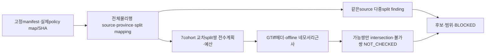

# Gate Source Split Overlap 20261017 — 물리 원본의 고정 split 간 모서리근사 교차후보

| 필드 | 값 |
|---|---|
| updated_at | 2026-10-17 23:36 KST — Git 상태 메타데이터 정정; 본문은 해당 Gate 기준 |
| source_commit | d474d5bce6c2a6c4bd8ba141c9256d15f6004631 (108까지 구현 검토 기준; 이 메타데이터 정리는 후속 문서 커밋) |
| evidence_paths | `backend/app/data/recovery_source_split_overlap.py`; `scripts/inspect_recovery_source_split_overlap.py`; `tests/test_recovery_source_split_overlap.py`; `backend/app/ml/readiness.py`; `evidence/integration/recovery-source-split-overlap-tests-20261017.log`; `evidence/integration/recovery-source-split-overlap-independent-20261017.log`; `evidence/integration/recovery-source-split-overlap-plan-check-20261017.log`; `docs/implementation/56_recovery_source_split_overlap_validation.md`; `evidence/integration/recovery-source-split-overlap-live-final-20261017.json`; `evidence/integration/recovery-source-split-overlap-full-tests-20261017.log`; `evidence/integration/recovery-source-split-overlap-live-integrity-20261017.json` |
| confidence | 코드·합성시험·실제물리source/corner후보·고정policy; 적격누출/readiness/독립성미검증 |
| status | VERIFIED_REAL: 물리91source/2227corner쌍; TESTED_SYNTHETIC: 15시험·별도계획대조; 학습/실행 BLOCKED |

## 쉬운 설명

학습용·검증용·시험용 상자에 연결된 원본사진들의 대략적인 지도윤곽을 비교해 겹칠 후보를 찾는다. 이번 대상은 창고의 물리목록 전체이며 품질검사를 통과한 적격학습묶음과 다르다. 후보가 없다고 정식 자료독립성을 승인하거나 기존누출문제를 해결했다고 말하지 않는다.

## 이론과 고정정책

실제 `readiness.default_policy().province_splits`를 읽어 South Sulawesi·Gorontalo·Southeast Sulawesi·East Java는train, Banten은val, West Java는test로 연결한다. 구현파일SHA와 직렬화한policy map SHA를 기록하고 조사종료때 구현변경을 거부한다. row의명시split이정책과다르면 계획오류다. 임의재배정하지 않는다.

전체물리1,384행의 source맥락을 다루며 quality_status를필터로쓰지 않고 적격1,111/readiness를재계산하지 않는다. 같은canonical source가여러split에걸치면 distinct-source쌍0이어도별도finding이다.

서로다른 source쌍은 적어도하나의 서로다른split조합이있으면 대상이다. A{train,val}–B{train}도 포함한다. 세split의비어있지않은집합은최대7cohort이며 같은단일split cohort 내부만범위밖이다. 전체후보수를예산검사한후필요한쌍만생성해 큰동일cohort의무의미한전수를피한다. source헤더와쌍예산은각1..10,000이며 초과하면header0/pair0이다.

## 코드·관측 범위

`recovery_source_split_overlap.inspect_recovery_source_split_overlap(data_root, expected_manifest_sha256, max_source_headers=128, max_pairs=10000)`와 내부CLI가 구현이다. 고정manifest·source 명시경로/SHA형식·canonical상충·존재를 전수검사한다. 같은source헤더는1회읽고 기존offline corner helper로 EPSG:4326직선근사를만든다. 회전/skew·always_xy/errcheck·네트워크finally복원을재사용한다.

invalidsource와연결된쌍은 NOT_CHECKED_INVALID_CORNER_FOOTPRINT를남기고 나머지가용쌍은계속진단한다. pair_diagnostic_record_count는보고서행수, intersection_attempt_count는실제GEOS호출수이므로별도로읽는다. 경계파일은 BOUNDARY_NOT_USED이며 이전주관계검사의legacy80 경계미기재범위와혼동하지않는다.

네모서리직선근사·평면degree²후보이며 픽셀/정확외곽/곡선가장자리·현재source내용SHA·source전체의동일내용·적격subset 누출검사를하지않는다. stat/target·manifest/policy SHA재확인도원자snapshot/OSlock은아니다. 원본raster/geometry·분할수정, repair/재투영저장·후보발행/학습은없다.

## 시험과 최종 실제근거

관련15 PASS/9.129초·독립15 PASS/10.368초의보존로그를읽었다. 다중split직접finding·A{train,val}/B{train}쌍·samecohort범위밖·계획예산·invalidsource연결쌍skip·진단수/시도수·policy변경·변환/네트워크복원·출력보호를fixture로검사했다.

별도고정seed40개cohort사례에서4,532후보쌍을독립전수split조합기준과대조해일치했다. 이합성실험은정규unittest나전체회귀에더하지않고실제source를읽지않았다. 실제 최종 CP949 CLI exit0에서 물리1,384행은 train848/val272/test264, source91헤더/모서리근사가 유효했다. 교차split계획2,227/진단행2,227/실제intersection2,227 모두 DISJOINT였고 접촉/양수중첩/issue0·다중split canonical source finding0이었다. 같은단일split1,868쌍은 OUT_OF_SCOPE다. CROSS_SPLIT_CORNER_CANDIDATES_DIAGNOSED지만 전체BLOCKED다. Shapely2.1.2/GEOS3.13.1·pyproj3.7.2/PROJ9.5.1·network false→false/restored true를 기록했다. 최종 전체 `scripts/test.ps1`은 **521건 중520 PASS·1 SKIP/160.195초/종료0**다. SKIP은 기존 OS symlink 생성 권한이고 deterministic 경계 시험은 통과했다. 관련15 PASS/9.129초·독립15 PASS/10.368초와 별도고정seed40사례/4,532후보쌍 계획대조를 전체521에 중복 합산하지 않는다. 보호132참조·기존 계약17SHA는 불변이며 이전 추적 코드·데이터·계약 변경0이다. source91개 stat·처음16바이트와91부모목록 관측도 불변이었다. 현재 source 전체SHA·원자적 snapshot 증명은 아니며 이해자료 작성은 보존 근거를 읽고 재실행하지 않았다. 이해자료작성에서는재시험/실자료조사를실행하지않았다.

## 한계·승인·UI

후보진단은 적격학습1,111개누출평가·기하/장면/분할독립승인·정확footprint·픽셀중첩·과학성능이아니다. boundary와공식권한검사도없다. 원본적격1,111/계획후보1,095·기존5ML blocker·baseline Draft·terminal없는2건/예약136,314,880B는유지한다. BLOCKED·exactly-once UNKNOWN·학습/실행/정산/자동재개/과학승인false·환불0이다.

공개API/화면계약없는내부CLI라 UI수정·실행frontend반영·브라우저재검사는불필요하다. 전체개발과10분보고는계속한다.

## 발표 1분

“이번에는 원본사진들을 실제 고정정책의 학습·검증·시험 상자에 연결하고, 서로다른 상자에 걸친 사진쌍의 모서리근사윤곽을 비교하는 도구를 추가했습니다. 품질을 통과한 적격자료가 아니라 물리목록 전체의 맥락을 봅니다. 같은원본이 여러상자에 들어가면 별도발견사항으로 기록하고, 비교쌍 전체를 예산 안에서 계획합니다. 사용할수없는 원본의 쌍은 검사불가로 남겨 실제계산수와 보고서행수를 구분합니다. 경계파일은 이번에 사용하지 않습니다. 후보진단은 정확한 영상중첩이나 적격자료의 누출승인이 아니므로 분할재배정·학습 없이 기존차단을 유지합니다.”

## 발표 5분·10분

1. **0~1분:** 상자와 원본사진 비유·물리목록과 적격자료 차이를 소개한다.
2. **1~2분:** 실제4/1/1 policy map/SHA·다중split source finding·7cohort계획을 설명한다.
3. **2~3분:** 네모서리직선근사·invalidsource관련 NOT_CHECKED·진단수와실시도수를 말한다.
4. **3~4분:** 최종실제/runtime·관련/독립/전체/보호근거와 별도40사례실험을 구분한다.
5. **4~5분:** 후보≠적격누출/독립성승인·boundary미사용·BLOCKED·UI불필요·개발지속을 설명한다.

10분은 다중splitsource의0pair가능사례·A/B공통split있어도cross조합포함·같은단일cohort범위밖·고정policy변경감지·sourceSHA재해시false를 덧붙인다.

## Q&A

**2,227쌍이면 적격자료의누출검사인가?** 전체물리source맥락이며 적격1,111/readiness재평가가아니다.

**같은원본다중split이면쌍이없어도찾나?** distinctsource쌍과별도finding으로기록한다.

**진단행수는실제intersection수인가?** invalidfootprint의NOT_CHECKED행도있을수있어별도수치를읽는다.

**boundary80 UNKNOWN도이번결과인가?** 이번은BOUNDARY_NOT_USED이며이전경계참조검사와다른범위다.

**후보가없으면차단해제하나?** 정확외곽/픽셀·적격subset/클래스문제를해결한것이아니며기존5차단을유지한다.

## 이후 갱신

문서56·최종독립/실제/runtime/전체/보호근거를받아기능해설·구조/용어·대본/FAQ/시연·INDEX·CHANGELOG를함께확정했다. 후속범위는별도Gate로구분한다.

## 기존 readiness와 비교할 때의 주의점

실제 readiness 코드는 적격scene의 source_group/scene_id 토큰 일치와 bounds_wgs84 bbox의 양수교차를 통해 주별 component를 만들고, component가 고정split을 넘으면 차단한다. 이번은 물리source의 canonical경로와 네모서리 직선근사이므로 같은 검사와 대상이 아니다.2,227 DISJOINT로 기존차단을 해제하지 않는다. 현재단위는 기존차단의 어느분기가 실제원인인지 재분류하지 않았으므로 추측하지 않는다.

## 다음 작업의 현재 상태

다음 저장readiness 차단근거와 이번corner진단의 scope차이를 읽기 대조하는 최소리포트는 **PLANNED**다. 원본group/scene token과 적격bbox교차의 근거를 분리해 살피되 기존gate/policy/원장/분할을 바꾸지 않고 원인·적격성 상태를 추측하지 않는 별도단위다.
