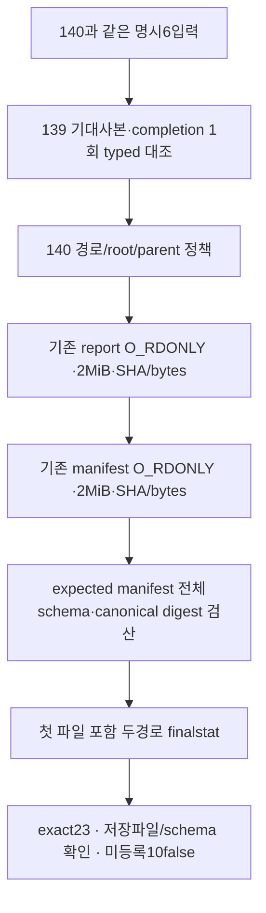

# Gate141 — 저장된 보고서 두 파일의 등록 전 읽기 점검

| 필드 | 값 |
|---|---|
| updated_at | 2026-10-18 06:27:30 KST — 141 최종 읽기/schema·관련/독립·초기 오류 구분·보존 반영 |
| source_commit | 기준 c2165340a1d5f1cfd253f13bcf9603c843d526d0 + 141 작업파일 raw SHA (게시 전 검증 시점; 후속 Git 게시의 바이트 보존은 별도 확인) |
| evidence_paths | `backend/app/data/quality_report_preflight.py`; `tests/test_quality_report_preflight.py`; `docs/implementation/141_quality_report_preflight.md`; `evidence/integration/quality-report-preflight-agent-20261018.log`; `evidence/integration/quality-report-preflight-agent-initial-20261018.log`; `evidence/integration/quality-report-preflight-root-related-20261018.log`; `evidence/integration/quality-report-preflight-independent-20261018.json`; `evidence/integration/quality-report-preflight-independent-20261018.log`; `evidence/integration/quality-report-preflight-independent-initial-20261018.json`; `evidence/integration/quality-report-preflight-independent-initial-20261018.log`; `evidence/integration/quality-report-preflight-live-integrity-final-20261018.json`; `evidence/integration/quality-report-preflight-operating-inventory-20261018.json` |
| confidence | 동결 소스·집중11/관련69/독립13건(12 PASS·1 SKIP)·실제 Temp 소비·모의 정책/변조·보존 확인 |
| status | TESTED_SYNTHETIC 저장2파일 읽기·schema 진단; 미등록·원자료/기관/품질/과학/실행 승인 BLOCKED |

## 쉬운 설명

140은 새 파일을 저장했고141은 등록하기 전에 그 파일을 다시 읽는다. 주문서와 실제 인쇄물이 같은지 확인하는 것처럼, 명시 선언에서 다시 만든 내용·지문과 저장 report/manifest를 비교한다. 이어 report manifest의 실제 전체 schema도 검사한다. 읽기 검증에 성공해도 아직 등록하지 않았고 보고서의 기관 권위나 원영상 품질을 승인한 것은 아니다.

## 이론적 배경

저장 시점의 확인과 등록 전 현재 확인은 다르다. 파일은 그 사이 바뀔 수 있어 내용·크기·지문·file descriptor와 경로 identity를 다시 본다.141은 두 번째 파일·schema 검사 뒤 첫 파일까지 최종 stat을 재확인한다. 그래도 모든 파일을 같은 순간에 고정하거나 반환 후 불변을 보장하지는 않는다. 실제 등록 경계의 재확인은 여전히 필요하다.

같은 JSON 의미여도 공백·키 순서가 다르면 바이트가 다르다. 이번은 expected의 canonical bytes와 정확히 같아야 하며 저장된 미신뢰 JSON을 파싱해 선언을 바꾸지 않는다. schema가 수용하는 선언이라는 사실과 물리적 영상·mask의 정답이나 기관 승인도 구분한다.

## 구조

## 코드·입력 → 처리 → 출력

`inspect_stored_quality_report(data_root,image_manifest,mask_manifest,report_identity,report_metadata,manifest_output_uri)`는140과 같은6개 입력을 받는다.139의 기대 completion을 별도 사본에서 재구성하고 completion을 한 번 호출해 타입·bytes/SHA·refs·draft·10false를 대조한다. 검산 후 가변 반환값 대신 기대 사본을 사용한다.

140의 root·같은 기존 parent·ancestor·경로 충돌·예약명/ADS/Unicode·symlink/reparse 정책을 재사용한다. 이번에는 파일이 이미 있어야 하므로 writer는 호출하지 않는다. report와manifest를 O_RDONLY로 각각 최대2MiB까지 복사하고 같은 바이트에서SHA를 계산한다. lstat/fstat·크기·mtime/ctime·dev/ino·부모 identity를 읽기 전후로 검사하며 성장·교체·비일반파일을 차단한다. 원영상/마스크는 열지 않고 Store·등록·writer·네트워크·학습/추론을 호출하지 않는다.

복사 bytes는 기대 report bytes와 기대 manifest canonical bytes에 정확히 일치해야 한다. 저장 JSON의 공백·추가 newline·부분 파일·변조도 거부한다. 저장된 내용을 임의로 정규화해 수용하지 않는다. 파일은 생성·수정·삭제하지 않는다.

## 전체 schema 검사와 반환 사본

바이트가 맞은 뒤 기존 `dataset_registry.canonical_manifest`를 expected report manifest의 별도 사본에 한 번 호출한다. cold cache이면 신뢰하는 로컬 dataset-manifest.schema.json을 읽으므로 자료파일2개 외에 schema I/O가 있을 수 있다.139의 순수 subset 확인을 넘어 전체 기존 schema를 사용하지만 새 RFC3339 parser나 기관 표준을 추가하는 것은 아니다.

schema 반환도 exact tuple2·기대 manifest와typed동등한dict·정확한str digest를 검사한다. 잘못된 반환은 MANIFEST_SCHEMA_OUTPUT_INVALID,검증 예외는 MANIFEST_SCHEMA_INVALID다. 최종 응답은 가변 schema dict가 아닌 기대 manifest 사본이다. schema가끝난뒤 report와manifest의 최종 stat을 모두 다시 검사한다.

## exact23과 실패 정책

성공 상태는 STORED_REPORT_FILES_VERIFIED_UNREGISTERED다. stored_report_files_verified와manifest_schema_verified가true일 수 있지만 기존10개artifact/Registry등록/참조/품질/기관/과학/실행/state_dict/Workflow flags는 모두false다. files는 report/manifest의 role/verified/bytes 두 관측이다.

어느 단계든 실패하면 fresh null payload와files둘다false/bytesnull로 닫는다. 이미 읽은 첫 파일이 맞았어도 부분draft/SHA/ref를 성공처럼 반환하지 않는다. 이false는 I/O가0이었다는 뜻이 아니다. stored_report_files_verified는 두 보고서파일의 순차 관측만 뜻하며 image/mask 파일·header·값·AOI·품질정답·최소비율·기관ACL을 검증하지 않는다.

## 집중 시험과 실제/모의 구분

집중 최종11 PASS/2.265초를 읽었다. 실제Temp140 저장파일에서 readonly2open·139한번·SHA/bytes·입력/파일불변·coldschema1회,누락/부분/변조/비canonical/초과/성장·fd읽기중변화·두번째읽기중첫파일변화를 검사했다. reparse/parent변화·가변completion/schema결과는 명시 모의 경계다. 최종 관련69 PASS/13.656초·독립13건/12 PASS/1 SKIP/3.166969초·exit0 및 보존 근거를 확인했다. 반복 시험은 합산하지 않는다.

초기11건은10 PASS/1 FAIL/3.514초였다. 설치된 기존FormatChecker가+00:60을거부할것이라는시험기대가맞지않아실패했다. 해당날짜가 실제schema에서 차단됐다고 주장하지 않는다. 기존96/139와 schema/parser는 바꾸지 않았다. 설치 checker가+09:60도 수용하는 독립 관측을 엄격한 날짜 진실성 검증으로 확대하지 않는다. 최종schema실패시험은 required필드를추가한임시더엄격한Validator를명시주입한 모의정책실패다. 실제원schema의거부사례나새제품보완으로소개하지않는다.

## 최종 독립·소비·초기 오류와 보존

최종 집중11 PASS/2.265초·관련69 PASS/13.656초·독립13건/12 PASS/1 SKIP/3.166969초·exit0을 읽었다. source04758b1ac3e03fb392790e2c0c7d87aa261a9563b160d704cbf06023af09e62a와test3b4dbf91d37a183cfa282c86a122d0755eae1ae615383a7eb0a303eee91a9a41는 동결값과 일치했다. 초기 집중11건/10 PASS/1 FAIL/3.514초는 설치 checker의 날짜 거부를 가정한 기대 오류로 보존했다.

초기 독립13건/11 PASS/1 FAIL/1 SKIP/8.9813945초는 시험의 parent 교체 fault injection이 의도한 mkdir까지 제품 무생성 guard가 감지한 구성 문제다. initial py/json/log의 원바이트를 보존하고 의도한 fixture 생성만 os.mkdir로 분리했다. 제품 guard와 소스는 바꾸지 않았고 최종13건을 초기와 합산하지 않는다.

실제 Temp는140의 두 저장 파일 →141의 data2개 O_RDONLY/139한번/schema한번 →별도 SQLite3버전 setup →131/133 읽기 소비로128/128/256·DB/전체파일 불변을 확인했다. symlink는 실제 Windows1314 권한 제한으로1 SKIP이며 reparse 속성·parent 교체·첫 파일 변경·가변 반환은 명시 모의/fault injection이다. 운영 동시성·OS 격리 보장으로 확대하지 않는다.

독립 관측에서 설치 FormatChecker가+09:60을 수용했고 preflight도 성공했다. 이는 완전한 RFC3339나 실제 취득 시각 검증이 아니다. 더 엄격한 임시 required-field schema를 주입한 실패는 실제 원schema의 날짜 차단과 구분한다. nodata0·RESTRICTED도 저장 보고서 점검은 성공할 수 있으나 binary 소비는 차단됐다.

보호141·기존 소스320개 전체·이전 증거1331개·catalog14행 canonical SHA·예약136314880바이트는 불변이다.06:20 운영 count는DatasetVersion0·legacy datasets6/models1이다. 운영 등록·수집·학습·추론·배포·Workflow dispatch0이며 원본·원장·lock·분할·모델은 보존했다. 이번 전체 backend/frontend/build/browser는 재실행하지 않았고137의 전체1359건/1358 PASS/기존1 SKIP·front271은 이전 근거다.

## 한계와 다음 작업

부모 동시 치환·FIFO 교체/open blocking·모든TOCTOU·전역 원자snapshot·반환후불변·OSsandbox·시간/RSS hardcap은보장하지않는다. mapped drive의실제매체가로컬이라는인증도아니다. 신뢰하는로컬schema/cache환경을상속한다.

HTTP/main/137 API/UI·Registry자동등록과미연결인새내부reader라이번전체backend/frontend/build/browser를재실행하지않는다.137의전체1359건/1358 PASS/기존1 SKIP·front271은이전근거다. 운영 root에는적용하지않고원본·원장·lock·분할·모델·예약을보존한다. 다음142는caller가명시한report등록어댑터와TempRegistry검증후속(PLANNED)이며운영자동등록이아니다.

## 발표 대본

### 1분

“저장한 보고서와 manifest를 등록 전에 다시 읽어 확인합니다. 호출자가 명시한 내용과 지문이 정확히 같은지 보고, 전체 manifest schema도 검사합니다. 두 번째 파일을 읽은 뒤 첫 파일이 바뀌지 않았는지도 다시 봅니다. 하지만 모든 파일이 영원히 고정되는 것은 아닙니다. 실패하면 부분 초안이나 지문을 내보내지 않고 닫습니다. 성공해도 아직 등록하지 않았고 원영상 품질이나 기관·실행 승인은 별도입니다.”

### 5분

첫1분은 저장확인과등록전재확인의차이를설명한다. 다음1분은readonly2파일·각2MiB·정확한bytes대조를보여준다. 세번째1분은fullschema와cold로컬읽기·반환사본검산을설명한다. 네번째1분은초기날짜가정실패와모의엄격정책시험을구분한다. 마지막1분은실패freshnull·순차관측한계·10false·142후속을정리한다.

### 10분 확장

‘등록전확인’,‘같은내용과같은바이트’,‘schema와정책환경’,‘실패를닫는출력’,‘등록경계로남은일’ 다섯장에파일변화/모의guard2분·자원/동시성한계1분·Q&A2분을더한다.

## Q&A

Q. schema가 맞으면 등록됐나? A. 아직 미등록이며 Registry를 호출하지 않는다.

Q. 실패의 files=false면 읽기0인가? A. 읽은 뒤 실패했을 수 있고 부분 성공을 반환하지 않는 출력 정책이다.

Q.+00:60을 기존 checker가 막았나? A. 그 기대는 틀렸고 최종 실패 시험은 명시 임시 정책이다.

Q. 두 파일은 같은 시점의 사본인가? A. 순차 읽기와 최종 stat이며 동시 원자 snapshot이나 반환 후 불변은 보장하지 않는다.

Q. 원영상도 확인하나? A. 보고서 두 파일과 로컬 schema만 읽고 영상·마스크는 열지 않는다.

## 근거 바로 열기

[구현 설명](../../implementation/141_quality_report_preflight.md) · [읽기 점검](../../../backend/app/data/quality_report_preflight.py) · [최종 집중](../../../evidence/integration/quality-report-preflight-agent-20261018.log) · [초기 실패](../../../evidence/integration/quality-report-preflight-agent-initial-20261018.log)

[관련 회귀](../../../evidence/integration/quality-report-preflight-root-related-20261018.log) · [최종 독립](../../../evidence/integration/quality-report-preflight-independent-20261018.json) · [초기 독립 실패 보존](../../../evidence/integration/quality-report-preflight-independent-initial-20261018.json) · [보존 근거](../../../evidence/integration/quality-report-preflight-live-integrity-final-20261018.json)
