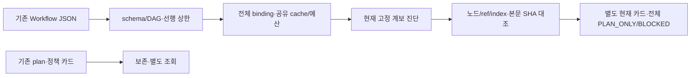

# Gate Workflow Current Lineage 20261017 — 공유 자료를 현재 계보로 확인

| 필드 | 값 |
|---|---|
| updated_at | 2026-10-17 23:36 KST — Git 상태 메타데이터 정정; 본문은 해당 Gate 기준 |
| source_commit | Git 연결됨; 문서 작성 시 변경분 미커밋, evidence snapshot SHA로 추적 (원격 기준 d483d25) |
| evidence_paths | `backend/app/workflow_lineage.py`; `backend/app/workflow_lineage_api.py`; `backend/app/lineage_batch.py`; `docs/implementation/40_workflow_lineage_validation.md`; `docs/implementation/41_workflow_lineage_ui.md`; `evidence/integration/workflow-lineage-independent-tests-20261017.log`; `evidence/integration/workflow-lineage-full-tests-20261017.log`; `evidence/integration/workflow-lineage-ui-build-20261017.log`; `evidence/integration/workflow-lineage-live-20261017.json` |
| confidence | 코드·fixture/전체로그·실제미등록공유/빈입력 UI; 성공운영계보미검증 |
| status | TESTED_SYNTHETIC: 성공·예산·계약; VERIFIED_REAL: 로컬차단/본문신원/UI; 실행 BLOCKED |

## 한 문장·1분 비유

여러 작업이 같은 재료를 쓰면 한 번 확인해 검사표를 공유하는 별도 창구를 만들었다. 비어 있거나 검사하지 못한 입력은 통과로 채우지 않는다. 재료 계보가 맞아도 전체 작업의 실행 허가는 아니다.

## 왜·이론·5분 흐름

기존 plan의 입력·Agent·정책 진단을 보존하고, 현재 전이 계보만 별도 명시 버튼으로 읽는다. 원문 Workflow schema/DAG를 먼저 확인한 뒤 전체 요청이 cache와 총 검사 예산을 공유한다. 같은 고정 root는 노드를 넘어 재사용하고, 다른 root의 공유 조상 재검사 비용은 다시 총량에 포함한다.

## 코드·요청 신원·응답

`workflow_lineage.py:validate_workflow_lineage`, `workflow_lineage_api.py:create_workflow_lineage_router`, 공통 `lineage_batch.py:inspect_lineage_bindings`가 구현이다. 새 POST `/v1/workflows/lineage-validation`은 내부 RFC이며 upstream schema/OpenAPI를 바꾸지 않는다. Job도 helper를 쓰지만 기존 정상/부분/상충응답은 추출 전후 동일하다.

extension은greenblue.workflow-lineage-validation.rfc1/INTERNAL_REVIEW, scope는CURRENT_WORKFLOW_TRANSITIVE_LINEAGE_PLAN_ONLY다. 서버request_sha256는수신HTTPbodybytes의SHA이며본문을반환하지않는다. UI는실제로보낼JSON.stringify(parsedPayload)의TextEncoderUTF8bytes를WebCrypto로해시한다. 키정렬canonical이나textarea들여쓰기원문hash가아니다. WorkflowID·Trace·실제본문SHA와요청세대/key가맞아야표시한다.

## 예산·검증 범위

| 한도/상태 | 해석 |
|---|---|
| 노드128초과 | DAG계산전차단·dag_validated=false; 순환발견단정금지 |
| 입력64·고유root32초과 | DAG후해시전차단·dag_validated=true |
| 깊이32·root당64·전체256노드검사 | Workflow전체공유예산; 부분미검사명시 |
| 같은ID/version다른SHA | node가달라도양쪽무해시상충차단 |
| 같은고정root | 요청내진단/diagnostic_index재사용·요청간cache없음 |
| 빈node입력 | INPUT_REFS_REQUIRED·inputs_complete=false |

checked/available/current_assets_revalidated는수행/보고서/시도여부이지성공이아니다. 부분결과는CHECK_LIMIT_REACHED·checked=false를유지한다. 개별INTEGRITY_VERIFIED·전체lineage=true여도modePLAN_ONLY/statusBLOCKED·execution_started/can_execute/권한/실행/과학false다.

URI/role/parameters·quality·Agentreadiness·AOI/기간/제품의모든실행요건을검사하지않는다. 노드상한은HTTP본문크기·artifact총bytes·운영동시부하상한이아니다. 순차검사이며원자적snapshot·실행직전불변성을보증하지않는다. 제한상위계보/원문경로/자격정보는숨기되기관ACL·운영노출정책·과학/배포승인은후속이다.

## HTTP·UI·실제 근거

schema/DAG/비표준NaN·Infinity는400,내부검사오류는503,자료차단·한도는200보고서다. 기존인증·no-store·thread pool을사용하고Job/Trace·background저장을만들지않는다.

`WorkflowLineageDiagnostics`/adapter가GeoQuery의독립버튼·현재카드를제공한다. 자동조회/polling은없고JSON/질의메뉴/context변경은기존결과/busy/오류·세대를무효화한다. 기존inspectPlan도본문key/신원/세대guard로보완하고session초안은보존했다.

실제5174→API8002에서공유미등록2노드+빈노드1의진단1/비용1·dependent재사용·빈입력차단·본문SHA일치·PLAN_ONLYBLOCKED를확인했다. cycle400/NaN400·JSON편집clear/invalid비활성·원래823자DOM정확복원·desktop1440×1000/mobile390×844폭375<390/viewport복원이다. 기존plan도원래FAIL_ALL3empty노드로재조회해입력/정책카드·비실행을확인했고새계보자동호출은없었다.

## 시험·보존

신규Workflow11 PASS/1.995초·기존Job12 PASS/4.066초·독립합계23 PASS/5.134초다. 전체321건/72.556초/OK(skipped=1)=320 PASS·1 SKIP,UI38/38 PASS/961.1713ms·build66modules/19.37초다. 기존OSsymlink권한1SKIP/mock경계PASS와이전전체수치를구별한다.

보호5SHA·기존2JobSHA불변·신규실행0이다. 실제성공계보/과학모델·기관승인은검증하지않았고성공은fixture범위다.

## 발표·10분 확장·Q&A

30초: “공유 자료는 한 번 검사하고 검사표를 공유하되 전체 실행 승인은 따로 둡니다. 실제로는 미등록 공유입력과 빈 노드의 차단·본문 신원·초안 보존을 확인했습니다.”

5분은JSON→DAG→공유검사→별도카드→비실행,10분은raw본문신원·nodecap/DAG범위·총예산/부분검사·기존plan/Job호환을확장한다.

Q1. 모든계보가맞으면실행? A. 전체BLOCKED다.

Q2. 같은참조면두번검사? A. 요청내재사용한다.

Q3. bodySHA는editor원문? A. 실제전송bytes다.

Q4. nodecap의DAGfalse는cycle? A. 미검증일수있다.

Q5. 기존plan/초안은? A. 보존했고별도조회한다.

[DEMO](../presentations/DEMO_STORY.md)의최신Workflow현재계보절을사용한다. 관련설계/API/사용법/시험/인계·UI·이해자료를같이갱신하고전체개발·10분보고는유지한다.
