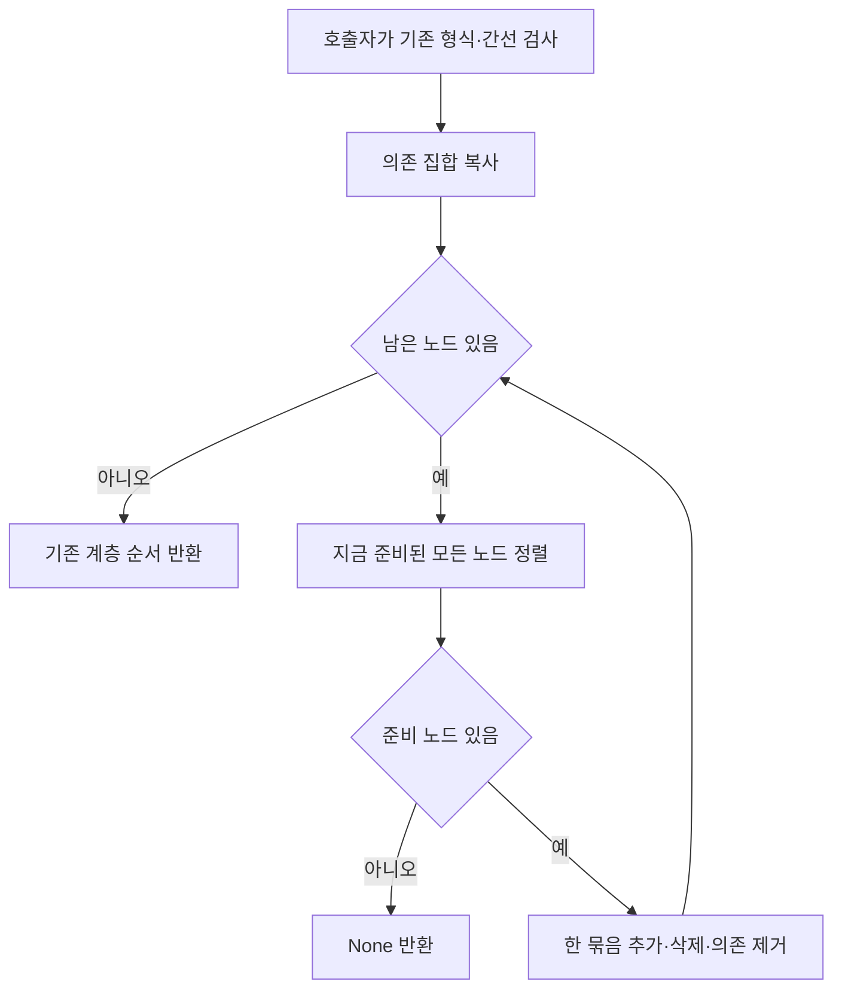

# Gate107 — Workflow 의존 순서 계산 공통화

| 항목 | 내용 |
|---|---|
| updated_at | 2026-10-17 23:36 KST — Git 상태 메타데이터 정정; 본문은 해당 Gate 기준 |
| source_commit | d474d5bce6c2a6c4bd8ba141c9256d15f6004631 (108까지 구현 검토 기준; 이 메타데이터 정리는 후속 문서 커밋) |
| evidence_paths | `backend/app/workflow_dependency_order.py`; `tests/test_workflow_dependency_order.py`; `backend/app/gmais_api.py`; `backend/app/workflow_lineage.py`; `backend/app/workflow_policy.py`; `docs/implementation/107_workflow_dependency_order.md`; `evidence/integration/workflow-dependency-order-focused-20261017.log`; `evidence/integration/workflow-dependency-order-focused-final-20261017.log`; `evidence/integration/workflow-dependency-order-related-20261017.log`; `evidence/integration/workflow-dependency-order-independent-20261017.log`; `evidence/integration/workflow-dependency-order-independent-review-20261017.json`; `evidence/integration/workflow-dependency-order-full-tests-20261017.log`; `evidence/integration/workflow-dependency-order-live-integrity-20261017.json`; `evidence/integration/workflow-dependency-order-preflight-20261017.json`; `evidence/integration/workflow-dependency-order-original-gmais_api-20261017.py`; `evidence/integration/workflow-dependency-order-original-workflow_lineage-20261017.py`; `evidence/integration/workflow-dependency-order-original-workflow_policy-20261017.py` |
| confidence | 완료 코드·원문 사본·시험·보존 근거 확인; 운영 서버 동작 인증 아님 |
| status | TESTED_SYNTHETIC; 기존 학습 BLOCKED; 전체 개발 진행 중 |

## 쉬운 설명

준비된 서류를 한 묶음씩 처리하는 규칙을 세 창구가 함께 쓰도록 정리했다. 지금 준비된 a와 z를 이름순으로 먼저 처리한 뒤, a가 끝나야 가능한 b를 다음 묶음에서 처리한다. 따라서 순서는 a → z → b다. a 뒤에 새로 준비된 b를 즉시 끼워 넣어 a → b → z로 바꾸지 않는다.

이번 작업은 기존 세 구현이 서로 다른 오류를 냈다는 결함 수정이 아니다. 같은 규칙을 한곳에 두고 기존 응답과 검증 순서가 유지되는지 확인하는 내부 정리다. 순서 계산은 실제 작업 실행이나 병렬 실행 승인이 아니다.

## 이론적 배경

의존관계가 없는 노드를 뽑고 제거하는 Kahn 방식의 위상 정렬이다. 남은 각 노드의 의존 집합을 복사한다. 한 반복에서 준비된 모든 노드를 정렬한 뒤 목록에 넣고, 그 묶음을 제거한다. 모두 제거하면 순서 목록을 반환한다. 남은 노드가 있는데 준비된 노드가 없으면 None을 반환한다.

전역 최소 원소를 매번 꺼내는 heap 방식으로 바꾸지 않았다. 두 방식 모두 가능한 위상 순서를 만들 수 있어도 기존 표시·응답 순서는 달라질 수 있기 때문이다. 실제 기존 계층 순서를 유지하는 것이 이번 변경의 목적이다.

## 코드와 데이터 동작

`workflow_dependency_order.topological_order(validated_dependency_map)`는 입력 집합을 복사하고 파일·DB·network·실행기를 호출하지 않는다. 입력 alias와 원형 집합도 바꾸지 않는다. 빈 map은 빈 목록을 반환한다. 식별자·없는 간선·중복 노드·자기 의존의 검증은 호출자 책임이다. helper의 None을 항상 단독 순환 증명으로 해석하지 않는다. 미충족 unknown 간선도 helper만 직접 호출하면 진행을 막지만 제품 호출자는 그 전에 기존 오류로 거부한다.

세 호출부는 `gmais_api`의 plan_workflow, `workflow_lineage.validate_workflow_lineage`, `workflow_policy.diagnose_workflow_blocking`이다. 기존 정렬 반복과 import만 공통 함수로 바꿨다. schema·한도·중복·self·unknown 검사의 우선순위, 순환의 오류 문구·응답, manifest/Store 접근 시점은 그대로다. 계보의 입력 한도 도달 응답과 정책 blocker 복사·전파도 바꾸지 않는다.

새 helper의 IO0과 전체 호출부의 기존 IO는 별개다. 격리 통합 시험은 실제 원 schema와 TempStore를 사용할 수 있다. 다른 node/fullJob 관측의 dag_validated=false나 실행/과학 미검증 축을 바꾸지 않는다. 동적 선행 입력 연결·Job 생성·scheduler도 추가하지 않았다.

## 시험 증거

최초 집중9 PASS/5.997초 뒤 distinct-root 한도 사례를 강화했다. 실패를 고친 것이 아니라 기존 시험의 두 입력을 실제 다른 root로 만드는 보강이었다. 최종 집중 로그는9 PASS/4.453초, 관련61 PASS/13.116초, 독립61 PASS/13.845초로 읽었다. 최종 전체1069건/1068 PASS/1 SKIP/354.650초와 아래 보존 근거를 확인했다.

시험은 준비된 계층과 heap 순서의 차이, 빈 그래프·diamond·끊긴 요소·반복 간선·cycle·입력 집합 복사를 확인했다. 수정 전 세 모듈의 사본 SHA를 확인해 별도 로드하고, 정상·오류 응답 body/headers·예외 문구·Store 접근 순서·레코드 무쓰기를 현재 호출부와 비교했다. 작은 TempStore의 실제 코드 비교이며 운영 Workflow 실행 시험이 아니다. 고정한 세 원문 모듈의 대조이고 당시 전체 런타임과 전이 의존성의 독립 인증은 아니다. 반복 시험을 전체에 더하지 않는다.

## 한계와 UI 영향

검증 범위는 합성 그래프와 격리 Store의 동등성이다. 알고리즘 공통화만으로 데이터 독립성·계보 권위·과학 성능·실제 실행 준비가 검증된 것은 아니다. 응답을 보존하는 내부 변경이라 새 API/화면 상태가 없고 이번 프론트·build·브라우저를 재실행하지 않는다. 이전105/106 실제 화면·HTTP 근거는 그 단위의 근거로 유지한다.

기존 원본·분할·모델·원장·lock·예약136314880B와 후보QA4차단·학습 BLOCKED를 유지한다. 전체 개발과10분 보고는 계속된다. 다음 작업은 확정 후 PLANNED로 별도 기록한다.

## 발표 스크립트

### 1분

“세 곳에 있던 작업 순서 계산을 하나로 모았습니다. 지금 준비된 서류를 이름순으로 한 묶음 처리한 뒤 다음 묶음으로 가는 기존 규칙을 유지합니다. a와 z가 준비돼 있고 b는 a를 기다리면 순서는 a, z, b입니다. 중간에 b를 끼워 넣지 않습니다. 원래의 정상 응답과 오류, 자료를 읽는 순서가 같은지 수정 전 코드와 비교했습니다. 다른 동작의 버그를 새로 발견해 고친 것은 아닙니다. 순서를 계산할 뿐 실제 작업을 실행하거나 학습을 승인하지는 않습니다.”

### 5분 순서

첫1분은 세 창구가 같은 서류 순서 규칙을 쓰는 비유를 설명한다. 두 번째1분은 a·z·b 예와 계층 정렬을 보여준다. 세 번째1분은 형식과 간선 검증은 호출자가 책임지는 구조를 설명한다. 네 번째1분은 수정 전 원문 사본과 현재 응답·오류·IO 순서 비교를 설명한다. 마지막1분은 내부 정리·UI 미재시험·실제 실행과 승인 한계를 구분한다.

### 10분 확장과 슬라이드

공통화 이유, 계층 정렬, 세 호출부의 검증 순서, 원문 대비 시험, 미검증·운영 경계의 다섯 장으로 구성한다. 5분 설명 뒤에는 diamond/반복 간선/cycle 사례를2분, caller 오류 우선순위를1분, 입력 복사·IO 범위를1분, 질문을1분 배정한다.

## Q&A

Q. a 다음에 b가 준비되는데 왜 z보다 뒤인가? A. 같은 반복에서 이미 준비된 a·z 전체 묶음을 먼저 처리하는 기존 규칙이다.

Q. None이면 항상 cycle인가? A. helper만 보면 미충족 간선도 막힌다. 제품 호출자는 unknown/self 등을 먼저 거부한다.

Q. 이제 실제 작업을 병렬 실행하나? A. 순서 목록 계산만 공통화했다. scheduler와 실행 승인은 없다.

Q. IO가 전혀 없나? A. helper는 없지만 기존 호출자는 schema·Store 등을 읽을 수 있다.

Q. 세 기존 함수가 틀렸던 것인가? A. 실제 서로 다른 응답 결함을 확인한 작업이 아니다. 같은 규칙과 응답을 유지하는 정리다.

독립 검토는 세 호출부의 import와loop만 제거·복원한 AST가 기존 원문과 같고 cycle 오류도 같음을 확인했다. 초기 보조 정규화에서 AsyncFunctionDef가 빠져 대조가 실패했으나 검사기를 보완했으며 제품 수정은 없다. 신규 원문 대조 시험은 운영 main을 import하지 않지만 관련 기존 API 시험은 임시 data root로 main을 bootstrap할 수 있다. 이를 운영 Store 사용으로 해석하지 않는다.

## 107 최종 전체·보존 근거

전체 backend1069건/1068 PASS/기존 Windows symlink 권한1 SKIP/354.650초/exit0이다. 집중9·관련61·독립61은 이 전체에 반복 합산하지 않는다. 보호141·이전 증거771·catalog14는 불변이다. 기존 추적 코드의 변경은 허용한 세 caller뿐이고 프론트 파일은 그대로다. 보존 범위는 추적 파일과 명시 참조이며 전체 workspace나 원자 snapshot 보장은 아니다.

새 동작 검증은 TESTED_SYNTHETIC이다. 운영 서버에서107 새 코드의 동작을 HTTP로 확인하지 않았고 이전105/106의 실제 요청을 재사용하지 않는다. 운영 Job 제출·모델 등록·수집·새 QA·훈련·배포는 없다. 기존 원본/원장/lock/예약136314880B/분할/모델·후보QA4차단·학습 BLOCKED를 유지한다. 전체 개발과10분 보고는 계속된다.

[구현 계약](../../implementation/107_workflow_dependency_order.md), [완료 helper](../../../backend/app/workflow_dependency_order.py), [독립 검토](../../../evidence/integration/workflow-dependency-order-independent-review-20261017.json), [최종 전체 로그](../../../evidence/integration/workflow-dependency-order-full-tests-20261017.log)를 읽는다.
